# 02 · 流程圖集（Flows）

| 項目 | 內容 |
| --- | --- |
| 專案 | ZaiOrder — 台灣小吃店線上點餐平台（消費者端） |
| 文件 | 使用者流程、系統流程、時序圖與狀態機（Mermaid） |
| 版本 | v0.4.1 草案 ｜ 2026-10-16 |
| 相關文件 | [01 需求](./01-requirements.md)（FR / BR 編號）・[06 API](./06-api-spec.md)（端點與錯誤碼）・[05 資料表](./05-database-schema.md)（欄位名稱） |

> 文件導覽：[← 01 需求規格書](./01-requirements.md) ・ 下一份：[03 UI/UX 設計 →](./03-uiux-design.md)
>
> 所有圖皆為 [Mermaid](https://mermaid.js.org/)，GitHub、VS Code（Markdown Preview Mermaid Support）、多數文件平台可直接渲染。

## 圖表索引

| 編號 | 名稱 | 類型 | 對應需求 |
| --- | --- | --- | --- |
| FLOW-01 | 整體點餐主流程 | flowchart | 全部 |
| FLOW-02 | 店家營業狀態判定 | flowchart | FR-ST-02、BR-07 |
| FLOW-03 | 商品客製化與加入購物車 | flowchart | FR-PD-*、BR-12/13/30/35 |
| FLOW-04 | 結帳與送出訂單 | flowchart | FR-CK-*、BR-25/27/39 |
| FLOW-05 | 取餐時段產生 | flowchart | FR-CK-02、BR-08/09 |
| FLOW-06 | 外送範圍、門檻與運費 | flowchart | FR-CK-04、BR-03/04/10 |
| FLOW-07 | 優惠券驗證 | flowchart | FR-PR-01、BR-05/20 |
| FLOW-08 | OTP 登入 | sequence | FR-AC-01 |
| FLOW-09 | 下單與線上付款 | sequence | FR-CK-11/15、FR-PY-*、BR-38 |
| FLOW-10 | 訂單狀態機 | state | BR-15/38、FR-OD-02 |
| FLOW-11 | 付款狀態機 | state、sequence | BR-18/28/38、FR-PY-05 |
| FLOW-12 | 取消訂單 | flowchart | FR-OD-03、BR-16/38 |
| FLOW-13 | 再來一單 | flowchart | FR-OD-06、BR-11/40 |
| FLOW-14 | Demo 模擬器狀態推進 | flowchart | FR-DM-01、FR-DM-12/13、BR-38 |
| FLOW-15 | API 錯誤處理策略 | flowchart | NFR-06、BR-27/39/41 |
| FLOW-16 | 訂單追蹤輪詢 | flowchart | FR-OD-02 |
| FLOW-17 | 商品卡呈現與版面降級 | flowchart | FR-MN-08～11、BR-31 |
| FLOW-18 | 免登入點餐與選填登入 | flowchart | FR-AC-10、FR-OD-11、BR-33 |
| FLOW-19 | 快速鍵處理 | flowchart | FR-SY-12/13/18、BR-34/42 |
| FLOW-20 | 點餐記憶與快速再點 | flowchart | FR-MN-12/13、FR-PD-09、FR-AC-11、BR-35 |
| FLOW-21 | 觸控面板閒置重置 | state | FR-SY-14/15、BR-36/37 |
| FLOW-22 | 結帳最終庫存確認 | state、flowchart | FR-CK-15、BR-38～40、NFR-17 |
| FLOW-23 | 異動清單處理 | flowchart | FR-CK-16、KPI-11、EC-30～33 |
| FLOW-24 | 結果未知與冪等重送 | flowchart | FR-CK-11、BR-27/41、EC-05/35/36 |
| FLOW-25 | 鍵盤偵測與快速鍵提醒 | state | FR-SY-18、BR-42、NFR-18 |

---

## FLOW-01 整體點餐主流程

從進站到取餐完成的端到端主流程，是其他流程圖的總覽。**全程不需登入**（BR-33）；登入僅為訂單成立後的選填提示（虛線）。

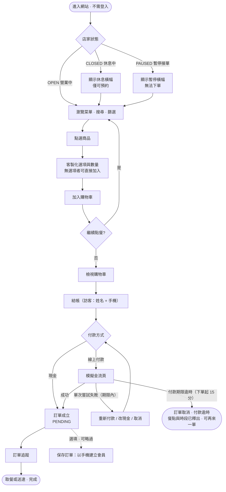

---

## FLOW-02 店家營業狀態判定

決定首頁與結帳頁的 `StoreStatus`。判定順序即 [BR-07](./01-requirements.md#6-業務規則)；所有時間以店家時區 `Asia/Taipei` 計算。

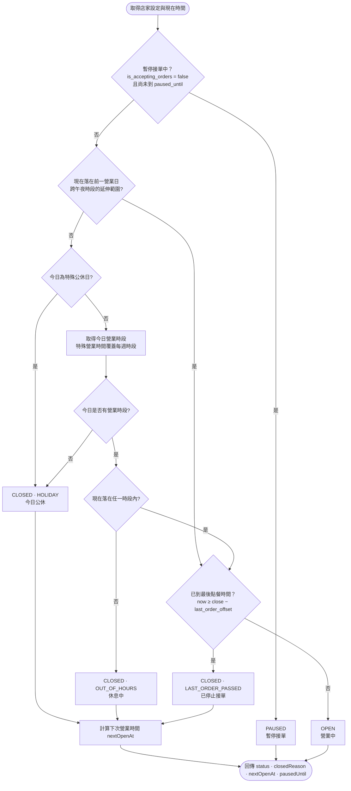

**說明**

- 最後點餐時間 ＝ 該時段 `close_time − last_order_offset_minutes`（預設 15 分鐘）；`現在 ≥` 該時間即為 `LAST_ORDER_PASSED`，邊界時刻起不再接受即時單。預約時段的 `startAt`（取餐時間）仍可等於該時間（見 FLOW-05）。
- 跨午夜時段（`close_time ≤ open_time`）視為延伸到隔日，並歸屬於開始營業的那一日（BR-23）：午夜後仍在延伸範圍內時，以**前一營業日**的設定判定，即使「今日」為公休日。
- 週日無任何營業時段，與特殊公休日一樣顯示「今日公休」。
- `PAUSED` 期間不接受任何新訂單（含預約）；`paused_until` 到達即自動恢復，為 `NULL` 則需手動恢復。
- 本流程回傳**店家整體**狀態；外送即時單另受「預估完成不得晚於打烊」限制（BR-08），由 `GET .../pickup-slots` 的 `asap` 回報。

---

## FLOW-03 商品客製化與加入購物車

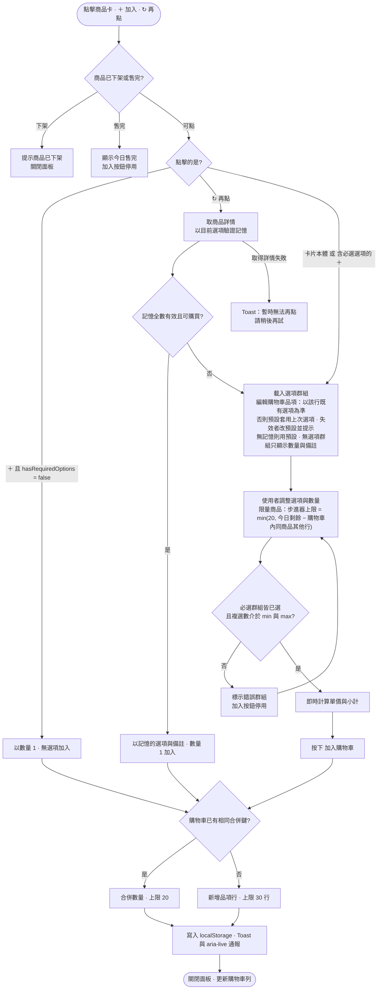

**說明**

- 合併鍵 = `productId + 排序後的 optionIds + 備註`（BR-13）。
- **快速加入**（BR-30）：`hasRequiredOptions=false` 的商品，點卡片上的「＋」直接以數量 1、無選項加入；點卡片本體仍會開啟面板，可調整數量與備註。
- **再點**（BR-35）：有選項群組且記憶了至少一個選項的商品，卡片顯示「↻ 再點」。記憶仍全數有效時**不開面板**直接加入；任一選項已失效（停售、群組變更、超出新上限）則開啟面板，失效者改用預設並提示「部分選項已不提供」。「＋」維持 BR-30：`hasRequiredOptions=false` 直接加入預設（無選項）、否則開啟面板。
- 面板開啟時預設套用上次選項與備註（數量固定 1），並提供「恢復預設」。優先序：**編輯中的品項行 ＞ 點餐記憶 ＞ 預設**。
- 從購物車「編輯」進入時，選項與備註以該行既有內容為準（不套用記憶、不顯示「已套用上次的選擇」），結果為**取代原品項行**；若修改後的合併鍵與其他行相同，則合併。
- 已達上限（同一品項 20 份或 30 行）時不加入，以 Toast 與 `aria-live` 說明。「復原」將本次加入的數量從該行扣回，歸零則移除該行。
- **限量商品**（BR-11、FR-PD-04）：步進器上限 = `min(20, remainingToday − 購物車內同商品其他行份數)`；達上限時「＋」停用並提示「今日只剩 {n} 份，已達上限」，與「已達 20 份上限」的提示區分。`remainingToday` 省略代表未提供剩餘資訊，不預先限制。此為不保留的預覽，最終以送出時的確認為準（FLOW-22）。
- 加入成功後以 `aria-live="polite"` 通報（例：「已加入購物車：招牌滷肉飯，目前 4 項，共 $364」）。

---

## FLOW-04 結帳與送出訂單

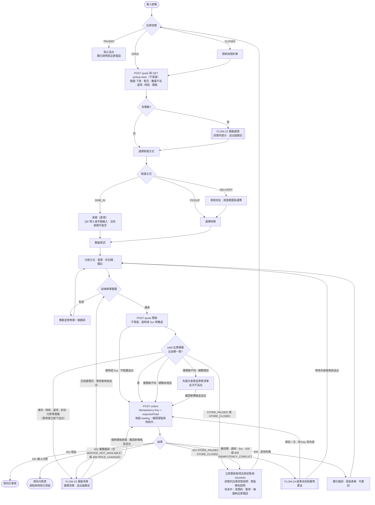

**說明**

- `PAUSED` 時整頁唯讀（FR-CK-12）；使用者可返回菜單或致電店家。
- **內用桌號為選填**（BR-22、VR-10）：步驟 J 可留空（自由入座、先領餐號叫號），留空時請求不帶 `dineIn.tableNo`（`dineIn` 可整個省略），不檢查、不擋送出，仍產生 `T` 前綴的取餐號碼。有提供桌號（QR 帶入或手動輸入）時，前端只檢查格式（1～10 字元英數字）；是否為店家桌位於 `POST /orders` 確認，不是店家桌位回 `422 TABLE_NOT_FOUND`（落點為桌號欄，FLOW-23 第 4 類，可改正或留空）。QR 帶入且有效時取餐方式鎖定為內用並帶入桌號（不可改成不存在的桌號）；觸控面板模式沒有桌號輸入，內用單一律無桌號。
- 步驟 C 與 O 的 `quote` 都是**不保留**的預檢（BR-39）：O 與 R 之間庫存、時段與金額仍可能變動，因此 `POST /orders` 才是最終裁決（FLOW-22），並必須帶 `expectedTotal`（BR-25）。庫存與可用性先於價格：有任何業務錯誤回 `422`（附 `error.quote`），全數通過後金額不符才回 `409 PRICE_CHANGED`。
- 步驟 O 逾時或 5xx **不阻擋送出**，直接 `POST /orders`（伺服器完整重驗，只降低友善度，不降低正確性）。重新計價中按下送出（含 Ctrl/⌘ + Enter）時排入佇列，`quote` 回來後依 FLOW-23 的條件自動送出，並以 polite 通報「計價中，完成後送出」。
- 被退回（`422`（店家狀態類除外）或 `409 PRICE_CHANGED`）時**不離開結帳頁**：就地展開異動清單（FLOW-23），保留已填表單、已選時段與同一把 `Idempotency-Key`；不自動重送、不靜默改選時段或調整數量。僅 `400` 與非業務類失敗才回到表單（L）。
- 店家狀態類（`STORE_PAUSED`、`STORE_CLOSED`）的 `422`，或預檢回報同一狀態時，**不進異動清單**：立即 invalidate `/status` 與 StoreInfo，於狀態列下方顯示預留高度（`min-height`）的店家狀態說明並將焦點移到該說明（休息中提供「改預約」；暫停接單則整頁唯讀並顯示店家電話），再依 B 的判斷處理。`SERVICE_NOT_AVAILABLE`（店家未開放此取餐方式）則重新載入 StoreInfo、停用該取餐方式，列入 FLOW-23 的「時段 · 取餐方式」類，動作為「改為其他取餐方式」。
- 價格異動（EC-03）：總額增加時，第一次按下送出鈕或 Ctrl/⌘ + Enter 只展開差異並聚焦清單，**不送出**；差異展示後按鈕文案才變為「確認新價格並送出 · ${total}」，第二次才送出。僅降價或價格不變可一鍵送出。
- 結果未知（逾時、斷線、5xx）、確定未建立的 `503`（附 `retryAfterSeconds`）與 `429`（`POST /orders` 專屬限流），以及 `409 IDEMPOTENCY_CONFLICT` 走 FLOW-24：以**相同** `Idempotency-Key` 重送（EC-05、EC-35、BR-27、BR-41），不得換新 Key。
- 送出中按鈕以 `aria-disabled` 與 `aria-busy` 呈現「確認餐點與時段中…」，焦點保留；連點只建立一筆（EC-04）。

---

## FLOW-05 取餐時段產生

產生 `GET /stores/{slug}/pickup-slots` 的回傳內容；Mock 與後端必須使用相同演算法（共用 `domain/slots`）。

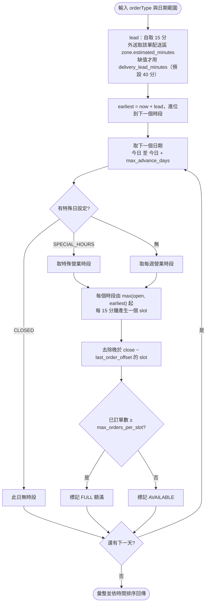

**範例**（時間 14:30，自取，`lead=15`，每週時段 11:00–14:00 與 17:00–21:00）

| 項目 | 結果 |
| --- | --- |
| `earliest` | 14:45 |
| 時段 11:00–14:00 | 全部早於 `earliest`，不產生 |
| 時段 17:00–21:00 | 由 17:00 起，最後一個 slot 為 20:45（`21:00 − 15`） |
| 預設選取 | 今日 17:00（見 [UAT-03](./01-requirements.md#11-驗收情境uat)） |

**即時單（`asap`）可用條件**：(a) 店家狀態為 `OPEN`；(b) `now + lead ≤` 該時段 `close_time`（預估完成不得晚於打烊，BR-08）。不符時 `asap.available=false`，原因為 `STORE_PAUSED`、`STORE_CLOSED` 或 `SLOT_UNAVAILABLE`（外送來不及在打烊前送達）。跨午夜時段的凌晨延伸段屬於前一營業日（BR-23），產生時段時需一併納入。

**時段已訂數的計入**：`max_orders_per_slot` 的「已訂單數」以預約單、依 `scheduled_at` 所屬時段計入，計入集合與釋放規則同庫存（`status` 不是 `CANCELLED`，逾期待付款已排除；即時單暫不計入，Q-11；見 FLOW-22）。此處的 `FULL` 只是預覽：送出時以建單交易內的確認為準，額滿回 `422 SLOT_UNAVAILABLE`（FLOW-23）。

---

## FLOW-06 外送範圍、門檻與運費

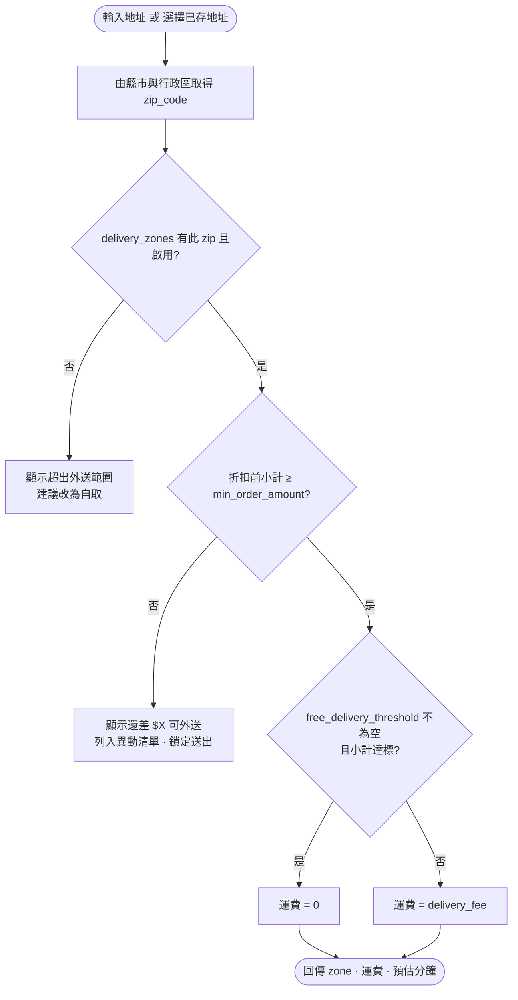

---

## FLOW-07 優惠券驗證

驗證順序即 [BR-20](./01-requirements.md#6-業務規則)，錯誤碼定義於 [06 API §3](./06-api-spec.md)。

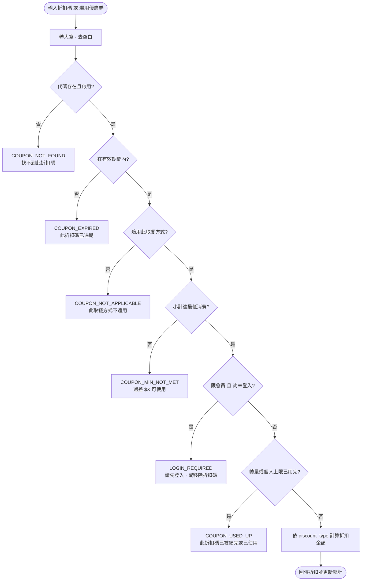

---

## FLOW-08 OTP 登入

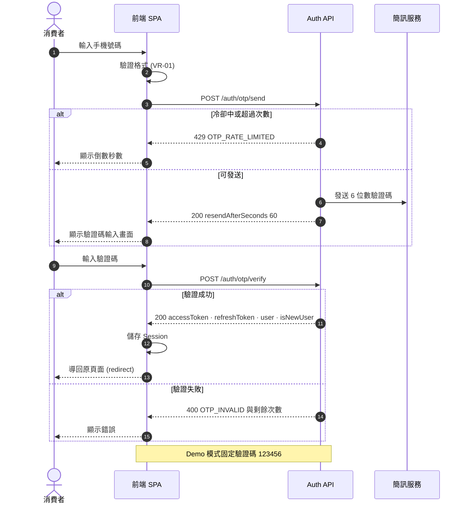

**說明**

- 重送冷卻 60 秒；同一手機 10 分鐘內最多驗證 5 次，超過鎖定 10 分鐘（EC-13）。
- 首次驗證成功即建立會員（`isNewUser=true`）。

---

## FLOW-09 下單與線上付款

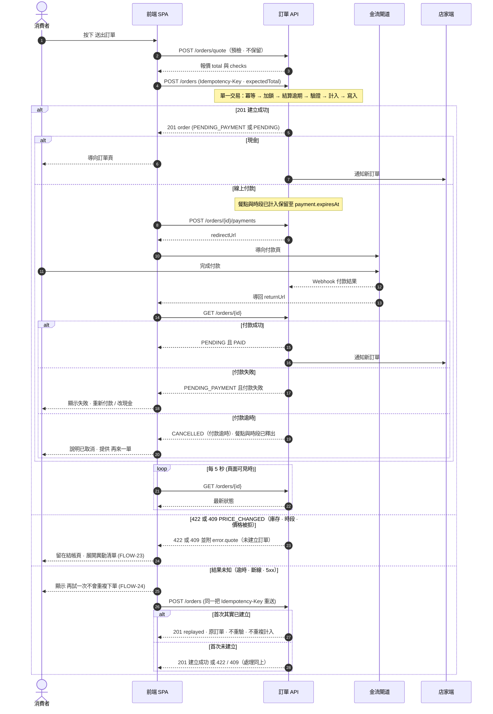

**說明**

- Phase 1：`API` = Mock Adapter，`PG` = 內建的模擬金流頁（`/payment/:orderId`），`ST` = Demo 模擬器。
- Phase 2：付款結果**以後端 Webhook 為準**；前端導回後只是查詢訂單，不可信任 `returnUrl` 的 query 參數。
- `quote` 只是預檢；`POST /orders` 才是庫存與時段的最終裁決（FLOW-22）。被退回的 `422` 與 `409 PRICE_CHANGED` 皆附 `error.quote`，前端以同一支 `deriveCheckoutIssues` 轉成異動清單（FLOW-23）。
- `201` 線上付款時，餐點與時段在建單交易提交的當下已計入保留（至 `payment.expiresAt`），**付款階段不再檢查庫存**（BR-38）；付款失敗、重新付款與改用現金都不重驗，但已逾 `payment.expiresAt` 者一律回 `409 ORDER_STATE_CONFLICT`。
- 結果未知時以**同一把** Key 重送：首次若其實已建立，伺服器回 `201`（`replayed = true`，不重驗、不重複計入）；詳見 FLOW-24。

---

## FLOW-10 訂單狀態機

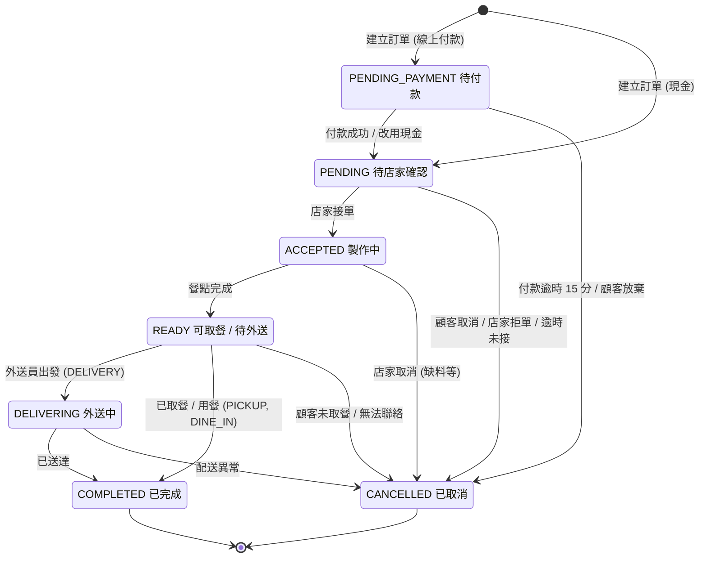

**轉換權限**

| 由 | 至 | 觸發 | 操作者 | 顧客可見文案（自取 / 外送 / 內用） |
| --- | --- | --- | --- | --- |
| — | `PENDING_PAYMENT` | 線上付款下單 | CUSTOMER | 等待付款 |
| — | `PENDING` | 現金下單 | CUSTOMER | 等待店家確認 |
| `PENDING_PAYMENT` | `PENDING` | 付款成功，或改用現金（條件式更新：仍為 `PENDING_PAYMENT` 且未逾 `payment_expires_at`） | SYSTEM、CUSTOMER | 等待店家確認 |
| `PENDING_PAYMENT` | `CANCELLED` | 付款逾時 / 顧客放棄（付款**失敗不會**取消訂單，可重新付款或改現金） | SYSTEM、CUSTOMER | 已取消（付款未完成） |
| `PENDING` | `ACCEPTED` | 接單 | STORE | 製作中 |
| `PENDING` | `CANCELLED` | 取消 / 拒單 / 逾時未接（BR-17） | CUSTOMER、STORE、SYSTEM | 已取消 |
| `ACCEPTED` | `READY` | 出餐 | STORE | 可取餐 / 餐點完成，等待外送 / 餐點完成 |
| `ACCEPTED` | `CANCELLED` | 店家取消 | STORE | 已取消（店家取消） |
| `READY` | `DELIVERING` | 外送出發（僅 DELIVERY） | STORE | 外送中 |
| `READY` | `COMPLETED` | 取餐 / 用餐完成（PICKUP、DINE_IN） | STORE | 已取餐 / — / 已完成 |
| `READY` | `CANCELLED` | 顧客未取餐、無法聯絡 | STORE | 已取消（未取餐） |
| `DELIVERING` | `COMPLETED` | 送達 | STORE | 已送達 |
| `DELIVERING` | `CANCELLED` | 配送異常 | STORE | 已取消（配送異常） |

> 每次轉換都必須寫入 `order_status_logs`（`from_status`、`to_status`、`operator_type`、`note`），並更新 `orders` 對應時間欄位（`accepted_at`、`ready_at`、`completed_at`、`cancelled_at`）。顧客可見文案以 [03 §6.4](./03-uiux-design.md) 為準。進入 `CANCELLED` 時須執行「寫入狀態紀錄、作廢付款交易、返還優惠券、**釋放庫存與時段**（不再計入已售與時段已訂數）」後處理，且與狀態轉換在**同一交易**內完成（皆為資料庫操作）；需要退款時，退款的外部呼叫於 `COMMIT` 之後（鎖外）執行（BR-28、BR-29、BR-38）。進入 `PENDING`（現金建單、付款成功或改用現金）時寫入 `orders.pending_at`，接單期限自此起算（BR-17）；各狀態是否計入庫存見 FLOW-22 的保留與釋放狀態圖。

---

## FLOW-11 付款狀態機

訂單層級 `orders.payment_status`：

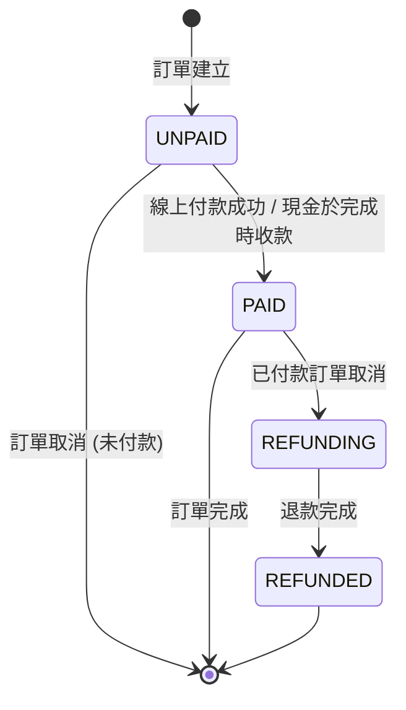

交易層級 `payments.status`（一筆訂單可有多次付款嘗試）：

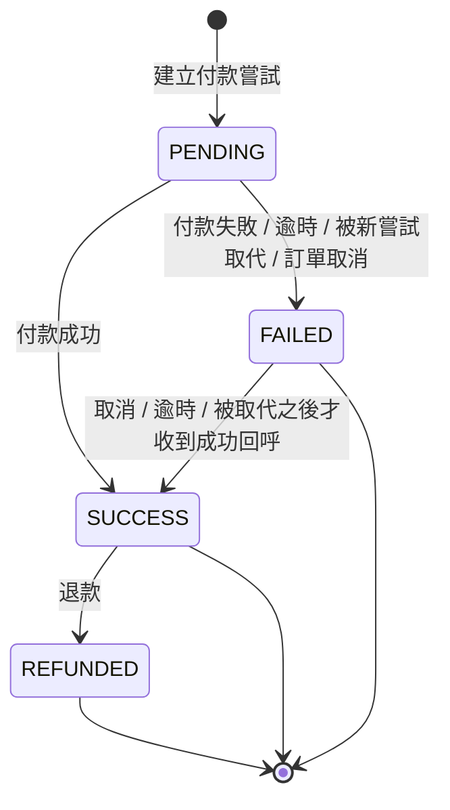

**競態與補償規則**（BR-28）

| 情境 | 處理 |
| --- | --- |
| 線上付款失敗 | 該筆交易 `FAILED`；**訂單維持** `PENDING_PAYMENT` / `UNPAID`，可在逾時前重新付款或改用現金（FR-PY-04） |
| 重新付款 | 建立新交易前，作廢同訂單既有 `PENDING` 交易（`FAILED`，`failure_code=SUPERSEDED`） |
| 改用現金 | 作廢既有 `PENDING` 線上交易；建立 `CASH` 交易（`PENDING`）；訂單轉 `PENDING` |
| 付款成功（訂單轉 `PENDING`） | 同一交易內作廢同訂單其餘 `PENDING` 的線上付款交易（`FAILED`，`failure_code=SUPERSEDED`），避免殘留處理中的交易（對帳 5） |
| 付款進行中顧客取消 | 訂單 `CANCELLED`；所有 `PENDING` 交易作廢（`ORDER_CANCELLED`） |
| 付款逾時 | 訂單 `CANCELLED`（SYSTEM）；`PENDING` 交易以 `EXPIRED` 作廢；同時釋放庫存與時段（BR-38） |
| 取消 / 逾時**之後**才收到成功回呼 | 交易記為 `SUCCESS`，訂單 `payment_status` 依序 `PAID` → `REFUNDING` → `REFUNDED`（自動退款），並寫入狀態紀錄（EC-17）；訂單不復活、不重新計入庫存 |
| 付款期限已過但排程尚未寫入 `CANCELLED` | 惰性釋放：不再計入庫存與時段（唯讀查詢以 predicate 排除，不寫入）；付款與「改用現金」一律回 `409 ORDER_STATE_CONFLICT`；逾期判斷一律使用資料庫時鐘；寫入路徑（建單鎖內、取消、付款、`GET /orders/{id}` 的 `expireIfDue`）先於同一交易內結算並完成後處理（FLOW-22） |
| 付款成功回呼：已通過交易閘門（本次回呼把該交易轉為 `SUCCESS`），且訂單的條件式更新影響 0 列 | 一律先**重讀訂單**再分流：(a) 訂單為 `CANCELLED`，或仍為 `PENDING_PAYMENT` 但已逾 `payment_expires_at` → 走逾時路徑（交易記 `SUCCESS`、訂單維持或轉 `CANCELLED`、自動退款）；(b) 訂單已是 `PENDING` 或更後的狀態（例如已改用現金後才收到線上付款成功回呼）→ **僅**將該筆交易記為 `SUCCESS` 並退回該筆款項，**不得**變更訂單狀態、`payment_status` 或影響庫存 |
| 現金訂單被取消 | 現金交易作廢（`ORDER_CANCELLED`），`payment_status` 維持 `UNPAID` |
| 重複、亂序或並行回呼 | 回呼先以 `provider` 與 `provider_txn_id` 查交易（`UK(provider, provider_txn_id)`）：已 `SUCCESS` / `REFUNDED` 直接回 `200`，不重複入帳、不重複退款，也不進入 0 列分流；此為預檢（唯讀、不持鎖），只是快速路徑而不是防止並行重複的閘門，先於上方的條件式更新與分流。**並行抵達**的相同成功回呼都可能通過這個檢查，因此取得訂單列鎖（`SELECT … FOR UPDATE`）後，再以交易層級閘門 `UPDATE payments SET status = 'SUCCESS' … WHERE id = ? AND status IN ('PENDING', 'FAILED')` 為準：影響 1 列才進入訂單更新與分流，影響 0 列即回 `200`（已由另一個回呼處理）；正常付款退款 0 次、逾時路徑退款 1 次 |

**說明**

- 現金：建立訂單時即建立一筆 `PENDING` 的 `payments`；店家於 `COMPLETED` 時標記 `SUCCESS`。
- 退款完成前訂單頁需持續輪詢（FLOW-16），讓顧客看到退款進度（FR-PY-05）。
- 交易已 `FAILED`（訂單取消、逾時或被新嘗試取代）之後才收到成功回呼時，該筆交易補記為 `SUCCESS` 並依上表分流（自動退款，或僅退回該筆款項），不復活訂單。
- 付款成功與「改用現金」的狀態轉換皆為條件式更新（`WHERE status = 'PENDING_PAYMENT' AND payment_expires_at > 資料庫時鐘`，成功時一併寫入 `pending_at`）：**付款成功**影響 0 列時依上表分流；**改用現金**影響 0 列（已逾期或已被取消等）則直接回 `409 ORDER_STATE_CONFLICT`，不分流、不退款。付款成功回呼先取得該筆訂單的列鎖（`SELECT … FOR UPDATE`），再以 `payments` 的交易層級閘門擋掉並行的相同回呼（影響 1 列才繼續，0 列回 `200`）；付款失敗、重新付款與改用現金（未逾期）不重驗庫存與店家狀態，因為保留仍有效。

**付款回呼與逾時競態**（BR-28、BR-38）：排程取消與付款回呼作用於同一列，恰一方生效。

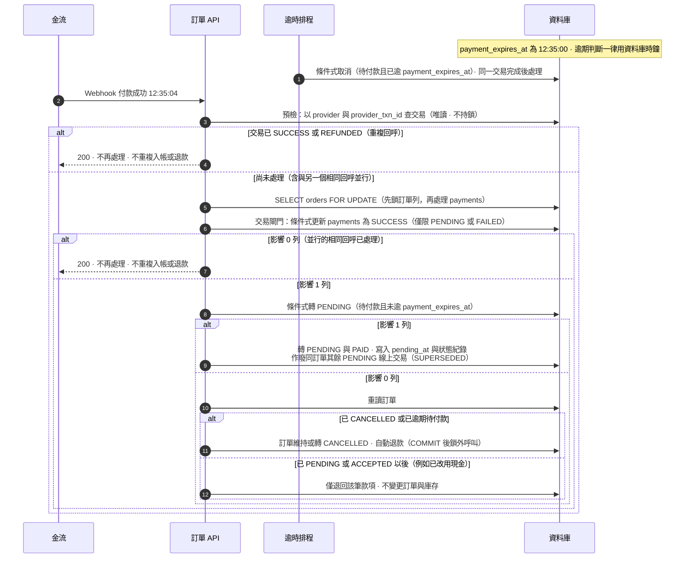

兩個條件式更新作用於同一列，因此不會出現「已付款卻無訂單」，也不會出現「逾期後重新佔用庫存」。並行抵達的相同成功回呼由「訂單列鎖 ＋ 交易層級閘門」序列化：先取得列鎖者把交易轉為 `SUCCESS` 並完成分流，後者在閘門影響 0 列、直接回 `200`，因此正常付款退款 0 次、逾時路徑退款 1 次，不會把正常入帳的款項再退一次，也不會發出兩次退款呼叫。建單交易在計數前同樣先結算逾期待付款（會等待在途的付款交易，見 FLOW-22），結算與後處理在同一交易內完成，故在途付款不會讓已被排除的份數重新計入，也不存在後處理被遺漏的缺口。

---

## FLOW-12 取消訂單

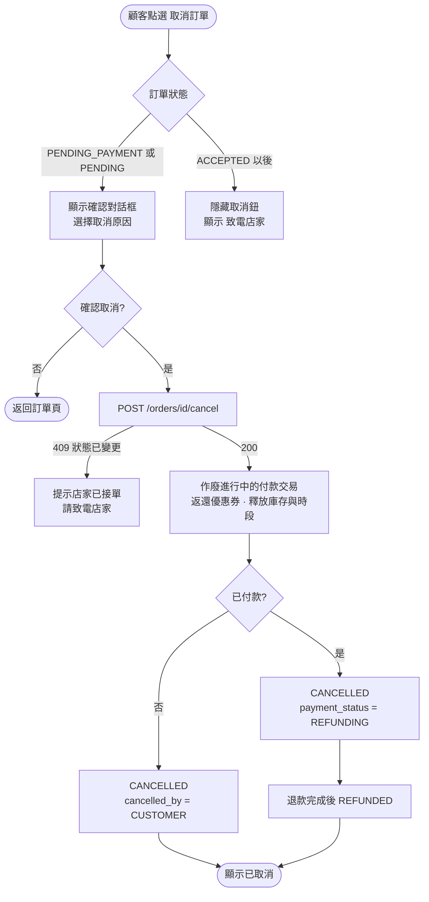

**說明**：店家 / 系統取消（拒單、逾時、未取餐、配送異常）同樣執行「寫入狀態紀錄 → 作廢付款交易 → 返還優惠券 → 必要時退款 → 釋放庫存與時段」後處理（BR-28、BR-29、BR-38），且與狀態轉換在同一交易內完成，需要退款的外部呼叫於 `COMMIT` 之後（鎖外）執行。庫存與時段於進入 `CANCELLED` 的當下釋放，與退款進度無關；每條取消路徑皆以 `WHERE id = ? AND status IN (可轉換的來源狀態)` 條件式更新，影響 0 列視為已處理（冪等：已 `CANCELLED` 再次取消回 `200` 原狀態，不重複返還優惠券）。

---

## FLOW-13 再來一單

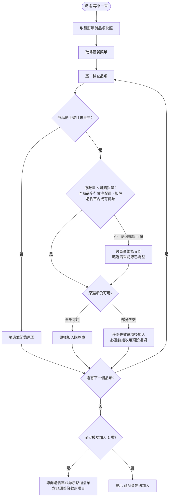

**說明**

- 必選群組的選項失效且無預設選項時，整個品項視為無法加入並略過。
- **可購買量**（BR-11、BR-40）：以最新菜單的 `remainingToday` 預判，可購買量 = `min(20, remainingToday − 購物車內同商品其他行份數)`（`remainingToday` 省略則不限制）。原數量超過可購買量者**調整為可購買份數**，並於略過清單說明「已將「{品名}」調整為 {n} 份（今日限量）」；可購買量為 0 視同售完而略過。同一張訂單內的同商品多行依訂單順序配置。
- 這是不保留的預覽：加入購物車不保留庫存，送出時仍以 FLOW-22 的最終確認為準。一鍵「↻ 再點」（FLOW-03、FLOW-20）同樣以可購買量判斷，已在購物車的份數須一併扣除。

---

## FLOW-14 Demo 模擬器狀態推進

Mock Adapter 採「**讀取時惰性推進**」：不依賴 `setTimeout`，每次讀取訂單時依經過時間補算應有狀態，重新整理或分頁被背景節流都不會中斷模擬。

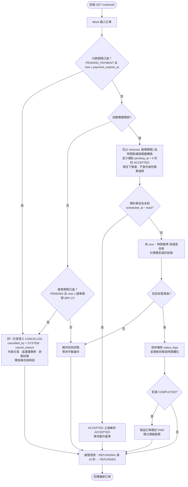

**預設時間表**（速度 1×，可切換 1× / 2× / 5×）

| 轉換 | 自取 / 內用 | 外送 |
| --- | --- | --- |
| `PENDING` → `ACCEPTED` | +5 秒 | +5 秒 |
| `ACCEPTED` → `READY` | +20 秒 | +20 秒 |
| `READY` → `DELIVERING` | — | +10 秒 |
| `READY` / `DELIVERING` → `COMPLETED` | +15 秒 | +20 秒 |
| 已付款訂單取消 → `REFUNDED` | 取消後 +10 秒 | 取消後 +10 秒 |

**規則**

- **時間基準**：`PENDING → ACCEPTED` 自 `pending_at`（進入 `PENDING` 的時間：現金單為下單時間，線上付款為付款成功或改用現金的時間）起算 +5 秒，即時單與預約單皆同；即時單其後各轉換接續同一基準，預約單 `ACCEPTED` 之後的製作基準為 `scheduled_at − lead`（尚未到達前維持 `ACCEPTED`，不被推進）。
- **逾時與自動模擬開關**：**付款逾時不受開關影響**：付款期限（`payment_expires_at`）在每次 `GET /orders/{id}` 與寫入路徑都會檢查，即使「自動模擬」關閉。**接單逾時只在自動模擬關閉、店家端未接單時發生**（BR-17：`pending_at + accept_timeout_minutes`；預約單為 `max(pending_at + accept_timeout_minutes, scheduled_at − lead)`，`lead` 同 BR-08：外送為該單配送區 `estimated_minutes`、缺值才用 `delivery_lead_minutes`，自取為 `pickup_lead_minutes`）。自動模擬開啟時，惰性推進必須**先**以 `min(now, 接單期限)` 為時間點補寫模擬轉換（至少補到 `pending_at + 5 秒` 的 `ACCEPTED`），**再**判斷接單逾時；因此離頁、分頁被背景節流或用時間穿梭「快轉」超過接單期限之後才讀取，仍為 `ACCEPTED`（或其後的模擬狀態），不會被取消。預約單的自動接單早於任何接單期限，製作基準仍為 `scheduled_at − lead`。
- **預設**：自動模擬開啟、速度 1×。要停在某個狀態展示（如取消訂單）請先關閉自動模擬。
- 「拒單」為手動操作：`PENDING` → `CANCELLED`（`cancelled_by=STORE`，原因「店家忙碌，無法接單」）。
- **釋放與結算**：取消、拒單與逾時一律在同一步驟釋放庫存與時段（BR-38）。`settleExpiredOrders(now)` 只在**寫入路徑**呼叫（`create`、`cancel`、`pay`，以及 `GET /orders/{id}` 的 `expireIfDue`），把已逾付款期限、以及（自動模擬關閉時）已逾接單期限的訂單寫成 `CANCELLED`，並在同一步驟完成全部後處理（自動模擬開啟時先補寫模擬轉換再判斷接單逾時，見上一條）；唯讀查詢（`getMenu`、`getProduct`、`getPickupSlots`、`quote`）**不寫入**，只以 `countsTowardStock` predicate 排除已逾付款期限的待付款單，釋放不依賴掃描時機；`GET /orders`（列表）同樣唯讀，已逾付款期限者以相同條件顯示為已取消、`tab` 歸 `cancelled`（顯示修正，不寫入），`GET /orders/lookup` 只回 `orderId` 與新簽發的權杖，不回狀態、不結算（06 §5.14）。後端的接單逾時只由排程寫入、不做惰性排除，Mock 於寫入路徑（自動模擬關閉時）較精確地先結算，此差異列於 06 §7，契約測試不得斷言。Demo 面板時間穿梭的「快轉 +15 分鐘」可觀察待付款保留的釋放（08 S23）。
- **單一寫入口**：所有會寫入 Mock 資料庫的路徑（惰性推進、取消、付款、店家模擬動作、建單、會員資料、`DemoControl`）一律經 `withDbLock`：取得鎖 → 重讀資料庫 → 變更 → 同步寫回，使多分頁與惰性推進不互相覆蓋；防抖（debounce）僅用於非資料庫鍵（偏好、購物車等 UI 儲存）；不支援 Web Locks 的瀏覽器於多分頁下可能遺失寫入（08 §8）。
- **建單臨界區**：`orders.create` 的驗證與計入發生在同步臨界區內（內部無 `await`），順序與注入情境（他人搶購、時段額滿、`failNext.phase`）見 FLOW-22 的 Mock 臨界區流程圖。

---

## FLOW-15 API 錯誤處理策略

統一由 `ApiClient` 的攔截層處理，UI 只處理「業務錯誤碼」。錯誤碼清單見 [06 §3](./06-api-spec.md)。

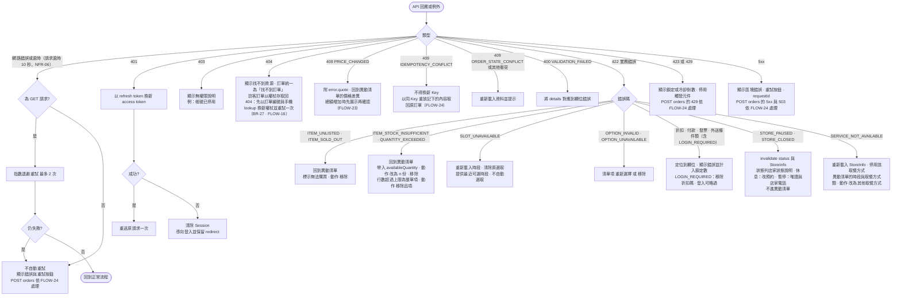

**`POST /stores/{slug}/orders` 的結果對照**

| 回應 | 訂單是否已建立 | 前端處理 | 對應流程 |
| --- | --- | --- | --- |
| `201`（非重放） | 是 | 現金導向訂單頁、線上付款導向付款頁；Key 作廢，購物車清除 | FLOW-04 |
| `201` 且 `replayed = true` | 是（原訂單，可能已 `CANCELLED`） | 依 `nextAction` 導向（`TRACK` → 訂單頁；`PAY` → 付款頁並顯示剩餘時間；已 `CANCELLED` → 訂單頁並保留購物車）；原訂單未取消且內容與目前購物車一致才清除購物車；Key 作廢 | FLOW-24 |
| `422`（業務錯誤，店家狀態類除外） | 否 | 留在結帳頁、展開異動清單；保留表單、時段與 Key；不自動重送 | FLOW-23 |
| `422 STORE_PAUSED` / `STORE_CLOSED` | 否 | 留在結帳頁；立即重新取得店家狀態與 StoreInfo，狀態列顯示店家狀態說明（休息中 → 改預約；暫停 → 唯讀與店家電話），焦點移到說明；不進異動清單；保留表單與 Key | FLOW-04 |
| `409 PRICE_CHANGED` | 否 | 清單價格差異；總額增加時先展示再確認 | FLOW-23 |
| `409 IDEMPOTENCY_CONFLICT` | 是（先前某次送出已成立） | 不換新 Key；以同 Key 重放記下的內容取回原訂單 | FLOW-24 |
| `503`（附 `retryAfterSeconds`，建單鎖等待逾時） | 否（確定未建立，不綁定 Key） | 不記下送出內容；依 `retryAfterSeconds` 暫停送出鈕後以同 Key 重送；文案「目前點餐人數較多，請稍後再按一次送出訂單」 | FLOW-24 |
| `429 RATE_LIMITED`（`POST /orders` 專屬限流，06 §1.6） | 否（確定未建立，不綁定 Key） | 不記下送出內容；依 `retryAfterSeconds` 暫停送出鈕後以同 Key 重送；文案「操作太頻繁，請稍後再按一次送出訂單」；焦點在頁首 Alert 的「再試一次」 | FLOW-24 |
| 無回應、逾時、其他 `5xx`（含未附 `retryAfterSeconds` 的 `503`） | 未知 | 保留 Key 並記下送出內容；提供「再試一次」與「致電店家確認」 | FLOW-24 |
| `400 VALIDATION_FAILED` | 否 | 對應欄位顯示錯誤，捲動並聚焦第一個錯誤 | FLOW-04 |

> `409 ORDER_STATE_CONFLICT` 出現在付款與取消端點（例：付款已逾期、店家已接單）：重新載入訂單並提示，見 FLOW-10 與 FLOW-11。

---

## FLOW-16 訂單追蹤輪詢

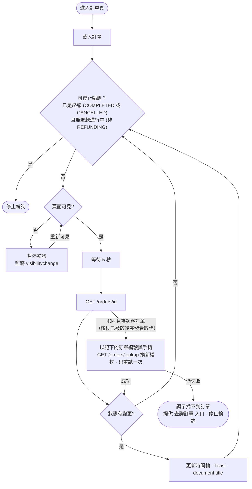

**404 取回**（BR-27、EC-36）：同 Key 並行或另一裝置以編號與手機查詢，會使舊的訪客追蹤權杖失效（同一訂單同時只有一把有效權杖）。持有此訂單本機記錄的訪客遇到 `404` 時，先以記下的訂單編號與手機（取自該筆 `201` 的 `order.orderNo`、`order.customer.phone`）呼叫 `GET /orders/lookup` 換取新權杖並重試一次；仍失敗才顯示「找不到訂單」並提供手動查詢入口，不無限重試。`DINE_IN` 訪客未填手機時無法以 `lookup` 取回，因此送出中須停用送出鈕、不並行送出同一把 Key（06 §5.9）。

---

## FLOW-17 商品卡呈現與版面降級

決定菜單的版面模式，以及每張商品卡在「缺圖、缺描述、無選項、售完」時的呈現。規則細節與視覺見 [03 §6.6、§6.7](./03-uiux-design.md)。

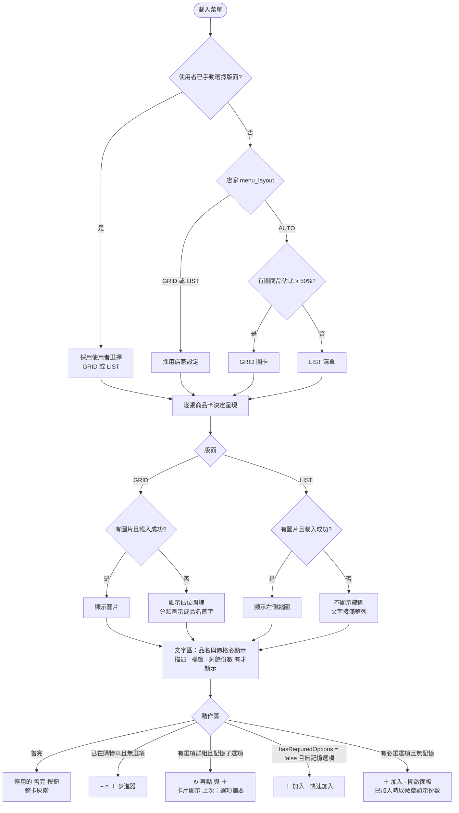

**說明**

- 圖片載入失敗（404 / 逾時）與「沒有圖片」同樣處理，絕不顯示瀏覽器的破圖圖示（EC-20）。
- `AUTO` 在商品數為 0 時視為 `LIST`；全店無圖時整份菜單呈現為純文字清單（EC-19）。
- 每個文字欄位（描述、標籤、過敏原）都可缺漏；缺漏時**整個區塊隱藏**，不留空標題或空白行（FR-MN-10）。
- 「↻ 再點」與「上次：…」只出現在**有選項群組且記憶了至少一個選項**的商品；沒有選項群組的商品不顯示（但仍可出現在「常點」區塊）。「＋」的行為不因記憶而改變（BR-30）。

---

## FLOW-18 免登入點餐與選填登入

「登入」在整個點餐過程中只是**加速與保存**，不是前提。下表列出所有會出現登入提示的位置，皆可略過（BR-33）；其中會員專屬折扣碼的提示會鎖定送出，但移除折扣碼即可繼續，仍不強制登入下單。

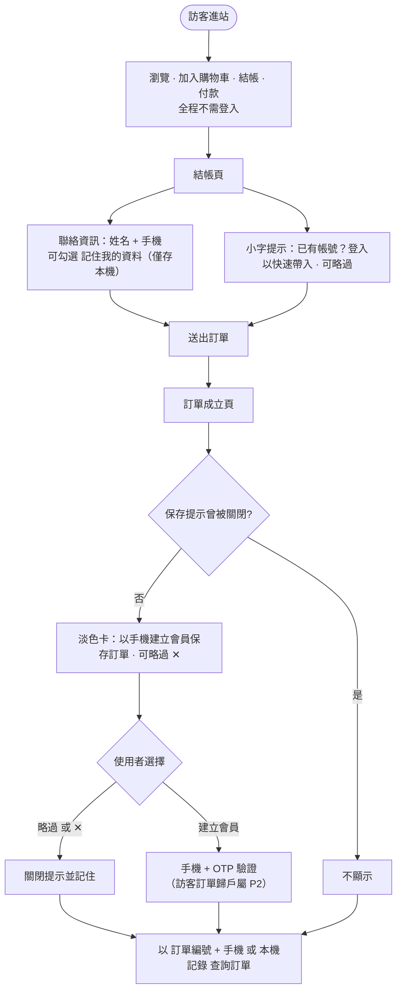

| 位置 | 提示內容 | 可略過 | 行為 |
| --- | --- | --- | --- |
| 全域頂部 | 「登入」ghost 連結 | — | 不彈窗、不導頁（點擊才進入登入頁） |
| 結帳頁 | 「已有帳號？登入以快速帶入 · 可略過」小字 | ✓ | 登入後預填聯絡資訊與地址並返回結帳頁 |
| 訂單成立頁 | 「想保存這筆訂單？以手機建立會員」淡色卡 | ✓（關閉後記住） | P1 導向登入；訪客訂單歸戶為 P2（FR-AC-08） |
| 愛心（我的最愛） | Toast「登入後可收藏喜愛的餐點」 | ✓ | 不影響加入購物車 |
| 會員專屬折扣碼 | 「此折扣碼僅限會員」+「移除折扣碼」「登入」 | ✓ | 登入後返回並自動重新套用；不登入則移除折扣碼即可送出（該錯誤計入送出鎖定數，不強制登入下單） |
| 底部「訂單」分頁 | 訪客改導向「查詢訂單」，並顯示本機記錄 | — | 不要求登入 |

**訪客資料記憶**（FR-CK-14）：勾選「記住我的資料」時，姓名、手機與最近一次外送地址僅寫入此裝置的 `localStorage`；結帳頁與頁尾提供「清除我的資料」。

---

## FLOW-19 快速鍵處理

全站鍵盤事件由單一處理器（`HotkeyProvider`）統一判斷：它掛在 `document` 的 **capture 階段**、先於所有元件處理器執行，先 `classify`（累積偵測證據，FLOW-25）再處理 `HOTKEYS`。`HOTKEYS` 登錄的鍵（單字元、`Esc`、`Ctrl/⌘ + Enter`）只能由 `HotkeyProvider` 處理，元件不得自行監聽；方向鍵、`Home` / `End`、搜尋框的 ↓ / `Enter` 屬元件原生導覽（商品網格、膠囊列、radio、步進器），不是單字元快速鍵，元件可自行處理。判定規則為 [BR-34](./01-requirements.md#6-業務規則)，快速鍵地圖見 [03 §10.3](./03-uiux-design.md)，實作見 [07 §7.5](./07-frontend-architecture.md)。單字元快速鍵**預設關閉**（`prefs.hotkeysEnabled = false`）；偵測到實體鍵盤時如何提醒開啟見 FLOW-25，提醒本身不攔截 `keydown`、不 `preventDefault`。

```mermaid
flowchart TD
    A([keydown]) --> B{"組字中或長按重複?<br/>isComposing · repeat · 輸入元件內的 keyCode 229"}
    A -.->|"capture 階段先交 FLOW-25 評估證據<br/>不攔截 · 不 preventDefault · 觸控面板模式不評估"| EV([FLOW-25 鍵盤偵測])
    B -->|是| X([忽略])
    B -->|否| C{含 Alt?}
    C -->|是| X
    C -->|否| D{含 Ctrl 或 ⌘?}
    D -->|是| E{是 Enter?}
    E -->|否| X2([留給瀏覽器與輔助科技])
    E -->|是| H
    D -->|否| F{"Shift + 字母或數字?"}
    F -->|是| X
    F -->|否| G[正規化按鍵<br/>key 優先 · 非拉丁字元改用 code]
    G --> H{焦點在輸入元件?}
    H -->|"是 且不是 Esc 或 Ctrl+Enter"| X
    H -->|"否 · 或為 Esc · Ctrl+Enter"| I{"單鍵快速鍵未啟用（預設）<br/>或觸控面板模式?"}
    I -->|"是 且不是 Esc 或 Ctrl+Enter"| X
    I -->|"否 · 或為 Esc · Ctrl+Enter"| J["依範圍由特定到泛用比對<br/>浮層開啟時僅 close · 浮層範圍 · help（需已啟用）"]
    J --> K{找到對應動作?}
    K -->|否| X
    K -->|"是 · 其他快速鍵"| L[執行動作並以 aria-live 通報結果]
    K -->|"是 · Esc"| ES1{有開啟的浮層?}
    K -->|"是 · Ctrl 或 ⌘ + Enter"| SB{"送出鈕狀態 · 依序判斷"}
    ES1 -->|是| ES1A[關閉最上層浮層並還原焦點]
    ES1 -->|否| ES2{"鍵盤提醒可見<br/>且焦點在其中?"}
    ES2 -->|是| ES2A["收起提醒（≥ 768 收成 ⌨ 上的小圓點）<br/>closeTarget = NOTICE · 由 HotkeyProvider 處理"]
    ES2 -->|否| ES3{搜尋框有字?}
    ES3 -->|是| ES3A[清除並失焦]
    ES3 -->|否| X3([不動作 · 不做頁面返回])
    SB -->|"① 送出中 · 冷卻中 或 店家 PAUSED"| X
    SB -->|"② 重新計價中"| SB2["排入佇列 · quote 回來後再決定<br/>通報 計價中，完成後送出"]
    SB -->|"③ 被異動清單鎖定"| SB1["焦點與捲動移到異動清單標題<br/>通報 還有 n 項需要處理 · 不送出"]
    SB -->|"④ 總額增加且差異尚未展示"| SB3["只展開差異並聚焦清單 · 此次不送出"]
    SB -->|"⑤ 可送出"| SB4["等同按下 送出訂單<br/>先做表單驗證"]
```

**說明**

- 比對以 `event.key` 為準（非 QWERTY 配置以鍵帽字元為準，Shift + 字母 / 數字不觸發）。僅輸入法佔位值（`Process`、`Unidentified`）與非拉丁字元（注音符號等）改以 `event.code`（實體按鍵）比對，使 `c`、`3` 等鍵仍可用。
- 輸入元件內的 `isComposing` 與 keyCode 229 一律忽略（選字時 Esc 不會關閉浮層）；非輸入元件焦點下的 229 仍以 `code` 比對。實際行為依瀏覽器 / 輸入法而異，列入手動測試矩陣（07 §13）。
- 「輸入元件」指文字類 `<input>`、`<textarea>`、`<select>`、`contenteditable`、`role="textbox" / "searchbox" / "combobox"`；radio、checkbox、button 與步進器不算，故啟用後選項群組上仍可按 `a` 加入。
- **預設關閉**（BR-34）：`prefs.hotkeysEnabled` 是單一開關，徽章（`KeyHint`）與單鍵的 `aria-keyshortcuts` 跟隨同一個開關；未啟用時單鍵一律不觸發、不 `preventDefault`，因此不再攔截 Firefox 的 `/` 快速尋找與輔助科技按鍵。開啟入口皆不依賴單鍵：鍵盤提醒的「開啟」、頂部「鍵盤快速鍵與偏好」⌨ 按鈕、跳過連結、頁尾「鍵盤快速鍵」與「偏好設定」。
- **`?` 受開關約束**：`?` 是符號字元快捷鍵（WCAG 2.1.4 須可關閉），`help` 不設 `alwaysOn`，未啟用時不生效。
- **Esc** 與 **Ctrl/⌘ + Enter** 屬非字元鍵或含修飾鍵，不受單鍵開關影響（WCAG 2.1.4）。Esc 依序：關閉最上層浮層 → 收起鍵盤提醒（若可見且焦點在其中）→ 搜尋框有字則清除並失焦 → 其餘不動作（不做頁面返回）。
- **Ctrl/⌘ + Enter** 等同按下「送出訂單」並先驗證表單：送出中、冷卻中（`503` 附 `retryAfterSeconds` 或 `429`，依該秒數暫停；送出鈕以 `aria-disabled` 呈現並以 `aria-describedby` 帶倒數說明）與店家 `PAUSED`（真正停用）維持不動作；其後依序判斷：**重新計價中**排入佇列（優先於鎖定；`quote` 回來後再依清單狀態決定，有阻擋項改為展開清單、總額增加先展開差異、否則自動送出）；**被異動清單鎖定**時改為把焦點與捲動移到異動清單並通報「還有 n 項需要處理」，不送出（鍵盤使用者不會遇到靜默無反應）；總額增加且差異尚未展示時只展開差異，第二次才送出（FLOW-04、FLOW-23）。判斷順序與 `decideSubmit`（07 §7.6）相同。
- 送出鈕旁的「Ctrl/⌘ + Enter」小字與 `aria-keyshortcuts="Control+Enter Meta+Enter"` **不**跟隨單鍵開關：桌機（`(hover:hover) and (pointer:fine)`）常駐於送出鈕旁，觸控面板模式除外。
- 浮層開啟時背景頁面範圍（含 Ctrl/⌘ + Enter）一律失效，只留 `?`（已啟用時）、Esc 與浮層自己的範圍。
- 觸控面板模式停用單鍵快速鍵（僅保留 Esc 與 Ctrl/⌘ + Enter），不輸出提示徽章與 `aria-keyshortcuts`（含 Ctrl/⌘ + Enter 的說明小字），也不偵測、不提醒（FLOW-25）。
- 螢幕閱讀器瀏覽模式會先攔截字母鍵，屬輔助科技行為（EC-26）；單鍵快速鍵預設即未啟用，因此預設不與瀏覽模式衝突，曾開啟者可於說明對話框停用。

---

## FLOW-20 點餐記憶與快速再點

```mermaid
flowchart TD
    A([訂單建立成功]) --> B{"訪客 且已啟用點餐記憶<br/>且非觸控面板模式?"}
    B -->|否| X([不寫入本機<br/>會員由伺服器依訂單推導])
    B -->|是| C[逐品項寫入<br/>選項 ID + 名稱快照 + 備註 + 時間]
    C --> D[同商品覆蓋 · 清除超過 180 天 · 超過 100 項淘汰最舊]
    D --> E([寫入 localStorage<br/>會員另可由 GET /me/frequent-items 同步])
    F([載入菜單]) --> G[載入並排除超過 180 天者<br/>會員：伺服器常點與訪客記憶在記憶體合併 · 較新者優先]
    G --> H[有選項群組且記了選項的卡片顯示 上次：選項摘要<br/>常點區塊取最近 6 項 · 僅菜單內仍存在的商品]
    H --> I{使用者操作}
    I -->|點 ↻ 再點| J[取商品詳情<br/>以目前選項驗證記憶]
    J -->|取得詳情失敗| JX[Toast：暫時無法再點]
    J --> K{全數有效且可購買?}
    K -->|是| L[直接加入購物車 · 數量 1<br/>Toast 與 aria-live 通報]
    K -->|否| M[開啟面板<br/>有效選項已套用 · 失效者改預設並提示]
    I -->|點卡片或 ＋| N[開啟面板]
    N --> O[預設套用上次選項與備註<br/>顯示 已套用上次的選擇 · 恢復預設]
```

**說明**

- 記憶以「商品」為單位，只記最近一次的選擇；寫入時機為**訂單成立**（而非加入購物車），避免未下單的嘗試污染記憶。之後該訂單被取消或逾時**不回溯移除**，與伺服器推導（排除已取消訂單）可能略有差異。
- 驗證一律以商品**目前**的選項群組為準（[`applyRemembered`](./07-frontend-architecture.md)）：失效選項丟棄、**超出群組上限視同失效（不靜默截斷）**、必選群組不足保留有效者並以預設補足，狀態為 `PARTIAL`，不允許一鍵再點。
- 讀取時也排除超過 180 天者。價格不隨記憶保存，一律以加入當下的現價計算。
- 訪客記憶僅存此裝置；會員由伺服器依近 180 天非取消訂單推導（跨裝置，FR-AC-11、EC-29），**不寫入本機**，登出後不殘留；登入期間與此裝置的訪客記憶在記憶體合併，較新者優先。
- 觸控面板模式與使用者關閉記憶時，不記錄也不套用（共用裝置不保存，EC-23）。
- 步驟 K 的「可購買」指未下架、未售完且可購買量 ≥ 1：已在購物車的同商品份數須一併扣除（`canRepeatDirectly` 帶入 `inCartQuantity`），可購買量不足時不一鍵加入、改開面板；最終仍以送出時的確認為準（FLOW-22）。

---

## FLOW-21 觸控面板閒置重置

```mermaid
stateDiagram-v2
    state "ACTIVE 使用中" as ACTIVE
    state "WARNING 閒置警示（倒數 30 秒）" as WARNING
    state "RESET 重置" as RESET
    state "DONE 訂單完成畫面" as DONE

    [*] --> ACTIVE : 進入觸控面板模式
    ACTIVE --> ACTIVE : 任何指標 / 觸控 / 鍵盤 / 捲動操作
    ACTIVE --> WARNING : 閒置 60 秒
    WARNING --> ACTIVE : 按「繼續點餐」或任何操作
    WARNING --> RESET : 倒數歸零（共 90 秒）
    RESET --> ACTIVE : 清空購物車與暫存資料，回到菜單
    ACTIVE --> DONE : 訂單成立
    DONE --> DONE : 按「再看一下」或任何操作（重新計 30 秒）
    DONE --> RESET : 30 秒或按「開始新訂單」
```

**說明**

- 時限常數：警示 60 秒、重置 90 秒、完成畫面 30 秒（BR-37；`domain/idle.ts`）。計時使用單調時鐘，不受 Demo「時間穿梭」與系統時間調整影響。
- 警示以 `role="alertdialog"` 呈現並可由螢幕閱讀器朗讀，倒數每 10 秒以 `aria-live="assertive"` 通報；「繼續點餐」為最大的主要按鈕。
- 重置會清空購物車、結帳草稿、已輸入的聯絡資訊、記憶體中的訂單與 `trackingToken`，並一併丟棄 `Idempotency-Key` 與記下的送出內容。觸控面板模式的用戶端儲存**全程僅存記憶體**（不讀寫 `localStorage`），因此不會讀到一般模式留下的姓名、手機、地址、點餐記憶與本機訂單記錄，也不會留下任何個資（BR-36）。
- 觸控面板僅提供櫃檯付款（現金），不產生待線上付款的訂單，因此閒置重置不會中斷付款流程。
- **結果未知**（FLOW-24）：送出訂單後結果未知（逾時、斷線、5xx）時，閒置警示照常出現（不延後重置），並多一行「上一筆訂單結果尚未確認，請洽櫃檯確認」（觸控面板不提供 `tel:` 連結）。重置即為邊界：一併丟棄記憶體中的 `Idempotency-Key` 與記下的送出內容，下一位顧客一律使用新 Key；重複下單的風險交由櫃檯確認承擔。
- 完成畫面顯示超大取餐號碼、倒數文字「{n} 秒後自動回到首頁」與「開始新訂單」「再看一下」；後者與任何操作都會重新計時（WCAG 2.2.1）。

---

## FLOW-22 結帳最終庫存確認

「結帳最終庫存確認」＝ `POST /stores/{slug}/orders` 在**單一資料庫交易**內，以與 `quote` 相同的 `evaluateOrder` 驗證店家狀態、售完、限量、選項與時段容量，**全部通過才寫入並同時計入**。它是庫存與時段的**唯一最終裁決點**（FR-CK-15、BR-39）；購物車、步進器與 `quote` 都只是不保留的預檢。本流程由後端（Phase 2）與 Mock（Phase 1）共同遵守；被退回時的前端呈現見 FLOW-23，結果未知與重送見 FLOW-24。型別與錯誤碼見 [06 §3.2、§5.9](./06-api-spec.md)，鎖定、隔離與計入規則見 [05 §6.3、§6.4](./05-database-schema.md)，Mock 實作見 [07 §6.8](./07-frontend-architecture.md)。

### 三層檢查與保證

| 層 | 時機 | 性質 | 可信任？ |
| --- | --- | --- | --- |
| 前端預覽 | 加入購物車、步進器、再點、再來一單 | 讀菜單快取的 `remainingToday` 預判；不呼叫 API | 否 |
| `quote` 預檢 | 進入購物車（背景）、進入結帳、購物車品項變動（數量 / 移除 / 復原 / 改為 n 份 / 套用建議）、變更取餐方式 / 地址 / 時段 / 折扣碼（250 ms debounce）、視窗重新取得焦點、付款頁返回、按下送出前 | 唯讀、不保留、不扣減；回傳 `checks[]` | 否（可能已過期） |
| `POST /orders` | 按下送出 | 單一交易內：冪等 → 加鎖 → 結算逾期 → 驗證 → 計入 → 寫入 | **是：唯一最終裁決** |
| 付款階段 | 付款頁、改用現金 | 不重驗庫存與店家狀態；只檢查保留是否仍有效（未逾 `payment.expiresAt`） | 已保留 |

### 保留與釋放

採「訂單即保留」：不新增保留表或計數欄位（D-08）。保留的起點是 `POST /orders` 提交的那個交易；加入購物車、進入結帳與 `quote` 都不保留（免登入訪客可無成本進入結帳，結帳期預留會讓單一訪客鎖死限量商品）。**計入集合 = `status <> 'CANCELLED'`**，逾期待付款先結算為 `CANCELLED`。

```mermaid
stateDiagram-v2
    state "未保留（購物車 · quote）" as NOT_HELD
    state "PENDING_PAYMENT（計入至 payment_expires_at）" as PENDING_PAYMENT
    state "PENDING（計入）" as PENDING
    state "ACCEPTED 至 COMPLETED（計入）" as ACCEPTED
    state "CANCELLED（不計入 · 已釋放）" as CANCELLED

    [*] --> NOT_HELD
    NOT_HELD --> PENDING_PAYMENT : POST orders 線上付款（同一交易計入）
    NOT_HELD --> PENDING : POST orders 現金（同一交易計入）
    PENDING_PAYMENT --> PENDING : 付款成功或改用現金（條件式更新 · 不重驗）
    PENDING_PAYMENT --> CANCELLED : 付款逾時 · 顧客放棄
    PENDING --> ACCEPTED : 店家接單
    PENDING --> CANCELLED : 顧客取消 · 拒單 · 接單逾時
    ACCEPTED --> CANCELLED : 店家取消 · 未取餐 · 配送異常
    CANCELLED --> [*]
```

逾時後才成功的付款不復活訂單、不重新計入（FLOW-11）。

| `status` | 計入已售與時段已訂數？ | 備註 |
| --- | --- | --- |
| `PENDING_PAYMENT` 且資料庫時鐘 < `payment_expires_at` | 是 | 保留中 |
| `PENDING_PAYMENT` 且已逾 `payment_expires_at`（排程尚未掃到） | 否 | 惰性釋放：唯讀查詢以 predicate 排除、不寫入；寫入路徑（建單鎖內、取消、付款、存取訂單）先條件式寫入 `CANCELLED` 並於同一交易完成後處理；此時付款與改用現金一律 `409 ORDER_STATE_CONFLICT` |
| `PENDING`、`ACCEPTED`、`READY`、`DELIVERING`、`COMPLETED` | 是 | `COMPLETED` 亦為已售；`PENDING` 的接單逾時由排程寫入 `CANCELLED`，後端不做惰性排除（Mock 僅在自動模擬關閉時於寫入路徑先結算，較精確，差異見 06 §7） |
| `CANCELLED` | 否 | 釋放，與退款進度無關 |

保留時長依付款方式而不同（15 分鐘只適用線上付款）：

| 訂單 | 保留至 | 之後 |
| --- | --- | --- |
| 線上付款（`PENDING_PAYMENT`） | `payment.expiresAt`（下單起 15 分鐘） | 逾時釋放；付款成功或改用現金轉為 `PENDING` 後持續計入，接單期限自進入 `PENDING` 的時間（`pending_at`）起算 |
| 現金即時單（`PENDING`） | 接單期限 `pending_at + accept_timeout_minutes`（`pending_at` = 建單時間；預設 10 分鐘，BR-17） | 店家未接單逾時 → `CANCELLED`（SYSTEM），釋放 |
| 現金預約單（`PENDING`） | 接單期限 `max(pending_at + accept_timeout_minutes, scheduled_at − lead)`（BR-17；`lead` 同 BR-08：外送為該單配送區 `estimated_minutes`、缺值才用 `delivery_lead_minutes`，自取為 `pickup_lead_minutes`），最長可至預約時間前 | 同上；長時間占用的風險見 R-07、Q-14 |

接單期限一律自 `pending_at` 起算：線上付款者在 15 分鐘付款期限內才付款成功，不會因「進入 `PENDING` 時已逾 `placed_at + accept_timeout_minutes`」而立即被取消；付款成功後的預約單適用上列預約單期限。`Order.acceptBy`（僅 `PENDING` 有值，伺服器依 BR-17 計算）供 PG-06 顯示「店家將於 HH:mm 前確認」。

**釋放與後處理**：任何進入 `CANCELLED` 的路徑，在**同一個資料庫交易**內完成狀態轉換與後處理（皆為資料庫操作，不違反「鎖內無外部 I/O」），依序：條件式 `UPDATE → CANCELLED`（`cancel_reason` 於同一 `UPDATE` 寫入）→ 寫入 `order_status_logs` → 作廢進行中付款交易（BR-28）→ 返還優惠券（BR-29）→ 必要時進入 `REFUNDING` → **釋放庫存與時段**（不需額外寫入：計入集合已不含 `CANCELLED`）。需要退款的外部呼叫在 `COMMIT` 之後（鎖外）執行。路徑：顧客取消、店家拒單、店家取消（缺料）、未取餐、配送異常、付款逾時、接單逾時；逾時後才成功的付款維持 `CANCELLED` 並自動退款。每條路徑以 `WHERE id = ? AND status IN (可轉換的來源狀態)` 條件式更新，影響 0 列即視為已處理（冪等；後處理與該次狀態轉換綁在同一交易，只有成功轉換的交易會執行）。排程使用同一個函式、同樣在單一交易內完成；付款逾時另在存取（`GET /orders/{id}`、付款、取消）時以同一函式補做（`expireIfDue`），使付款期限的釋放不依賴掃描時機；接單逾時只由排程寫入（後端不做惰性排除）。店家備料後取消預設回補（Q-13），缺料取消時建議店家同時標示售完。

### 建單交易

```mermaid
flowchart TD
    A(["POST orders · 必帶 Idempotency-Key"]) --> B{"格式驗證"}
    B -->|不通過| E0(["400 VALIDATION_FAILED"])
    B -->|通過| C{"Key 已綁定訂單?<br/>無鎖快速路徑"}
    C -->|"是 · 指紋相同"| RP(["先對原訂單 expireIfDue · 201 回傳目前狀態<br/>replayed = true · 重簽 trackingToken<br/>不重驗 · 不重複計入 · nextAction 以結算後狀態計算"])
    C -->|"是 · 指紋不同"| IC(["409 IDEMPOTENCY_CONFLICT"])
    C -->|否| D["BEGIN · READ COMMITTED<br/>取得店家建單互斥鎖<br/>SELECT store_settings FOR UPDATE"]
    D --> E{"鎖內再查 Key<br/>（並行同 Key）"}
    E -->|"已綁定 · 指紋相同"| RP
    E -->|"已綁定 · 指紋不同"| IC
    E -->|否| F0["結算逾期待付款<br/>條件式 UPDATE 為 CANCELLED 並於同一交易完成後處理<br/>以資料庫時鐘判斷 · 等待在途付款交易"]
    F0 --> F["鎖後才讀取商品 · 選項 · 設定<br/>計入集合 = status 不是 CANCELLED<br/>計算已計入份數與時段已訂數"]
    F --> G["evaluateOrder（與 quote 同一份）<br/>店家狀態 → 品項 · 選項 · 數量 · 庫存 → 時段<br/>→ 外送 · 門檻 → 折扣碼 → 付款 · 發票<br/>全部收集 · 不短路"]
    G --> H{"有 ERROR?"}
    H -->|是| R1(["ROLLBACK · 422 + error.quote<br/>全部異動項與 availableQuantity"])
    H -->|否| I{"expectedTotal 等於 total?"}
    I -->|否| R2(["ROLLBACK · 409 PRICE_CHANGED + error.quote"])
    I -->|是| J["寫入 orders · order_items · order_item_options<br/>payments（僅現金單的 PENDING 現金交易）· order_status_logs<br/>coupons.used_count 條件式 +1 · pickup_no"]
    J --> K["COMMIT · 釋放鎖<br/>即計入已售與時段已訂數"]
    K --> L{"付款方式"}
    L -->|現金| M(["201 · PENDING"])
    L -->|線上付款| N(["201 · PENDING_PAYMENT<br/>payment.expiresAt = 現在 + 15 分"])
```

鎖序固定為 `store_settings → orders（逾期結算）→ products → options → coupons`（與 [05 §6.3](./05-database-schema.md) 相同）；結算後處理觸及的 `payments`、`user_coupons` 與 `order_status_logs` 在已取得的 `orders` 列鎖之下處理（順序見 05 §6.3）。取消、付款回呼、發起付款、改用現金與排程**不取店家鎖**，第一個資料庫動作一律是對該筆 `orders` 列的 `SELECT … FOR UPDATE`（不以影響 0 列的條件式更新充當鎖），取得列鎖後才處理 `payments` 與 `coupons`（相對順序與建單交易相同），因此不會與建單交易互鎖。步驟：

1. **無鎖前置**：格式驗證；以 `(store_id, idempotency_key)` 查既有訂單，命中且指紋相同 → 重放（回應建構前先對原訂單 `expireIfDue`，`nextAction` 以結算後狀態計算），指紋不同 → `409`。指紋為正規化請求的 SHA-256，不含 `expectedTotal`（`optionIds` 排序、備註去前後空白、`items` 順序保留），因此回應遺失後背景重新報價造成的價格變動不會被誤判為內容不同。
2. **取得店家建單互斥鎖**：開交易（`READ COMMITTED`），對 `store_settings` 該店列 `FOR UPDATE`；同店建單自此序列化，「暫停接單」等設定變更與建單線性化。鎖等待逾時 5 秒回 `503 SERVICE_UNAVAILABLE`（附 `retryAfterSeconds`，不綁定 Key）。鎖內不得呼叫金流、簡訊或發票等外部服務。
3. **鎖內再查 Key 並比對指紋**：相同 → 重放；不同 → `409`。並行同 Key 的第二個請求在此看見已提交訂單，轉為重放（唯一鍵衝突亦轉重放，不回 500）。
4. **計數前先結算**：對 `PENDING_PAYMENT` 且已逾 `payment_expires_at`（資料庫時鐘 `NOW(3)`）的列做條件式 `UPDATE → CANCELLED`（同一 `UPDATE` 寫入 `cancel_reason`；會等待在途的付款交易提交或回復），**後處理（作廢進行中付款交易、返還優惠券、寫入狀態紀錄）在同一交易內完成**——皆為資料庫操作，不違反鎖內無外部 I/O；排程使用同一函式、同樣在單一交易內完成，不存在「稍後補做」。再以 `status <> 'CANCELLED'` 計數。逾期判斷不用應用伺服器時間；需要退款的外部呼叫在 `COMMIT` 之後（鎖外）執行。
5. **鎖後才讀資料**：商品、選項與設定在鎖後讀取一次，驗證與快照用同一份值，不得沿用鎖前快照。
6. **`evaluateOrder`**：與 `quote` 呼叫同一個函式（`quote` 只評估請求內帶有的欄位）；階段內全部收集、不短路，頂層 `error.code` 依 06 §3.2 的優先序；庫存與可用性先於價格。
7. **價格**：僅在無任何 ERROR 時比對 `expectedTotal`，不符回 `409 PRICE_CHANGED`（附 `error.quote`）。
8. **寫入**：寫入全部資料列（現金單同時寫入 `pending_at = placed_at` 與一筆 `PENDING` 的現金 `payments`；線上付款單不在此寫入 `payments`，線上交易由 `POST /orders/{id}/payments` 於鎖外建立）；`pickup_no` 於鎖內取得（序號以營業日與前綴為鍵）；優惠券以條件式更新防超發（0 列即 `COUPON_USED_UP`，整單回復）。
9. **提交之後**：`COMMIT` 之後（鎖外）才通知店家；外部副作用失敗不回復訂單，由重試處理。線上付款的付款交易不在建單交易內建立：前端收到 `201` 後另呼叫 `POST /orders/{id}/payments`，由後端於鎖外向金流取得 `provider_txn_id` 並建立 `PENDING` 交易（FLOW-09），失敗時由訂單頁「繼續付款」處理。

**配置與金額規則**（BR-40）

- **同商品多行加總**：以 `productId` 加總各行數量（合併鍵含選項與備註，同商品可有多行但共用同一份庫存），依請求 `items` 順序配置剩餘量，先加入者先配置，後面的行先被縮減；只有 `available` 的行（未下架、選項有效）參與配置。例：剩 3、A 要 2、B 要 2 → A = 2、B = 1；剩 3、A 要 4、B 要 2 → A = 3、B = 0。`QuotedLine.availableQuantity` 為此行配置後最多可購買份數。
- **issue 的歸類**：`availableQuantity = 0` 且商品層級 `remaining > 0` 時一律為 `ITEM_STOCK_INSUFFICIENT`（文案「已被同商品其他行占用」）；`ITEM_SOLD_OUT` 僅限手動售完或商品層級 `remaining = 0`。
- **金額以可成立內容計算**：不可購買行 `lineTotal = 0`、數量不足行 `lineTotal = unitPrice × availableQuantity`（`QUANTITY_EXCEEDED` 的 `availableQuantity` 為 `min(quantity, 單行上限)`），仍保持 `subtotal = Σ lineTotal`（BR-02）；最低消費、免運與折扣門檻以調整後小計判斷；全部不可購買時 `subtotal`、運費、折扣、`total` 皆為 0。
- **營業日歸屬**：限量以取餐營業日計（預約明日扣明日限量，不受今日 `is_sold_out` 旗標影響；旗標只約束當前營業日，Q-12）。加入購物車仍以今日剩餘保守判斷（BR-11）。
- **時段容量**：與庫存同一把鎖、同一交易。`scheduledAt` 須為以送出當下 `now` 重新產生的合法時段，且該時段已計入的訂單數 < `max_orders_per_slot`（`NULL` = 不限）；即時單暫不計入時段容量（Q-11）。額滿回 `SLOT_UNAVAILABLE`，`checks` 帶 `field = scheduledAt`。
- **不變式**：計入集合只會因建單交易提交而變大，取消與逾時只會讓它變小；建單於店家鎖內序列化，且逾期待付款在計數前已於鎖內結算，付款成功與改用現金為條件式更新，故不超賣、不超收（NFR-17）。

### Mock 建單臨界區

Mock 以同步臨界區達到與後端相同的語意：驗證與計入之間不讓出執行權，且所有會寫入資料庫的路徑共用同一把鎖（FLOW-14、[07 §6.8](./07-frontend-architecture.md)）。

```mermaid
flowchart TD
    A([orders.create 進入]) --> B["await 延遲 latencyMs"]
    B --> C{"failNext 命中且 phase = BEFORE?"}
    C -->|是| C1(["丟 503 SERVICE_UNAVAILABLE（不附 retryAfterSeconds）<br/>請求未處理 · 前端視為結果未知 · 不消耗 race"])
    C -->|否| D["計算 requestFingerprint（臨界區外）"]
    subgraph CS["臨界區：Web Locks 與重讀 db · 內部無 await"]
        E["withDbLock：db.reload()<br/>settleExpiredOrders(now)"] --> F{"同 Key 已綁定?"}
        F -->|"指紋相同"| RPL["重放：重簽 trackingToken<br/>回傳目前狀態 · 不重驗 · 不重複計入 · 不消耗 race"]
        F -->|"指紋不同"| XC["409 IDEMPOTENCY_CONFLICT"]
        F -->|無| G{"raceOnNextCreate 已預備?"}
        G -->|是| G1["先寫入他人訂單 · 補滿時段 · 設為售完<br/>清除預備"]
        G -->|否| H
        G1 --> H["evaluateOrder（與 quote 同一函式）"]
        H --> I{有 ERROR?}
        I -->|是| J["422 或 409（依優先序）<br/>附 error.quote · 不寫入"]
        I -->|否| K["commit：orders · items · options · logs · payment<br/>綁定 Key 與指紋"]
        K --> L["db.flushNow() 同步寫回"]
    end
    D --> E
    L --> M{"failNext phase = AFTER_COMMIT?"}
    M -->|是| M1(["丟網路層錯誤<br/>訂單已建立 · 回應遺失"])
    M -->|否| N(["201 + trackingToken"])
```

- **單一 `evaluateOrder`**：`orders.quote` 與 `orders.create` 共用同一函式；`DemoState` 的 `soldOutProductIds`、`priceOverrides`、`limitOverrides` 只在 `loadWorld()` 一處合成，quote、create、menu、product 共用。精簡菜單（`MINIMAL`）下以 profile 轉換後的目錄視圖驗證（選項群組為空、單價為 `basePrice`），庫存事實（售完、剩餘）取原始值（07 §6.7）。
- **他人搶購寫入真實訂單列**：`raceOnNextCreate` 與時段額滿以真實訂單列注入（`pickup_no` 前綴 `X`，不屬任何 user 或 guestOrders），由同一查詢計入，因此可重現售出、保留、逾時釋放與店家拒單釋放；`X` 前綴使用獨立計數，不影響 `A`、`D`、`T` 的序號。
- **臨界區內無 `await`**：延遲與失敗注入都在臨界區外。`failNext.phase`：`'BEFORE'`（請求未處理，不消耗預備）與 `'AFTER_COMMIT'`（訂單已建立、回應遺失，用以展示 EC-05 與 BR-27 的重放）。
- **多分頁**：所有寫入路徑（含會員資料與 `DemoControl`）經 `withDbLock`（鎖內先 `reload` 再變更再 `flush`）；不支援 Web Locks 的瀏覽器可能遺失寫入（08 §8）。

### 前端、後端與 Mock 分工

| 職責 | 前端 | 後端（Phase 2） | Mock（Phase 1） |
| --- | --- | --- | --- |
| 可購買量預覽、步進器上限 | `maxAddable`；剩餘 ≤ 10 才揭露份數 | 菜單回 `isSoldOut`、`remainingToday` | 同左，由查詢計算 |
| 預檢 | `quote` 觸發時機、debounce、背景偵測規則 | `quote` 回 `checks[]`、`availableQuantity`、`remaining` | `evaluateOrder` |
| 最終確認 | Key 生命週期、結果未知處理、按鈕 loading | 單一交易內驗證與計入、鎖、聚合錯誤、重放 | 同步臨界區與 Web Locks |
| 異動呈現 | `deriveCheckoutIssues`、CMP-40、焦點與朗讀 | 不涉及 | 不涉及 |
| 釋放 | 倒數與保留說明文案 | 惰性排除、排程寫入與退款 | `settleExpiredOrders` 與 predicate |

---

## FLOW-23 異動清單處理

當 `quote` 預檢或 `POST /orders` 指出「無法依原內容成立」的項目時，結帳頁以**就地、非 modal** 的異動清單（CMP-40 `AvailabilityIssueList`）一次列出全部問題，每項提供一到兩個就地動作。處理過程不離開結帳頁；已填表單、已選時段與 `Idempotency-Key` 全數保留，不自動重送、不靜默改選（FR-CK-16、BR-39）。購物車頁（PG-03）只以逐行狀態標示異動品項並提供就地動作，「前往結帳」維持可用；阻擋與清單一律由結帳頁（PG-04）負責。元件規格、線框與文案見 [03 §6.1、PG-04、§9](./03-uiux-design.md)，`QuotedLine.availableQuantity` 與 `checks[]` 見 [06 §4.3](./06-api-spec.md)。

```mermaid
flowchart TD
    A(["異動來源<br/>進入結帳 · 欄位變更或品項處理後 quote · 視窗取得焦點 · 付款頁返回<br/>按下送出後的預檢 · 送出被退回"]) --> B["deriveCheckoutIssues(quote, lineId 快照)<br/>快照 = 該 quote 請求當時的 lineId 陣列 · 驗證 productId 一致 · 不符者略過<br/>無法購買 → 數量不足 → 時段 · 取餐方式 → 折扣 · 付款 · 發票 · 外送條件 → 價格更新<br/>另回傳 storeIssue 旗標（店家狀態不進清單）"]
    B --> BAR["首屏狀態列（預留 min-height · 內容可撐高）<br/>確認中：正在確認餐點與時段…<br/>有異動：有 n 項需要調整〔查看〕<br/>僅價格更新：有 k 項價格更新〔查看〕（k = 價格更新項數 · 不計入 n）<br/>預檢失敗：暫時無法預先確認，送出時會再確認<br/>無異動：✓ 餐點與時段可供應（淡色小字 · 高度不變）"]
    BAR --> C{"清單展開時機?"}
    C -->|"進入結帳 · 欄位變更 · 視窗取得焦點 · 付款頁返回"| C1["維持收合列<br/>只更新狀態列 · 訂單明細行 · 送出鈕<br/>polite 通報 · 不展開 · 不搶焦點 · 不位移版面"]
    C -->|"送出被退回（422 或 409）<br/>按下送出後預檢發現異動"| D
    C -->|"點 查看 · 點鎖定的送出鈕 · 鎖定時按 Ctrl 或 ⌘ + Enter"| D
    C1 --> C2(["使用者點 查看 或 鎖定的送出鈕"])
    C2 --> D
    D["展開 AvailabilityIssueList<br/>明確捲動到清單 · 焦點移到標題 h2<br/>送出鈕鎖定"] --> E{使用者操作}
    E -->|"改為 n 份"| F1["setQuantity(availableQuantity)<br/>同商品多行依配置調整"]
    E -->|移除| F2["removeLine<br/>提供復原 6 秒 · hover 或焦點暫停"]
    E -->|重新選擇| F3[開啟商品面板編輯該行]
    E -->|"改選時段 · 改為盡快 · 改為自取 · 改為其他取餐方式"| F4["更新表單欄位 · 保留其餘輸入"]
    E -->|"修正折扣碼 · 付款 · 發票 · 地址 · 桌號 · 移除折扣碼"| F6["捲動並聚焦該欄位<br/>顯示錯誤 · 計入鎖定數"]
    E -->|全部套用建議| F5["依建議一次調整<br/>顯示已調整摘要與復原"]
    E -->|"返回購物車 · 回菜單"| X(["離開 · 購物車與草稿保留"])
    F1 --> G
    F2 --> G
    F3 --> G
    F4 --> G
    F5 --> G
    F6 --> G
    F2 -->|購物車變空| Z(["EmptyState：餐點目前都無法購買<br/>回菜單看看 · 草稿保留"])
    G["250 ms 後 quote 重新計價<br/>期間沿用快照 · 停用逐行動作<br/>送出鈕：重新計價中…"] --> H{仍有異動?}
    G -.->|"此時按下送出 或 Ctrl 或 ⌘ + Enter"| Q(["排入佇列<br/>polite 通報 計價中，完成後送出"])
    Q -.->|"quote 回來"| H
    H -->|有阻擋項| D
    H -->|"僅價格更新"| I["清單只剩價格差異<br/>總額增加：先展示差異再確認<br/>按鈕：確認新價格並送出"]
    H -->|無| J["收合為已調整摘要<br/>焦點移到送出鈕（不搶走輸入中的欄位）<br/>已排入佇列者無阻擋項時自動送出"]
```

**異動分類與落點**（`error.quote.checks[]` 與 `QuotedLine.issue` 的每個 422 code 在 UI 都有落點；類別編號即顯示順序，與 [03 PG-04](./03-uiux-design.md) 的類別表一致）

| # | 類別 | 錯誤碼或來源 | 落點 | 就地動作 | 計入鎖定數 n |
| --- | --- | --- | --- | --- | --- |
| 1 | 無法購買 | `ITEM_UNLISTED`、`ITEM_SOLD_OUT`、`OPTION_INVALID`、`OPTION_UNAVAILABLE` | 清單項（對應購物車行） | 移除、重新選擇 | 是 |
| 2 | 數量不足 | `ITEM_STOCK_INSUFFICIENT`（含同商品多行加總後被縮減者）；`QUANTITY_EXCEEDED`（單行超過單品上限，`availableQuantity` = `min(quantity, 單行上限)`）；品項行數超過 `maxLines`（無 `lineIndex` 的整單項） | 清單項；行數超限為置於本類別最前的整單項 | 改為 n 份、移除；整單項為「移除品項」 | 是 |
| 3 | 時段 · 取餐方式 | `SLOT_UNAVAILABLE`、`SERVICE_NOT_AVAILABLE` | 時段選擇區與清單項；取餐方式切換 | 改選最近可選時段、選其他時段、改為盡快（若可用）、預約明天；改為其他取餐方式 | 是 |
| 4 | 折扣 · 付款 · 發票 · 外送條件 | `COUPON_NOT_FOUND`、`COUPON_EXPIRED`、`COUPON_NOT_APPLICABLE`、`COUPON_MIN_NOT_MET`、`COUPON_USED_UP`、`LOGIN_REQUIRED`、`MIN_ORDER_NOT_MET`、`OUT_OF_DELIVERY_AREA`、`PAYMENT_METHOD_NOT_ALLOWED`、`INVOICE_INVALID`、`TABLE_NOT_FOUND` | 對應欄位（折扣碼、地址、付款方式、發票、桌號）顯示錯誤，清單同步列出；`TABLE_NOT_FOUND` 只在請求有提供桌號或 QR 權杖時才會出現（內用留空不檢查） | 修正欄位（桌號可改正或直接清空，內用可以沒有桌號）；`LOGIN_REQUIRED` 為「移除折扣碼」「登入（可略過）」；超出外送範圍提供「改為自取」，未達最低消費提供「繼續點餐」 | 是 |
| 5 | 價格更新（固定最後） | `PRICE_CHANGED`，或 quote 單價與購物車快照不同 | 清單的價格差異列 | 由主按鈕「確認新價格並送出」確認 | 否 |

- 第 4 類原本沒有落點：折扣失效同時是價格變動，以「折扣 −$40 已失效，總額 $380 → $420」列為價格差異，且折扣碼欄位標示錯誤並計入鎖定數。`LOGIN_REQUIRED` 與其他折扣碼錯誤同為折扣類異動：定位到折扣碼欄位並計入鎖定數（前端 `blocking = true`），動作為「移除折扣碼」「登入（可略過）」；**不強制登入下單**，移除折扣碼即可送出（BR-33）。
- 店家狀態類不進異動清單：`STORE_PAUSED`、`STORE_CLOSED`（`422` 被退回或預檢回報）一律立即 invalidate `/status` 與 StoreInfo，在狀態列下方預先預留的店家狀態說明槽（`min-height`；店家營業中時為空白佔位，因此填表中途店家狀態改變也不位移版面）顯示——休息中提供「改預約」，暫停接單則整頁唯讀並顯示店家電話——焦點移到該說明並以 polite 通報；與清單並存時，說明先於清單。`deriveCheckoutIssues` 不靜默丟棄這類結果，以 `storeIssue` 旗標回傳。`SERVICE_NOT_AVAILABLE` 則重新載入 StoreInfo、停用該取餐方式並列入第 3 類。
- `quote` 只評估請求內帶有的欄位：付款方式、發票與桌號類（`PAYMENT_METHOD_NOT_ALLOWED`、`INVOICE_INVALID`、`TABLE_NOT_FOUND`）若 `quote` 請求未帶，第一次出現於送出被退回的 `error.quote`（見 [06 §5.8](./06-api-spec.md)）；落點與動作相同。桌號類另有一個前提：內用的桌號與 QR 權杖皆為選填，未提供（含空字串、全空白）時 `POST /orders` 也不檢查，不會產生 `TABLE_NOT_FOUND`（BR-22）。
- 顯示順序依阻擋性：無法購買 → 數量不足 → 時段 · 取餐方式 → 折扣 · 付款 · 發票 · 外送條件 → 價格更新（固定最後，不計入 n）。同商品多行以商品分組，組標題「{品名}　合計已選 m 份，今日只剩 n 份」，各行顯示自己的建議。
- 「全部無法購買」時以 EmptyState 取代清單；金額、運費與折扣皆為 0，表單草稿保留，重新加入商品後不需重填聯絡資訊（EC-37）。
- 被顧客**自己**的待付款單占用時（EC-34），清單可依此裝置本機持有的待付款訂單補充說明並提示「繼續付款」或「取消該訂單」；此為選配，文案見 [03 §9](./03-uiux-design.md)，不屬上表的必要就地動作，也不計入 n；跨裝置無法判斷。

**展開時機與版面穩定**（NFR-03、NFR-18 的同一原則：任何背景偵測都不位移既有版面）

- 首屏狀態列預留 `min-height`（以 rem 計，涵蓋兩行文字與 44 px 目標），內容可撐高：「正在確認餐點與時段…」→ 收合列「有 n 項需要調整〔查看〕」；僅價格更新（n = 0）時為「有 k 項價格更新〔查看〕」（k = 價格更新項數，不計入 n；不顯示「有 0 項」）；預檢失敗（逾時或 5xx，不阻擋送出，FLOW-04）時為「暫時無法預先確認，送出時會再確認」，未取得 `quote` 時不顯示「✓ 餐點與時段可供應」；已取得 `quote` 且無異動時為「✓ 餐點與時段可供應」（淡色小字，高度不變）。僅在文字縮放或使用者覆寫行高與間距時才允許位移（WCAG 1.4.4、1.4.12）。
- 清單**只在兩種時機展開**：送出被退回（含按下送出後的預檢發現異動），或使用者點「查看」（含點擊鎖定的送出鈕、鎖定時按 Ctrl/⌘ + Enter）。進入結帳、欄位變更後的 `quote`、視窗重新取得焦點與從付款頁返回等背景偵測**不展開**，只更新狀態列、右側訂單明細行與送出鈕。
- 展開以明確捲動到清單為準，不依賴 scroll anchoring；手機虛擬鍵盤開啟時（EC-16）不插入。頁尾的鎖定說明預留兩行高（`min-height`）；桌機右欄 sticky 的訂單明細與送出鈕位置不位移：右欄 ⑨ 的行狀態使用預留高度的狀態槽（無狀態時空白佔位）。E2E 以 `getBoundingClientRect` 比對送出鈕與小計位置（不依賴 CLS），並加入 200% 字級與大字模式的檢查，同時量測 CLS（NFR-03）。

**送出鈕與價格確認**

- 被鎖定時送出鈕以 `aria-disabled` 呈現（可聚焦，`aria-describedby` 關聯「還有 n 項需要處理」）；點擊或 Ctrl/⌘ + Enter 不送出，改為聚焦並捲動到清單、通報「還有 n 項需要處理」（FLOW-19）。
- 價格異動（EC-03、EC-33）：總額增加（`quote.total` 大於顧客目前在畫面上看到的金額，即送出時的 `expectedTotal`）時，第一次點擊或 Ctrl/⌘ + Enter 只展開差異並聚焦清單，差異展示後按鈕文案才變為「確認新價格並送出 · ${total}」，第二次才送出；僅降價或價格不變可一鍵。庫存與價格同時異動時，併成同一份清單、一次確認。
- 重新計價中送出排入佇列，`quote` 回來後無阻擋項且價格未上漲才自動送出，否則依清單處理；處理完不自動送出，焦點回到送出鈕（只在焦點仍在清單內或已隨動作鈕消失時；使用者已在別的欄位輸入則不搶焦點，只通報「全部處理完」）。

**焦點與螢幕閱讀器**

| 情境 | 焦點去向 | 通報 |
| --- | --- | --- |
| 送出被退回（422、409 或按下送出後的預檢異動） | 清單標題 h2（`tabindex="-1"`）；摘要以 `aria-describedby` 帶入（不重複標題），不另用 `role="alert"` | 朗讀一次：標題「有 2 項餐點需要調整」，描述「訂單尚未送出，資料都還在。古早味紅茶今日售完；雙人分享餐只剩 2 份」 |
| 總額增加，首次點擊送出（僅價格更新） | 清單標題（價格差異） | polite：「總額由 $X 變為 $Y，確認後再按一次送出」 |
| 店家狀態被退回或預檢回報（休息中、暫停接單） | 店家狀態說明（休息中為「改預約」） | polite：店家狀態說明（文案見 03 §9） |
| 進入結帳且有異動、背景偵測 | 焦點不動、版面不位移 | polite：「古早味紅茶今日售完，結帳頁已標示」 |
| 單項處理（移除、改為 n 份） | 下一個異動項的主要動作；最後一項處理完移到送出鈕（焦點已在別的輸入欄位時不移動） | 以 debounce 合併為一句，例「已改為 2 份，金額 $670，還有 1 項需要處理」 |
| 全部套用建議 | 「已調整」摘要標題 | polite：「已調整 3 項，可以送出了」 |
| 復原 | 清單標題 | polite：已復原 |
| 購物車變空 | 「回菜單看看」 | polite：購物車已清空 |
| 點擊鎖定的送出鈕或 Ctrl/⌘ + Enter | 清單標題 | polite：還有 n 項需要處理 |
| 時段額滿被退回且僅時段問題 | 時段選擇區第一個可選項；原選取清除，不自動選取 | polite：取餐時段已清除，請重新選擇 |

**單一通報來源**：結帳頁內 CMP-17 的狀態變化不自行通報，一律由合併句的 `LiveAnnouncer` 通報；送出被退回的那次 `quote` 更新不再發「背景偵測」通報，避免與標題摘要重複。

**操作安全與其他規則**

- 單項「移除」比照 Toast「復原」：6 秒、hover 或焦點暫停；該 Toast 在 Tab 順序中緊接異動清單之後，鍵盤使用者可在逾時前以 Tab 到達「復原」（焦點進入即暫停計時），不需滑鼠；「全部套用建議」置於清單標題下方，附持續存在的「復原」（無倒數，WCAG 2.2.1）。動作鈕間距 ≥ 8，破壞性動作（移除）以圖示與文字區分；320 px 時直向堆疊。
- 「改為 n 份」依 `availableQuantity` 調整；套用後金額與連鎖失效（未達最低消費、折扣碼因小計不足失效）因 `quote` 以可成立內容計算，在清單第一次出現時就已呈現，不是處理完才冒出（EC-33）。
- 「暫時額滿（他人未付款占用）」不新增 `stockState`，維持顯示「今日售完」；被退回時以限量補充文案說明份數可能釋出，觸控面板（僅櫃檯付款）不顯示「付款期限」字樣（Q-15）。
- 觸控面板：動作鈕 ≥ 56×56；處理清單視為使用者操作，會重設閒置計時（BR-37）。
- **quote 與購物車綁定**：異動清單吃「`quote` ＋ 該 `quote` 請求當時的 `lineId` 陣列（快照）」；`deriveCheckoutIssues` 以快照的 `lineId` 對應購物車行並驗證 `productId` 一致，對不到（該行已移除）或不一致者略過，不指到別的品項。重新計價期間（就地動作送出到新 `quote` 回來之間）沿用快照並停用逐行動作，避免連續點擊作用在已改變的購物車；新 `quote` 回來後以新的快照重算。單元測試涵蓋「`quote` 與購物車錯位」（07 §13）。

---

## FLOW-24 結果未知與冪等重送

送出意圖以 `Idempotency-Key` 綁定：同一次「想下這筆訂單」的所有重送使用**同一把** Key，使「回應遺失但訂單其實已建立」不會產生重複訂單（BR-27、BR-41；EC-05、EC-35、EC-36）。伺服器端的重放與指紋規則見 FLOW-22 與 [06 §1.4](./06-api-spec.md)。

```mermaid
flowchart TD
    A([按下送出]) --> B{"草稿內已有 Key?<br/>sessionStorage · 觸控面板僅記憶體"}
    B -->|否| C["產生 Idempotency-Key 存入草稿"]
    B -->|是| D
    C --> D["POST orders · 同一 Key · 目前內容"]
    D --> E{結果}
    E -->|"201 · 非重放"| F(["依 nextAction 導向訂單頁或付款頁<br/>Key 作廢 · 清除購物車"])
    E -->|"201 · replayed = true"| G0
    E -->|"422 或 409 PRICE_CHANGED"| H["確定未建立 · 保留 Key<br/>回到異動清單（FLOW-23）"]
    E -->|"503 且附 retryAfterSeconds"| H2["確定未建立（建單鎖等待逾時）· 保留 Key<br/>不記下送出內容 · 暫停送出鈕至可重試"]
    E -->|"429 RATE_LIMITED"| H3["確定未建立（專屬限流）· 保留 Key<br/>不記下送出內容 · 依 retryAfterSeconds 暫停送出鈕"]
    E -->|"無回應 · 逾時 · 其他 5xx<br/>（含未附 retryAfterSeconds 的 503）"| I["結果未知 · 保留 Key · 記下此次送出內容<br/>再試一次 · 致電店家確認"]
    E -->|"409 IDEMPOTENCY_CONFLICT"| J["先前某次未知送出其實已成立<br/>不換新 Key · 以同 Key 重放記下的內容"]
    J --> J1{重放結果}
    J1 -->|"201 · replayed = true"| G0
    J1 -->|"無回應 · 逾時 · 5xx"| I
    G0{"取回的原訂單目前狀態<br/>（已先 expireIfDue）"} -->|"CANCELLED · nextAction = TRACK"| G3(["導向訂單頁 · 顯示取消原因與 再來一單<br/>不提示 訂單已成立 · Key 立即作廢 · 購物車保留"])
    G0 -->|"其餘 · TRACK 或 PAY"| G{"取回的訂單內容<br/>與目前購物車一致?"}
    G -->|是| G1(["依 nextAction 導向：TRACK 到訂單頁 · PAY 到付款頁（顯示剩餘時間）<br/>提示 訂單已成立 · Key 立即作廢 · 清除購物車"])
    G -->|否| G2(["依 nextAction 導向原訂單<br/>說明內容與目前購物車不同 · Key 立即作廢 · 購物車保留並提示"])
    H --> A
    H2 --> A
    H3 --> A
    I --> A
```

**Key 生命週期**（BR-41）

| 時機 | Key 的行為 |
| --- | --- |
| 首次按下送出 | 產生並存入 `checkoutDraft`（`sessionStorage`，涵蓋重新整理；觸控面板僅存記憶體） |
| 422、`409 PRICE_CHANGED`、`429`、附 `retryAfterSeconds` 的 `503`，或結果未知後修改內容再送 | 沿用同一把 Key（4xx 與 5xx 不綁定，BR-27），伺服器自行裁決 |
| 任一次 2xx（含重放取回） | 立即作廢；下次送出產生新 Key |
| `409 IDEMPOTENCY_CONFLICT` | **不得換新 Key**；以同 Key 重放記下的內容取回原訂單 |
| 關閉分頁後重新開始 | 產生新 Key；無法涵蓋「首次已建立但回應遺失」，屬可接受限制（可致電店家確認） |
| 觸控面板閒置重置 | 一併丟棄 Key 與記下的送出內容；下一位顧客一律使用新 Key（FLOW-21） |

**規則**

- 結果未知時保留 Key 並記下該次送出內容。「再試一次」以**記下的內容**與同一把 Key 重送；若顧客先修改內容再按送出，仍使用同一把 Key：首次若未建立，以新內容正常建立；首次若已建立，伺服器回 `409`，前端改以同 Key 重放記下的內容取回原訂單，**絕不換新 Key 重送**（否則會重複下單）。
- **判別式**：`status = 503` 且回應 body 的 `retryAfterSeconds` 為數字 → 確定未建立（建單鎖等待逾時，不綁定 Key）：不記下送出內容、不進結果未知，文案用鎖逾時句並依 `retryAfterSeconds` 暫時停用送出鈕；其餘 `5xx`、無回應與逾時（含未附 `retryAfterSeconds` 的 `503`）一律視為結果未知。Mock 的 `failNext.phase = 'BEFORE'` 丟出不附 `retryAfterSeconds` 的 `503`，因此展示為結果未知（請求其實未處理，「再試一次」即可成立）。
- **`429 RATE_LIMITED`**（`POST /orders` 專屬限流，06 §1.6）同為確定未建立：不記下送出內容、不進結果未知，沿用同一把 Key，依 `retryAfterSeconds` 暫停送出鈕，文案「操作太頻繁，請稍後再按一次送出訂單」。冷卻期間（`503` 附 `retryAfterSeconds` 或 `429`）送出鈕以 `aria-disabled` 呈現並以 `aria-describedby` 帶倒數說明（可聚焦，同送出中），Ctrl/⌘ + Enter 同樣不動作（FLOW-19）。
- 重放不重驗、不重複計入、忽略 `expectedTotal`；回傳原訂單的**目前狀態**，且回應前先對原訂單 `expireIfDue`（付款期限已過者先轉為 `CANCELLED`），`nextAction` 以結算後的狀態計算：`TRACK` → 訂單頁，`PAY`（仍為 `PENDING_PAYMENT` 且未逾期）→ 付款頁並顯示剩餘時間。原訂單已 `CANCELLED`（重放時已逾時）時導向訂單頁並顯示取消原因，不進付款頁、不提示「訂單已成立」，**購物車保留**（訂單頁照常提供「再來一單」）。
- 重放取回成功後 Key 立即作廢；購物車僅在原訂單未取消，且取回的內容與目前購物車一致時清除，不一致（或原訂單已取消）則保留並提示，避免清掉顧客剛改好的內容。「內容一致」只比對品項（商品、選項、數量、品項備註），訂單層級欄位（訂單備註、時段、付款方式）不參與；比對來源為被重放的那次請求內容（記下的送出內容或當次送出內容），而非 `Order.items`（其選項只有名稱快照，沒有 `optionId`）。
- 並行同 Key（雙擊加 Ctrl/⌘ + Enter、兩個分頁）由店家鎖序列化，第二個請求在鎖內看見已提交訂單而轉為重放；兩個分頁各自產生不同 Key 時由伺服器序列化，後者可能被拒（EC-36）。
- 結果未知的文案**不導向「查詢訂單」**（顧客可能沒有訂單編號），改為「再試一次」與「致電店家確認」（`tel:` 與店名）。

**各結果的呈現與焦點**

| 結果 | 呈現 | 焦點目標 | 通報 |
| --- | --- | --- | --- |
| `201`（非重放） | 現金導向訂單頁、線上付款導向付款頁（顯示已保留與期限） | 新頁面 h1 | 沿用頁面切換通報 |
| `201` 且 `replayed = true`（原訂單未取消） | 依 `nextAction` 導向（`TRACK` → 訂單頁；`PAY` → 付款頁並顯示剩餘時間）；Toast「訂單已成立」；內容不同時說明「稍早送出的訂單已成立，內容與目前購物車不同。如需調整，請先取消該訂單再重新下單」 | 目標頁 h1 | polite：訂單已成立 |
| `201` 重放且原訂單已 `CANCELLED` | 導向訂單頁，顯示取消原因，購物車內容保留：「這筆訂單已取消，購物車內容仍保留，可回到購物車重新送出」；訂單頁照常提供「再來一單」 | 訂單頁 h1 | polite 同左 |
| `422` 或 `409 PRICE_CHANGED` | 留在結帳頁，展開異動清單（FLOW-23）；店家狀態類（`STORE_PAUSED`、`STORE_CLOSED`）改為狀態列的店家狀態說明 | 清單標題 h2（`aria-describedby` 帶摘要）；店家狀態說明 | 摘要朗讀一次 |
| 結果未知 | 頁首 Alert：「網路不太穩，無法確認訂單是否已送出。再試一次不會重複下單」；動作「再試一次」「致電店家確認」 | Alert 內的「再試一次」按鈕 | Alert 朗讀一次 |
| `503` 且附 `retryAfterSeconds`（建單鎖等待逾時） | 頁首 Alert：「目前點餐人數較多，請稍後再按一次送出訂單」；以同 Key 重送，送出鈕依 `retryAfterSeconds` 暫停 | 「再試一次」按鈕 | Alert 朗讀一次 |
| `429 RATE_LIMITED`（`POST /orders` 專屬限流） | 頁首 Alert：「操作太頻繁，請稍後再按一次送出訂單」；不記下送出內容，以同 Key 重送，送出鈕依 `retryAfterSeconds` 暫停 | 「再試一次」按鈕 | Alert 朗讀一次 |
| `400` | 欄位錯誤 | 第一個錯誤欄位（FR-CK-10） | 沿用表單錯誤通報 |

**觸控面板**（BR-36、BR-37）

- 結果未知時顯示「再試一次」與「請洽櫃檯確認」，不提供 `tel:` 連結與「查詢訂單」。
- Key 與記下的內容只存記憶體。結果未知期間閒置警示照常出現（FLOW-21），並多一行「上一筆訂單結果尚未確認，請洽櫃檯確認」；**重置時一併丟棄 Key 與記下的送出內容**，下一位顧客一律使用新 Key，重複下單的風險交由櫃檯確認承擔。

---

## FLOW-25 鍵盤偵測與快速鍵提醒

單字元快速鍵**預設關閉**（BR-34）。本流程決定「何時提醒使用者可以開啟」：偵測到**首次可信的實體鍵盤**操作後，以不位移版面、不搶焦點、不遮蔽主要操作的 `KeyboardNotice`（CMP-41）提醒；使用者按「開啟」才寫入偏好並顯示徽章（FR-SY-18、BR-42、NFR-18）。偵測結果只存在記憶體，只用於提醒，不隱藏或停用任何輸入方式（BR-36）。與 FLOW-19 的關係：`HotkeyProvider` 掛在 `document` 的 capture 階段、先於所有元件處理器執行，先把事件交給 `classifyKeyboardEvidence`（`domain/kbdNotice.ts`，見 [07 §7.5](./07-frontend-architecture.md)）累積證據（不 `preventDefault`、不吞事件），再照 FLOW-19 解析快速鍵（未啟用時單鍵一律不觸發，不 `preventDefault`）；偵測放在 `HotkeyProvider` 內，不新增監聽 `keydown` 的 hook。版位、尺寸與文案見 [03 §10.3、CMP-41](./03-uiux-design.md)。

```mermaid
stateDiagram-v2
    state "OFF 不偵測 · 不渲染" as OFF
    state "WATCHING 累積證據 · 無 UI" as WATCHING
    state "PENDING 證據達標 · 被阻擋待命" as PENDING
    state "VISIBLE 提醒顯示中 12 秒" as VISIBLE
    state "PAUSED 暫停計時" as PAUSED
    state "CONFIRMED 已開啟 · 確認 6 秒" as CONFIRMED
    state "SNOOZED 本次已處理 · ≥ 768 為 ⌨ 小圓點" as SNOOZED
    state "DECLINED 不用了 · 不再提醒" as DECLINED
    state GATE <<choice>>

    [*] --> GATE
    GATE --> OFF : 觸控面板模式 · 已啟用 · 已選不用了 · 已提醒 2 次 · 24 小時內提醒過 · 本次載入已提醒或已開啟 PG-19 · 儲存降級
    GATE --> WATCHING : 其餘
    OFF --> GATE : 偏好或模式改變
    WATCHING --> WATCHING : 證據未達門檻
    WATCHING --> PENDING : 證據達標但有阻擋條件
    WATCHING --> VISIBLE : 證據達標且無阻擋條件
    PENDING --> VISIBLE : 阻擋條件解除並經 300 ms 確認
    PENDING --> WATCHING : 證據逾時 60 秒 · 重播產生的待命除外
    VISIBLE --> PAUSED : 滑鼠移入 · 焦點進入 · 頁面隱藏
    PAUSED --> VISIBLE : 移出且焦點離開且頁面可見
    VISIBLE --> SNOOZED : 12 秒逾時 · Esc · 被 Toast 或浮層或 Demo 面板搶走 · 焦點被卡片遮住 · 進入結帳或付款路由
    PAUSED --> SNOOZED : 焦點在提醒內按 Esc · 被搶走 · 焦點被卡片遮住 · 進入結帳或付款路由
    VISIBLE --> CONFIRMED : 按開啟
    PAUSED --> CONFIRMED : 按開啟
    VISIBLE --> DECLINED : 按不用了
    PAUSED --> DECLINED : 按不用了
    CONFIRMED --> CONFIRMED : hover 或焦點在卡片內時暫停計時
    CONFIRMED --> OFF : 6 秒逾時 · 按查看全部 · Esc · 被搶走 · 進入觸控面板模式 · 開啟 PG-19
    CONFIRMED --> DECLINED : 按復原
    WATCHING --> OFF : 進入觸控面板模式 · 單鍵快速鍵被其他途徑或其他分頁啟用 · 開啟 PG-19 · gate 因次數 · 間隔 · 本次已提醒或儲存降級而關閉
    PENDING --> OFF : 同上
    VISIBLE --> OFF : 進入觸控面板模式 · 單鍵快速鍵被其他途徑或其他分頁啟用 · 開啟 PG-19
    PAUSED --> OFF : 同上
    SNOOZED --> OFF : 進入觸控面板模式 · 單鍵快速鍵被其他途徑或其他分頁啟用 · 開啟 PG-19 · 點 ⌨ 清除圓點
    DECLINED --> OFF : 進入觸控面板模式
    OFF --> PENDING : Demo 重播鍵盤提醒
    SNOOZED --> PENDING : Demo 重播鍵盤提醒
    DECLINED --> PENDING : Demo 重播鍵盤提醒
    SNOOZED --> [*] : 本次載入結束 · 下次載入重新評估
    DECLINED --> GATE : Demo 重置資料
```

圖與 [07 §7.5](./07-frontend-architecture.md) 的 `nextNoticeState` 逐一對應，未畫出的（狀態，事件）組合維持原狀態。補充：Demo 重播對任何狀態皆有效，被阻擋時進入 PENDING、否則直接 VISIBLE；進入觸控面板模式對任何非 OFF 狀態一律收起並進入 OFF；開啟 PG-19 對 OFF 與 DECLINED 以外的狀態進入 OFF（含 CONFIRMED，且不還原先前焦點）；gate 關閉只影響尚未顯示者（WATCHING、PENDING）；其他分頁按「開啟」或「不用了」、或單鍵快速鍵被其他途徑啟用，對 WATCHING、PENDING、VISIBLE、PAUSED、SNOOZED 進入 OFF，對 CONFIRMED 不影響（自己剛寫入的偏好變更不收起確認狀態）。

### 狀態說明

| 狀態 | 說明 |
| --- | --- |
| GATE | 載入時，以及偏好或模式改變時，依 `prefs` 與環境評估；不產生任何 UI |
| OFF | 不掛證據偵測、不渲染 `KeyboardNotice`；觸控面板（Kiosk）、已啟用、已選「不用了」、已提醒 2 次、24 小時內提醒過、儲存降級皆在此；確認狀態結束後、開啟 PG-19 或單鍵快速鍵被其他途徑啟用後亦在此（本次載入不再提醒）；開啟 PG-19 時設定記憶體旗標 `prefsOpenedThisLoad`，之後偏好或模式改變而重新評估 gate 時仍關閉 |
| WATCHING | 只在 `HotkeyProvider` 的單一 `keydown`（capture 階段）內累積證據，沒有任何 UI |
| PENDING | 證據已達標但被阻擋條件擋住；不計入 `shownCount`；證據保留 60 秒，逾時回到 WATCHING；Demo 重播產生的待命沒有證據，不受 60 秒限制，直到阻擋條件解除 |
| VISIBLE | 提醒顯示，計時 12 秒；進入時寫入 `shownCount + 1` 與 `lastShownAt`，並以 polite 通報一次 |
| PAUSED | hover、焦點進入卡片與頁面隱藏三個來源**任一為真即維持暫停**（保留剩餘時間），三者皆解除才繼續計時（`hold()` / `release()` 為三個來源的合取，不得以單一布林覆寫）；焦點仍在卡片內不會逾時 |
| CONFIRMED | 已寫入 `hotkeysEnabled = true` 與 `outcome = ACCEPTED`，徽章已出現；同一張卡顯示「查看全部」「復原」，6 秒，hover 或焦點在卡片內時同樣暫停（僅由鍵盤（Enter / Space）啟動「開啟」時，焦點才由「開啟」移到「查看全部」，避免焦點遺失；滑鼠或觸控點擊不移動焦點，卡片依計時於 6 秒後收起，不會因焦點進入卡片而停住）；逾時、按「查看全部」、Esc 或被搶走後進入 OFF，不留圓點 |
| SNOOZED | 本次載入已處理完畢（逾時、Esc 或被讓位），`outcome` 仍為 `NONE`；≥ 768 收成頂部 ⌨ 按鈕上的小圓點（不佔流、不消失），**只在點 ⌨、開啟 PG-19 或以任何途徑啟用單鍵快速鍵時清除，路由切換不清除**；< 768 沒有 ⌨ 按鈕，逾時直接收起（入口為頁尾「鍵盤快速鍵」與跳過連結）；同次載入不再出現 |
| DECLINED | `outcome = DECLINED`，不再自動提醒；入口仍在 |

### 偵測判定

**前置 gate**（任一成立即不監聽證據）：觸控面板模式（`env.kiosk` 或 `inputMode = 'KIOSK'`）；單鍵快速鍵已啟用（`hotkeysEnabled`，或 Demo 的 `inputMode = 'KEYBOARD_HINTS'`）；`outcome` 不是 `NONE`；`shownCount ≥ 2`；`lastShownAt` 距今 < 24 小時；本次載入已顯示過；本次載入已開啟過 PG-19（記憶體旗標 `prefsOpenedThisLoad`，於開啟 PG-19 時設為 `true`，不寫入儲存；使用者已看過開關，之後即使只切換其他偏好也不再提醒）；儲存不可用（FR-SY-11，降級為記憶體時不主動提醒，入口仍在）。時間一律使用 `systemClock.now()`，不用 `Date.now()`，也不受 Demo「時間穿梭」影響。

**排除**（任一成立即為 NONE）：`!isTrusted`（自動填入、密碼管理員、擴充功能、腳本合成）、`defaultPrevented`（僅指擴充功能、瀏覽器等**他人**已消費的事件；`HotkeyProvider` 先於元件處理器執行，自家元件的 `preventDefault` 不會被算進來）、`repeat`、`isComposing`、含 Alt / Ctrl / ⌘、純修飾鍵與切換鍵（Shift、Control、Alt、Meta、CapsLock 等）、`Escape`、頁面捲動用途的鍵（Space、PageUp、PageDown、Home、End，以及焦點在 body / html 時的方向鍵與 Enter）、`code` 為空字串、`Unidentified` 或不在實體鍵碼白名單內（`Key[A-Z]`、`Digit[0-9]`、`Numpad[0-9]`、`NumpadAdd`、`NumpadSubtract`、`Slash`、`Equal`、`Minus`、`Tab`、`Enter`、`NumpadEnter`、方向鍵）。以 `code` 而非 `key` 判斷，AZERTY、Dvorak、注音等配置結果一致。

**分類**

| 類別 | 判定 | 備註 |
| --- | --- | --- |
| NAV | Tab / Shift + Tab（不論焦點位置，含輸入元件內）；或 Enter、方向鍵，且目標不是可編輯元件、`document.activeElement` 不是 `body` | 在商品網格、膠囊列、按鈕上的操作 |
| CHAR | 字母、數字、`/`、`=`、`-`、`?`，且焦點不在輸入元件 | 涵蓋「想按 c 開購物車卻沒反應」；若該鍵在啟用後會對應動作，提醒文案改用「剛才按的 c 是快速鍵」版本 |
| EDIT_TYPING | 焦點在輸入元件內的實體字母 / 數字鍵（`code` 合格、非組字） | P2 選配，**預設關閉**（預設行為與 BR-42、EC-39「輸入元件內的打字不算證據」一致）；啟用時只累積，焦點離開輸入框後達標 |
| NONE | 其餘 | 不計證據 |

**門檻**

| 裝置類型 | 判定 | 規則 |
| --- | --- | --- |
| 桌機、筆電、接了觸控板或滑鼠的平板 | `(any-pointer: fine)` 為 true | 1 次 NAV 或 CHAR 即達標；EDIT_TYPING（P2 選配，預設關閉）累積 ≥ 3 次且離開輸入框後達標 |
| 平板或手機外接鍵盤（無 fine pointer） | `(any-pointer: fine)` 為 false | 證據須含 Tab；或 10 秒內 ≥ 3 次且至少一次非 Enter 鍵；EDIT_TYPING 不計 |
| 純軟鍵盤 | 輸入元件內的打字一律不算證據（Tab 例外，視為導覽證據）；輸入元件外的 `keydown` 本身即硬體鍵盤的強證據；再以 `code` 白名單雙重過濾 | 不會被提醒 |
| 觸控面板（Kiosk） | `env.kiosk` 或 `inputMode = 'KIOSK'` | 不偵測、不提醒、不寫入任何旗標 |

螢幕閱讀器瀏覽模式會吃掉字母鍵與方向鍵，頁面收不到 → 不會被提醒；焦點模式 / 表單模式下 Tab 會到達 → 最多提醒一次，以 polite 通報（EC-26）。軟鍵盤、輸入法組字與自動填入的合成事件不誤判（EC-39）。

**阻擋與讓位條件**（單一事實來源：BR-42、03 §10.3 與 07 皆引用本表）。達標後只要有任一項成立即不顯示，保持 PENDING，條件解除後再經 300 ms 確認期；**提醒已顯示時**，標示「轉 SNOOZED」者直接收起，避免閃現（EC-40）。

| 條件 | 說明 | 提醒已顯示時 |
| --- | --- | --- |
| 焦點在輸入元件 | 沿用 `isEditableTarget` | 維持顯示 |
| 有浮層 | 商品面板、購物車抽屜、對話框、閒置警示 | 轉 SNOOZED（開啟 PG-19 者直接 OFF） |
| Toast 顯示中 | Toast 優先；消失後再等 400 ms | 轉 SNOOZED |
| Demo 面板展開 | 提醒待命；收合面板後才顯示（重播鍵盤提醒同） | 轉 SNOOZED |
| 路由為結帳（PG-04）或付款（PG-05） | 填表與金流流程不打擾 | 轉 SNOOZED |
| 頁面隱藏 | `document.visibilityState` 不是 `visible` | 暫停計時，回到可見後繼續 |
| 視窗高度 < 480 px | 手機橫向、400% 縮放，避免佔掉過多可視區 | 維持顯示 |
| 焦點被卡片遮住（`FOCUS_COVERED`） | PENDING 時比對 `document.activeElement` 與卡片矩形，重疊即維持待命 | 於 `focusin` 偵測重疊，重疊即轉 SNOOZED |

### 呈現、次數與入口

- **位置**（不位移版面，CLS = 0）：≥ 768 錨定於頂部「鍵盤快速鍵與偏好」⌨ 圖示按鈕（非觸控面板）下方的非 modal 浮動卡（`position: fixed`、不佔流，寬 `min(360px, 100vw − 32px)`）；< 768 位於 CartBar 與底部 Tab 之上，與 Toast 同一浮動槽。不搶焦點（顯示時不呼叫 `focus()`）；不遮蔽取得焦點的元件與主要操作，可暫時覆蓋非互動的標題區（例如訂單面板標題）；DOM 順序緊接 `SkipLinks` 之後，焦點在頁首時 Tab 可立即到達。
- **到達性限制**：焦點已在頁面中段時（例如在第 8 張商品卡按 `c`），需 `Shift + Tab` 回到頁首才到得了提醒，12 秒內不一定來得及；錯過不影響功能，⌨ 圓點（≥ 768）、跳過連結與頁尾入口仍在（EC-41），顯示時另以 polite 通報一次。
- **動作**：「開啟」寫入 `hotkeysEnabled = true` 與 `outcome = ACCEPTED`，同一張卡轉為確認狀態（「查看全部」「復原」，6 秒，hover / 焦點暫停）；「不用了」寫入 `outcome = DECLINED`，不再自動提醒。提示狀態 12 秒逾時、hover / 焦點暫停；逾時後 ≥ 768 收成 ⌨ 按鈕上的小圓點（`aria-label` 補「，有新提示」），< 768 直接收起；入口仍在（EC-41）。
- **Esc**：焦點在提醒內時由 `HotkeyProvider` 依 `closeTarget` 的 `NOTICE` 結果處理（不是 `HotkeyScope`）並收起（FLOW-19 的 Esc 順序第二步）；元件不得自行監聽 `keydown`。`useKeyboardNotice` 對外提供 `feed(evidence)`、`dismiss()`、`hold()` / `release()`（hover、焦點、頁面可見性三個來源合取）與 `seize()`，證據只存在 `HotkeyProvider` / `kbdNotice` 單一處。
- **次數**：同一次載入最多 1 次、每裝置最多 2 次（Q-16）；第 2 次需距 `lastShownAt` ≥ 24 小時且第 1 次逾時未處理。`shownCount` 與 `lastShownAt` 在轉為 VISIBLE 的當下寫入，儲存於 `prefs.kbdNotice`（`outcome`、`shownCount`、`lastShownAt`，與 `hotkeysEnabled` 同一份偏好，07 §6.2）。證據、Pending 與計時器只在記憶體。
- **多分頁**：任一分頁按「開啟」或「不用了」，其他分頁經 `storage` 事件立即收起並進入 OFF（BR-42）。
- **觸控面板**：不偵測、不提醒、不寫入（偏好走記憶體儲存，BR-36）；顯示中切入觸控面板模式時立即收起。
- **入口**（皆不依賴單鍵）：提醒的「開啟」、頂部 ⌨ 按鈕（≥ 768；結帳、付款與訂單詳情等任務型頁面同樣保留，位置一致）、跳過連結「鍵盤快速鍵與偏好」（任務型頁面省略「跳到我的訂單」，保留「跳到主要內容」與「鍵盤快速鍵與偏好」，相對順序與一般頁面一致）、頁尾「鍵盤快速鍵」與「偏好設定」。提醒的「開啟」直接寫入偏好並啟用（不經 PG-19）；其餘入口與確認狀態的「查看全部」開啟 PG-19，開關「啟用單鍵快速鍵」為對話框內第一個可操作控制項。
- **Demo**：`inputMode` 列舉值不變（`'AUTO' | 'KIOSK' | 'KEYBOARD_HINTS'`），`KEYBOARD_HINTS` 顯示名稱為「強制啟用快速鍵並顯示徽章」，不寫入偏好；新增按鈕「重播鍵盤提醒」：重設 `kbdNotice` 為預設並把 `hotkeysEnabled` 設回 `false`，略過證據、仍遵守阻擋條件與觸控面板。按鈕位於 Demo 面板內，面板展開本身即為阻擋條件，因此先進入 PENDING，收合面板後才顯示（此 PENDING 不受 60 秒證據逾時影響）；由 `features/demo` 直接操作 prefs，不經 `DemoControl`；「重置 Demo 資料」會讓提醒旗標歸零。

---

## 附錄：Mermaid 撰寫慣例

- 節點 ID 使用英文字母（如 `A`、`Placed`），**不要使用 `end`、`graph` 等保留字**。
- 含括號、冒號、逗號、`<`、`>`、`|` 等符號的標籤一律用雙引號包住：`G["max(open, earliest)"]`。
- 換行使用 `<br/>`；避免在時序圖訊息中使用 `;` 與 `#`。
- 狀態機的狀態 ID 與列舉值（見 [05 §3](./05-database-schema.md)）**完全一致**，說明文字放在 `state "…" as ID`。
- 引用其他流程時使用子程序節點 `X[["FLOW-23 異動清單"]]`，不在圖內重畫對方的步驟。
- 修改圖表後可用 [Mermaid Live Editor](https://mermaid.live) 或 `@mermaid-js/mermaid-cli` 驗證語法。
