# 03 · UI/UX 設計規格（UI/UX Design Specification）

| 項目 | 內容 |
| --- | --- |
| 專案 | ZaiOrder — 台灣小吃店線上點餐平台（消費者端） |
| 文件 | 視覺方向、資訊架構、設計代幣與品牌主題化、RWD、元件與降級規則、頁面規格 |
| 版本 | v0.4.1 草案 ｜ 2026-10-16 |
| 相關文件 | [01 需求](./01-requirements.md)（FR 編號）・[02 流程圖](./02-flows.md)・[07 前端架構](./07-frontend-architecture.md)（元件實作方式） |

> 文件導覽：[← 02 流程圖集](./02-flows.md) ・ 下一份：[04 ERD →](./04-erd.md)

---

## 1. 設計目標與原則

**目標**：讓第一次使用的消費者在手機上 90 秒內完成一筆 3 品項的自取訂單（KPI-01），**不需註冊或登入**（KPI-07）。

**視覺方向**：白色為主的簡約介面——大量留白、細緻的灰階文字、圓角卡片與膠囊形標籤 / 按鈕，只有**一個可更換的品牌主色**。版面參考使用者提供的兩張參考圖（§2.3），並刻意保持「業態中立」，可套用到小吃、飲料、咖啡、早餐、便當、火鍋等不同餐飲業。

| # | 原則 | 具體做法 |
| --- | --- | --- |
| 1 | 免登入優先 | 瀏覽、點餐、結帳、付款、追蹤、查詢訂單全程不需登入；登入只是選填的加速與保存，且以非阻擋方式提示（BR-33；會員專屬折扣碼未登入時只鎖定該折扣碼，移除即可送出） |
| 2 | 手機優先、單手可操作 | 主要動作（加入、結帳、送出）固定在畫面底部拇指熱區；桌機版再擴展為「商品區 + 常駐訂單面板」 |
| 3 | 白底簡約、業態中立 | 白底 + 中性灰階 + 單一品牌色；不綁定特定品項的圖示或用語；更換品牌色即切換業態風格（§4.8） |
| 4 | 有圖更好，無圖也美 | 圖片是加分而非必要：缺圖時以佔位圖塊或純文字清單維持版面完整；缺描述、缺標籤、無選項時整塊隱藏、不留空白（§6.7） |
| 5 | 價格透明 | 運費、門檻、折扣在加入購物車前就能看見，結帳頁金額永遠可見，不在最後一步才出現額外費用 |
| 6 | 少打字 | 預設值、記住上次選擇（訪客資料僅存本機）、選單取代輸入、會員資料預填 |
| 7 | 即時回饋 | 操作 100ms 內有視覺回應；非同步超過 300ms 顯示骨架畫面或載入中 |
| 8 | 容錯 | 任何步驟可返回與編輯；購物車與表單不因重新整理而遺失；破壞性操作需確認 |
| 9 | 在地語感 | 繁體中文與台灣慣用語；叫號文化（取餐號碼大字顯示）；自備餐具、統編、載具等在地情境 |
| 10 | 可及性 | WCAG 2.2 AA；色彩不是唯一資訊；鍵盤與螢幕閱讀器可完成主流程（§10） |
| 11 | 輸入方式平等 | 觸控、滑鼠、鍵盤、螢幕閱讀器都是一級公民：不以單一偵測決定能力，任何功能都不只能靠 hover 或手勢完成（§5.6） |
| 12 | 回訪者一鍵再點 | 記住每個商品上次點過的選項：卡片顯示「上次：…」與「↻ 再點」，面板預設套用（§6.8） |
| 13 | 提醒不位移版面 | 背景產生的提醒僅限鍵盤偵測提醒、庫存與時段異動偵測、店家狀態變化（休息中、暫停接單）三類（§8.1 的離線提示不在此範圍），都不得推擠既有操作版面、搶走焦點或遮蔽主要操作：以預留高度（`min-height`）的頁首狀態列、預留高度的店家狀態槽、不佔流的浮動卡或既有入口上的小圓點呈現；異動清單只在送出被退回或使用者主動查看時展開（NFR-18、§10.3、PG-04） |
| 14 | 送出即最終確認 | 庫存與時段的最終確認發生在送出訂單的瞬間，介面只誠實說明「正在確認」「已保留到幾點」「哪裡要調整」，不增加額外確認步驟；被退回時不離開結帳頁、不清空輸入、不自動重送、不靜默改選，一次列出全部問題並提供就地動作（FR-CK-15、FR-CK-16） |

---

## 2. 使用者與情境

### 2.1 Persona

| | A · 午休上班族「小怡」 | B · 週末外送的「陳先生」 | C · 夜市學生「阿凱」 |
| --- | --- | --- | --- |
| 年齡 / 情境 | 28 歲，午休 1 小時，辦公室附近 | 40 歲，家庭晚餐，想外送給 4 人 | 20 歲，在店內用餐，朋友聚餐 |
| 主要取餐方式 | 自取（預約） | 外送 | 內用（掃描 QR Code；沒有 QR 也可直接選「內用」） |
| 目標 | 準時取餐、不排隊、不用等叫號 | 清楚運費與送達時間、人多份量好選 | 掃 QR Code 就點、不用等店員、可分次加點 |
| 痛點 | 現場排隊久；不知道要等多久 | 不確定能否外送、運費多少 | 店員忙不過來、點餐慢 |
| 關鍵功能 | 預約時段、記住我的資料（免登入）、再來一單 | 外送範圍檢查、免運門檻、套餐 | `?table=` 帶桌號（沒有桌號也能內用）、單手操作、無須註冊 |

### 2.2 小怡的使用者旅程

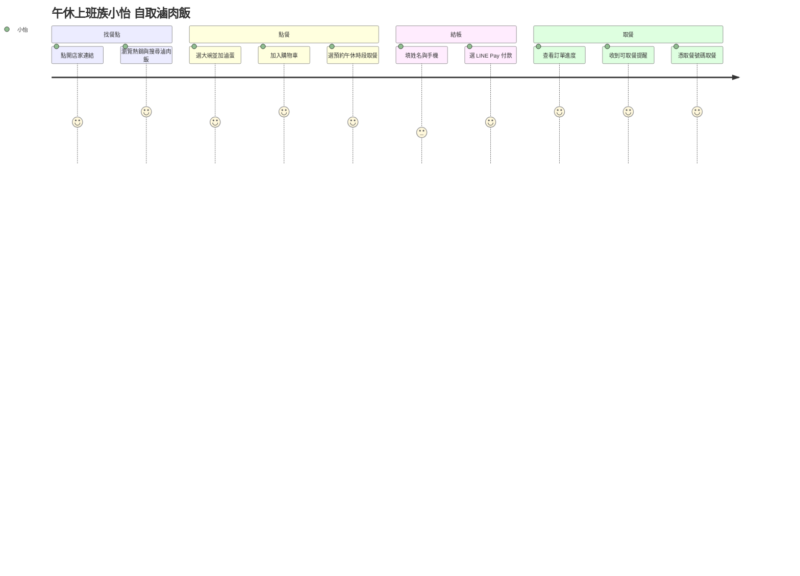

> 分數 1～5，3 以下為需改善的摩擦點：「填姓名與手機」是訪客結帳唯一的必填輸入，因此以會員預填、瀏覽器自動填入（`autocomplete`）降低成本。

### 2.3 視覺參考與取捨

使用者提供兩張參考圖。**本專案只借用版面與互動手法，不複製其品牌、文案、商品與插畫**（參考圖未隨文件附入）。

| 參考圖 | 內容概述 | 借用 | 不採用 / 調整 |
| --- | --- | --- | --- |
| **A**：POS 式桌機點餐介面（品牌「zillo」） | 白底帶淡粉色調、紅橘色主色；上方搜尋與分類膠囊標籤；3 欄商品卡（上圖、品名、兩行描述、價格 +「＋ Add」）；已加入時卡片出現 `− 2 ＋`；右側常駐訂單面板（品項縮圖、`2x 品名`、備註、`Edit`、價格；小計 / 稅 / 總計；底部主要與次要按鈕） | 膠囊分類標籤列；圓角卡片；卡片底列「價格 + 動作」；卡片內步進器；桌機右側常駐訂單面板與其資訊結構；單一高彩度主色搭配大量中性色 | 左側圖示導覽列、多張訂單頁籤、列印帳單、收款（皆為店員端 POS 功能）。亮橘紅（約 `#E8452C`）與白字對比僅 3.95:1，預設主色改為 `#D93A22`（4.59:1） |
| **B**：白底餐飲首頁（品牌「Eatly」） | 大標題 + 紅色圓角 CTA；圓形餐盤主視覺與「Delivery 30 min」浮動標籤；特色圖示列；4 欄圓形餐點圖（品名、短描述、價格、小圓點）；顧客見證、App 示意 | 大量留白與細灰階文字；紅色圓角主要按鈕；浮動資訊標籤（預估時間）；「圖片優先」且圓角的菜單呈現 | 行銷首頁區塊（見證、App 示意、特色列）不屬於點餐流程；圖片不作為必要條件（§6.7） |

**共通結論**：白底、細邊框、16px 圓角、膠囊按鈕與標籤、單一主色、價格與動作同列、右側常駐訂單摘要。

**設計參考原型**：為讓設計與前端在實作前確認視覺方向，本文件附有可直接開啟的靜態原型與截圖——[`assets/mockups/index.html`](./assets/mockups/index.html)（可用 URL 參數切換畫面、品牌色、資料完整度與版面，說明見 [`assets/mockups/README.md`](./assets/mockups/README.md)）。原型**不是**產品程式碼，下方各頁面規格內嵌的畫面皆取自該原型。

---

## 3. 資訊架構與導覽

### 3.1 網站地圖

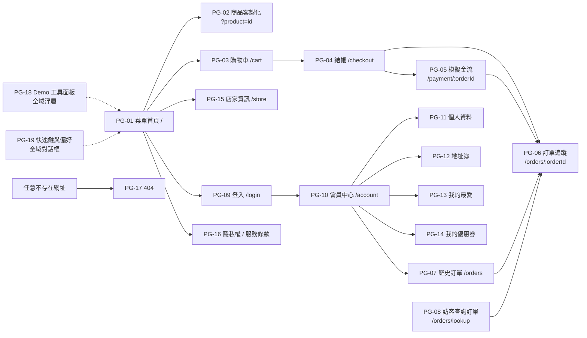

### 3.2 路由與存取

| 頁面 | 路由 | 存取 | Query 參數 |
| --- | --- | --- | --- |
| PG-01 菜單首頁 | `/` | 公開 | `table`（內用 QR 帶入的桌號；選填，沒有此參數也可手動選內用）、`product`（開啟商品面板）、`q`（搜尋字串） |
| PG-02 商品客製化 | `/?product=:id`、`/cart?edit=:lineId` | 公開 | — |
| PG-03 購物車 | `/cart` | 公開 | `edit`（編輯品項行） |
| PG-04 結帳 | `/checkout` | 公開（訪客可結帳） | — |
| PG-05 模擬金流 | `/payment/:orderId` | 持有訂單者 | `method` |
| PG-06 訂單追蹤 / 詳情 | `/orders/:orderId` | 訂單擁有者或持有追蹤權杖 | — |
| PG-07 歷史訂單 | `/orders` | 會員 | `tab`（active / completed / cancelled） |
| PG-08 訪客查詢訂單 | `/orders/lookup` | 公開 | — |
| PG-09 登入 | `/login` | 公開 | `redirect` |
| PG-10 會員中心 | `/account` | 會員 | — |
| PG-11 個人資料 | `/account/profile` | 會員 | — |
| PG-12 地址簿 | `/account/addresses` | 會員 | — |
| PG-13 我的最愛 | `/account/favorites` | 會員 | — |
| PG-14 我的優惠券 | `/account/coupons` | 會員 | `tab` |
| PG-15 店家資訊 | `/store` | 公開 | — |
| PG-16 靜態頁 | `/privacy`、`/terms` | 公開 | — |
| PG-17 404 / 錯誤 | `*` | 公開 | — |
| PG-18 Demo 工具面板 | （全域浮層） | `VITE_DEMO_MODE=true` | — |
| PG-19 快速鍵與偏好 | （全域對話框，無獨立路由） | 公開；觸控面板模式不提供 | — |

### 3.3 導覽模型

| 斷點 | 全域導覽 | 購物車入口 |
| --- | --- | --- |
| < 768（手機） | 頂部 AppBar（品牌圓標 + 店名、搜尋、購物車）＋ **底部 Tab Bar**：菜單 / 訂單 / 我的 | 底部浮動 CartBar；AppBar 購物車圖示 |
| 768–1023（平板） | 頂部導覽列（由左而右）：品牌 + 店名、搜尋、購物車圖示（顯示品項數）、查詢訂單、登入（ghost）、鍵盤快速鍵與偏好（⌨ 圖示按鈕，位於最右，觸控面板模式不顯示） | 頂部購物車圖示與置中 CartBar（底部浮動，寬 ≤ 520，無底部 Tab）皆開啟右側滑出抽屜（Drawer）；啟用單鍵快速鍵後 `c` 同樣開啟 |
| ≥ 1024（桌機） | 同上但沒有購物車圖示（購物車即右欄 `OrderPanel`），搜尋為常駐膠囊輸入框；⌨ 仍位於最右 | 右欄常駐 `OrderPanel`（sticky，寬 360） |

- 「登入」在所有斷點皆為 ghost 連結，不使用強調色，亦不自動彈出（BR-33）。
- 「鍵盤快速鍵與偏好」⌨ 圖示按鈕（≥ 768、非觸控面板）位於頂部導覽列最右側，位置固定，不隨單鍵快速鍵開關出現或消失，因此不位移版面；< 768 由頁尾的「鍵盤快速鍵」「偏好設定」與跳過連結進入（FR-SY-18）。
- 底部 Tab「訂單」：會員進入 PG-07；訪客進入 PG-08（查詢），並顯示本機記錄的近期訂單。
- 結帳、付款、訂單詳情等「任務型頁面」隱藏底部 Tab，改用 AppBar 返回鈕，避免誤觸；但仍保留 AppBar 最右側的 ⌨（≥ 768、非觸控面板）、頁尾「鍵盤快速鍵」「偏好設定」與跳過連結「鍵盤快速鍵與偏好」；任務型頁面省略「跳到我的訂單」（沒有常駐訂單面板），保留「跳到主要內容」與「鍵盤快速鍵與偏好」，相對順序與一般頁面一致（WCAG 3.2.6）。鍵盤偵測提醒本身不在結帳與付款頁顯示（BR-42）。

---

## 4. 設計代幣（Design Tokens）

> 代幣以 CSS Custom Properties 定義（語意命名），Tailwind 設定檔直接引用。**品牌色於執行期由店家設定推導並注入**（§4.8），日後切換深色模式（FR-SY-09）只需覆寫中性色變數。

### 4.1 色彩

**白底為主**：頁面與卡片皆為白色，以細邊框與極淺的陰影分層；色彩只出現在「品牌主色」與「語意色」。**所有對比度皆為實測值**（WCAG 2.1 相對亮度公式，與 `domain/theme.ts` 的 `contrastRatio` 一致）。

#### 中性色與語意色（固定，不隨品牌變動）

| Token | 色值 | 用途 | 對比度 |
| --- | --- | --- | --- |
| `--color-bg` | `#FFFFFF` | 頁面、卡片、面板 | — |
| `--color-bg-subtle` | `#FAFAFA` | 次要區塊、側欄底 | — |
| `--color-bg-muted` | `#F4F4F5` | 佔位圖塊、停用底、骨架畫面 | — |
| `--color-text` | `#18181B` | 主要文字 | 白底 17.72；`#FAFAFA` 16.97；`#F4F4F5` 16.12 |
| `--color-text-sub` | `#52525B` | 次要文字、描述 | 白底 7.73；`#F4F4F5` 7.03 |
| `--color-text-muted` | `#6B6B75` | 說明、placeholder、價格註記 | 白底 5.27；`#FAFAFA` 5.05；`#F4F4F5` 4.79 |
| `--color-text-disabled` | `#A1A1AA` | 停用文字（WCAG 對停用元件豁免，仍須搭配其他提示） | 白底 2.56 |
| `--color-border` | `#E4E4E7` | 卡片外框、分隔線（僅裝飾） | 白底 1.27 |
| `--color-border-strong` | `#D4D4D8` | 較明顯的分隔、未選取標籤外框（僅裝飾） | 白底 1.48 |
| `--color-border-input` | `#8A8A93` | 表單欄位邊框（WCAG 1.4.11 需 ≥ 3:1） | 白底 3.42；`#FAFAFA` 3.28；`#F4F4F5` 3.11 |
| `--color-success` / `-soft` | `#15803D` / `#F0FDF4` | 成功、素食標籤、可取餐 | 白底 5.02；於淺底 4.79 |
| `--color-warning` / `-soft` | `#B45309` / `#FFFBEB` | 警示、休息中、限量 | 白底 5.02；於淺底 4.84 |
| `--color-danger` / `-soft` | `#B91C1C` / `#FEF2F2` | 錯誤、取消、暫停接單 | 白底 6.47；於淺底 5.91 |
| `--color-info` / `-soft` | `#1D4ED8` / `#EFF6FF` | 一般資訊、新品標籤 | 白底 6.70；於淺底 6.16 |

#### 品牌色（由店家設定；預設如下，推導規則見 §4.8）

| Token | 預設值 | 用途 | 對比度 |
| --- | --- | --- | --- |
| `--color-brand` | `#D93A22` | 主要按鈕底色、選取狀態邊框、重點填色 | 白字 4.59 |
| `--color-on-brand` | `#FFFFFF` | 主色上的文字 | — |
| `--color-brand-hover` | `#BF331E` | Hover / Pressed | 白字 5.66 |
| `--color-brand-soft` | `#FCEFED` | 選取中標籤 / 選項的淺底 | `brand-text` 於其上 4.88 |
| `--color-brand-soft-strong` | `#F8DCD7` | 淺底的邊框、強調底（**不放文字**，其上文字對比可能 < 4.5） | — |
| `--color-brand-text` | `#C3341F` | 白底與淺底上的文字、圖示、連結 | 白底 5.48；淺底 4.88 |

**使用規則**

- 一般文字 ≥ 4.5:1；大字（≥ 24px，或 ≥ 18.66px 粗體）≥ 3:1；表單與按鈕邊界 ≥ 3:1。
- 狀態一律「圖示 + 文字 + 顏色」三者並用，不單靠顏色。
- 同一畫面主要按鈕（primary）最多 1 個；其他動作使用外框（secondary）或 ghost。
- 危險 / 錯誤一律使用 `--color-danger`，**不使用品牌色**，避免品牌為紅色時與主要 CTA 混淆。
- `--color-text-muted` 僅用於白底、`#FAFAFA` 與 `#F4F4F5` 底，不用於更深的底色。

### 4.2 字型與字級

字體堆疊：`"Noto Sans TC", "PingFang TC", "Microsoft JhengHei", system-ui, sans-serif`。使用 Google Fonts 時啟用 `display=swap`，其 CJK 字體會自動依 `unicode-range` 分片，避免一次載入完整字檔。

| Token | 字級 / 行高 | 字重 | 用途 |
| --- | --- | --- | --- |
| `display` | 32 / 40（手機 28 / 36） | 700 | 取餐號碼 |
| `h1` | 24 / 32 | 700 | 頁面標題 |
| `h2` | 20 / 28 | 700 | 區塊標題 |
| `h3` | 18 / 26 | 600 | 卡片標題、商品名稱 |
| `body` | 16 / 24 | 400 | 內文；**輸入框最小 16px**，避免 iOS 聚焦自動縮放 |
| `small` | 14 / 20 | 400 | 次要說明 |
| `caption` | 12 / 16 | 400 | 標籤、註記（不放關鍵資訊） |
| `price` | 同所在層級 | 700 | 金額，啟用 `font-variant-numeric: tabular-nums` |

- 字級以 `rem` 為單位，尊重使用者瀏覽器字級設定；放大至 200% 版面不得破壞（WCAG 1.4.4）。
- 中文不加額外字距；英數字與中文之間不手動補空白（由字體處理）。

### 4.3 間距與格線

- 基準 4px：`4 / 8 / 12 / 16 / 20 / 24 / 32 / 40 / 48 / 64`（`--space-1` ～ `--space-10`）。
- 頁面左右邊距：手機 16、平板 24、桌機 32。
- 觸控目標最小 **44 × 44 px**，相鄰可點擊元素間距 ≥ 8px。

### 4.4 圓角、陰影、層級

| 類別 | Token | 值 |
| --- | --- | --- |
| 圓角 | `--radius-sm / md / lg / xl / pill` | 8 / 12 / 16 / 20 / 999 px |
| 陰影 | `--shadow-sm` | `0 1px 2px rgba(24,24,27,.06)` |
| | `--shadow-md` | `0 4px 16px rgba(24,24,27,.08)` |
| | `--shadow-lg` | `0 12px 32px rgba(24,24,27,.12)` |
| 層級 `z-index` | `base / sticky / header / bottomBar / drawer / modal / toast / demo` | 0 / 10 / 20 / 30 / 40 / 50 / 60 / 70 |

- 卡片：白底 + 1px `--color-border` + `--shadow-sm`，圓角 `lg`（16）；輸入框 `md`（12）；標籤、按鈕、步進器 `pill`；Bottom Sheet 頂部圓角 `xl`（20）。
- 懸浮元件（Sheet、Drawer、Toast、Dialog）使用 `--shadow-md` / `--shadow-lg`。
- `KeyboardNotice`（CMP-41）與 `Toast` 同屬 `toast` 層：< 768 兩者共用同一浮動槽位（CartBar 與底部 Tab 之上，不上下堆疊）；≥ 768 的提醒為錨定於頂部 ⌨ 圖示按鈕下方的 `position: fixed` 浮動卡，不佔流（§10.3）。

### 4.5 動效

| 類型 | 時間 | 緩動 | 範例 |
| --- | --- | --- | --- |
| 微互動 | 120ms | `cubic-bezier(.2, 0, 0, 1)` | 按鈕按下、勾選 |
| 標準 | 200ms | 同上 | Toast 進出、Tab 指示線 |
| 面板 | 320ms | 同上 | Bottom Sheet、Drawer |

- 尊重 `prefers-reduced-motion: reduce`：改為僅淡入淡出，取消位移、彈跳與脈動。
- 禁止無限循環動畫，唯一例外是「目前進行中」的訂單步驟指示（可被 reduced-motion 關閉）。

### 4.6 圖示與圖像

- 圖示：[Lucide](https://lucide.dev/)（線條 1.5～2px，預設 20px / 24px），按鈕內圖示須附 `aria-label` 或可見文字。
- 商品圖：4:3 裁切；清單縮圖 88 × 88、詳情 16:9；必須設定 `width` / `height` 避免版面位移（CLS）；`loading="lazy"`。
- Demo 佔位圖：以 `surface-sunken` 底色 + 大型 emoji（🍚🍜🍗🥟🧋）產生，不依賴外部圖庫。
- 圖片失敗時退回佔位圖，不顯示破圖圖示。

### 4.7 CSS 變數範例

```css
:root {
  /* 中性色（固定） */
  --color-bg: #FFFFFF;
  --color-bg-subtle: #FAFAFA;
  --color-bg-muted: #F4F4F5;
  --color-text: #18181B;
  --color-text-sub: #52525B;
  --color-text-muted: #6B6B75;
  --color-border: #E4E4E7;
  --color-border-input: #8A8A93;

  /* 語意色（固定） */
  --color-success: #15803D;
  --color-warning: #B45309;
  --color-danger: #B91C1C;
  --color-info: #1D4ED8;

  /* 品牌色（預設值；執行期由 ThemeProvider 依店家設定覆寫） */
  --color-brand: #D93A22;
  --color-on-brand: #FFFFFF;
  --color-brand-hover: #BF331E;
  --color-brand-soft: #FCEFED;
  --color-brand-soft-strong: #F8DCD7;
  --color-brand-text: #C3341F;

  --radius-lg: 16px;
  --space-4: 16px;
  --font-sans: "Noto Sans TC", "PingFang TC", "Microsoft JhengHei", system-ui, sans-serif;
}
```

### 4.8 品牌主題化（可套用不同餐飲業）

店家只需提供**一個品牌主色**（`stores.brand_color`，見 [05](./05-database-schema.md)；API `StoreInfo.display.brandColor`）。前端以 `deriveBrandTokens`（[07 §7.4](./07-frontend-architecture.md)）推導整組代幣並寫入 CSS 變數，**免重新建置**即可換色；其餘（中性色、語意色、圓角、陰影、字型）固定不變，確保各店風格一致且可及。

| 推導項目 | 規則 |
| --- | --- |
| `brand` | 店家色碼（無效或空值 → 預設 `#D93A22`） |
| `on-brand` | 依序嘗試白、`#18181B`、純黑，取第一個對比 ≥ 4.5 者 |
| `brand-hover` | 加深 12%；若深色文字因此 < 4.5，改為提亮 12% |
| `brand-soft` / `-strong` | 與白色混合（92% / 82% 白） |
| `brand-text` | 自品牌色起逐步加深，直到在 `brand-soft` 上 ≥ 4.5（同時保證白底上 ≥ 4.5） |

**預設品牌色組（實測；`?brand=` 切換於設計參考原型與 Demo 面板）**

| key | 名稱 | 適用情境 | `brand` | `on-brand` | 主色對比 | `brand-text` 於淺底 |
| --- | --- | --- | --- | --- | --- | --- |
| `red`（預設） | 辣椒紅 | 小吃、熱炒、麵食 | `#D93A22` | 白 | 4.59 | 4.88 |
| `green` | 抹茶綠 | 飲料、輕食、沙拉 | `#2E7D4F` | 白 | 5.05 | 4.56 |
| `coffee` | 咖啡棕 | 咖啡廳、烘焙 | `#7A4B2A` | 白 | 7.32 | 6.51 |
| `orange` | 活力橘 | 早餐店、速食 | `#BA520A` | 白 | 4.88 | 4.75 |
| `blue` | 海洋藍 | 海鮮、冷飲 | `#1F5FBF` | 白 | 6.09 | 5.42 |
| `black` | 極簡黑 | 精緻餐飲、中性風格 | `#18181B` | 白 | 17.72 | 15.13 |
| `yellow` | 檸檬黃（壓力測試） | 驗證深色文字 | `#FACC15` | `#18181B` | 11.57 | 4.60 |

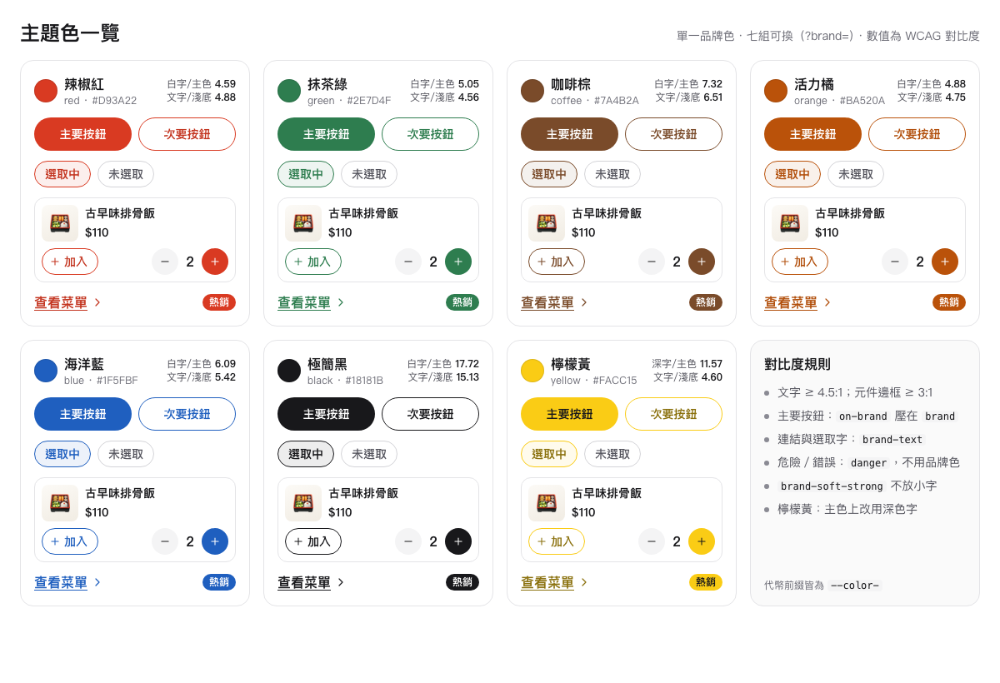

*七組預設品牌色（`themes.png`）。同一套元件僅更換品牌色；錯誤與警示色維持不變。*

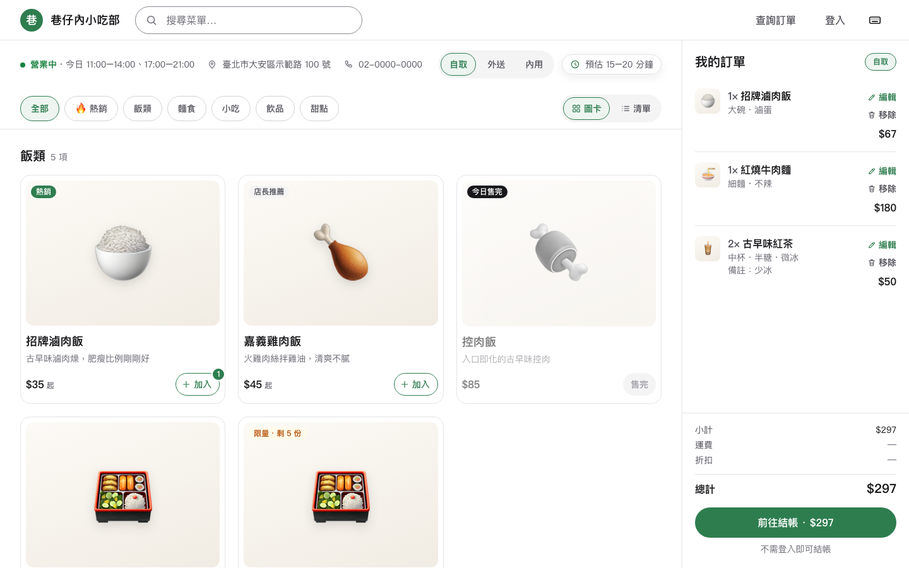

*抹茶綠主題的桌機菜單頁：按鈕、選取標籤、步進器、連結與 Logo 圓標皆隨品牌色改變。*

**重點說明**

- 參考圖 A 的亮橘紅（約 `#E8452C`）與白字僅 3.95:1，因此預設色加深為 `#D93A22`；店家若設定了對比不足的顏色，系統自動改用深色文字，**不阻擋顯示**（EC-22）。
- 對全部 RGB 色彩的格點掃描（約 4.9 萬色），主色上文字、hover 與 `brand-text` 的對比皆 ≥ 4.5（07 §7.4 的單元測試）。其中中等明度的色（如 `#947D39`，白字與 `#18181B` 皆不足）會退到純黑文字。
- 淺色品牌色（如檸檬黃）的主色填色對白底僅約 1.5:1：按鈕靠其高對比文字（深色字 11.57:1）辨識，選取標籤另以淺底與 `brand-text` 文字表示；若店家要求更嚴格的邊界對比，可為淺色主色按鈕加 1px `brand-text` 外框。
- 業態差異來自品牌色、Logo、店名與菜單內容；元件、文案與版面不寫死特定品項。

---

## 5. 響應式設計（RWD）

### 5.1 斷點

手機優先（`min-width` 由小到大疊加）。

| 名稱 | 範圍 | 代表裝置 | 欄數 | 左右邊距 |
| --- | --- | --- | --- | --- |
| `xs` | 320–479 | 小尺寸手機 | 4 | 16 |
| `sm` | 480–767 | 一般手機、手機橫向 | 4 | 16 |
| `md` | 768–1023 | 平板直向 | 8 | 24 |
| `lg` | 1024–1439 | 平板橫向、筆電 | 12 | 32 |
| `xl` | ≥ 1440 | 桌機 | 12，內容最大寬 1440（含右側訂單面板） | 置中 |

Tailwind 設定：`screens: { sm: '480px', md: '768px', lg: '1024px', xl: '1440px' }`。

### 5.2 版型對照

| 頁面 | `< 768` 手機 | `768–1023` 平板 | `≥ 1024` 桌機 |
| --- | --- | --- | --- |
| PG-01 菜單 | AppBar + 緊湊店家卡；分類膠囊列 sticky；`GRID` 2 欄圖卡 / `LIST` 單欄；底部 CartBar + Tab Bar | 頂部導覽；分類膠囊列；`GRID` 3 欄 / `LIST` 2 欄；購物車為右側 Drawer（頂部購物車圖示與置中 CartBar 開啟） | 頂部導覽（常駐搜尋）；店家資訊列；分類膠囊列 sticky；`GRID` 3 欄 / `LIST` 2 欄；右側常駐 `OrderPanel`（360，sticky） |
| PG-02 客製化 | Bottom Sheet（高度 ≤ 90dvh，隨內容） | 置中 Modal（寬 560） | 置中 Modal（寬 640），有圖時圖片與選項左右並排；無圖時單欄 |
| PG-03 購物車 | 獨立頁面 | 獨立頁面或 Drawer | 常駐 `OrderPanel`（不需獨立頁，路由導向首頁並展開） |
| PG-04 結帳 | 單欄堆疊；頁首預留高度（`min-height`）的狀態列（異動清單於其下展開）；底部 sticky 送出列 | 單欄置中（寬 640） | 雙欄：左側狀態列、異動清單與表單 ＋ 右側摘要（sticky，寬 380） |
| PG-06 訂單 | 單欄；狀態卡置頂 | 單欄置中（寬 640） | 雙欄：左側時間軸 ＋ 右側明細 |
| PG-07 歷史訂單 | 單欄卡片 | 2 欄卡片 | 2 欄卡片，置中寬 960 |
| PG-10～14 會員 | 清單式導覽，逐頁進入 | 同左 | 左側選單 ＋ 右側內容 |

> 分類導覽在所有斷點皆為**膠囊標籤列**（不再使用左側分類欄）：版型變體更少，也避免分類數量多時側欄過長。

### 5.3 容器與格線規則

- 內容容器：`max-width: 1440px`（含右側 `OrderPanel`），左右 padding 依 §5.1；商品區為彈性寬。
- 商品網格欄數：`GRID`——手機 2、平板 3、桌機 3、寬度 ≥ 1680 時 4；`LIST`——手機 1、平板 2、桌機 2。`GRID` 卡片最小寬 140px，不足時自動退為單欄 `LIST`。
- 表單：單欄為主，欄位寬度 100%；桌機雙欄表單僅用於「姓名 / 手機」等短欄位。
- 文字行寬：長文（條款、公告）最大 `65ch`。

### 5.4 行動裝置注意事項

| 主題 | 規範 |
| --- | --- |
| Viewport | `<meta name="viewport" content="width=device-width, initial-scale=1, viewport-fit=cover">`；**不得禁止縮放** |
| 視窗高度 | 使用 `dvh` / `svh`，避免 `100vh` 被網址列遮擋 |
| 安全區域 | 底部 sticky 元件加 `padding-bottom: env(safe-area-inset-bottom)` |
| 輸入欄位 | 字級 ≥ 16px；手機 `type="tel"` + `inputmode="numeric"` + `autocomplete="tel"`；OTP `autocomplete="one-time-code"`；姓名 `autocomplete="name"`；地址 `autocomplete="street-address"` |
| 虛擬鍵盤 | 輸入框聚焦時以 `scrollIntoView({ block: 'center' })` 置中；鍵盤開啟（`visualViewport` 高度縮小）時隱藏底部 Tab Bar，sticky 送出列改為文件流內，避免遮擋輸入框（EC-16） |
| 捲動鎖定 | Bottom Sheet / Drawer 開啟時鎖定 body 捲動，面板內使用 `overscroll-behavior: contain` |
| 返回鍵 | Sheet、Drawer、Modal 皆寫入歷史紀錄，實體返回鍵優先關閉浮層（FR-PD-01） |
| 手勢 | 不覆寫系統邊緣返回手勢；Sheet 可下滑關閉，但必須同時提供「✕」按鈕 |
| 內建瀏覽器 | LINE / Facebook / Instagram 內建瀏覽器：外部導轉（付款、地圖）使用同分頁；不依賴 `window.open` 彈窗；`tel:`、`maps` 連結需實測 |
| 橫向 | 手機橫向時 Sheet 最大高度 90dvh 並可捲動；sticky 列縮減高度；視窗高度 < 480 px（含 400% 縮放）時，結帳的 sticky 送出列改為文件流內，鎖定說明不再預留兩行（與鍵盤提醒待命的視窗高度門檻相同，§10.3） |
| Hover | 不得有僅靠 hover 才能使用的功能；hover 樣式以 `@media (hover: hover)` 包住 |

### 5.5 裝置與瀏覽器測試矩陣

| 類別 | 項目 |
| --- | --- |
| 寬度 | 360、390、768、1024、1440（KPI-04）；補測 320、1920 |
| 手機 | iOS Safari、Android Chrome、LINE 內建瀏覽器、Facebook / Instagram 內建瀏覽器 |
| 平板 | iPad Safari（直 / 橫） |
| 桌機 | Chrome、Edge、Safari、Firefox（最新兩版） |
| 輔助 | 瀏覽器字級 200%、VoiceOver / TalkBack 冒煙、僅鍵盤操作 |

### 5.6 輸入裝置與觸控面板

介面同時支援觸控、滑鼠、鍵盤與螢幕閱讀器，**不以單一偵測決定能力**（BR-36）。「觸控面板」泛指以觸控為主要輸入的大尺寸裝置：店內點餐機、櫃檯平板、觸控螢幕一體機（多半以瀏覽器全螢幕執行）。

| 項目 | 一般模式 | 觸控面板模式（Kiosk） |
| --- | --- | --- |
| 啟用方式 | 預設 | `VITE_KIOSK_MODE=true`（專用機台）；Demo 模式另可用 `?mode=kiosk` 或 Demo 面板「輸入模式」（以分頁旗標保持，站內導覽不遺失）；正式環境不接受消費者自行切換 |
| 互動目標最小尺寸 | 44×44 px，間距 ≥ 8 | 56×56 px，間距 ≥ 12；主要按鈕高 ≥ 64 |
| 基準字級 | 16px | 18px（其餘按比例 +12.5%） |
| 圖示 | 20–24 px | 28 px |
| 版型 | 依 §5.2 | 3 欄放大商品卡；右側訂單面板寬 400；分類膠囊列兩端加「‹ ›」翻頁鈕 |
| 鍵盤提示 / 快速鍵 | 預設隱藏、單鍵快速鍵關閉；偵測到實體鍵盤時提醒可開啟，開啟後才顯示徽章（§10.3）；`Ctrl/⌘ + Enter` 的說明小字常駐於結帳送出鈕旁（桌機） | 不顯示、單鍵快速鍵停用（保留 `Esc` 與 `Ctrl/⌘ + Enter`），不偵測、不提醒、不寫入旗標，無「鍵盤快速鍵與偏好」入口 |
| 登入、查詢訂單、我的最愛 | 顯示（ghost） | 隱藏 |
| 個資與記憶 | 可記住我的資料與點餐記憶 | **不保存**：無「記住」勾選與記憶；購物車、結帳草稿、訂單記錄等用戶端儲存僅存記憶體，進入與重置時清空 |
| 閒置 | 無 | 60 秒警示、90 秒清空並回到菜單（FLOW-21）；送出結果未知時警示多一行「上一筆訂單結果尚未確認，請洽櫃檯確認」 |
| 付款 | 依店家設定 | 僅「現金（櫃檯付款）」，不提供線上付款（避免付款中被閒置重置）；因此沒有「請於 HH:mm 前完成付款」的保留說明，庫存與時段於送出訂單時計入（BR-38） |
| 送出結果未知 | 「再試一次」與「致電店家確認」（FLOW-24、BR-41）；`Idempotency-Key` 與記下的送出內容存 `sessionStorage`（涵蓋重新整理） | 顯示「再試一次」與「請洽櫃檯確認」，不提供「致電」；`Idempotency-Key` 與記下的送出內容僅存記憶體；閒置警示照常出現並多一行「上一筆訂單結果尚未確認，請洽櫃檯確認」，**重置時一併丟棄 Key 與記下的送出內容**，下一位顧客一律使用新 Key（重複下單的風險交由櫃檯確認承擔，FLOW-21、FLOW-24） |
| 結帳異動清單 | 依 PG-04 | 動作鈕 ≥ 56×56、主要按鈕高 ≥ 64；處理異動視為使用者操作，會重新計閒置時間（FLOW-21）；全部無法購買時提供「回菜單看看」 |
| 取餐方式 | 自取 / 外送 / 內用 | 「內用」「外帶」兩項（`PICKUP` 在店內用語為「外帶」）；不提供外送，預設內用；**沒有桌號輸入**，內用單一律無桌號（不套用 `?table=`），餐點好了依取餐號碼叫號，不因缺桌號被擋下（BR-22、BR-36） |
| 輔助 | 於「偏好設定」切換大字、減少動態 | 標題列直接提供「大字」切換（文字 +12.5%，重置時還原）；無偏好設定入口 |
| 完成後 | 訂單追蹤頁 | 完成畫面（取餐號碼超大字、「開始新訂單」「再看一下」與倒數文字，見 PG-06），30 秒自動回首頁；任何操作重新計時 |

| 觸控面板・菜單 | 觸控面板・閒置警示 |
| :---: | :---: |
| 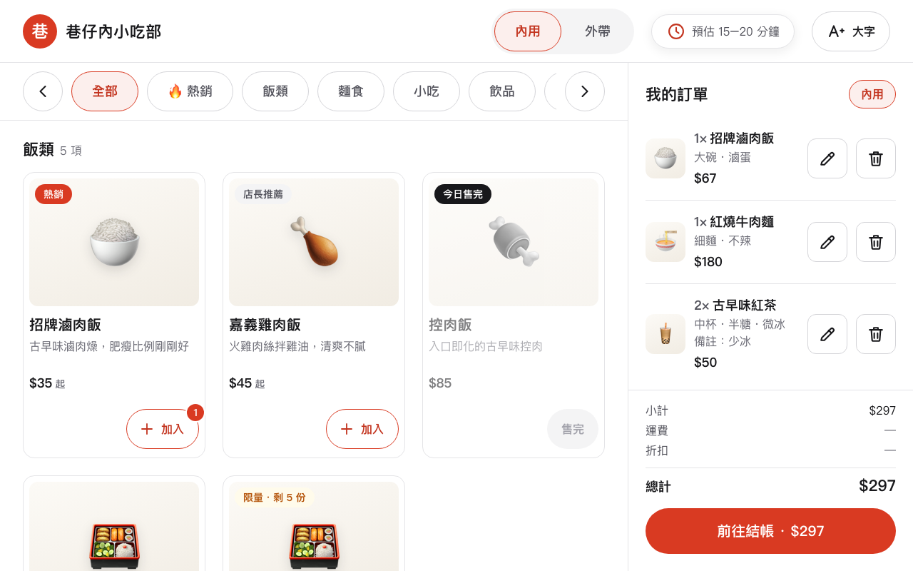 | 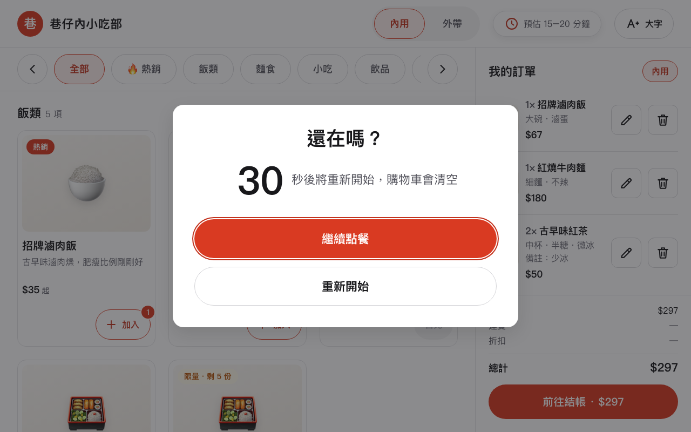 |

*觸控面板（1280×800）：目標 ≥ 56×56、右側訂單面板寬 400、分類列兩端有「‹ ›」翻頁鈕、標題列有「大字」；沒有鍵盤徽章與鍵盤偵測提醒、登入與查詢訂單。閒置 60 秒出現「還在嗎？」警示與 30 秒倒數，「繼續點餐」為最大的主要按鈕。*

**觸控互動規範**

- **無 hover 相依**：hover 只作強化；提示內容必須也能由焦點或點擊取得（WCAG 1.4.13）。
- **手勢皆有替代**：Sheet 下滑關閉 ↔「✕」按鈕；分類膠囊橫向捲動 ↔（觸控面板）「‹ ›」按鈕；沒有必須長按或多指的操作（WCAG 2.5.1、2.5.7）。
- **回饋與誤觸**：按下 `:active` 100ms 內有視覺回應；`touch-action: manipulation`（避免雙擊縮放延遲）；按鈕 `user-select: none`、圖片 `-webkit-touch-callout: none`；送出類按鈕按下後立即進入送出中並忽略重複觸發（`aria-disabled` + `aria-busy`，焦點保留；並以 `Idempotency-Key` 兜底）；破壞性操作需二次確認。
- **螢幕鍵盤**：欄位使用正確的 `type`、`inputmode`、`enterkeyhint`；聚焦時捲入可視範圍並不被 sticky 列遮住（EC-16）。
- **混合裝置**：觸控與滑鼠並存時不隱藏任何一種；所有裝置預設不顯示快速鍵徽章，偵測到實體鍵盤時提醒可開啟、開啟後才顯示（EC-28、FR-SY-18）；提醒不影響版面（NFR-18）。
- **方向**：以橫向 1280×800 為基準；直向（800×1280）時 `OrderPanel` 改為底部抽屜。

---

## 6. 元件規格

### 6.1 元件清單

| ID | 元件 | 用途 | 變體 / 屬性 | 必備狀態 |
| --- | --- | --- | --- | --- |
| CMP-01 | `Button` | 動作觸發 | `primary` `secondary` `ghost` `danger`；尺寸 `lg 48` `md 44`；`fullWidth`、`loading` | default hover focus active disabled loading |
| CMP-02 | `IconButton` | 圖示按鈕 | 熱區 ≥ `--hit-size`（一般 44、觸控面板 56）；必附 `aria-label` | 同上 |
| CMP-03 | `TextField` | 文字輸入 | `label` `helper` `error` `counter`；`type` text / tel / email | default focus filled error disabled |
| CMP-04 | `Select` | 縣市、行政區、時段 | 原生 `<select>` 優先（行動裝置體驗佳） | default focus error disabled |
| CMP-05 | `RadioCard` | 付款方式、取餐方式、發票類型 | 圖示 + 標題 + 說明；選取時 `primary-soft` 底 + 主色邊框 + ✓ 圖示 | default selected disabled |
| CMP-06 | `Checkbox` / `Switch` | 複選、餐具、行銷同意 | 標籤可點擊 | default checked disabled |
| CMP-07 | `QuantityStepper` | 數量 | 範圍 1–20 且不超過可購買份數（`maxAddable`：剩餘份數扣除購物車內同商品其他行）；`＋` 於 20 或剩餘上限時停用，達剩餘上限提示「今日只剩 {n} 份，已達上限」（與「此品項已達上限 20 份」區分）。變體 `sheet`（商品面板）：`−` 於 1 停用；變體 `cart`（購物車）：數量為 1 時 `−` 變為「移除」並詢問確認 | default min max |
| CMP-08 | `Chip` | 篩選、地址標籤 | `selected`；可含計數 | default selected |
| CMP-09 | `Badge` | 商品標籤 | `HOT` 熱銷、`NEW` 新品、`CHEF_PICK` 店長推薦、`SPICY` 辣、`VEGETARIAN` 素食、`LIMITED` 限量 | — |
| CMP-10 | `StoreStatusBadge` | 營業狀態 | 見 §6.3 | OPEN CLOSED PAUSED |
| CMP-11 | `OrderTypeSwitch` | 取餐方式切換 | Segmented control；依店家設定隱藏不可用項 | default selected disabled |
| CMP-12 | `CategoryChips` | 分類導覽 | 膠囊標籤列；sticky、橫向捲動（右緣淡出遮罩）、scroll-spy；選取：品牌淺底 + 品牌邊框 + `brand-text` 文字；選取項自動捲入可視範圍 | default active |
| CMP-13 | `ProductCard` | 商品卡 | `GRID`（圖卡）、`LIST`（橫式）；圖片區 `PHOTO` / `PLACEHOLDER` / `THUMB` / `NONE`；內嵌步進器；含收藏鈕（見 §6.6） | default pressed soldOut limited noImage |
| CMP-14 | `ProductSheet` | 客製化面板 | 手機 Bottom Sheet / 桌機 Modal；圖片、描述、選項皆可缺漏（§6.7） | loading ready error |
| CMP-15 | `OptionGroup` | 選項群組 | `SINGLE` 單選清單、`MULTIPLE` 複選清單；標頭顯示「必選」或「選填・最多 N 項」 | default error limitReached |
| CMP-16 | `CartBar` | 浮動購物車列 | 顯示數量與小計；點擊開啟購物車（< 768 為底部全寬浮動列；768–1023 為置中浮動列，寬 ≤ 520，與頂部購物車圖示皆開啟 Drawer；≥ 1024 不顯示，改用 `OrderPanel`） | hidden visible |
| CMP-17 | `CartLineItem` | 購物車品項 | 名稱、選項摘要、備註、步進器、編輯 / 刪除；`invalid` 提供就地動作「移除」（選項失效另有「重新選擇」）、數量不足時「改為 {n} 份」；`limited` 於品名下方以 warning 顯示「今日剩 {n} 份」（剩餘 ≤ 10）；`reduced` 以 info 顯示「已調整為 {n} 份」並提供「復原」；狀態只標示並提供就地動作，不阻擋前往結帳（阻擋與清單由結帳頁負責）；`reduced` 的 `polite` 通報僅用於購物車頁，結帳頁內的狀態變化交由 `LiveAnnouncer` 合併句通報；於結帳摘要（⑨ / `OrderPanel`）內，狀態文字與動作鈕位於預留高度的狀態槽（無狀態時空白佔位），行高不因狀態改變 | default invalid（已下架 / 售完 / 選項失效 / 數量不足） limited reduced |
| CMP-18 | `PriceSummary` | 費用明細 | 小計、運費、折扣、總計；`compact` 變體 | default loading（重新計價中） |
| CMP-19 | `TimeSlotPicker` | 預約時段 | 日期 Chips + 時段網格（手機 3 欄）；額滿時段 `aria-disabled` 並說明；送出被退回時清除原選取並提供「改選最近時段」快選，不靜默改選（EC-07） | default selected full disabled |
| CMP-20 | `AddressCard` / `AddressForm` | 地址選擇與編輯 | 已存地址 RadioCard；表單含縣市 / 行政區 / 詳細地址 | default selected error |
| CMP-21 | `CouponInput` | 折扣碼 | 輸入 + 套用；顯示已套用標籤與移除 | default applying applied error |
| CMP-22 | `InvoiceSelector` | 發票設定 | 5 種 RadioCard + 條件式輸入 | default selected error |
| CMP-23 | `OrderTimeline` | 訂單進度 | 垂直步驟；完成 ✔、進行中 ●（脈動）、未達 ○、取消 ✕ | done current upcoming cancelled |
| CMP-24 | `OrderCard` | 歷史訂單卡 | 編號、時間、類型、狀態、摘要、金額、動作 | default |
| CMP-25 | `Toast` | 輕量通知 | `success` `info` `error`；不含動作者 3 秒、含動作者（「復原」）6 秒後消失，滑鼠移入或取得焦點時暫停計時（結帳異動清單單項「移除」的「復原」Toast 在 Tab 順序中緊接異動清單之後，PG-04）；「加入購物車」「移除品項」「清空購物車」這類帶「復原」的 Toast 標為 `dismissOnNavigate`：換頁（路由 pathname 改變；開關商品面板的 `?product=` 等查詢字串變化不算）即關閉，不把「復原」帶到看不到變化的頁面（例如結帳頁，按下去會讓訂單明細突然變空）；登入成功、再來一單導向購物車等不帶旗標的提示換頁後照常保留到計時結束；與 `KeyboardNotice`（CMP-41）共用浮動槽位與 `toast` 層，Toast 優先、提醒讓位 | enter exit |
| CMP-26 | `Dialog` / `Alert` | 確認對話框 / 頁內提示 | `Dialog` 具焦點陷阱；`Alert` 為 `info` `warning` `danger` | — |
| CMP-27 | `Skeleton` | 載入骨架 | 對應 `ProductCard`、`OrderCard`、`PriceSummary` | — |
| CMP-28 | `EmptyState` | 空狀態 | 插圖 + 標題 + 說明 + 主要動作 | — |
| CMP-29 | `OtpInput` | 驗證碼輸入 | 6 格；自動跳格、貼上分配、完成自動送出 | default error disabled |
| CMP-30 | `DemoPanel` | Demo 工具面板 | 見 PG-18 | collapsed expanded |
| CMP-31 | `OrderPanel` | 桌機右側常駐訂單面板 | 標題（我的訂單 + 取餐方式；QR 帶入桌號時顯示「內用・桌號 A3」，沒有桌號只顯示「內用」）、品項列（縮圖可無；恆有「編輯」「移除」，不隨快速鍵徽章開關顯示或隱藏；異動時依 CMP-17 狀態標示並提供就地動作，「前往結帳」維持可用，阻擋與清單由結帳頁負責）、費用摘要、主要 CTA、小字「不需登入即可結帳」 | empty hasItems |
| CMP-32 | `ImageOrPlaceholder` | 商品圖片或佔位 | `PHOTO`、`PLACEHOLDER`（淡底 + 分類圖示 / 品名首字）、`THUMB`、`NONE`；載入失敗（`onError`）即切換為佔位 | loading loaded error |
| CMP-33 | `LoginNudge` | 非阻擋的登入 / 保存提示 | `inline`（結帳頁小字）、`card`（訂單成立頁淡色卡，可關閉並記住） | default dismissed |
| CMP-34 | `KeyHint` | 快速鍵徽章 | 小寫單一字元 `<kbd>`（例：`c`）；`aria-hidden`，控制項加 `aria-keyshortcuts`；主色填滿按鈕內改為透明底 + `currentColor` 邊框、字色同按鈕文字（對比與按鈕相同）；**預設隱藏**，單鍵快速鍵啟用後才顯示（與 `aria-keyshortcuts` 一併輸出），停用即一併隱藏，不再以 hover / pointer 或偵測結果決定；觸控面板模式永不顯示；為行內元素（`display: inline-flex`、`pointer-events: none`，不以 `position: absolute` 疊加）；使用者主動開啟的瞬間允許局部重排（Q-16），但不得隱藏或移動功能控制項（購物車「編輯」「移除」不得與徽章開關耦合）；「送出訂單」旁的 `Ctrl/⌘ + Enter` 小字不跟隨此開關 | hidden visible |
| CMP-35 | `ShortcutsDialog` | 快速鍵與偏好對話框（PG-19） | 快速鍵表由 `HOTKEYS` 產生；含「啟用單鍵快速鍵」（預設關閉，開啟後鍵位才生效）「記住上次點過的選項」「大字模式」「減少動態」開關與「清除我的資料」；焦點陷阱、Esc 關閉 | closed open |
| CMP-36 | `RecentItems` | 「常點」區塊 | 橫向緊湊卡（最多 6 項）：品名、選項摘要（無選項者省略）、現價、`↻ 再點`；售完停用；僅菜單內仍存在的商品；觸控面板模式不顯示 | hidden visible |
| CMP-37 | `IdleGuard` | 閒置警示（觸控面板模式） | `role="alertdialog"`；倒數；「繼續點餐」（主要）、「重新開始」；送出結果未知時多一行「上一筆訂單結果尚未確認，請洽櫃檯確認」 | active warning |
| CMP-38 | `SkipLinks` | 跳過連結 | 「跳到主要內容」「跳到我的訂單」「鍵盤快速鍵與偏好」；取得焦點才顯示；「跳到我的訂單」只在有常駐訂單面板（`OrderPanel`，≥ 1024 的菜單頁）時出現，其餘頁面為兩個；「鍵盤快速鍵與偏好」永遠是最後一個，螢幕閱讀器使用者可由此啟用或停用單鍵快速鍵（鍵盤提醒不新增連結）；結帳、付款、訂單詳情等任務型頁面省略「跳到我的訂單」，保留「跳到主要內容」與「鍵盤快速鍵與偏好」，相對順序與一般頁面一致（WCAG 3.2.6） | hidden focused |
| CMP-39 | `LiveAnnouncer` | 即時通報區域 | 視覺隱藏的 `aria-live` polite / assertive 兩區 | — |
| CMP-40 | `AvailabilityIssueList` | 結帳異動清單（非 modal；PG-04） | `section[aria-labelledby]` → `h2`（`tabindex="-1"`）→ 說明 → 「全部套用建議」（標題下方）→ 異動項 `ul`；五類（依顯示順序）：無法購買、數量不足、時段 · 取餐方式、折扣 / 付款 / 發票 / 外送條件、價格更新；每項就地動作（目標 ≥ 44×44，名稱含品名）；平常以頁首預留高度（`min-height`，內容可撐高）的狀態列呈現（有異動「有 {n} 項需要調整〔查看〕」、僅價格更新「有 {k} 項價格更新〔查看〕」（k = 價格更新項數，不計入 n）、預檢失敗「暫時無法預先確認，送出時會再確認」），只在送出被退回（含按下送出後預檢發現異動）或使用者點「查看」（含點擊鎖定的送出鈕、鎖定時 `Ctrl/⌘ + Enter`）時展開；不使用 fixed / overlay；店家狀態類（休息中、暫停接單）不進清單，改由狀態列下方的店家狀態說明呈現 | collapsed expanded priceOnly precheckFailed resolving summary emptyCart |
| CMP-41 | `KeyboardNotice` | 鍵盤偵測提醒（FR-SY-18） | 非 modal 浮動卡（`position: fixed`、不佔流、不搶焦點）：標題「偵測到實體鍵盤」、「開啟」（主要）與「不用了」；變體 `hint`（含「剛才按的 {key} 是快速鍵」）、`confirmed`（「查看全部」「復原」）；與 Toast 共用 `toast` 層並讓位於 Toast、浮層與 Demo 面板；逾時：≥ 768 收成 ⌨ 按鈕上的小圓點（< 768 無 ⌨，直接收起），圓點只在點 ⌨、開啟 PG-19 或以任何途徑啟用單鍵快速鍵時清除；觸控面板模式不渲染 | hidden visible paused confirmed |

### 6.2 價格顯示規則

- 格式：`$1,250`；負數折扣顯示為 `−$40`（使用全形減號或 U+2212，避免與連字號混淆）。
- 商品卡：有「必選且價格不同」的選項群組時顯示 `$35 起`，否則 `$35`。
- 購物車與結帳：金額一律靠右對齊，使用等寬數字。
- 運費為 0 時顯示「免運」（成功色），未選外送時顯示「—」。

### 6.3 `StoreStatusBadge` 對照

| `status` | `closedReason` | 文案 | 色彩 | 圖示 |
| --- | --- | --- | --- | --- |
| `OPEN` | — | 營業中・今日 {時段} | success | ● |
| `CLOSED` | `OUT_OF_HOURS` | 休息中・{下次營業時間} 開始營業 | warning | ◐ |
| `CLOSED` | `HOLIDAY` | 今日公休・{下次營業日} 營業 | warning | ✕ |
| `CLOSED` | `LAST_ORDER_PASSED` | 已停止接單・可預約 {下次營業時間} | warning | ◐ |
| `PAUSED` | — | 暫停接單（有 `pausedUntil` 時加註「預計 {時間} 恢復」） | danger | ⏸ |

### 6.4 `OrderTimeline` 步驟與文案

四個主要步驟，依取餐方式調整第三步文案（對應 [FLOW-10](./02-flows.md#flow-10-訂單狀態機)）：

| 步驟 | 涵蓋狀態 | 自取 | 外送 | 內用 |
| --- | --- | --- | --- | --- |
| 1 | `PENDING_PAYMENT` `PENDING` | 訂單已送出，等待店家確認 | 同左 | 同左 |
| 2 | `ACCEPTED` | 製作中 | 製作中 | 製作中 |
| 3 | `READY` `DELIVERING` | 可取餐 | `READY`：餐點完成，等待外送；`DELIVERING`：外送中 | 餐點完成 |
| 4 | `COMPLETED` | 已取餐 | 已送達 | 已完成 |

`CANCELLED`：時間軸在中斷處以 ✕ 與 `danger` 色顯示「已取消」，並呈現取消者與原因。`PENDING_PAYMENT` 於步驟 1 之前額外顯示「等待付款」與倒數。

預約單的 `ACCEPTED` 於店家接單後即進入步驟 2，實際開始製作的時間為 `scheduled_at − lead`（BR-21）；步驟名稱沿用「製作中」，僅代表店家已接單，狀態卡同時固定顯示「預約 {HH:mm} 取餐」（PG-06）。

### 6.5 `OptionGroup` 規格

| 項目 | 規範 |
| --- | --- |
| 標頭 | 群組名稱 + 徽章：「必選・單選」（`--color-text` 填底、白字）／「選填・最多 N 項」（`--color-bg-muted` 底）；有最少數量時顯示「至少 M 項」。**必選不使用 `danger` 色**，避免與錯誤混淆 |
| 單選 | Radio 清單，整列可點；預設選項自動勾選；選項右側顯示 `+$12` 或空白 |
| 複選 | Checkbox 清單；達 `max_select` 時其餘未選項停用並顯示「已達上限」 |
| 加價 | `price_delta > 0` 顯示 `+$X`；`< 0` 顯示 `−$X`；`0` 不顯示 |
| 不可用 | `is_available=false` 的選項顯示灰階與「暫無供應」，不可選 |
| 錯誤 | 未滿足條件時於群組標頭下方顯示錯誤文字，並在送出時捲動至第一個錯誤群組 |

### 6.6 `ProductCard` 規格

| 項目 | `GRID`（圖卡） | `LIST`（橫式） |
| --- | --- | --- |
| 結構 | 圖片區（4:3，圓角 12，內縮 8）→ 品名列（愛心在品名**前**；品名 h3，最多 2 行）→ 描述（small，最多 2 行）→ 底列：價格（左）＋ 動作（右），左右緣與圖片區齊；底列貼卡片底端（同排卡片的價格與動作縱向位置相同）。窄卡改為價格一列、動作一列（見下「底列的窄卡堆疊」） | 上方兩欄：左 = 品名列（`♥ 品名 標籤`）、描述、分類 / 上次選擇；右 = 縮圖 88×88（可無；靠右，頂端與品名列頂端齊）。下方為**跨滿卡片內容寬度**的底列：價格（左，左緣與愛心圖示 / 品名 / 描述齊）＋ 動作（右，右緣 = 縮圖右緣），兩者垂直置中；底列貼卡片底端（多欄時同排卡片等高，價格與動作縱向位置相同） |
| 愛心（收藏，會員） | 在品名前，不浮在圖片上；圖示約 18、左緣與描述 / 價格左緣光學對齊，熱區 ≥ 44 | 同左 |
| 標籤位置 | 圖片區左上角（有圖 / 佔位圖塊） | 品名之後，可換行（或描述下方） |
| 高度 | 隨內容；圖片區固定 4:3 | ≥ 56（精簡資料為「♥ 品名」與「價格 … 動作」兩列） |
| 點擊 | 整張卡片開啟商品面板；右下「＋」為快速加入入口 | 同左 |
| 圖片區 | 有圖 → `PHOTO`；缺圖 → `PLACEHOLDER` | 有圖 → `THUMB`；缺圖 → `NONE` |

| `LIST`（會員，手機；混合資料） | `GRID`（會員，手機 2 欄；窄卡堆疊） |
| :---: | :---: |
| 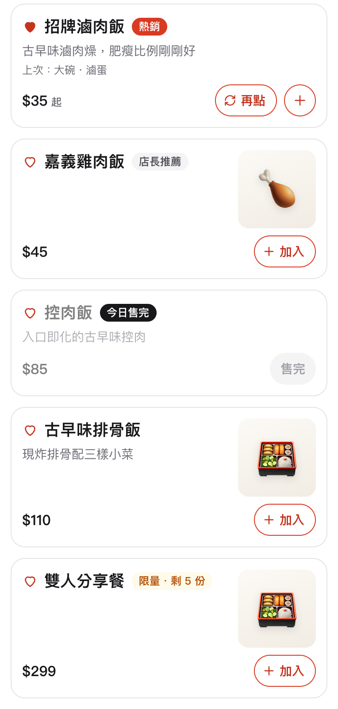 | 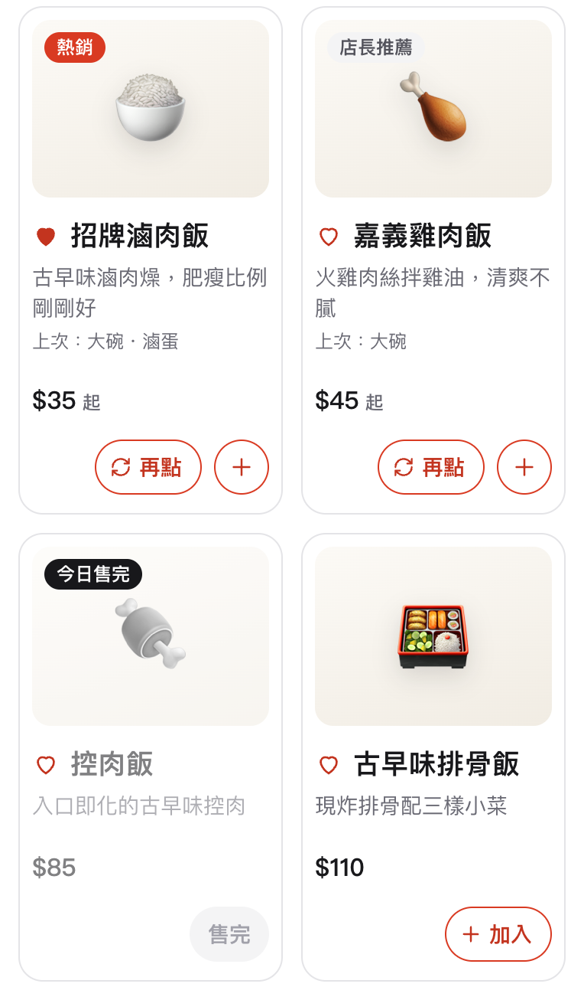 |

*同一份菜單的 `LIST` 與 `GRID` 商品卡（`login=member`、`memory=1`）：愛心一律在品名前（實心為已收藏）；`LIST` 的縮圖在右上、價格靠左、動作靠右並與縮圖右緣齊，缺圖的卡片沒有縮圖欄、底列規則相同；`GRID` 的標籤在圖片左上角，兩欄寬度不足，價格與動作各一列（動作靠右）；售完、限量、再點與「＋ 加入」共用同一套底列。*

**底列的窄卡堆疊**

- 底列（價格 ＋ 動作）的型態**只由卡片寬度決定**，不依價格字數或動作種類（步進器、「↻ 再點」、「NT$ N 起」字尾放不放得下，會讓同一畫面內相鄰卡片的價格上下錯開，不允許）。
- 以容器查詢（卡片為 `@container`）判斷卡片內容寬（扣除邊框與內距）：**≥ 13.5rem（約 216px）** 價格在左、動作在右，同一列；**< 13.5rem 一律堆疊**為「價格一列（靠左）→ 動作一列（靠右）」，左緣仍與圖片 / 愛心 / 描述齊、右緣與圖片區右緣齊。觸控面板按鈕較大，門檻為 15.5rem。門檻以 rem 計，隨 html 基準字級（大字模式、觸控面板）一併放大。
- 門檻略大於最寬的同列組合（步進器達上限的說明列「今日只剩 N 份，已達上限」約 12.7rem；觸控面板的「↻ 再點 ＋」約 14.7rem）。因此手機兩欄圖卡（320–430px）與三欄平板（768px）的所有卡片皆堆疊，≥ 1024px 皆同列。
- 步進器達上限時，說明列使該卡動作群組變高（價格與按鈕因而上移），屬暫時狀態，不列入同排對齊。

**動作區狀態**

| 狀態 | 呈現 | 條件 |
| --- | --- | --- |
| 可快速加入 | `＋ 加入`（膠囊、品牌外框、`brand-text` 字） | `hasRequiredOptions=false` 且不在購物車 |
| 需客製化 | `＋ 加入`（點擊開啟面板）；已加入時以徽章顯示份數（例：已加 2） | `hasRequiredOptions=true` |
| 已在購物車（無選項） | `− n ＋` 步進器；`−` 於 1 時移除並還原為「＋ 加入」 | 快速加入行存在（FR-MN-11） |
| 有點餐記憶 | `↻ 再點` + `＋`（圓形，開啟面板），描述下方 `上次：…`（見 §6.8） | 有選項群組、記憶了至少一個選項且未售完（FR-MN-12） |
| 售完 | 停用的灰階「售完」按鈕；整卡 opacity .55（「今日售完」標籤維持不透明）；仍可開啟面板（唯讀） | `isSoldOut`（手動售完），或可購買份數為 0（含被他人未付款訂單暫時占用者，仍顯示「今日售完」，Q-15） |
| 限量 | 標籤「剩 5 份」（warning）；步進器上限依剩餘封頂，達上限時「＋」停用並提示「今日只剩 5 份，已達上限」；購物車與結帳行內顯示「今日剩 5 份」 | `remainingToday ≤ 10` |

**標籤配色**

| 標籤 | 底色 | 文字 |
| --- | --- | --- |
| 熱銷 `HOT` | `--color-brand` | `--color-on-brand` |
| 店長推薦 `CHEF_PICK` | `--color-bg-muted` | `--color-text-sub` |
| 新品 `NEW` | `--color-info-soft` | `--color-info` |
| 素食 `VEGETARIAN` | `--color-success-soft` | `--color-success` |
| 辣 `SPICY`、限量・剩 n 份 `LIMITED` | `--color-warning-soft` | `--color-warning` |
| 今日售完 | `--color-text` | `#FFFFFF` |

### 6.7 資料缺漏與降級規則

**原則**：只有「品名」與「基本價」是必要資料。其餘欄位缺漏時，對應區塊**整塊隱藏**，不留空標題、空白行或破圖；版面節奏（對齊、間距）必須維持。判定流程見 [FLOW-17](./02-flows.md#flow-17-商品卡呈現與版面降級)。

| 欄位 | 必要 | 缺漏時的呈現 |
| --- | --- | --- |
| `name`、`basePrice` | ✔ | — |
| `imageUrl`（或載入失敗） | 否 | `GRID`：**佔位圖塊**（`--color-bg-muted` 底，置中顯示分類圖示；無圖示則品名首字；皆 `--color-text-muted`），維持 4:3 與卡片節奏。`LIST`：**不顯示縮圖**，文字撐滿整列，底列仍是價格靠左、動作靠右（無空白欄）。商品面板：不顯示圖片區。購物車 / 訂單：不保留縮圖欄 |
| `description` | 否 | 隱藏描述行；卡片高度自然縮短 |
| `tags`、剩餘份數 | 否 | 不顯示標籤與徽章 |
| `allergens` | 否 | 面板不顯示「過敏原」區塊 |
| `optionGroups` 為空 | 否 | 面板只有數量與備註，不顯示「選項」標題；卡片「＋」快速加入 |
| 分類 `icon` | 否 | 佔位圖塊改顯示品名首字；分類標籤列不顯示圖示 |
| 店家 `logoUrl` | 否 | 以品牌色圓底 + 店名首字作為標誌（AppBar、店家資訊皆同） |
| 全店皆無圖片 | — | `AUTO` → `LIST`：純文字清單（每張卡兩列：「♥ 品名」、其下「價格（左）…… 動作（右）」），不出現任何佔位圖塊（EC-19） |
| 品名 / 描述過長 | — | 卡片品名最多 2 行、描述最多 2 行，以省略號截斷；面板顯示完整（EC-21） |

**對齊規則**

- 混合資料（部分有圖）：`LIST` 縮圖固定靠右，因此文字左緣始終對齊；`GRID` 以佔位圖塊維持相同尺寸，列高一致。
- 底列（價格 ＋ 動作）：窄卡一律堆疊、同排卡片價格與按鈕縱向位置相同（§6.6「底列的窄卡堆疊」）；缺圖、缺描述、缺標籤的卡片不改變這條規則。
- `GRID` 中一整列都缺圖時不特別處理（仍為佔位圖塊）；若店家長期無圖，建議將 `menu_layout` 設為 `LIST` 或 `AUTO`。

**精簡資料示意**（只有品名與價格；手機 `LIST`）

```text
┌─ 飯類 ─────────────────────────────────────
│  ♥ 招牌滷肉飯
│  $35                                [＋ 加入]
├────────────────────────────────────────────
│  ♥ 古早味排骨飯
│  $110                               [＋ 加入]
├────────────────────────────────────────────
│  ♥ 愛玉檸檬
│  $45                                [＋ 加入]
```

（`♥` 為會員的收藏鈕，在品名前；訪客與觸控面板沒有。價格左緣與品名 / 愛心圖示左緣齊，動作右緣與卡片內容區右緣齊。）

### 6.8 點餐記憶與快速再點

回訪者最在意的是「跟上次一樣」。記憶以**商品**為單位，只記最近一次點過的選項與備註（BR-35、[FLOW-20](./02-flows.md#flow-20-點餐記憶與快速再點)）。

| 位置 | 呈現 | 條件 |
| --- | --- | --- |
| 商品卡（有選項群組且記憶了選項） | 描述下方一行 `上次：大碗・滷蛋`（caption、`--color-text-muted`）；動作區為 `↻ 再點`（膠囊外框，一鍵加入）+ `＋`（圓形外框，開啟面板調整）。窄卡（§6.6「底列的窄卡堆疊」，例如手機圖卡 2 欄）時價格獨占一列，`↻ 再點` + `＋` 整組靠右排成下一列；極窄時 `＋` 換到下一行（仍靠右），不壓縮點擊目標 | 該商品有選項群組、記憶了至少一個選項且未售完 |
| 商品卡（沒有選項群組的商品） | 不顯示「上次」；仍為「＋ 加入」快速加入或步進器（可出現在「常點」區塊） | `optionGroups` 為空 |
| 「常點」區塊 | 標題「常點的餐點」+ 說明「依你上次點餐的選項」；桌機為橫向 3–4 張緊湊卡，手機為橫向捲動；最多 6 項；含無選項商品（只顯示品名與現價）；僅列出菜單內仍存在的商品。現價為選項加價後的金額：預取最多 6 筆商品詳情並快取，載入中或失敗時顯示菜單的起始價（「$35 起」） | 有記憶（≥ 1 項）；觸控面板模式不顯示 |
| 商品面板 | 品名下方淡色提示列：`已套用上次的選擇：大碗・滷蛋　[恢復預設]`；備註欄預填上次備註（可編輯）；數量固定 1 | 開啟時有記憶 |
| 部分失效 | 提示列改為 `部分選項已不提供，已改用預設`（`--color-warning-soft` 底）；失效選項不被選取；必選群組改用預設 | 記憶的選項已停售 / 群組變更 |
| 加入結果 | Toast「已再點：招牌滷肉飯（大碗・滷蛋）$67，目前 4 項，共 $364」含「復原」（停留 6 秒，hover / 焦點時暫停）；`aria-live` 同步通報 | 一鍵再點成功 |

**規則**

- 「↻ 再點」會先以商品**目前**的選項驗證記憶（必要時取商品詳情）：全數有效才直接加入；否則開啟面板並提示，絕不在使用者不知情下加入已變動的選項。
- 限量商品另以可購買份數判斷：記憶的選項雖有效，但加上購物車內同商品份數後超過剩餘時不直接加入，改開啟面板（步進器依剩餘封頂，達上限提示「今日只剩 {n} 份，已達上限」）；已售完者「↻ 再點」維持停用。
- 記憶只在**訂單成立**時寫入，加入購物車但未下單不會改變記憶；使用者可在「偏好設定」（PG-19）關閉「記住上次點過的選項」，或以「清除我的資料」一併清除（FR-CK-14）。
- 「＋」不因記憶而改變（BR-30）：可直接加入者加入預設（無選項），否則開啟面板（預填上次選項）；要一鍵帶入上次的選項請用「↻ 再點」。
- 價格不隨記憶保存，一律以加入當下的現價計算。「復原」將本次加入的數量扣回（歸零則移除該行）；已達上限（同品項 20 份 / 30 行）或取得商品詳情失敗時不加入，並以 Toast 與 live region 說明（「此品項已達上限 20 份」「暫時無法再點，請稍後再試」）。
- 從購物車編輯品項時以該行既有選項為準，不套用記憶、不顯示「已套用上次的選擇」。
- 會員的記憶來自伺服器、不寫入本機、登出即清除；訪客記憶僅存此裝置（BR-35）。
- 說明文字：「點餐記憶僅存於此裝置，可在『清除我的資料』移除。」

---

## 7. 頁面規格

> 線框圖採「左側導線」文字格式（避免中英文等寬字體對不齊）；實際視覺以設計稿為準。`●` 選取、`○` 未選、`[ ]` 按鈕或輸入框。

### PG-01 菜單首頁

| 項目 | 內容 |
| --- | --- |
| 路由 | `/`（`?table=`、`?product=`、`?q=`） |
| 需求 | FR-ST-01～09、FR-MN-01～13、FR-PD-07、FR-CT-01、FR-AC-05、FR-AC-10、FR-AC-11、FR-SY-12/13、FR-SY-17/18 |
| 資料 | `GET /stores/{slug}`、`/status`、`/menu`、`/banners`、`GET /me/frequent-items`（會員） |

**手機（`GRID`，完整資料）**

```text
┌─ AppBar（sticky）──────────────────────────
│  (巷) 巷仔內小吃部                    🔍   🛒 3
├─ StoreCard（緊湊）─────────────────────────
│  ● 營業中 · 今日 11:00–14:00、17:00–21:00
│  [ 自取 ● ] [ 外送 ○ ] [ 內用 ○ ]    預估 15–20 分
├─ CategoryChips（sticky，橫向捲動）─────────
│  [全部] [🔥熱銷] [飯類] [麵食] [小吃] [飲品] …
├─ 商品（GRID 2 欄）─────────────────────────
│  ┌ [圖 4:3] 熱銷 ┐   ┌ [圖 4:3]      ┐
│  │ 招牌滷肉飯     │   │ 嘉義雞肉飯     │
│  │ 古早味滷肉燥…  │   │ 火雞肉絲拌…    │
│  │ $35 起    [＋] │   │ $45 起    [＋] │
│  └────────────────┘   └────────────────┘
│  ┌ [佔位圖塊 🍖] ┐   ┌ [圖 4:3]      ┐
│  │ 控肉飯   售完  │   │ 古早味排骨飯   │
│  │ $85     [售完] │   │ $110      [＋] │
├─ CartBar（sticky）─────────────────────────
│  🛒 3 項   $297                [ 查看購物車 › ]
└─ BottomTab：菜單 │ 訂單 │ 我的
```

| 完整資料（圖卡 2 欄） | 部分缺圖（清單） | 精簡資料（只有品名與價格） |
| :---: | :---: | :---: |
| 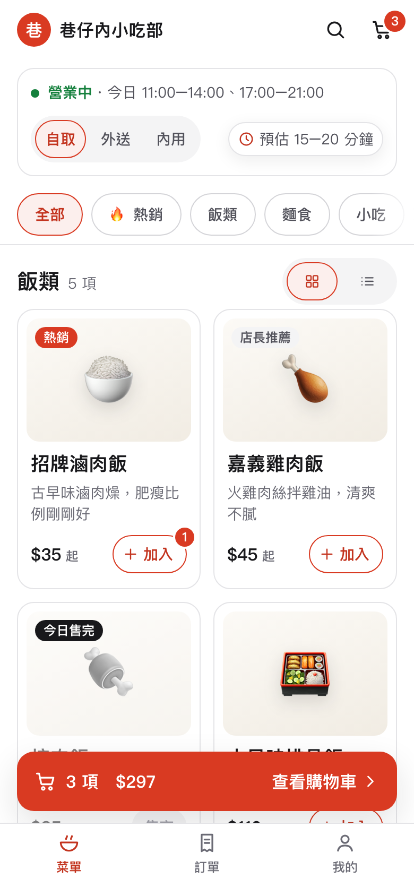 | 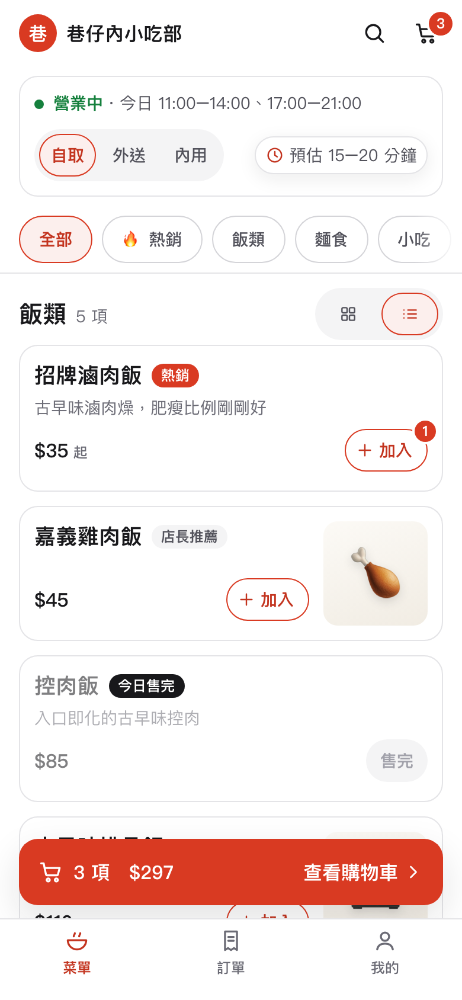 | 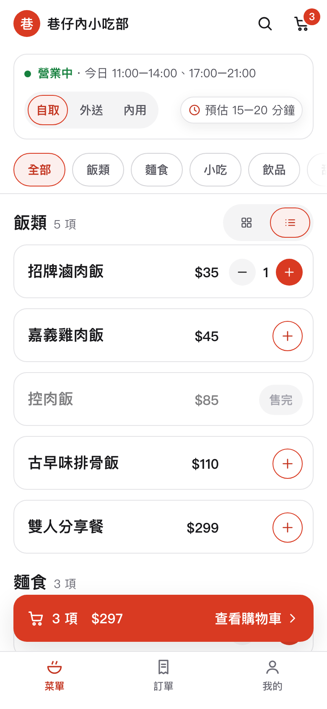 |

*同一份菜單的三種資料完整度（Demo 面板「菜單資料」可切換）。中間欄的清單縮圖固定靠右，缺圖的卡片文字撐滿整列，左緣仍然對齊；價格一律在左下、動作在右下，動作右緣與縮圖右緣齊。右欄只有品名與價格，每張卡兩列（品名列、價格與「＋ 加入」），「＋ 加入」直接加入。*

**桌機（≥ 1024）區域配置**

```text
┌─ TopBar ──────────────────────────────────────────────────────────────
│  (巷) 巷仔內小吃部    [🔍 搜尋菜單…]                  查詢訂單   登入   ⌨
├─ StoreStrip ──────────────────────────────────────────────────────────
│  ● 營業中 · 今日 11:00–14:00、17:00–21:00 · 臺北市大安區示範路 100 號 · 02-0000-0000
│                                          [ 自取 | 外送 | 內用 ]   預估 15–20 分鐘
├─ CategoryChips（sticky）────────────────────────────────────────────────
│  [全部] [🔥熱銷] [飯類] [麵食] [小吃] [飲品] [甜點]            [圖卡｜清單]
├─ 商品區（GRID 3 欄 / LIST 2 欄）───────────┬─ OrderPanel 360（sticky）
│  [卡][卡][卡]                               │  我的訂單 · 自取
│  [卡][卡][卡]                               │  1× 招牌滷肉飯      $67   編輯   移除
│                                             │      大碗・滷蛋
│                                             │  小計 / 運費 / 折扣 / 總計
│                                             │  [ 前往結帳 · $297 ]
│                                             │  不需登入即可結帳
```

> TopBar 的 ⌨ 為「鍵盤快速鍵與偏好」圖示按鈕（≥ 768、非觸控面板；`aria-label="鍵盤快速鍵與偏好"`），位於頂部導覽列最右側，位置固定、預設不顯示任何徽章或圓點（圓點只在提醒逾時後出現，§10.3），開啟 PG-19；平板（768–1023）的頂部導覽列在其左側另有購物車圖示（§3.3）；手機 AppBar 空間有限，改由頁尾與跳過連結進入。

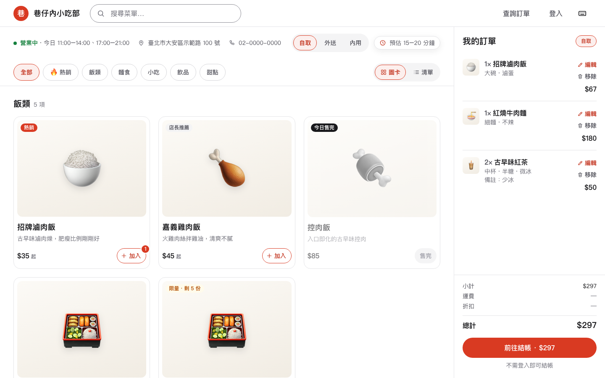

*桌機・完整資料：圖卡 3 欄 + 右側常駐訂單面板（含「不需登入即可結帳」）。含必選份量的商品維持「＋ 加入」並以徽章顯示已加入份數。*

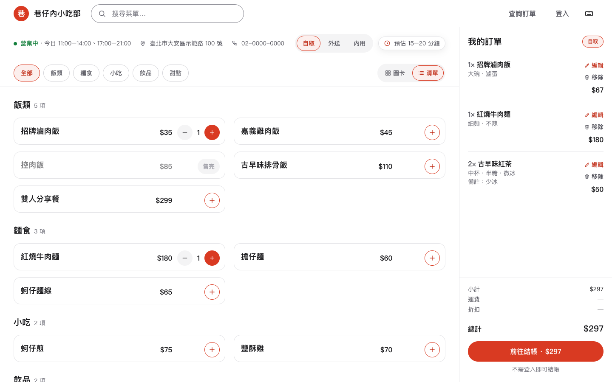

*桌機・精簡資料：自動採用 2 欄清單；沒有圖片、描述與標籤時，每張卡只剩兩列：品名列與「價格（左）… 動作（右）」底列，且「熱銷」分類因無標籤而不顯示。*

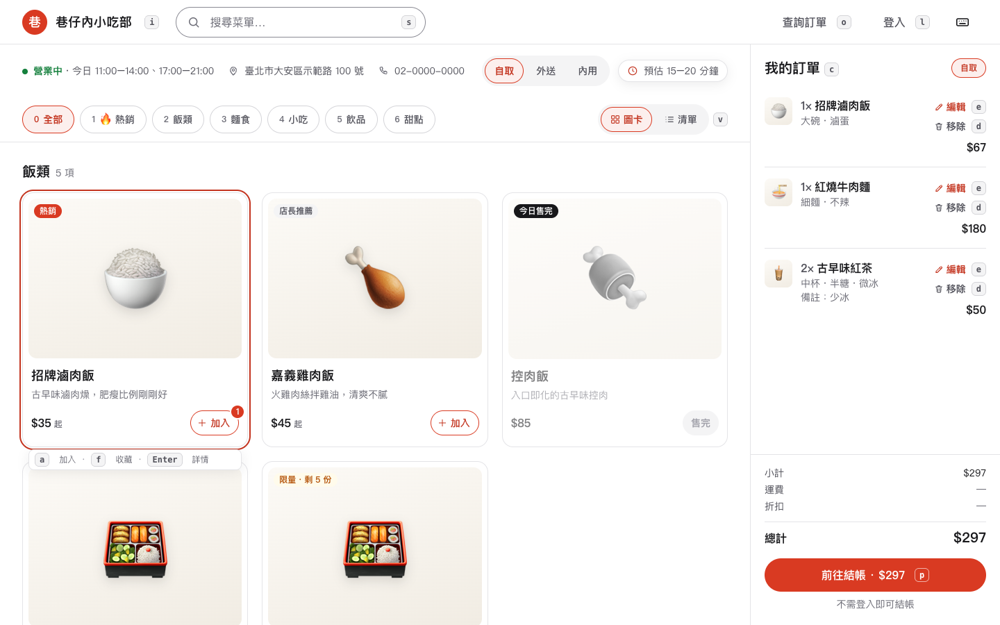

*鍵盤快速鍵提示（已開啟單鍵快速鍵後的畫面；預設不顯示徽章）：控制項旁顯示小寫字母徽章（搜尋 `s`、查詢訂單 `o`、登入 `l`、購物車 `c`、分類 `0`–`6`、版面 `v`…）；取得焦點的商品卡有焦點外框與底部提示列「a 加入 · f 收藏 · Enter 詳情」（僅在啟用時顯示）；主色按鈕內的徽章為透明底 + 邊框，對比與按鈕文字相同。*

| 桌機・點餐記憶與「常點」 | 手機・點餐記憶 |
| :---: | :---: |
| 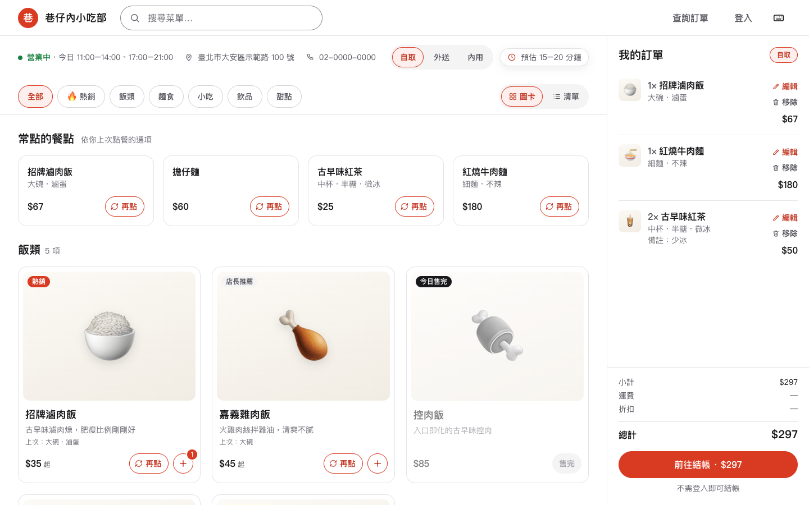 | 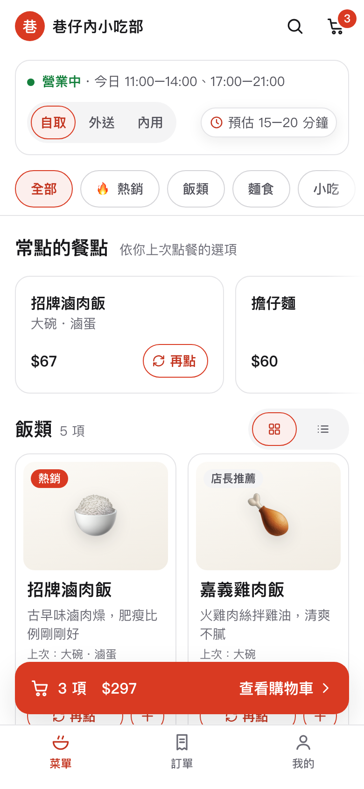 |

*點餐記憶：菜單頂部「常點的餐點」（含無選項商品）；有選項的商品卡顯示「上次：大碗・滷蛋」，動作區為「↻ 再點」與圓形「＋」（啟用單鍵快速鍵後，徽章掛在「＋」上）。*

**鍵盤偵測提醒**（FR-SY-18、CMP-41、§10.3）：單鍵快速鍵預設關閉，偵測到實體鍵盤後才以非阻擋的浮動卡提醒「可以開啟」；提醒不佔流、不搶焦點、不位移版面，不在結帳與付款頁出現（這些任務型頁面仍保留 ⌨、頁尾入口與跳過連結「鍵盤快速鍵與偏好」，§3.3）。

| 桌機（≥ 768）：錨定於 ⌨ 下方 | 手機（< 768）：與 Toast 同槽 |
| :---: | :---: |
| 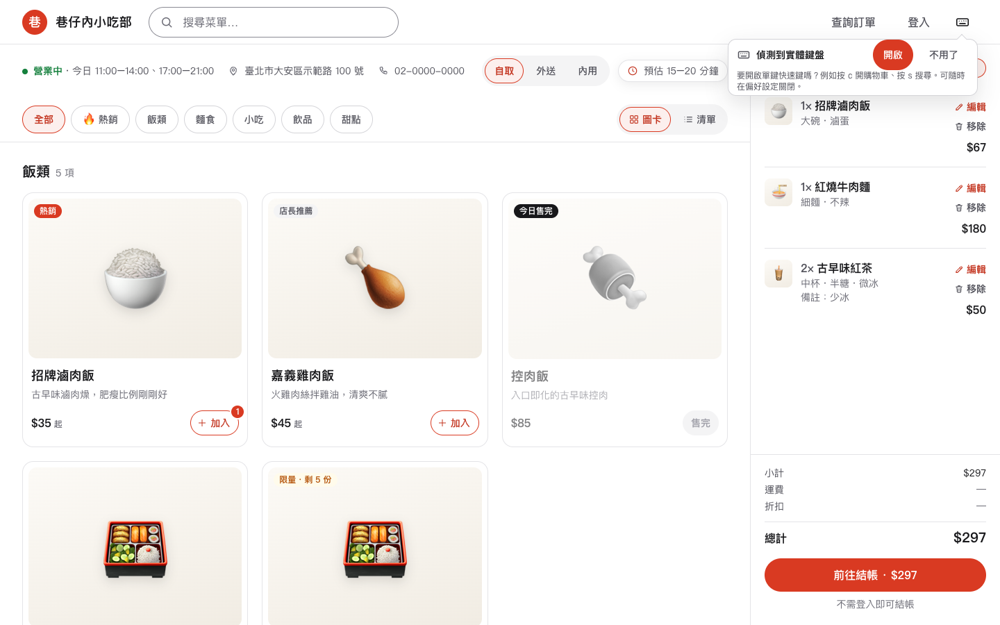 | 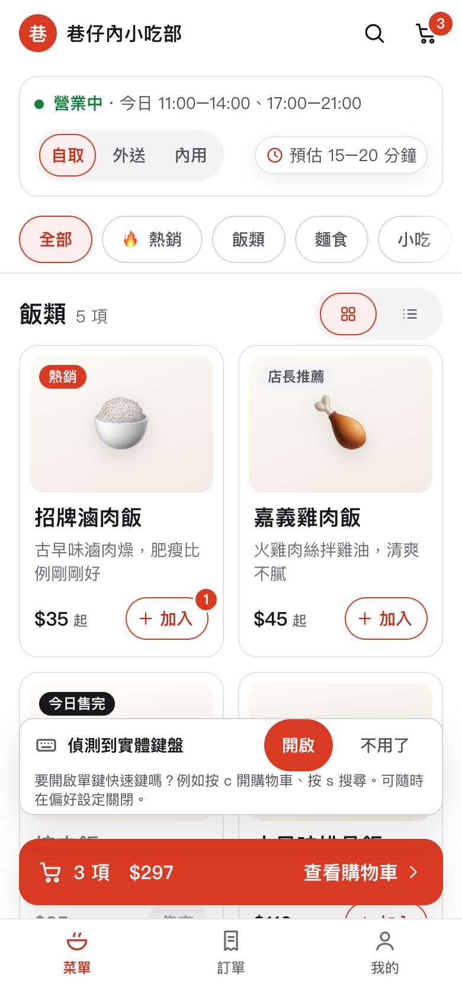 |

*提醒為 `position: fixed` 的小卡，顯示前後所有主要控制項位置完全不變（原型以 58 個互動元件逐一量測）；桌機錨定於頂部 ⌨ 按鈕下方，會暫時蓋住右側訂單面板的標題區，但不蓋住取得焦點的元件與主要操作（「前往結帳」、送出鈕、CartBar）；焦點移入被卡片遮住的元件時，提醒即轉為「稍後」；12 秒後（≥ 768）收成 ⌨ 上的小圓點。*

```text
┌─ ⌨ 圖示按鈕下方的浮動卡（≥ 768；< 768 與 Toast 同槽，位於 CartBar 與底部 Tab 之上）
│  偵測到實體鍵盤
│  要開啟單鍵快速鍵嗎？例如按 c 開購物車、按 s 搜尋。可隨時在偏好設定關閉。
│  [ 開啟 ]  [ 不用了 ]
└────────────────────────────────────────────
```

**互動**

- 分類膠囊列：點選平滑捲動至該區（`scroll-margin-top` = AppBar + 膠囊列高度）；捲動時以 `IntersectionObserver` 同步強調；`prefers-reduced-motion` 時改為瞬間跳轉。
- 點商品卡任一處開啟 PG-02；右下「＋」為**快速加入**（BR-30）：`hasRequiredOptions=false` 的商品直接加入並顯示 Toast（含「復原」），含必選群組者開啟 PG-02。
- 已快速加入的商品，卡片動作區變為 `− n ＋`（FR-MN-11）；含選項的商品以徽章顯示已加入份數。
- **再點**（FR-MN-12、§6.8）：有選項群組且記憶了選項的商品，卡片顯示「上次：…」與「↻ 再點」；菜單頂部另有「常點的餐點」區塊（FR-MN-13）。「＋」不因記憶而改變（BR-30）。
- **鍵盤**（FR-SY-12/13/17/18、§10.2–10.3）：方向鍵在商品網格內移動，`Enter` 開啟（不需開啟快速鍵）。單字元快速鍵（`a` 加入、`r` 再點、`f` 收藏、`v` 切換版面、`1`–`9` 跳分類、`c` 購物車…）**預設關閉**：偵測到實體鍵盤時提醒可開啟，或由頂部 ⌨ 按鈕、頁尾、跳過連結進入 PG-19 開啟；開啟後各控制項旁才顯示小寫字母徽章，`?` 才會開啟說明；未開啟時仍有 `Esc` 與 `Ctrl/⌘ + Enter`。`c`：桌機（常駐訂單面板）將焦點移到面板，平板 / 手機開啟購物車抽屜。取得焦點的商品卡底部提示條（`a 加入 · …`）只在單鍵快速鍵啟用時顯示，且不得蓋住可點目標。
- 版面切換：膠囊列右側提供「圖卡｜清單」切換（桌機）；手機於標題列以圖示切換。選擇寫入 `prefs`（FR-MN-09）；預設依店家設定與 `AUTO` 規則（BR-31）。
- 搜尋：手機點 🔍 展開 AppBar 內搜尋列；結果以單一扁平清單呈現並標示所屬分類；桌機為常駐膠囊輸入框。搜尋框內 `↓` 或 `Enter` 將焦點移到第一個結果商品卡，`Esc` 清除文字並失焦。
- **首次載入**：店家資訊、營業狀態、Banner 與菜單都回來（成功或失敗皆算）之前顯示整頁骨架，資料齊了才一次換成內容（單向：之後的重新取資料不會退回骨架）。公告橫幅只在首頁，與內容同時出現。原因：逐塊出現會把已顯示的內容往下推，CLS 實測 0.24～1.0（目標 ≤ 0.1）。
- **休息中**：營業狀態標籤說明何時開始營業，店家資訊列右側以「可預約取餐」取代預估時間；不另插一條提示列（它會在資料回來時把整頁往下推）。暫停接單由狀態標籤說明。
- 取餐方式切換：寫入 `prefs`（記住上次）；切換為外送時顯示運費與門檻摘要。
- `?table=A3`（FR-CK-05、BR-22）：以 QR 權杖解析桌號；有效且店家開放內用時，取餐方式鎖定為內用並於店家資訊顯示「桌號 A3」，結帳帶入桌號且不可改成不存在的桌號。店家未開啟內用或桌號無法辨識時，**回退為一般點餐**（取餐方式不鎖定，行為不變）並以非阻擋提示說明：「找不到 QR 帶入的桌號，已改為一般點餐；要內用請改選「內用」（桌號可留空），或洽店員」／「店家目前未開放內用，已改為一般點餐」。沒有 `?table=` 時，顧客仍可直接選「內用」，桌號為選填；觸控面板模式不套用 `?table=`（內用單一律無桌號）。
- 登入：頂部僅有「登入」ghost 連結；訪客點愛心時顯示可略過的 Toast「登入後可收藏喜愛的餐點」，不阻擋任何點餐動作（BR-33）。

**狀態**：載入中（店家資訊與 6 張商品卡骨架）、店家休息 / 暫停（頁面頂部 `Alert`，位於預留 `min-height` 的店家狀態槽，載入前以骨架佔位，不推擠商品區；商品仍可瀏覽並加入購物車）、無搜尋結果（`EmptyState`）、載入失敗（區塊錯誤 + 重試）；**資料缺漏**依 §6.7 降級，不出現破圖、空標題或空白行。

### PG-02 商品客製化

| 項目 | 內容 |
| --- | --- |
| 路由 | `/?product=:id`（購物車編輯：`/cart?edit=:lineId`） |
| 需求 | FR-PD-01～09、FR-MN-06/07/10 |
| 資料 | `GET /stores/{slug}/products/{id}` |

**完整資料（有圖、有描述、有選項）**

```text
┌─ Sheet（高度 ≤ 90dvh，可下滑關閉）──────────
│  ━━ 拖曳把手
│  [圖 16:9]                               ✕
│  招牌滷肉飯  🔥熱銷                      ♡
│  古早味滷肉燥，肥瘦比例剛剛好
│  過敏原：大豆
├─ 份量（必選・單選）────────────────────────
│  ● 小碗                          +$0
│  ○ 大碗                          +$20
├─ 加料（選填・最多 3 項）───────────────────
│  ☑ 滷蛋                          +$12
│  ☐ 滷豆干                        +$10
├─ 備註（選填）──────────────────────────────
│  [ 例：不要蔥                      0/50 ]
├─ Footer（sticky）──────────────────────────
│  [－] 1 [＋]    [ 加入購物車 · $47 ]
└────────────────────────────────────────────
```

**精簡資料（無圖、無描述、無選項）**——面板高度隨內容，不撐滿 90dvh，不出現圖片區、空的選項標題或過敏原區塊：

```text
┌─ Sheet（隨內容高度）───────────────────────
│  ━━ 拖曳把手
│  愛玉檸檬                                ✕
│  $45
├─ 備註（選填）──────────────────────────────
│  [ 例：不要蔥                      0/50 ]
├─ Footer（sticky）──────────────────────────
│  [－] 1 [＋]    [ 加入購物車 · $45 ]
└────────────────────────────────────────────
```

| 完整資料 | 精簡資料（無圖、無描述、無選項） |
| :---: | :---: |
| 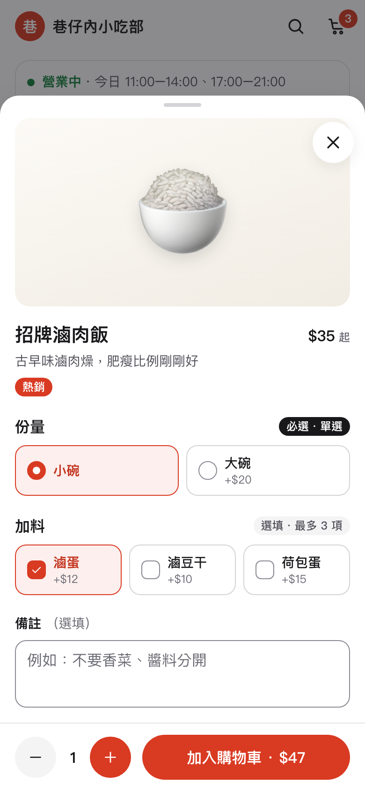 | 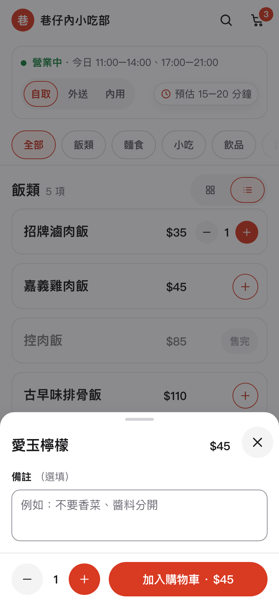 |

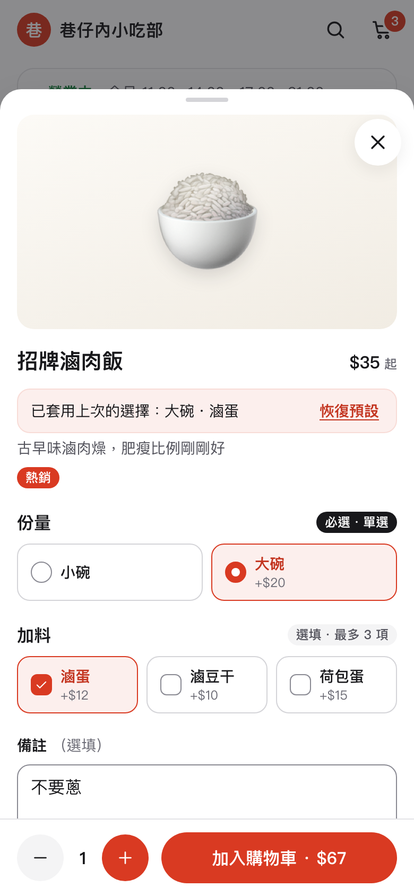

*有點餐記憶時：品名下方顯示「已套用上次的選擇：大碗・滷蛋　恢復預設」，選項與備註（「不要蔥」）已預先帶入，數量固定 1。*

**互動與規則**

- Footer 按鈕金額 = `(base_price + Σ price_delta) × quantity`，隨選項即時更新（FR-PD-03）。
- 必選未完成：按鈕停用並顯示「請選擇 {群組名稱}」；點擊停用按鈕時捲動至第一個錯誤群組。
- 售完商品：內容唯讀，按鈕顯示「今日售完」且停用。
- 限量商品（剩餘 ≤ 10）：品名旁顯示「剩 {n} 份」；數量步進器上限依剩餘份數封頂（扣除購物車內同商品其他行），達上限時「＋」停用並提示「今日只剩 {n} 份，已達上限」（CMP-07）；實際可否成立仍以送出訂單時的最終確認為準（BR-39）。
- 從購物車編輯：按鈕文字為「更新購物車」，帶入該行原選項、數量與備註（以該行為準，不套用點餐記憶）。
- 缺漏降級（FR-PD-08、§6.7）：缺圖不顯示圖片區；缺描述 / 標籤 / 過敏原不顯示對應區塊；`optionGroups` 為空時不顯示「選項」標題。
- **預設套用上次選項**（FR-PD-09、§6.8）：非編輯狀態且有記憶時，選項與備註預先帶入，品名下方顯示「已套用上次的選擇：…　恢復預設」；啟用單鍵快速鍵後 `d` 可恢復預設。
- 鍵盤：焦點移入面板標題，Tab 在面板內循環；`Esc` 關閉並還原焦點到觸發的商品卡；啟用單鍵快速鍵後另有 `+` / `-` 調整數量、`a` 加入。
- 關閉時若已變更選項，**不另跳確認**（可從購物車再編輯，避免打斷）。

### PG-03 購物車

| 項目 | 內容 |
| --- | --- |
| 路由 | `/cart`（桌機為右欄面板） |
| 需求 | FR-CT-01～07 |
| 資料 | 本機購物車；進入時背景呼叫 `POST /stores/{slug}/orders/quote` 取得最新價格與可用性 |

```text
┌─ AppBar：←  購物車（2）                 清空
├─ 取餐方式 ─────────────────────────────────
│  [ 自取 ● ] [ 外送 ○ ] [ 內用 ○ ]
├─ 品項 ─────────────────────────────────────
│  招牌滷肉飯                           $67
│  大碗 · 滷蛋
│  備註：不要蔥
│  [－] 1 [＋]               編輯   刪除
│  ────────────────────────────────────────
│  古早味紅茶                           $25
│  中杯 · 半糖 · 微冰
│  [－] 1 [＋]               編輯   刪除
├─ 加購推薦（Could）─────────────────────────
├─ 費用摘要 ─────────────────────────────────
│  小計 $92        運費 —        折扣 —
│  還差 $58 可外送（僅外送且未達門檻時顯示）
├─ Footer（sticky）──────────────────────────
│  [ 前往結帳 · $92 ]
└────────────────────────────────────────────
```

**無選項 / 無縮圖**：品項只顯示品名（與備註）與價格，不顯示空的選項行，也不保留縮圖欄（FR-CT-08）；桌機以 `OrderPanel` 呈現相同內容。

**狀態**：空購物車（`EmptyState`：「購物車還是空的，來點好吃的吧！」＋「回菜單」）、品項異動（`CartLineItem` 依下表以逐行狀態標示原因並提供就地動作，「前往結帳」維持可用；阻擋與異動清單由結帳頁負責，見 PG-04、FLOW-23）、價格已更新（`warning` `Alert` 列出差異，不阻擋）。

**品項狀態**（FR-MN-06、FR-CT-05、CMP-17；桌機 `OrderPanel` 與結帳摘要的品項列相同）

| 狀態 | 呈現 | 就地動作 |
| --- | --- | --- |
| `limited` | 品名下方「今日剩 {n} 份」（warning 圖示 + 文字；剩餘 ≤ 10 才顯示）；步進器「＋」於剩餘上限停用並提示「今日只剩 {n} 份，已達上限」 | — |
| 數量不足 | `warning-soft` 底 + ! +「今日只剩 {n} 份（已選 {m} 份）」；同商品多行時顯示「合計已選 {m} 份，今日只剩 {n} 份」與各行建議份數 | 「改為 {n} 份」「移除」 |
| 超過單行上限 | `warning-soft` 底 + ! +「此品項最多 {n} 份」 | 「改為 {n} 份」「移除」 |
| `reduced` | 「已調整為 {n} 份」（info；於購物車頁以 `polite` 通報，結帳頁內交由 `LiveAnnouncer` 合併句） | 「復原」 |
| `invalid` | `danger-soft` 底 + ✕ +「今日售完」「已下架」或「{選項}暫無供應」 | 「移除」；選項失效另有「重新選擇」 |

### PG-04 結帳

| 項目 | 內容 |
| --- | --- |
| 路由 | `/checkout` |
| 需求 | FR-CK-01～16、FR-PR-01/02、FR-AC-04 |
| 資料 | `GET .../pickup-slots`、`GET .../delivery-zones`、`GET .../delivery-check`、`POST .../orders/quote`、`POST .../orders`（被退回時回應附 `error.quote`，供異動清單使用） |

```text
┌─ AppBar：←  結帳
├─ 狀態列（預留 min-height，內容切換不位移版面）─
│  確認中：正在確認餐點與時段…
│  無異動：✓ 餐點與時段可供應（淡色小字，高度不變）
│  有異動：! 有 2 項需要調整                    [ 查看 ]
│  僅價格更新：↑ 有 {k} 項價格更新              [ 查看 ]
│  預檢失敗：暫時無法預先確認，送出時會再確認（不顯示 ✓）
├─ 店家狀態說明槽（預留 min-height；營業中為空白佔位，休息中 / 暫停接單時顯示說明，不進清單）
├─ 異動清單（CMP-40）：僅在送出被退回或點「查看」時展開（見下）
├─ 登入小提示（LoginNudge inline，可關閉）
│  ⓘ 已有帳號？登入以快速帶入 · 可略過                  [ ✕ ]
├─ ① 取餐方式 ───────────────────────────────
│  [ 自取 ● ] [ 外送 ○ ] [ 內用 ○ ]
├─ ② 取餐時間 ───────────────────────────────
│  ● 盡快   約 15–20 分鐘
│  ○ 預約   [ 今天 ▾ ] [ 12:30 ▾ ]
├─ ③ 取餐 / 外送 / 桌號（依方式切換；內用桌號選填）──
│  自取：巷仔內小吃部・臺北市大安區示範路 100 號  [導航]
│  外送：[ ● 家 · 大安區示範路 5 號 ] [ ＋新增地址 ]
│        外送費 $30（滿 $400 免運）・預估 35 分鐘
│        外送備註 [ 請按電鈴        0/50 ]
│  內用：桌號（選填）[ A3        ]    ← QR 帶入且有效時唯讀、取餐方式鎖定
│        沒有桌號可以留空，餐點好了會依取餐號碼叫號
├─ ④ 聯絡資訊 ───────────────────────────────
│  姓名 [ 王小明 ]   手機 [ 0912-345-678 ]
│  ☐ 記住我的資料（僅存於此裝置）
├─ ⑤ 付款方式 ───────────────────────────────
│  ● 現金（取餐時付款）  ○ 信用卡  ○ LINE Pay  ○ 街口支付
├─ ⑥ 優惠 ───────────────────────────────────
│  折扣碼 [            ] [套用]     我的優惠券 ›
├─ ⑦ 發票 ───────────────────────────────────
│  ● 隨餐附紙本  ○ 手機條碼  ○ 自然人憑證  ○ 捐贈  ○ 統編
├─ ⑧ 備註與餐具 ─────────────────────────────
│  訂單備註 [                      0/100 ]
│  ☐ 需要餐具（預設不需要，減少一次性餐具）
├─ ⑨ 訂單明細（可收合）──────────────────────
│  小計 $92   運費 —   折扣 —   總計 $92
│  限量餐點於送出訂單後才會保留（含限量品且剩餘 ≤ 10 時顯示）
├─ 條款聲明（送出即表示同意服務條款與隱私權政策）
│  ☐ 我願意收到店家的優惠與活動訊息（選填，預設不勾選）
├─ 頁尾連結：條款 · 隱私權 · 鍵盤快速鍵 · 偏好設定（任務型頁面同樣保留）
├─ Footer（sticky）──────────────────────────
│  還有 2 項需要處理（鎖定時顯示；預留兩行高 min-height，顯示與否不位移）
│  [ 送出訂單 · $92 ]    Ctrl/⌘ + Enter（桌機常駐）
└────────────────────────────────────────────
```

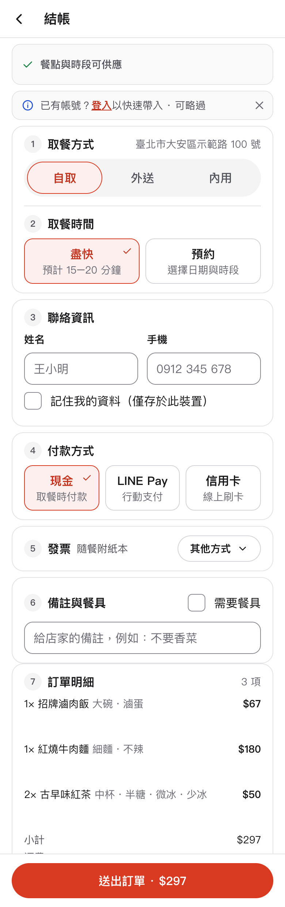

*訪客結帳：狀態列之下只有一條可關閉的小提示「已有帳號？登入以快速帶入 · 可略過」；聯絡資訊只需姓名與手機，並可勾選「記住我的資料」。原型為示意簡化版，區塊編號與數量和上方線框不同，見 [原型 README](./assets/mockups/README.md)。*

**狀態列與異動清單**（FR-CK-15、FR-CK-16、CMP-40；流程見 [FLOW-22](./02-flows.md#flow-22-結帳最終庫存確認)、[FLOW-23](./02-flows.md#flow-23-異動清單處理)）

送出訂單的瞬間才是庫存與時段的最終確認（BR-39）：進入結帳與欄位變更後的 `quote` 只是不保留的預檢。介面只誠實說明「正在確認」「哪裡要調整」，不增加額外確認步驟；被退回時不離開結帳頁、不清空任何輸入、不自動重送、不靜默改選。

**手機（< 768）**：狀態列位於頁首（AppBar 之下，預留 `min-height`），異動清單在其下方、表單 ① 之上；送出鈕為 sticky footer，鎖定時於其上方顯示「還有 n 項需要處理」（預留兩行高）。

```text
┌─ AppBar：←  結帳
├─ 有 3 項餐點需要調整                         ← h2（tabindex -1，送出被退回時焦點落此）
│  訂單尚未送出，已填寫的資料都還在。          ← 與各項原因合為視覺隱藏摘要，標題以 aria-describedby 帶入，朗讀一次
│  [ 全部套用建議 ]  移除 1 項、1 項改為 2 份、時段改為 17:15
│  ┌ ✕ 古早味紅茶　中杯・半糖・微冰             今日售完
│  │   [ 移除 ]
│  ├ ! 雙人分享餐                               今日只剩 2 份（已選 3 份）
│  │   [ 改為 2 份 ]  [ 移除 ]
│  ├ ! 取餐時段 17:00                           這個時段已額滿
│  │   [ 改選 17:15 ]  [ 選其他時段 ]
│  └ ↑ 招牌滷肉飯　價格已更新：$67 → $72        （不計入「還有 n 項」）
│                                               返回購物車
├─ ① 取餐方式 … ⑧（表單維持原狀，仍可填寫）
├─ Footer（sticky，safe-area）
│  還有 3 項需要處理                     [ 送出訂單 ]（aria-disabled）
└──────────────────────────────────────────
```

**處理完成**：清單收合為摘要「✓ 已調整：移除古早味紅茶、雙人分享餐改為 2 份、時段改為 17:15　[ 復原 ]」（畫面可見摘要；`polite` 通報用 §10.4 的「已調整 3 項，可以送出了」）；招牌滷肉飯的價格差異仍列出，主按鈕變為「確認新價格並送出 · $670」。

| 結帳・異動清單（桌機） | 結帳・異動清單（手機） |
| :---: | :---: |
| 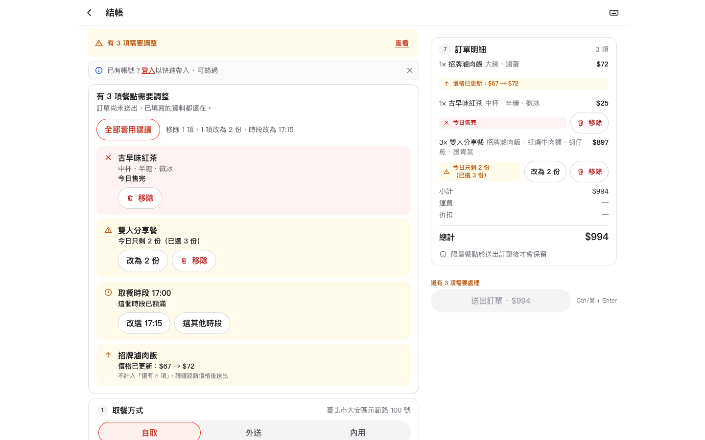 | 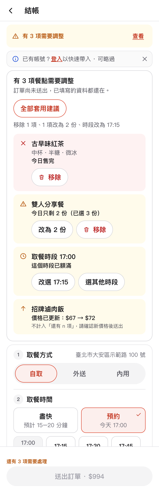 |

*送出被退回後就地展開：頁首狀態列「有 3 項需要調整」，下方依序為無法購買、數量不足、時段、價格更新；右側訂單明細的對應行同步標示並可就地處理；送出鈕鎖定並說明「還有 3 項需要處理」，旁邊保留 Ctrl/⌘ + Enter 小字。原型為示意簡化版：右欄標題編號為 ⑦（本節線框為 ⑨），且不含地址、折扣碼與條款聲明區塊，見 [原型 README](./assets/mockups/README.md)。*

**桌機（≥ 1024）**：狀態列與清單位於左欄 ①～⑧ 之上；右欄 ⑨ 的對應品項列以 CMP-17 的 `invalid` / `limited` / `reduced` 狀態標示，並可就地「改為 n 份」「移除」；品項列的狀態使用預留高度的狀態槽（涵蓋狀態文字與 44 px 動作鈕，無狀態時空白佔位），行高不因狀態改變，因此 ⑨ 的小計與送出鈕仍在右欄 sticky 且位置不位移（E2E 以 `getBoundingClientRect` 比對送出鈕與小計位置，不依賴 CLS）。右欄釘在 sticky 頂部列的下方（`top` = 頂部列高 + 16 px，與未捲動時的位置一致）：不被頂部列蓋住，欄位錯誤橫幅出現 / 消失造成捲動錨定微調 scrollY 時，卡片與送出鈕也不會在「釘住」與「自然位置」之間跳動（E2E `checkout-sticky-summary`）。清單與右欄的動作共用同一份狀態。

**異動類別**（CMP-40 依下列順序分組；同商品多行以商品分組，組標題「{品名}　合計已選 {m} 份，今日只剩 {n} 份」，各行顯示自己的建議份數；取餐營業日不是今日時，文案中的「今日」依 §9「取餐日非今日」改寫）

| # | 類別 | 原因文案（範例） | 就地動作 | 計入「還有 n 項」 |
| --- | --- | --- | --- | --- |
| 1 | 無法購買 | 「今日售完」；送出被退回且該品原本可買時為「剛剛被訂走了」；「已下架」；「{選項}暫無供應」 | 「移除」；選項失效另有「重新選擇」 | 是 |
| 2 | 數量不足 | 「今日只剩 {n} 份（已選 {m} 份）」；同商品其他行已用完時為「已被同商品其他行占用」；單行超過上限（`QUANTITY_EXCEEDED`）時為「此品項最多 {n} 份」 | 「改為 {n} 份」「移除」；品項行數超過上限（無 `lineIndex` 的整單項，固定置於整張清單最上方，先於各類別組）為「移除品項」 | 是 |
| 3 | 時段 · 取餐方式 | 「{HH:mm} 這個時段已額滿」；「{HH:mm} 已來不及準備，請重新選擇時段」；外送「盡快」不可用；店家未開放此取餐方式（`SERVICE_NOT_AVAILABLE`）為「店家目前未開放{取餐方式}」 | 「改選 {HH:mm}」「選其他時段」「改為盡快」（可用時）「預約明天」「改為自取」；「改為其他取餐方式」 | 是 |
| 4 | 折扣 / 付款 / 發票 / 外送條件 | 折扣碼類（`COUPON_NOT_FOUND`、`COUPON_EXPIRED`、`COUPON_NOT_APPLICABLE`、`COUPON_MIN_NOT_MET`、`COUPON_USED_UP`、會員專屬券未登入的 `LOGIN_REQUIRED`）、`MIN_ORDER_NOT_MET`、`OUT_OF_DELIVERY_AREA`、`PAYMENT_METHOD_NOT_ALLOWED`、`INVOICE_INVALID`、`TABLE_NOT_FOUND` | 定位到對應欄位（⑥ 折扣碼、③ 外送 / 桌號、⑤ 付款、⑦ 發票）並顯示錯誤（`TABLE_NOT_FOUND` 只在有提供桌號或 QR 權杖時出現，桌號可改正或清空）；超出外送範圍另有「改為自取」，未達最低消費另有「繼續點餐」；`LOGIN_REQUIRED` 為「移除折扣碼」「登入（可略過）」，不強制登入下單（BR-33） | 是 |
| 5 | 價格更新（固定最後） | 「價格已更新：${舊} → ${新}」；折扣失效時為「折扣 −$40 已失效，總額 $380 → $420」 | 無就地動作，由主按鈕「確認新價格並送出」確認（兩步確認見下） | 否 |

- **展開時機**：只在「送出被退回」（含按下送出後，送出前預檢發現異動，屬使用者按下送出的結果）、使用者點狀態列「查看」、點擊鎖定的送出鈕，或鎖定時按 `Ctrl/⌘ + Enter` 時展開。進入結帳與背景偵測（欄位變更後的 `quote`、視窗取得焦點、從付款頁返回）只更新狀態列、明細行與送出鈕，並以 `polite` 通報，**不展開、不搶焦點、不位移版面**（NFR-18）；虛擬鍵盤開啟時同樣只更新狀態列，不插入清單（EC-16）。展開以明確捲動將清單標題帶入視窗，不依賴 scroll anchoring。
- **狀態列**：預留 `min-height`（以 rem 計，涵蓋兩行文字與 44 px 目標），內容可撐高，僅在文字縮放或使用者覆寫行高與間距時才允許位移（WCAG 1.4.4、1.4.12）。內容：確認中「正在確認餐點與時段…」；無異動「✓ 餐點與時段可供應」（須已取得 `quote`，未取得時不顯示 ✓）；有異動「有 {n} 項需要調整〔查看〕」；僅價格更新（n = 0）「有 {k} 項價格更新〔查看〕」（k = 價格更新項數，不計入 n；不顯示「有 0 項」）；預檢逾時或 5xx（不阻擋送出）「暫時無法預先確認，送出時會再確認」。
- **店家狀態**：`STORE_PAUSED`、`STORE_CLOSED`（送出被退回或預檢回報）不進異動清單：立即重新載入 `/status` 與 StoreInfo，於狀態列下方預先預留 `min-height` 的店家狀態說明槽（營業中為空白佔位，因此填表中途店家狀態改變也不位移版面）顯示——休息中提供「改預約」，暫停接單時整頁唯讀並顯示店家電話；焦點移到該說明並以 `polite` 通報，與清單並存時說明先於清單。`SERVICE_NOT_AVAILABLE`（店家未開放此取餐方式）則重新載入 StoreInfo、停用該取餐方式並列入第 3 類，動作「改為其他取餐方式」。
- **付款 / 發票 / 桌號類的出現時機**：`PAYMENT_METHOD_NOT_ALLOWED`、`INVOICE_INVALID`、`TABLE_NOT_FOUND` 不在 `quote` 的檢查範圍內（`QuoteRequest` 不帶這些欄位，06 §5.8），第一次出現於送出被退回的 `error.quote`；落點與動作相同。桌號為選填：內用留空時 `POST /orders` 也不檢查，不會出現 `TABLE_NOT_FOUND`。
- **被退回時**：停止 loading，留在 `/checkout`；保留所有欄位、已選時段與同一把 `Idempotency-Key`（BR-41），不自動重送、不靜默改選。焦點移到清單標題（`h2`），標題以 `aria-describedby` 指向視覺隱藏的摘要節點（內容為「訂單尚未送出，資料都還在。」加各項原因，不重複標題）朗讀一次，不另用 `role="alert"`（避免重複朗讀）；時段額滿且僅此一項時，焦點改到時段選擇區第一個可選項，原選取清除、不自動選取（EC-07）。
- **處理完後的焦點**：清單處理完（含改選取餐方式、報價回來後才發現已無異動）時一律通報「全部處理完」；焦點只在「仍在清單內或已隨動作鈕消失」時才移到送出鈕，使用者已在別的欄位輸入（姓名、手機、備註…）則不搶焦點，避免打到一半的內容被截斷。
- **處理與復原**：每個動作後 250 ms 重新計價，送出鈕顯示「重新計價中…」，結果合併為單一句 `polite` 通報（例：「已改為 2 份，金額 $670，還有 1 項需要處理」）。單項「移除」比照 Toast「復原」（6 秒，hover / 焦點暫停；該 Toast 在 DOM 與 Tab 順序中緊接異動清單之後，鍵盤使用者可在逾時前以 Tab 到達「復原」，焦點進入即暫停計時）；「全部套用建議」置於清單標題下方，套用後收合為「已調整：…（復原）」摘要，「復原」持續存在到下一次異動或離開頁面（無倒數）。動作鈕間距 ≥ 8，破壞性動作（移除）以圖示與文字區分，320 px 時直向堆疊，名稱含品名（「將雙人分享餐改為 2 份」「移除古早味紅茶」）。KPI-11：從清單出現到可再次送出 ≤ 2 次操作（「全部套用建議」為 1 次）。結帳頁內 `CartLineItem`（CMP-17）的狀態變化不自行通報，一律由 `LiveAnnouncer` 的合併句通報；送出被退回的那次 `quote` 更新不再發「背景偵測」通報，避免與標題摘要重複。
- **全部無法購買**：以 `EmptyState` 取代清單：「購物車裡的餐點目前都無法購買」＋「回菜單看看」；表單草稿保留（`sessionStorage`），重新加入商品後不需重填（EC-37）。
- **Demo 模式**：Demo 入口在頂部列（不浮動），不會遮擋清單動作鈕與送出鈕；Demo 橫幅不在結帳頁顯示，避免蓋住頁底 sticky 送出列（PG-18）。

**互動與規則**

- 區塊 ③ 隨取餐方式切換內容；切換方式後金額與可用付款方式即時更新。
- **內用桌號（選填）**（FR-CK-05、BR-22、VR-10）：內用區的桌號欄標示「桌號（選填）」，常駐提示「沒有桌號可以留空，餐點好了會依取餐號碼叫號」；輸入自動轉大寫、最長 10 字元。留空送出時請求不帶 `dineIn.tableNo`，訂單明細與摘要只顯示「內用」，有桌號才顯示「桌號 A3」。

| 情境 | 呈現 | 文案 / 結果 |
| --- | --- | --- |
| 手動選「內用」（沒有 `?table=`，或 QR 回退後改選） | 文字欄「桌號（選填）」，可留空 | 提示：沒有桌號可以留空，餐點好了會依取餐號碼叫號 |
| QR 帶入且有效 | 取餐方式鎖定「內用」，桌號帶入並唯讀顯示，不可改成不存在的桌號 | 桌號 A3 |
| QR 無法辨識或店家未開放內用 | 回退為一般點餐、取餐方式不鎖定（PG-01） | 找不到 QR 帶入的桌號，已改為一般點餐；要內用請改選「內用」（桌號可留空），或洽店員 |
| 留空送出 | 不檢查桌號，送出成功；仍產生 `T` 前綴取餐號碼 | — |
| 有填但格式不符（非 1～10 字元英數字） | 送出前擋下，定位到桌號欄 | 找不到此桌號，請洽店員 |
| 有填但不是店家桌位（`TABLE_NOT_FOUND`） | 送出被退回，列入異動清單第 4 類並定位到桌號欄；改正或清空後可再送出 | 找不到這個桌號，請洽店員協助 |
| 觸控面板模式 | 沒有桌號欄，內用單一律無桌號 | 內用不需要桌號，餐點好了會依取餐號碼叫號 |

- 休息中：②「盡快」停用，預設選取第一個可預約時段；暫停接單：整頁唯讀、送出按鈕停用並顯示說明（有 `pausedUntil` 時註明預計恢復時間）；這是唯一使用真正 `disabled` 的送出狀態，其餘狀態一律 `aria-disabled`（§10.3）。
- 外送的「盡快」可能比自取更早停用（預估完成不得晚於打烊，BR-08）：顯示「外送已來不及在打烊前送達，可預約其他時段或改為自取」。
- 外送：選擇行政區即檢查範圍（[FLOW-06](./02-flows.md#flow-06-外送範圍門檻與運費)）；不在範圍時顯示錯誤與「改為自取」按鈕。
- 發票：選項切換時顯示對應輸入（手機條碼 / 憑證 / 愛心碼 / 統編），輸入即時驗證（VR-11～14）。
- **送出**（FR-CK-11、FR-CK-15）：按鈕進入 loading（`aria-disabled` + `aria-busy`，焦點保留），文案「確認餐點與時段中…」並以 `aria-live="polite"` 通報同一句；送出中再次點擊或按 `Ctrl/⌘ + Enter` 不動作（BR-27）；冷卻中（`503` 附 `retryAfterSeconds` 或 `429`）同樣不動作，送出鈕以 `aria-disabled` 呈現並以 `aria-describedby` 帶倒數說明（可聚焦）。送出前的預檢若發現異動則不送出，改為展開清單（屬使用者按下送出的結果）。失敗時停止 loading、保留所有欄位與已選時段：庫存、時段、價格與折扣 / 付款 / 發票 / 外送條件類異動（`422`、`PRICE_CHANGED`）展開異動清單（見上）；網路、`400` 與結果未知類錯誤置於頁面頂端 `Alert` 並捲動到可見。
- **送出鈕鎖定**（FR-CK-16）：有阻擋項（價格更新不計；含未達最低消費與未登入的會員專屬折扣碼）時，送出鈕為 `aria-disabled="true"`（不使用 `disabled`，焦點與點擊仍有效），頁尾顯示預留兩行高（`min-height`）的「還有 {n} 項需要處理」並以 `aria-describedby` 關聯。點擊鎖定的送出鈕或按 `Ctrl/⌘ + Enter` 不送出，改為展開清單、焦點與捲動移到清單標題，並通報「還有 n 項需要處理」。視窗高度 < 480 px（含手機橫向與 400% 縮放）時，sticky 送出列改為文件流內且鎖定說明不再預留兩行（§5.4）。
- **價格差異需兩步確認**（BR-25）：僅價格異動且總額增加（新的 `quote` 總額高於顧客目前在畫面上看到的金額，即送出時的 `expectedTotal`）時，第一次點擊送出鈕或 `Ctrl/⌘ + Enter` 只展開差異並聚焦清單標題（與鎖定相同），並以 `polite` 通報「總額由 ${舊} 變為 ${新}，確認後再按一次送出」；差異展示後按鈕文案才變為「確認新價格並送出 · ${total}」，第二次才送出；僅降價或價格不變可一鍵送出（金額更新以 `polite` 通報）。
- **重新計價中送出**：送出鈕顯示「重新計價中…」；此時按下送出或 `Ctrl/⌘ + Enter` 會排入佇列（優先於鎖定判斷，順序與 FLOW-19 的 `decideSubmit` 相同：送出中、冷卻中或店家暫停 → 重新計價中 → 阻擋項鎖定 → 價格差異 → 送出），`quote` 回來後依上述規則處理（有阻擋項或總額增加時改為展開清單），並以 `polite` 通報「計價中，完成後送出」。
- **限量說明**：購物車含限量品且剩餘 ≤ 10 時，⑨ 訂單明細下方顯示小字「限量餐點於送出訂單後才會保留」（caption，非警示），品項行內顯示「今日剩 {n} 份」；加入購物車與進入結帳都**不保留**庫存，保留自送出訂單成立起算（BR-38）：線上付款保留至付款期限（15 分鐘），現金單保留至店家接單或接單期限（BR-17；PG-06 顯示「店家將於 {HH:mm} 前確認」）。
- **線上付款成立後**：導向 PG-05，顯示「已保留餐點與取餐時段，請於 {HH:mm} 前完成付款」；逾時釋放與說明見 PG-05、PG-06。
- **結果未知**（無回應、逾時，或未附 `retryAfterSeconds` 的 `5xx`）：頁首 `Alert` 說明「網路不太穩，無法確認訂單是否已送出。再試一次不會重複下單」，動作為「再試一次」與「致電店家確認」（`tel:` 與店名），**不導向「查詢訂單」**（顧客可能沒有訂單編號）；焦點移到「再試一次」。`Idempotency-Key` 存 `sessionStorage` 並保留到 2xx，修改內容後再送仍沿用同一把 Key；回應顯示先前送出其實已成立（`IDEMPOTENCY_CONFLICT`）時，以同 Key 取回原訂單並依 `nextAction` 導向（`TRACK` 到訂單頁、`PAY` 到付款頁並顯示剩餘時間），說明其內容與目前購物車不同；`503` 且附 `retryAfterSeconds`（建單鎖等待逾時，確定未建立）顯示「目前點餐人數較多，請稍後再按一次送出訂單」，送出鈕依該秒數暫停並沿用同一把 Key；`429`（`POST /orders` 專屬限流，確定未建立）顯示「操作太頻繁，請稍後再按一次送出訂單」，同樣不記下送出內容、不進結果未知，送出鈕依 `retryAfterSeconds` 暫停並沿用同一把 Key，焦點在頁首 `Alert` 的「再試一次」（[FLOW-24](./02-flows.md#flow-24-結果未知與冪等重送)、BR-41）。觸控面板模式改為「再試一次」與「請洽櫃檯確認」（§5.6）：閒置警示照常出現並多一行「上一筆訂單結果尚未確認，請洽櫃檯確認」，重置時一併丟棄 Key 與記下的送出內容。
- 桌機：右欄顯示 ⑨ 與送出按鈕（sticky），左欄為狀態列、異動清單與 ①～⑧。
- **條款與行銷同意**（FR-CK-13）：條款聲明為送出即同意的說明文字（連結至 PG-16）；「行銷同意」為其下獨立的選填勾選（`Checkbox`），**預設不勾選**，不勾選不影響送出；勾選結果隨訂單記錄（`marketing_opt_in`，見 [05](./05-database-schema.md)）。
- **送出快速鍵**：桌機（`(hover: hover) and (pointer: fine)`）於「送出訂單」旁常駐小字「Ctrl/⌘ + Enter」並輸出 `aria-keyshortcuts="Control+Enter Meta+Enter"`；它不是單字元快速鍵，**不跟隨**單鍵快速鍵開關；觸控面板模式不顯示（§10.3）。
- **免登入**：訪客只需姓名與手機即可送出；「登入以快速帶入」為狀態列之下可關閉的小字（`LoginNudge inline`），不彈窗、不阻擋（BR-33）。唯一會鎖定送出的登入提示是會員專屬折扣碼（`LOGIN_REQUIRED`，第 4 類）：移除折扣碼即可送出，不強制登入下單。
- **記住我的資料**（FR-CK-14）：**預設不勾選**（共用裝置較安全）；勾選後僅寫入此裝置，頁尾、「鍵盤快速鍵與偏好」與此處提供「清除我的資料」。第二次結帳時自動預填姓名、手機與最近一次外送地址。
- **快速鍵與偏好入口**：結帳屬任務型頁面（隱藏底部 Tab），仍保留頂部 AppBar 最右側的 ⌨（≥ 768）、頁尾「鍵盤快速鍵」「偏好設定」與跳過連結「鍵盤快速鍵與偏好」（省略「跳到我的訂單」，相對順序與一般頁面一致，WCAG 3.2.6）；`Ctrl/⌘ + Enter` 在此頁最需要被發現，不須先離開結帳即可開啟 PG-19。鍵盤偵測提醒本身不在此頁顯示（BR-42）。
- **觸控面板模式**：付款方式僅「現金（櫃檯付款）」；不顯示「記住我的資料」與登入提示；異動清單與結果未知依 §5.6（處理清單視為使用者操作，會重設閒置計時）；訂單成立後進入完成畫面（PG-06）。

### PG-05 模擬金流

| 項目 | 內容 |
| --- | --- |
| 路由 | `/payment/:orderId?method=` |
| 需求 | FR-PY-02～04 |
| 說明 | 僅 Demo 使用，模擬第三方金流頁；Phase 2 以真實金流導轉取代 |

```text
┌─ 模擬金流（Demo，不會產生實際扣款）
│  付款方式：LINE Pay
│  訂單 ZO261014K7M3QX    應付金額 $92
│  已保留餐點與取餐時段，請於 12:35 前完成付款
│  剩餘付款時間 14:32
│  [ 付款成功 ]  [ 付款失敗 ]  [ 取消付款 ]
└────────────────────────────────────────────
```

- 「付款成功」→ `PENDING`、`PAID` → 導向 PG-06。「付款失敗」→ 顯示失敗與「重新付款 / 改用現金」。「取消付款」→ 回 PG-06（仍為 `PENDING_PAYMENT`，可繼續付款）。
- 若 Demo 面板預設了付款結果，則自動套用並以 1 秒過場顯示「處理中」。
- **保留與時限**：頁首以「已保留餐點與取餐時段，請於 {HH:mm} 前完成付款」說明保留（HH:mm 取 `payment.expiresAt`，不寫死 15 分鐘）並顯示倒數；剩餘時間少於 2 分鐘時以 `role="alert"` 通報一次「付款時間剩 2 分鐘」。逾時訂單自動取消並釋放保留的餐點與時段（BR-38），可重新下單；逾時後才成功的付款自動退款（EC-17）。付款時限屬 BR-38 所定的保留期限（WCAG 2.2.1 的必要例外），是否另提供「延長一次」見 01 Q-10。
- **快速鍵與偏好入口**：同 PG-04——保留頂部 ⌨（≥ 768）、頁尾「鍵盤快速鍵」「偏好設定」與跳過連結「鍵盤快速鍵與偏好」（省略「跳到我的訂單」）；鍵盤偵測提醒不在此頁顯示（BR-42）。

### PG-06 訂單追蹤 / 詳情

| 項目 | 內容 |
| --- | --- |
| 路由 | `/orders/:orderId` |
| 需求 | FR-OD-01～05、FR-OD-08、FR-OD-10、FR-PY-03/05 |
| 資料 | `GET /orders/{id}`（輪詢 5 秒）、`POST /orders/{id}/cancel`、`POST /orders/{id}/payments` |

```text
┌─ AppBar：←  訂單
├─ 狀態卡 ───────────────────────────────────
│  取餐號碼
│    A027                         ← display 字級
│  ● 製作中・預計 12:35 可取餐（約 8 分鐘）
│  訂單編號 ZO261014K7M3QX  [複製]
├─ 付款提醒（PENDING_PAYMENT 才顯示）────────
│  已保留餐點與取餐時段，請於 12:35 前完成付款    [ 繼續付款 ]
├─ OrderTimeline ────────────────────────────
│  ✔ 訂單已送出            12:20
│  ● 製作中                12:21
│  ○ 可取餐
│  ○ 已取餐
├─ 取餐資訊 / 外送資訊 ──────────────────────
├─ 訂單明細（可收合）────────────────────────
├─ 付款與發票 ───────────────────────────────
├─ Actions ──────────────────────────────────
│  [ 取消訂單 ]（僅 PENDING_PAYMENT / PENDING） [ 致電店家 ] [ 再來一單 ]
├─ 保存提示（訪客；可略過 ✕）─────────────────
│  想保存這筆訂單？以手機建立會員 ›
└────────────────────────────────────────────
```

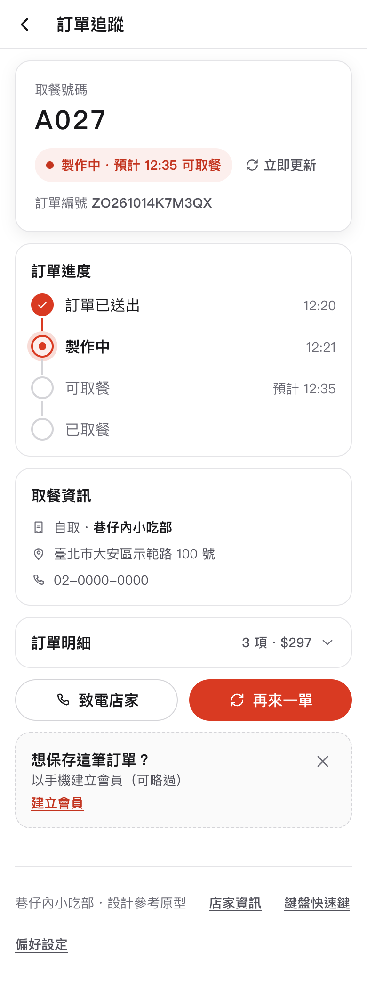

*訂單追蹤：取餐號碼大字顯示、進度時間軸、取餐資訊；底部淡色卡為選填的「保存這筆訂單」提示，可關閉。*

**狀態對應**

| 訂單狀態 | 狀態卡 | 主要動作 |
| --- | --- | --- |
| `PENDING_PAYMENT` | 等待付款 + 倒數；付款提醒列顯示「已保留餐點與取餐時段，請於 {HH:mm} 前完成付款」 | 繼續付款、取消訂單 |
| `PENDING` | 等待店家確認，並顯示「店家將於 {HH:mm} 前確認」（取 `Order.acceptBy`：伺服器依 BR-17 自進入 `PENDING` 起算，僅 `PENDING` 有值，前端不自行推算；預約單另顯示「預約 HH:mm」） | 取消訂單、致電店家 |
| `ACCEPTED` | 製作中 + 預計時間；預約單固定顯示「預約 {HH:mm} 取餐」，其「製作中」僅代表店家已接單（實際製作自 `scheduled_at − lead` 起，BR-21、FLOW-14） | 致電店家 |
| `READY` | 自取「可取餐」／ 外送「餐點完成，等待外送」／ 內用「餐點完成」 | 致電店家 |
| `DELIVERING` | 外送中 | 致電店家 |
| `COMPLETED` | 已完成 | 再來一單、（P2）評價 |
| `CANCELLED` | 已取消 + 取消者與原因（已付款者顯示退款進度）；付款逾時者說明「超過付款時間，訂單已自動取消，保留的餐點與時段已釋出。想再訂可按「再來一單」」 | 再來一單 |

- 狀態變更時：Toast 提示、`document.title` 前綴「（可取餐）」、支援時觸發 `navigator.vibrate`（FR-OD-10）。
- 取餐號碼可點擊放大為全螢幕，方便出示給店員。
- **內用資訊**（取餐資訊區塊，`orderType = DINE_IN`）：資訊列為「內用・{店名}・桌號 A3」；沒有桌號時改為「內用・{店名}・取餐號碼 T001」（例：「內用・巷仔內小吃部・取餐號碼 T001」；店家資訊尚未載入時省略店名），**不出現**桌號列、空白列、破折號或「桌號 undefined」（BR-22、EC-42）。狀態卡的取餐號碼（`T001`）即叫號與領餐識別；頁面標題（頂部列與 `document.title`）為「訂單追蹤・T001」，不分取餐方式與有無桌號。`order.table` 省略即代表沒有桌號。
- **快速鍵與偏好入口**：同 PG-04——訂單詳情屬任務型頁面，保留頂部 ⌨（≥ 768）、頁尾「鍵盤快速鍵」「偏好設定」與跳過連結「鍵盤快速鍵與偏好」（省略「跳到我的訂單」；觸控面板模式不提供）。
- **找不到訂單（`404`）**：持有此訂單本機記錄的訪客遇到 `404`（追蹤權杖已被較晚簽發者取代，BR-27、EC-36）時，先以記下的訂單編號與手機換取新權杖並重試一次（FLOW-16），期間維持原畫面、不閃現錯誤；仍失敗才顯示「找不到訂單，請確認編號與手機」並提供「查詢訂單」（PG-08）入口，停止輪詢。
- 狀態卡右側有「立即更新」ghost 按鈕（啟用單鍵快速鍵後顯示快速鍵 `u`），在 5 秒輪詢之外可手動刷新；結果以 `aria-live` 通報。「再來一單」旁於啟用後顯示快速鍵 `a`。
- 「再來一單」依現況逐項以可購買量判斷（[FLOW-13](./02-flows.md#flow-13-再來一單)）：足量者原樣加入，不足者調整為可購買份數並說明「已將「{品名}」調整為 {n} 份（今日限量）」，售完或下架者略過並列出。

**觸控面板完成畫面**（同路由 `/orders/:orderId`，以放大版型呈現；FLOW-21、BR-37）

```text
┌─ 訂單已送出 ──────────────────────────────
│              取餐號碼
│               A027                ← 超大字
│     請至櫃檯付款並等候叫號
│     12 秒後自動回到首頁
│   [ 開始新訂單 ]      [ 再看一下 ]
└────────────────────────────────────────────
```

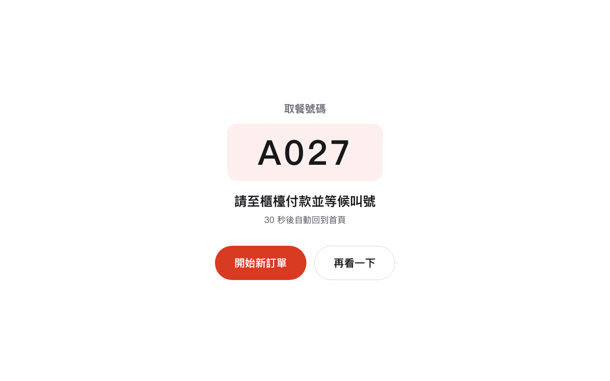

*觸控面板完成畫面：超大取餐號碼、櫃檯付款說明、倒數文字與「開始新訂單」「再看一下」。*

- 抵達時焦點移到「取餐號碼」標題並朗讀號碼（以空白分隔，例：「取餐號碼 A 0 2 7」）。
- 倒數文字每 10 秒以 `aria-live="polite"` 更新，剩 10 秒時改以 `assertive` 通報「10 秒後回到首頁，按『再看一下』可延長」。
- 「再看一下」與任何觸碰 / 按鍵操作都會重新計 30 秒；按鈕高 ≥ 64；不顯示訂單成立頁的「保存訂單」提示與登入入口。

### PG-07 歷史訂單

- 三個 Tabs：進行中 / 已完成 / 已取消；清單為 `OrderCard`，**無限捲動**（每頁 10 筆，`cursor` 分頁）。
- 每張卡：訂單編號、時間、取餐方式與取餐號碼（並列於同一行，例：「內用」「取餐號碼 T001」；`OrderSummary` 沒有桌號欄，歷史訂單卡不論有無桌號都**不顯示**桌號，以取餐號碼辨識，EC-42）、預約時間（有才顯示）、狀態標籤、品項摘要（「招牌滷肉飯 等 3 項」）、總額、動作（查看詳情、再來一單）。
- 空狀態：「還沒有訂單，現在就去點餐吧」＋「回菜單」。訪客進入此頁時改導向 PG-08。**P1 限制**：登入前以訪客身分下的訂單不會出現在歷史訂單（歸戶屬 FR-AC-08，P2），可由 PG-08 的「本機記錄」查看。

### PG-08 訪客查詢訂單

- 欄位：訂單編號、手機號碼；按鈕「查詢」。
- 查無資料一律顯示「找不到訂單，請確認編號與手機」，不揭露是哪個欄位錯誤（EC-15）。
- 下方列出「本機記錄的近期訂單」（`guestOrders`，最多 10 筆），可直接點入。

### PG-09 登入

- 兩步驟：① 輸入手機（`VR-01`）→ ② 輸入 6 位 `OtpInput`，完成自動送出；顯示「{n} 秒後可重新發送」。
- 登入成功導向 `redirect`（預設 `/`）；首次登入顯示簡短歡迎提示。
- 本頁為**選填**入口：從頂部「登入」、結帳頁小字或訂單成立提示進入，從不自動彈出；「以訪客身分繼續」置於按鈕下方的顯眼位置並回到來源頁。
- Demo 模式顯示提示：「Demo 驗證碼：123456」，並提供「快速登入示範會員」按鈕（FR-DM-08）。
- 頁尾告知蒐集目的與隱私權政策連結（FR-SY-06）。

### PG-10 ～ PG-14 會員中心

| 頁面 | 內容 | 重點 |
| --- | --- | --- |
| PG-10 會員中心 | 頭像字首、姓名、手機（遮罩）；入口：歷史訂單、地址簿、我的最愛、優惠券；隱私權、登出、刪除帳號 | 手機版為清單式導覽 |
| PG-11 個人資料 | 姓名、Email 編輯；手機為唯讀（需客服變更） | 儲存後 Toast |
| PG-12 地址簿 | `AddressCard` 清單；新增 / 編輯 Sheet；設為預設；刪除需確認 | 行政區選單連動郵遞區號 |
| PG-13 我的最愛 | 商品卡清單，可直接加入購物車或取消收藏 | 售完者以灰階顯示 |
| PG-14 我的優惠券 | Tabs：可用 / 已使用 / 已過期；券卡顯示折扣內容、條件、效期 | 過期券灰階 |

### PG-15 店家資訊

- 店家名稱、簡介、地址（含地圖連結）、電話（`tel:`）。
- 營業時間表（週一至週日；今日強調；特殊公休日列表）。
- 取餐方式說明、外送範圍表（行政區、運費、最低消費、免運門檻、預估時間）。
- 可用付款方式、餐具政策說明。

### PG-16 靜態頁

- 隱私權政策（蒐集目的、類別、利用期間 / 地區 / 對象 / 方式、當事人權利行使方式）、服務條款。
- 內容由靜態 Markdown 載入；Demo 階段為範例文字並標示「非正式條款」。

### PG-17 404 / 錯誤

- 404：插圖 + 「找不到這個頁面」+「回到菜單」。
- 全域錯誤邊界：「發生了一點問題」+ 重新整理 + 顯示 `requestId`（若有）。

### PG-18 Demo 工具面板

| 項目 | 內容 |
| --- | --- |
| 觸發 | **頂部列的 Demo 入口**（不浮動，因此不會蓋住商品卡、送出鈕或 CartBar）：一般頁面位於右側群組、⌨ 之前（< 768 在購物車圖示之後，位於最右）；任務型頁面（結帳、付款、訂單詳情）位於頁名之後、⌨ 之前；觸控面板預覽的頂部列也有入口（才能用面板把輸入模式切回「自動」）。深色底（不使用品牌色）：< 1024 為 44 px 的圓形圖示鈕（觸控面板 56 px），≥ 1024 為高 40 px 的「圖示 + Demo」膠囊（觸控面板 56 px）；垂直中線與頂部列其他圖示 / 按鈕一致（±1 px），不位移版面（CLS = 0）。可存取名稱「Demo 工具」（有預備項目時為「Demo 工具，已預備 {n} 項下次送出的模擬」），`aria-expanded` 反映面板開關。僅 `VITE_DEMO_MODE=true` 且為 Mock 模式（有 DemoControl）顯示 |
| 形式 | 手機 Bottom Sheet、桌機左下角浮動面板（寬 360） |
| 需求 | FR-DM-01～13 |

| 區塊 | 功能 |
| --- | --- |
| 店家模擬 | **菜單資料完整度**（完整 / 部分缺圖 / 無圖片 / 精簡）、**主題色**（7 組預設）、**店家狀態**（自動 / 強制營業 / 強制休息 / 暫停接單）、**時間穿梭**（實際時間、10:30、12:00、14:30、20:40、21:30、週日、自訂日期時間、快轉 +15 分鐘 / +24 小時）、**商品售完 / 調價**（手動售完旗標） |
| 訂單模擬 | **自動模擬**開關、速度 1× / 2× / 5×、**手動店家操作**：針對最新進行中訂單的按鈕（接單、出餐、出發、完成、拒單） |
| 付款結果 | 下一次付款結果：手動（預設，由付款頁按鈕決定）/ 成功 / 失敗 / 逾時；套用一次後回到手動 |
| 庫存與時段情境 | **每日限量**（剩 1 份 / 剩 2 份 / 用盡 / 恢復預設）、**模擬他人下單**（份數；已成立 / 待付款）、**下一次送出前才發生**（商品變售完 / 他人買走 n 份〔n 為輸入欄〕/ 時段額滿；預備後於下一次送出生效）、**預約時段**已訂數與「讓此時段額滿」「只剩 1 個名額」、清除他人訂單（FR-DM-12） |
| 送出結果 | **下一次送出訂單**（正常 / 失敗，未建立訂單 / 回應遺失，訂單已建立；套用一次後回到正常）、**最近 5 筆送出紀錄**（FR-DM-13） |
| 輸入與記憶 | **輸入模式**（自動 / 觸控面板 / 強制啟用快速鍵並顯示徽章）、**重播鍵盤提醒**（按鈕）、**點餐記憶**（清除 / 載入範例） |
| 系統 | 網路延遲（0 / 300 / 1500 ms）、指定端點的下一次請求失敗、快速登入示範會員、**重置 Demo 資料** |

- 入口不浮動，因此沒有「避讓」規則：Toast、鍵盤提醒的浮動槽與清單 / 焦點元素的 `scroll-padding-bottom` 都不再為 Demo 入口保留空間。面板（桌機為左下角非 modal 浮動面板）開啟時不得遮擋入口、右側訂單面板的「前往結帳」與桌機結帳頁右側摘要欄的送出鈕。
- 面板開關的單一事實來源是 `useInputModeStore.demoPanelOpen`：入口切換它，橫幅的「開啟 Demo 工具」與面板的關閉鈕也操作它，面板（延後載入的 `DemoRoot`）由它推導是否開啟——入口在面板就緒前被點了，就緒後仍會開啟。旗標在 store、不隨外殼重新掛載而歸零，因此換頁（含一般頁與任務型頁面之間）後面板維持開啟。收合面板（Esc、關閉鈕、再點入口）後焦點回到頂部列的入口。
- **Demo 橫幅**（FR-DM-07）：首次造訪顯示、可關閉（記住於 `prefs`）的 `position: fixed` 小卡，位於左下角、底部 Tab / CartBar 之上（與 Toast 共用同一個浮動槽基準），不佔流、不位移版面；**任務型頁面（結帳、付款、訂單詳情）與觸控面板不顯示**，避免蓋住頁底的 sticky 送出列與主要操作，回到一般頁面時（尚未關閉）再顯示；面板展開期間收起。
- Demo 狀態變更一律立即反映於前台，並於面板顯示「目前模擬時間」。
- 面板內顯示訂單之處只列取餐號碼、狀態與取餐方式（手動店家操作的訂單選項，例：「T001・製作中（內用）」），最近送出紀錄只列時間、訂單編號與結果；兩者都不含桌號，因此內用沒有桌號時不會出現桌號列、空白或「桌號 undefined」（EC-42）。
- 面板展開時，尚未顯示的鍵盤偵測提醒待命（收合後再顯示）；已顯示中的提醒被搶走而轉為「稍後」，同次載入不再出現（§10.3）。
- 「重播鍵盤提醒」重設提醒旗標與單鍵快速鍵開關（預設關），略過證據、仍遵守讓位規則與觸控面板模式；按鈕位於面板內，面板展開本身即為待命條件，因此提醒在**收合面板後**才顯示（此待命不受 60 秒證據逾時影響）；已選「不用了」者以此或「重置 Demo 資料」恢復提醒。

**庫存與時段情境**與**送出結果**（FR-DM-12、FR-DM-13；兩個獨立區塊，預設收合，手機 Bottom Sheet 高度上限 70vh、內部捲動）

```text
┌─ 庫存與時段情境 ───────────────────────────── ▾
│  商品 [ 雙人分享餐 ▾ ]
│  每日限量 5 ・ 今日已售 0 ・ 待付款保留 0 ・ 剩 5 份      （aria-live=polite）
│  [ 剩 1 份 ] [ 剩 2 份 ] [ 用盡（剩 0 份）] [ 恢復預設 ]   每日限量 [ 5 ]（空白 = 不限）
├─ 模擬他人下單 ─────────────────────────────────
│  份數 [ 3 ]   (●) 已成立   ( ) 待付款（15 分鐘後釋放）      [ 他人現在下單 ]
├─ 下一次送出前才發生 ───────────────────────────
│  ( ) 商品變售完  ( ) 他人買走 [ 5 ] 份  ( ) 時段額滿   [ 預備 ]
│  ● 已預備：下次送出訂單時，他人會先買走 雙人分享餐 ×5      [ 取消預備 ]
├─ 預約時段 ─────────────────────────────────────
│  日期 [ 今天 ▾ ] 時段 [ 12:30 ▾ ]  已訂 3 / 8   [ 讓此時段額滿 ] [ 只剩 1 個名額 ]
│  [ 清除他人訂單（2 筆）]
└────────────────────────────────────────────────
┌─ 送出結果（獨立區塊）──────────────────────── ▾
│  下一次送出訂單  (●) 正常  ( ) 失敗，未建立訂單  ( ) 回應遺失，訂單已建立
├─ 最近送出紀錄（5 筆）──────────────────────────
│  12:03:15  重送 → 取回原訂單 ZO261014K7M3QX（未重複建立）
│  12:03:11  回應遺失（訂單已建立）
│  12:02:40  被拒：雙人分享餐今日售完
└────────────────────────────────────────────────
```

- 兩區塊皆使用 `fieldset` / `legend`；既有「商品售完 / 調價」保留（手動售完旗標），「庫存與時段情境」的「用盡」代表限量用盡（剩餘 0），兩者在顧客端文案不同（見 §9「限量用盡補充」）。
- 有預備項目或「下一次送出訂單」不是「正常」時，Demo 入口顯示小圓點，`aria-label` 同步為「Demo 工具，已預備 {n} 項下次送出的模擬」；預備於下一次送出訂單時生效一次後自動清除。
- 「模擬他人下單」的份數與「他人買走 n 份」的 n 為各自獨立的輸入欄，皆為 1–20，超出顯示欄位錯誤；注入時夾到剩餘份數並以 Toast 說明。他人訂單以真實訂單列注入，會出現在庫存計數與時段已訂數中。
- 觸控面板模式不顯示「庫存與時段情境」與「送出結果」兩區塊；觸控面板下的送出失敗展示改用網址參數 `?demo_fail=orders.create:AFTER_COMMIT:1`（08 §4、S24 變體）。
- 展示者可觀察結果：剩 2 份 → 菜單卡「剩 2 份」、購物車已有 ×3 者進結帳顯示「今日只剩 2 份」；他人買光 → 卡片「今日售完」；預備被搶後送出 → 送出被拒、訂單集合無新單、表單保留；回應遺失後重試 → 只有 1 筆訂單且紀錄出現「取回原訂單」；快轉 +15 分鐘 → 待付款保留釋放、菜單剩餘回升。

### PG-19 快速鍵與偏好（全域對話框）

| 項目 | 內容 |
| --- | --- |
| 觸發 | 任何頁面按 `?`（僅在已啟用單鍵快速鍵後有效；開啟並停在「鍵盤快速鍵」）；頂部 ⌨ 圖示按鈕（≥ 768）；頁尾的「鍵盤快速鍵」（啟用後附 `?` 徽章）與「偏好設定」；跳過連結「鍵盤快速鍵與偏好」；鍵盤提醒確認狀態的「查看全部」（提醒的「開啟」直接啟用單鍵快速鍵，不經本對話框）。結帳、付款與訂單詳情等任務型頁面同樣提供上列入口。觸控面板模式不提供 |
| 需求 | FR-SY-13、FR-SY-17、FR-SY-18、BR-34、BR-35、BR-42 |
| 形式 | 置中對話框（寬 640；手機為全寬 Sheet），`role="dialog"`、`aria-modal="true"`，焦點陷阱，Esc 關閉並還原焦點；分「鍵盤快速鍵」「顯示與輸入偏好」兩區，內容較長時於對話框內捲動 |

```text
┌─ 鍵盤快速鍵與偏好 ──────────────────────────────────────── ✕
│  開啟下方開關後，按 ? 即可隨時開啟此說明；在輸入框內與輸入法組字時不會觸發
│  [ ] 啟用單鍵快速鍵    開啟後可用單鍵操作，例如 c 開購物車；關閉時僅保留 Esc 與 Ctrl/⌘ + Enter
│      使用螢幕閱讀器時，單鍵快速鍵可能與瀏覽模式的按鍵衝突，建議保持關閉。
│  以下為開啟後的鍵位；未啟用時僅 Esc 與 Ctrl/⌘ + Enter 有效
├─ 全域 ────────────────────┬─ 菜單頁 ─────────────────
│  s  /   搜尋菜單           │  1–9  0   跳到第 N 個分類
│  m      回到菜單           │  v        切換圖卡 / 清單
│  c      開啟購物車         │  a        加入焦點商品
│  o      訂單               │  r        再點上次的選擇
│  i      店家資訊           │  f        收藏 / 取消收藏
│  l      登入 / 會員中心    │
│  ?      顯示此說明         │
├─ 商品面板 ────────────────┼─ 購物車 / 訂單面板 ──────
│  + =    數量 +1            │  e        編輯品項
│  -      數量 −1            │  d        移除品項
│  a      加入購物車         │  + =  -   數量 +1 / −1
│  d      恢復預設選項       │  p        前往結帳
├─ 結帳頁 ──────────────────┼─ 訂單頁 ─────────────────
│  b      返回購物車         │  a        再來一單
│  Ctrl/⌘ + Enter  送出訂單  │  u        立即更新狀態
├─ 顯示與輸入偏好 ──────────────────────────────────────
│  [●] 記住上次點過的選項   於此裝置顯示「上次：…」「↻ 再點」與「常點」
│  [ ] 大字模式             文字放大 12.5%，版面自動重排
│  減少動態   (●) 跟隨系統   ( ) 開   ( ) 關
│  [ 清除我的資料 ]         清除此裝置記住的姓名、手機、地址、點餐記憶與本機訂單記錄
└─ 快速鍵以鍵帽上的字元為準；注音等輸入法下改以實體按鍵比對
```

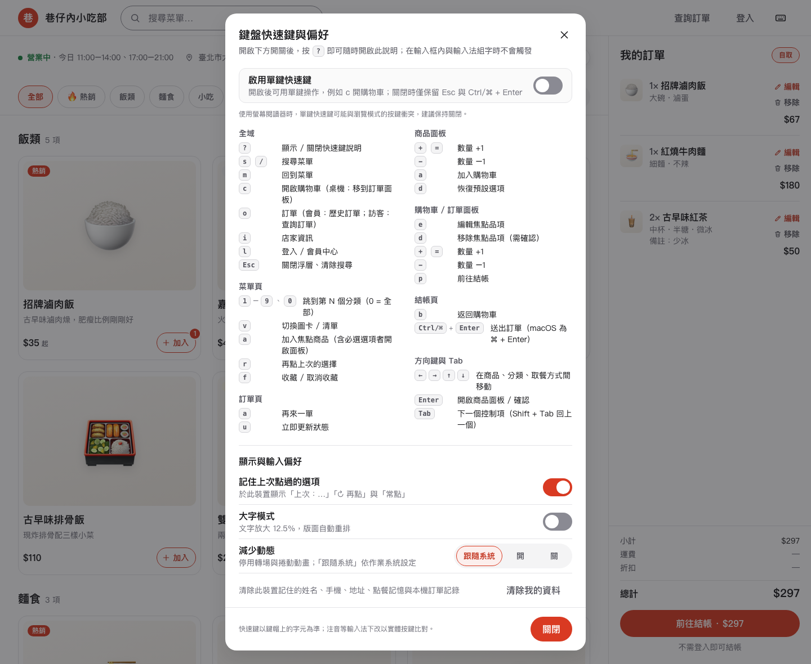

*快速鍵說明與偏好對話框（桌機，預設狀態）：上方為單鍵快速鍵總開關（預設關閉），中間依範圍列出開啟後的全部快速鍵與方向鍵 / Tab，下方為顯示與輸入偏好與「清除我的資料」。*

- 快速鍵內容由 `HOTKEYS` 登錄表產生（07 §7.5），不另行維護；另列出方向鍵與 Tab 行為（§10.2）供不熟悉的使用者參考。
- 「啟用單鍵快速鍵」**預設為關**；開啟後才有單鍵快速鍵、徽章與 `aria-keyshortcuts`，關閉時只保留 `Esc` 與 `Ctrl/⌘ + Enter`（FR-SY-17）。未開啟時 `?` 不生效，須由上列入口進入本對話框；開啟後鍵盤提醒不再自動出現，開啟過本對話框本身也視為已看過提示（以記憶體旗標 `prefsOpenedThisLoad` 記錄，本次載入不再提醒、⌨ 圓點清除，之後即使只切換其他偏好也不再提醒，FR-SY-18、FLOW-25）。
- 對話框副標依狀態切換：未啟用時為「開啟下方開關後，按 ? 即可隨時開啟此說明；…」，已啟用時為「按 ? 隨時開啟；…」；未啟用時鍵位表上方標示「以下為開啟後的鍵位」。使用螢幕閱讀器時，單鍵快速鍵可能與瀏覽模式的按鍵衝突（EC-26），開關下方提示建議保持關閉。
- Demo 模式於對話框底部加一行腳註：「已選「不用了」者，鍵盤提醒不再自動出現；「重置 Demo 資料」會重新啟用提醒。」
- **偏好**皆存於本機（`prefs`）、立即生效、不需按「儲存」。預設：快速鍵關、記住選項開、大字關、減少動態跟隨系統。
- 「清除我的資料」需二次確認（§8.4）：清除訪客資料（姓名、手機、最近地址、付款 / 發票設定）、點餐記憶與本機訂單記錄；**不**清除購物車與上列偏好（FR-CK-14）。
- 結帳頁與頁尾亦有「清除我的資料」捷徑，行為相同。

---

## 8. 狀態與回饋

### 8.1 載入、空、錯誤

| 情境 | 規範 |
| --- | --- |
| 載入 | 清單與卡片以 `Skeleton`（與實際內容同尺寸）；按鈕以 inline spinner；超過 10 秒視為逾時，轉為錯誤狀態 |
| 空狀態 | 插圖（emoji 或簡單 SVG）+ 一句話說明 + 一個主要動作 |
| 錯誤 | 區塊層級顯示原因與「重試」；全頁層級才使用錯誤頁；附 `requestId` 方便客服 |
| 離線 | 頂部固定 `Alert`：「目前沒有網路連線，部分功能暫時無法使用」；恢復後自動消失 |
| 樂觀更新 | 收藏、購物車數量為樂觀更新，失敗時回復並以 Toast 說明 |

### 8.2 空狀態文案

| 場景 | 標題 | 說明 | 動作 |
| --- | --- | --- | --- |
| 購物車空 | 購物車還是空的 | 來點好吃的吧！ | 回菜單 |
| 搜尋無結果 | 找不到「{關鍵字}」 | 試試其他關鍵字，或清除搜尋 | 清除搜尋 |
| 無歷史訂單 | 還沒有訂單 | 現在就去點餐吧 | 回菜單 |
| 無地址 | 還沒有儲存地址 | 新增地址，下次外送更快 | 新增地址 |
| 無最愛 | 還沒有收藏 | 點商品名稱前的愛心加入 | 去逛菜單 |
| 無優惠券 | 目前沒有可用的優惠券 | — | — |

### 8.3 表單驗證時機

- 欄位離開焦點（blur）時驗證；送出時對全表單驗證。
- 錯誤文字位於欄位下方，使用 `aria-describedby` 關聯，並將 `aria-invalid="true"` 置於輸入框。
- 送出失敗：捲動並聚焦第一個錯誤欄位（FR-CK-10）；頁面頂部以 `Alert` 彙整錯誤數量。
- 庫存、時段與價格類異動不屬欄位驗證：送出被退回時改為展開異動清單並聚焦其標題（PG-04、§10.2）；折扣 / 付款 / 發票 / 外送條件類則定位到對應欄位並計入「還有 n 項需要處理」。
- 即時格式化：手機號碼輸入時自動插入連字號（儲存時移除）；折扣碼自動轉大寫。

### 8.4 確認對話框

| 操作 | 標題 | 主要按鈕 | 次要按鈕 |
| --- | --- | --- | --- |
| 清空購物車 | 要清空購物車嗎？ | 清空（danger） | 取消 |
| 取消訂單 | 確定要取消這筆訂單嗎？ | 確認取消（danger） | 保留訂單 |
| 刪除地址 | 要刪除這個地址嗎？ | 刪除（danger） | 取消 |
| 登出 | 確定要登出嗎？ | 登出 | 取消 |
| 清除我的資料 | 要清除此裝置上記住的姓名、手機、地址、點餐記憶與本機訂單記錄嗎？ | 清除（danger） | 取消 |
| 刪除帳號 | 確定要刪除帳號嗎？ | 刪除帳號（danger） | 取消 |
| 切換店家狀態（含庫存售完）導致購物車異動 | 部分商品已無法購買 | 查看並調整（導向結帳頁；狀態列顯示異動，按「查看」展開異動清單，CMP-40） | — |

---

## 9. 文案與語氣

- 語氣：親切、直白、簡短；多用動詞開頭，不過度擬人、不使用驚嘆號堆疊。
- 稱呼：不使用「您」堆疊敬語，採無主詞直述；必要時使用「請」。
- 錯誤訊息：說明「發生什麼事」＋「可以怎麼做」，不暴露技術細節。
- 用詞（台灣慣用）：購物車、結帳、訂單、自取（外帶）、外送、內用、取餐號碼、折扣碼、優惠券、發票載具、統一編號、公休。

| 情境 | 文案 |
| --- | --- |
| 加入購物車 | 已加入購物車（復原） |
| 店家休息 | 目前休息中，可預約 {時間} 後取餐 |
| 暫停接單 | 店家目前較忙，暫停接單。可稍後再試或直接來電 |
| 商品售完 | 今日售完 |
| 限量 | 剩 {n} 份 |
| 外送未達門檻 | 還差 ${n} 可外送 |
| 超出外送範圍 | 此地址不在外送範圍內，可改為自取 |
| 時段額滿 | 此時段已額滿，請選擇其他時段 |
| 價格異動 | 部分商品價格已更新，請確認後再送出 |
| 付款失敗 | 付款未完成，可重新付款或改用現金 |
| 付款逾時 | 超過付款時間，訂單已自動取消，保留的餐點與時段已釋出。想再訂可按「再來一單」 |
| 訂單已送出 | 訂單已送出，等待店家確認 |
| 可取餐 | 餐點完成了，請憑取餐號碼 {pickup_no} 取餐 |
| 找不到訂單 | 找不到訂單，請確認編號與手機 |
| 網路錯誤 | 網路好像不太穩，請稍後再試 |
| 結帳頁登入提示 | 已有帳號？登入以快速帶入 · 可略過 |
| 免登入說明 | 不需登入即可結帳 |
| 記住資料 | 記住我的資料（僅存於此裝置） |
| 清除資料 | 清除我的資料 |
| 訂單成立保存提示 | 想保存這筆訂單？以手機建立會員 |
| 訪客點愛心 | 登入後可收藏喜愛的餐點 |
| 內用桌號欄 | 標籤「桌號（選填）」；提示「沒有桌號可以留空，餐點好了會依取餐號碼叫號」 |
| 內用沒有桌號（訂單頁「內用資訊」列） | 內用・{店名}・取餐號碼 {pickup_no}（沒有桌號時不顯示「桌號」列；有桌號為「內用・{店名}・桌號 {tableNo}」；歷史訂單卡不顯示桌號，只列取餐方式與取餐號碼） |
| QR 桌號無法辨識（回退一般點餐） | 找不到 QR 帶入的桌號，已改為一般點餐；要內用請改選「內用」（桌號可留空），或洽店員 |
| 店家未開放內用（QR 回退） | 店家目前未開放內用，已改為一般點餐 |
| 桌號格式不符（送出前擋下） | 找不到此桌號，請洽店員 |
| 桌號不是店家桌位（伺服器退回 `TABLE_NOT_FOUND`） | 找不到這個桌號，請洽店員協助 |
| 觸控面板內用 | 內用不需要桌號，餐點好了會依取餐號碼叫號 |
| 快速鍵說明（已啟用） | 鍵盤快速鍵｜按 ? 隨時開啟；在輸入框內與輸入法組字時不會觸發 |
| 偏好標題 | 顯示與輸入偏好 |
| 記住選項 | 記住上次點過的選項（僅存於此裝置） |
| 大字 | 大字模式（文字放大 12.5%） |
| 減少動態 | 減少動態：跟隨系統／開／關 |
| 清除確認 | 要清除此裝置上記住的姓名、手機、地址、點餐記憶與本機訂單記錄嗎？（清除／取消） |
| 快速鍵開關（預設關閉） | 啟用單鍵快速鍵｜開啟後可用單鍵操作，例如 c 開購物車；關閉時僅保留 Esc 與 Ctrl/⌘ + Enter |
| 上次選擇 | 上次：{選項摘要} |
| 再點 | ↻ 再點 |
| 面板套用 | 已套用上次的選擇：{選項摘要}　恢復預設 |
| 部分失效 | 部分選項已不提供，已改用預設 |
| 再點結果 | 已再點：{品名}（{選項摘要}）{金額}，目前 {n} 項，共 {小計} |
| 再點失敗 | 暫時無法再點，請稍後再試 |
| 達上限 | 此品項已達上限 {n} 份 |
| 付款時限 | 付款時間剩 2 分鐘 |
| 完成畫面按鈕 | 開始新訂單／再看一下 |
| 常點標題 | 常點的餐點（依你上次點餐的選項） |
| 記憶說明 | 點餐記憶僅存於此裝置，可在「清除我的資料」移除 |
| 閒置警示 | 還在嗎？{n} 秒後將重新開始，購物車會清空（繼續點餐／重新開始）；送出結果未知時多一行：上一筆訂單結果尚未確認，請洽櫃檯確認 |
| 完成畫面 | 請至櫃檯付款並等候叫號。{n} 秒後自動回到首頁（開始新訂單） |

**結帳與庫存確認（v0.4 新增）**

異動清單的原因與動作文案由前端依錯誤碼與 `availableQuantity`、`remaining` 組成（以下為準），伺服器回傳的 `message` 僅作未知錯誤碼的降級文字。

| 情境 | 文案 | 備註 |
| --- | --- | --- |
| 送出中 | 確認餐點與時段中… | 送出鈕文案，並以 `polite` 通報同一句 |
| 重新計價中（送出鈕） | 重新計價中… | |
| 狀態列（確認中） | 正在確認餐點與時段… | 頁首預留高度（`min-height`）的狀態列 |
| 狀態列（無異動） | ✓ 餐點與時段可供應 | 淡色小字，高度不變 |
| 狀態列（有異動） | 有 {n} 項需要調整〔查看〕 | 收合列；n 同清單標題 |
| 狀態列（僅價格更新） | 有 {k} 項價格更新〔查看〕 | k = 價格更新項數（不計入 n）；n = 0 時使用，不顯示「有 0 項」 |
| 狀態列（預檢失敗） | 暫時無法預先確認，送出時會再確認 | `quote` 逾時或 5xx；不阻擋送出；未取得 `quote` 時不顯示「✓」 |
| 清單標題 | 有 {n} 項餐點需要調整 | n = 阻擋項（品項、時段各算一項；同一品項行有多個原因時只算一項，以 06 §4.3 的優先序最高者呈現），價格更新不計入；含折扣 / 付款 / 發票 / 外送條件類時改用「有 {n} 項需要調整」 |
| 清單標題（僅價格更新） | 價格已更新，請確認 | n = 0 時使用 |
| 清單說明（送出被退回） | 訂單尚未送出，已填寫的資料都還在。 | 先說明未建立訂單 |
| 清單說明（點「查看」展開，狀態由背景偵測產生） | 部分餐點狀態有變動，調整後即可送出。 | 進入結帳與背景偵測本身不展開清單，只更新狀態列；使用者點「查看」後才顯示此句 |
| 售完 | {品名}　今日售完 | 動作：移除；送出被退回且該品原本可買時顯示「{品名}　剛剛被訂走了」 |
| 限量用盡補充 | 限量已被訂完；若他人的訂單逾時未付款或被取消，份數可能釋出，可稍後再試 | 次行小字（Q-15）；觸控面板不顯示付款期限字樣 |
| 數量不足 | {品名}　今日只剩 {n} 份（已選 {m} 份） | 動作：改為 {n} 份、移除 |
| 同商品多行 | {品名}　合計已選 {m} 份，今日只剩 {n} 份 | 各行「{選項摘要}　改為 {k} 份」 |
| 取餐日非今日（變體） | 上列含「今日」的庫存文案（售完、數量不足、同商品多行、限量用盡補充、行內剩餘）在取餐營業日不是今日時，「今日」改為「明天（{M/D}）」，更後面的營業日為「{M/D}」；例：「雙人分享餐　明天（10/15）只剩 2 份（已選 3 份）」 | 前端依所選時段的取餐營業日與今日比較決定（庫存依取餐營業日計，BR-40、EC-38）；購物車頁尚未選時段，維持「今日」並以今日剩餘保守封頂 |
| 同商品其他行已用完 | {選項摘要}　已被同商品其他行占用 | 動作：移除 |
| 單行超過上限 | {品名}　此品項最多 {n} 份 | 動作：改為 {n} 份、移除（`QUANTITY_EXCEEDED`） |
| 品項行數超過上限 | 購物車最多 {n} 項品項，請移除部分品項 | 無 `lineIndex` 的整單項，歸入「數量不足」類別並置於該類別最前（FLOW-23）；動作：移除品項 |
| 下架 | {品名}　已下架 | 動作：移除 |
| 選項失效 | {品名}　的「{選項}」暫無供應 | 動作：重新選擇、移除 |
| 時段額滿 | {HH:mm} 這個時段已額滿 | 動作：改選 {HH:mm}、選其他時段、改為盡快（若可用）；通用句沿用「此時段已額滿，請選擇其他時段」 |
| 時段已過 | {HH:mm} 已來不及準備，請重新選擇時段 | |
| 取餐方式不可用 | 店家目前未開放{取餐方式}，請改選其他取餐方式 | 動作：改為其他取餐方式（`SERVICE_NOT_AVAILABLE`） |
| 店家狀態（被退回，休息中） | 店家剛剛休息了，可預約 {時間} 後取餐 | 狀態列下方的店家狀態說明，不進清單；動作：改預約；焦點移到說明 |
| 店家狀態（被退回，暫停接單） | 店家剛剛暫停接單，目前無法送出訂單。可稍後再試或直接來電 | 整頁唯讀；動作：致電店家（電話）；`polite` 通報 |
| 價格更新 | {品名}　價格已更新：${舊} → ${新} | 無動作，由主按鈕確認 |
| 折扣失效 | 折扣 −${n} 已失效，總額 ${舊} → ${新} | 列為價格差異，並於折扣碼欄位顯示原因 |
| 會員專屬折扣碼未登入 | 此折扣碼僅限會員 | 折扣碼欄位錯誤，計入鎖定數；動作：移除折扣碼、登入（可略過）；不強制登入下單（BR-33） |
| 全部套用建議 | 全部套用建議 | 次行摘要「移除 1 項、1 項改為 2 份、時段改為 17:15」 |
| 套用結果 | 已調整：{摘要}（復原） | 畫面可見摘要，「復原」持續存在；`polite` 通報用 §10.4 的「已調整 n 項，可以送出了」 |
| 送出鈕（鎖定說明） | 還有 {n} 項需要處理 | `aria-disabled` + `aria-describedby` |
| 送出鈕（價格確認） | 確認新價格並送出 · ${total} | 差異展示後才出現（兩步確認） |
| 價格差異（首次點擊送出） | 總額由 ${舊} 變為 ${新}，確認後再按一次送出 | `polite`；焦點移到清單標題（價格差異） |
| 全部無法購買 | 購物車裡的餐點目前都無法購買 | 動作：回菜單看看 |
| 步進器達上限 | 今日只剩 {n} 份，已達上限 | 與「此品項已達上限 {n} 份」區分 |
| 行內剩餘 | 今日剩 {n} 份 | 剩餘 ≤ 10 於購物車與結帳顯示 |
| 限量揭露 | 限量餐點於送出訂單後才會保留 | caption，非警示 |
| 保留說明 | 已保留餐點與取餐時段，請於 {HH:mm} 前完成付款 | PG-05、PG-06 |
| 接單期限（PG-06） | 店家將於 {HH:mm} 前確認 | 取 `Order.acceptBy`，僅 `PENDING` 顯示；預約單另顯示「預約 HH:mm」 |
| 結果未知 | 網路不太穩，無法確認訂單是否已送出。再試一次不會重複下單 | 動作：再試一次、致電店家確認（店名與電話）；不導向「查詢訂單」 |
| 結果未知（觸控面板） | 無法確認訂單是否已送出，請洽櫃檯確認 | 動作：再試一次；閒置警示多一行「上一筆訂單結果尚未確認，請洽櫃檯確認」，重置時丟棄 Key 與記下的送出內容（FLOW-21） |
| 重放成功 | 訂單已成立 | Toast；依 `nextAction` 導向訂單頁或付款頁（FLOW-24） |
| 取回原訂單（內容不同） | 稍早送出的訂單已成立，內容與目前購物車不同。如需調整，請先取消該訂單再重新下單 | 依 `nextAction` 導向該訂單；購物車保留 |
| 重放為已取消 | 這筆訂單已取消，購物車內容仍保留，可回到購物車重新送出 | 導向訂單頁並顯示取消原因，訂單頁照常提供「再來一單」；不提示「訂單已成立」 |
| 鎖逾時（503） | 目前點餐人數較多，請稍後再按一次送出訂單 | 僅 `503` 且附 `retryAfterSeconds`（確定未建立）；未附者視為結果未知；冷卻期間（`503` 附 `retryAfterSeconds` 或 `429`）送出鈕依該秒數暫停並沿用同一把 Key，`aria-disabled` 並以 `aria-describedby` 帶倒數說明，`Ctrl/⌘ + Enter` 不動作 |
| 限流（429） | 操作太頻繁，請稍後再按一次送出訂單 | `429 RATE_LIMITED`（`POST /orders` 專屬限流，確定未建立）；不記下送出內容、不進結果未知，沿用同一把 Key；焦點在頁首 `Alert` 的「再試一次」（FLOW-24、06 §1.6） |
| 自己的待付款單占用（選配，EC-34 後半） | 這些餐點正由你的待付款訂單 {訂單編號} 保留（剩 {mm:ss}） | Phase 1 可不實作；僅用本機已持有的訂單判斷（跨裝置無法判斷），不計入「還有 n 項」；動作：繼續付款、取消該訂單 |
| 再來一單調整 | 已將「{品名}」調整為 {n} 份（今日限量） | 略過清單說明（FLOW-13） |
| 行銷同意 | 我願意收到店家的優惠與活動訊息 | 條款聲明下方的獨立選填勾選，預設不勾選（FR-CK-13） |

**鍵盤偵測提醒（v0.4 新增）**

| 情境 | 文案 | 備註 |
| --- | --- | --- |
| 提醒標題 | 偵測到實體鍵盤 | |
| 提醒內文（一般） | 要開啟單鍵快速鍵嗎？例如按 c 開購物車、按 s 搜尋。可隨時在偏好設定關閉。 | |
| 提醒內文（剛按到快速鍵） | 剛才按的「{key}」是快速鍵，目前尚未開啟。要開啟單鍵快速鍵嗎？ | 按鍵命中快速鍵時 |
| 按鈕 | 開啟／不用了 | 「開啟」為主要按鈕 |
| 「不用了」說明 | 之後不會再自動提醒，仍可在偏好設定開啟。 | `aria-describedby` |
| 確認狀態 | 已開啟單鍵快速鍵。按 ? 查看全部。 | 按鈕：查看全部／復原 |
| 容器名稱 | 鍵盤快速鍵提醒 | `aria-label` |
| ⌨ 按鈕名稱 | 鍵盤快速鍵與偏好 | `aria-label` 與 tooltip；≥ 768 逾時收起後有小圓點時補「，有新提示」 |
| 頁尾連結 | 鍵盤快速鍵（未啟用）／鍵盤快速鍵 ?（已啟用） | |
| PG-19 副標（未啟用） | 開啟下方開關後，按 ? 即可隨時開啟此說明；在輸入框內與輸入法組字時不會觸發 | 已啟用沿用上表「快速鍵說明」 |
| PG-19 螢幕閱讀器提示 | 使用螢幕閱讀器時，單鍵快速鍵可能與瀏覽模式的按鍵衝突，建議保持關閉。 | 開關下方 |
| PG-19 腳註（Demo） | 已選「不用了」者，鍵盤提醒不再自動出現；「重置 Demo 資料」會重新啟用提醒。 | 僅 Demo 模式 |
| 通報（顯示） | 偵測到實體鍵盤，可以開啟單鍵快速鍵。 | `polite`，僅一次 |
| 通報（開啟） | 單鍵快速鍵已開啟，按問號查看全部。 | `polite` |
| 通報（復原） | 單鍵快速鍵已關閉。 | `polite` |
| 通報（不用了） | 已不再提醒。可在偏好設定開啟單鍵快速鍵。 | `polite` |

---

## 10. 無障礙、鍵盤與多輸入裝置

### 10.1 目標與範圍

- **目標**：WCAG 2.2 AA（涵蓋 2.1 AA）。若要申請無障礙標章，請依主管機關最新檢測規範再行確認（以 WCAG 2.1 AA 為基礎）。
- **輸入平等**：觸控、滑鼠、鍵盤、螢幕閱讀器與語音輸入皆能完成主流程（§1 原則 11）。
- **驗證**：axe 自動檢測（含浮層開啟狀態與觸控面板模式）＋ Playwright 純鍵盤流程 ＋ VoiceOver / NVDA 手動冒煙（UAT-16～18）；異動清單與鍵盤提醒另見 UAT-26、UAT-27。

**WCAG 2.2 重點準則的落點**

| 準則 | 級別 | 做法 |
| --- | --- | --- |
| 1.4.10 重排 | AA | 320 CSS px 無水平捲動、無雙向捲動（§5.1） |
| 1.4.11 非文字對比 | AA | 表單邊框 ≥ 3:1（§4.1）；焦點外框 ≥ 3:1 |
| 1.4.12 文字間距 | AA | 容器不固定高度：結帳狀態列、店家狀態說明與鎖定說明只預留 `min-height`（rem，涵蓋兩行與 44 px 目標），內容可撐高，僅在文字縮放或使用者覆寫間距時才允許位移；文字區可承受行高 1.5、字距 0.12em（E2E 含 200% 字級與大字模式） |
| 1.4.13 懸停或焦點內容 | AA | Tooltip 可關閉（Esc）、可懸停、不自動消失；必要資訊不藏在 hover |
| 2.1.1 / 2.1.2 鍵盤 / 無鍵盤陷阱 | A | 全功能可鍵盤操作；浮層焦點陷阱可由 Esc 離開 |
| 2.1.4 字元快速鍵 | A | 單鍵快速鍵**預設關閉**、可隨時開關（`?` 同受開關約束）、僅在非輸入焦點觸發（§10.3）；`Esc` 與 `Ctrl/⌘ + Enter` 不是單字元快捷鍵 |
| 2.2.1 時限可調整 | A | 觸控面板閒置警示可延長、完成畫面可「再看一下」（FLOW-21）；付款倒數於剩 2 分鐘時通報，時限屬 BR-38 的保留期限（essential exception），是否提供延長見 Q-10；鍵盤提醒 hover / 焦點即暫停計時，逾時不遺失資訊或功能（≥ 768 的 ⌨ 圓點、頁尾、跳過連結與 PG-19 皆可進入） |
| 2.2.2 暫停、停止、隱藏 | A | 鍵盤提醒為一次性淡入淡出（約 200 ms），非循環動畫，hover / 焦點可暫停計時 |
| 2.4.1 / 2.4.3 / 2.4.7 | A / A / AA | 跳過連結、焦點順序、焦點可見 |
| 2.4.11 焦點不被遮蔽 | AA | sticky 列以 `scroll-padding` / `scroll-margin` 讓焦點元素不被遮住；鍵盤提醒顯示時同樣以 `scroll-padding` 避讓；待命時比對 `document.activeElement` 與卡片矩形，重疊即維持待命，顯示中焦點移入被卡片遮住的元件（`focusin` 重疊）即轉為「稍後」收起（FLOW-25 的焦點遮擋條件） |
| 2.5.1 / 2.5.7 手勢與拖曳 | A / AA | 無必要的路徑 / 多點手勢；下滑關閉有「✕」替代 |
| 2.5.3 名稱含可見標籤 | A | 按鈕可存取名稱包含可見文字；快速鍵徽章 `aria-hidden` 不改變名稱 |
| 2.5.8 目標尺寸（最小） | AA | 最低要求為 24×24 CSS px；本規格採更嚴格的 44×44（相當於 AAA 的 2.5.5），觸控面板 56×56（§5.6） |
| 3.2.1 / 3.2.2 取得焦點 / 輸入時 | A | 鍵盤提醒取得焦點與異動偵測都不觸發情境變更（不自動跳頁、不自動送出）；開啟單鍵快速鍵只在使用者明確按「開啟」後發生，並可復原 |
| 3.2.6 一致的說明 | A | 「致電店家」「查詢訂單」於各頁位置一致；頂部 ⌨ 按鈕、頁尾「鍵盤快速鍵」入口與跳過連結的相對順序一致（含結帳、付款、訂單詳情等任務型頁面；任務型頁面僅省略「跳到我的訂單」） |
| 3.3.1 / 3.3.3 錯誤識別與建議 | A / AA | 異動清單以文字說明原因並提供就地修正動作（改為 n 份、改選時段）；折扣 / 付款 / 發票類定位到欄位 |
| 3.3.4 錯誤預防（金額、資料） | AA | 送出時伺服器最終確認庫存與時段；總額增加須兩步確認；`Idempotency-Key` 防重複下單 |
| 3.3.7 重複輸入 | A | 同一流程不要求重填已輸入的資料；訪客資料可記住；被退回後表單與已選時段全數保留 |
| 3.3.8 無障礙驗證 | AA | OTP 可貼上、支援 `autocomplete="one-time-code"`，不要求轉抄或記憶 |
| 4.1.3 狀態訊息 | AA | 加入購物車、數量、錯誤、訂單狀態、庫存異動與鍵盤提醒結果以 `aria-live` 通報（§10.4） |

### 10.2 鍵盤操作與焦點管理

- **順序**：Tab 順序等於視覺順序（唯一的例外是浮動的鍵盤提醒：它在 DOM 中緊接跳過連結之後，Tab 可立即到達，但顯示時不搶焦點，見 §10.3）；商品網格、分類膠囊、分段控制採 roving tabindex（整組只佔一個 Tab 停點，內部用方向鍵）。
- **跳過連結**：頁面最前面最多三個——「跳到主要內容」「跳到我的訂單」「鍵盤快速鍵與偏好」，取得焦點才顯示；「跳到我的訂單」只在有常駐訂單面板（≥ 1024 的菜單頁）時出現，其餘頁面為兩個；「鍵盤快速鍵與偏好」永遠是最後一個（螢幕閱讀器使用者可由此啟用或停用單鍵快速鍵）；結帳、付款、訂單詳情等任務型頁面省略「跳到我的訂單」，保留「跳到主要內容」與「鍵盤快速鍵與偏好」，相對順序與一般頁面一致（WCAG 3.2.6）；鍵盤提醒（`KeyboardNotice`）在 DOM 中緊接跳過連結之後，Tab 順序為跳過連結 → 提醒 → 頁首。
- **焦點外框**：所有可互動元件 `:focus-visible` 為 2px `--color-brand-text` 外框 + 2px 間距；主色填滿的按鈕改用雙層環 `box-shadow: 0 0 0 2px #fff, 0 0 0 4px var(--color-brand-text)`。不得 `outline: none` 而不補替代。

**方向鍵與原生按鍵**（不屬於「單字元快速鍵」）

| 元件 | 鍵 | 行為 |
| --- | --- | --- |
| 商品網格 | `←` `→` `↑` `↓`、`Home` / `End` | 在商品卡間移動焦點；`Enter` / `Space` 開啟商品面板 |
| 分類膠囊列 | `←` `→`、`Home` / `End`、`Enter` | 移動並選取分類 |
| 取餐方式（分段控制） | `←` `→` | 切換自取 / 外送 / 內用 |
| 單選群組 | `↑` `↓` `←` `→` | 切換選項（原生 radio） |
| 複選群組 | `Space` | 勾選 / 取消 |
| 數量步進器 | `↑` `↓` | 增減（`role="spinbutton"`，朗讀目前數量）；`+` `-` 由全域快速鍵登錄表處理（§10.3），元件不另行監聽 |
| 預約時段 | 方向鍵 | 選擇時段；額滿者 `aria-disabled` 並說明 |
| 面板 / 對話框 | `Tab` / `Shift + Tab`、`Esc` | 焦點陷阱循環；Esc 關閉並還原焦點 |

> 方向鍵、`Home` / `End` 與搜尋框內的 `↓` / `Enter` 為元件原生導覽，由元件自行處理，不屬於單字元快速鍵；`HOTKEYS` 登錄的鍵（字元、`Esc`、`Ctrl/⌘ + Enter`）只由 `HotkeyProvider` 處理。`HotkeyProvider` 掛在 `document` 的 capture 階段、先於元件處理器執行，先累積鍵盤偵測證據（含方向鍵與 `Tab`，§10.3）再處理 `HOTKEYS`。

**焦點管理**

| 情境 | 焦點去向 |
| --- | --- |
| 開啟商品面板 | 移到面板標題（`tabindex="-1"`）；關閉時還原到觸發的商品卡 |
| 加入購物車 | 面板關閉後回到商品卡；以 live region 通報結果，不搶走焦點 |
| 路由切換 | 移到新頁面的 `h1`（`tabindex="-1"`），讓螢幕閱讀器朗讀頁標題 |
| 送出訂單成功 | 移到訂單頁狀態標題（UAT-16） |
| 確認對話框 / 閒置警示 | 移到安全的預設按鈕（取消 / 繼續點餐）；Esc = 取消 |
| 表單驗證失敗 | 移到第一個錯誤欄位；頁面頂部錯誤摘要 `role="alert"` |
| 移除購物車品項 | 移到下一個品項（最後一項被移除則移到前一項）；購物車變空則移到「回菜單」，並通報「購物車已清空」 |
| 卡片「＋ 加入」變為 `− n ＋` | 焦點保持在新出現的「＋」按鈕上，不遺失 |
| 「恢復預設」 | 焦點留在原處；以 polite 通報「已恢復預設選項」 |
| 觸控面板重置 | 焦點移到菜單頁標題，並通報「已重新開始」 |
| 送出訂單（送出中） | 焦點留在送出鈕（`aria-disabled` + `aria-busy`，不使用 `disabled`）；結果以 `polite` 通報 |
| 送出被退回（422 / 409），或按下送出後預檢發現異動 | 移到異動清單標題 `h2`；標題以 `aria-describedby` 指向視覺隱藏的摘要節點（不重複標題）朗讀一次，不另用 `role="alert"` |
| 進入結帳且有異動 | 不搶焦點（路由切換已移到頁面 `h1`）；狀態列在 `h1` 之後依序可讀，清單不自動展開 |
| 背景偵測到新異動 | 焦點不動、版面不位移；只更新狀態列、明細行與送出鈕，並以 `polite` 通報 |
| 點擊鎖定的送出鈕 / `Ctrl/⌘ + Enter` | 焦點與捲動移到清單標題，通報「還有 n 項需要處理」 |
| 總額增加，首次點擊送出（僅價格更新） | 移到清單標題（價格差異）；`polite` 通報「總額由 ${舊} 變為 ${新}，確認後再按一次送出」 |
| 店家狀態被退回或預檢回報（休息中、暫停接單） | 移到店家狀態說明（休息中時為「改預約」）；`polite` 通報說明文案，不進異動清單 |
| 單項處理（移除 / 改為 n 份） | 移到下一個異動項的主要動作；最後一項處理完移到送出鈕；購物車變空則移到「回菜單看看」，並通報「購物車已清空」 |
| 全部套用建議 | 移到「已調整」摘要標題；下一個 Tab 停點為「復原」與送出鈕 |
| 復原 | 焦點回到清單標題 |
| 時段額滿被退回且僅時段問題 | 移到時段選擇區第一個可選項；原選取清除，不自動選取 |
| 結果未知（無回應 / 逾時 / 5xx）、鎖逾時（`503` 附 `retryAfterSeconds`）或限流（`429`） | 移到頁首 `Alert` 內的「再試一次」按鈕（說明以 `aria-describedby` 帶入，不另用 `role="alert"`）；後兩者冷卻期間送出鈕與該按鈕同為 `aria-disabled`，以 `aria-describedby` 帶倒數說明（可聚焦） |
| 鍵盤提醒顯示 | 不移動焦點（不呼叫 `focus()`），`document.activeElement` 前後相同 |
| 鍵盤提醒按「開啟」 | 僅由鍵盤（`Enter` / `Space`）啟動時，焦點才由「開啟」移到「查看全部」；滑鼠或觸控點擊不移動焦點（避免計時被焦點暫停，卡片依計時於 6 秒後收起） |
| 鍵盤提醒收起（逾時、`Esc`、被讓位、確認狀態結束） | 收起當下 `document.activeElement` 仍在卡片內才還原先前焦點；焦點已離開卡片（例如已移到搜尋框或浮層）時不得移動焦點 |

### 10.3 單字元快速鍵（小寫字母）

為了讓鍵盤使用者更快完成點餐，常用功能提供**單一小寫字母**快速鍵。快速鍵**預設關閉**（徽章隱藏）：偵測到實體鍵盤時以提醒詢問是否開啟，啟用後才在控制項旁以小徽章標示，使用者不需記憶。

**設計原則**

1. **助記**：取英文字首（`c` cart、`s` search、`o` orders、`a` add、`r` repeat、`p` proceed、`e` edit、`d` delete / default、`b` back、`u` update），中文說明同時呈現。
2. **預設關閉、可開關**（WCAG 2.1.4）：說明對話框提供「啟用單鍵快速鍵」開關，預設為關；關閉時只保留 `Esc` 與 `Ctrl/⌘ + Enter`。
3. **不干擾輸入**：焦點在輸入元件（文字類 input、textarea、select、contenteditable；radio、checkbox、button 與數量步進器**不算**）、輸入法組字中、按下 Alt / Ctrl / ⌘（`Ctrl/⌘ + Enter` 除外）或長按時一律不觸發（BR-34、FLOW-19）。
4. **CapsLock 不影響**：以小寫比對；按住 Shift 的字母 / 數字不觸發（Shift 只用於 `?`、`+` 等符號），避免與大寫輸入習慣衝突。
5. **範圍化**：浮層開啟時，只有 `?`（已啟用時）、`Esc` 與該浮層自己的範圍有效；背景頁面的範圍（含 `Ctrl/⌘ + Enter`）一併失效，避免在面板後面誤觸導覽或送單。
6. **`Esc` 與 `Ctrl/⌘ + Enter` 的語意**：`Esc` 依序為關閉最上層浮層 → 收起鍵盤提醒（若可見且焦點在其中；由 `HotkeyProvider` 依 `closeTarget` 的結果處理，元件不自行監聽）→ 搜尋框有字則清除並失焦 → 其餘不動作（不做頁面返回；返回請用「←」或瀏覽器返回）。`Ctrl/⌘ + Enter` 等同按下「送出訂單」並先驗證表單：只有店家暫停接單（`PAUSED`，整頁唯讀）時送出鈕為真正的 `disabled`，其餘狀態（送出中、冷卻中、重新計價中、被異動清單鎖定含未達最低消費）一律 `aria-disabled`，可聚焦且點擊與 `Ctrl/⌘ + Enter` 仍會被處理；判斷順序：送出中、冷卻中（`503` 附 `retryAfterSeconds` 或 `429`，依該秒數暫停，送出鈕以 `aria-describedby` 帶倒數說明）或店家暫停 → 不動作；重新計價中 → 排入佇列，`quote` 回來後再決定；被異動清單鎖定 → 不送出，改為展開清單並聚焦標題；總額增加且差異尚未展示 → 只展開差異，第二次才送出；其餘 → 送出（與點擊送出鈕相同，FLOW-19、PG-04）。
7. **未啟用時一併隱藏**：未啟用（預設）、使用者停用單鍵快速鍵，或處於觸控面板模式（另停用單鍵快速鍵）時，不輸出徽章與 `aria-keyshortcuts`，避免提示不存在的快速鍵；`?` 為符號字元快捷鍵，同樣不生效（`help` 不設 `alwaysOn`）。**例外**：`Ctrl/⌘ + Enter` 不是單字元快捷鍵，其說明小字與 `aria-keyshortcuts="Control+Enter Meta+Enter"` 不跟隨開關，於桌機（`(hover: hover) and (pointer: fine)`）常駐在「送出訂單」旁，觸控面板模式除外。
8. **單一事實來源**：下表與說明對話框、徽章、`aria-keyshortcuts` 皆由 `HOTKEYS` 登錄表（[07 §7.5](./07-frontend-architecture.md)）產生。
9. **提醒不影響操作版面**：鍵盤偵測提醒（`KeyboardNotice`）為 `position: fixed` 的浮動卡，不佔流、不搶焦點、不遮蔽焦點與主要操作；顯示與收起前後主要控制項位置不變（NFR-18）。使用者主動開啟徽章時允許局部重排（Q-16），但不得隱藏功能控制項。
10. **事件界線**：`HotkeyProvider` 於 `document` 的 capture 階段、先於所有元件處理器執行，先判斷鍵盤偵測證據再處理 `HOTKEYS`；`HOTKEYS` 登錄的鍵（單字元、`Esc`、`Ctrl/⌘ + Enter`）只能由它處理；方向鍵、`Home` / `End`、搜尋框內的 `↓` / `Enter` 為元件原生導覽（§10.2），不屬於單字元快速鍵。

**快速鍵地圖**

以下為啟用後的鍵位；未啟用時僅 `Esc` 與 `Ctrl/⌘ + Enter` 有效。

| 範圍 | 鍵 | 動作 | 說明 |
| --- | --- | --- | --- |
| 全域 | `?` | `help` | 顯示 / 關閉快速鍵說明 |
| 全域 | `s`、`/` | `search` | 搜尋菜單 |
| 全域 | `m` | `goMenu` | 回到菜單 |
| 全域 | `c` | `openCart` | 開啟購物車（桌機：移到訂單面板） |
| 全域 | `o` | `goOrders` | 訂單（會員：歷史訂單；訪客：查詢訂單） |
| 全域 | `i` | `goStore` | 店家資訊 |
| 全域 | `l` | `goLogin` | 登入 / 會員中心 |
| 全域 | `Esc` | `close` | 關閉浮層、清除搜尋（不受停用影響） |
| 菜單頁 | `1`–`9`、`0` | `jumpCategory` | 跳到第 N 個分類（0 = 全部） |
| 菜單頁 | `v` | `toggleLayout` | 切換圖卡 / 清單 |
| 菜單頁 | `a` | `addFocused` | 加入焦點商品（含必選選項者開啟面板） |
| 菜單頁 | `r` | `repeatFocused` | 再點上次的選擇 |
| 菜單頁 | `f` | `toggleFavorite` | 收藏 / 取消收藏 |
| 商品面板 | `+`、`=` | `qtyUp` | 數量 +1 |
| 商品面板 | `-` | `qtyDown` | 數量 −1 |
| 商品面板 | `a` | `confirmAdd` | 加入購物車 |
| 商品面板 | `d` | `restoreDefault` | 恢復預設選項 |
| 購物車 / 訂單面板 | `e` | `editLine` | 編輯焦點品項 |
| 購物車 / 訂單面板 | `d` | `removeLine` | 移除焦點品項（需確認） |
| 購物車 / 訂單面板 | `+`、`=` | `qtyUp` | 數量 +1 |
| 購物車 / 訂單面板 | `-` | `qtyDown` | 數量 −1 |
| 購物車 / 訂單面板 | `p` | `checkout` | 前往結帳 |
| 結帳頁 | `b` | `back` | 返回購物車 |
| 結帳頁 | `Ctrl/⌘ + Enter` | `submitOrder` | 送出訂單（macOS 為 ⌘ + Enter）（不受停用影響） |
| 訂單頁 | `a` | `again` | 再來一單 |
| 訂單頁 | `u` | `refresh` | 立即更新狀態 |

> 數字鍵跳分類：`1`–`9` 對應分類膠囊由左而右（不含「全部」），`0` 為「全部」。`+` 在美式鍵盤需按 Shift，因此 `=` 同樣有效。非 QWERTY 配置（如 AZERTY）以鍵帽上印的字元為準：其數字列需按 Shift 才得到數字，而 Shift + 數字不觸發，請改用數字鍵台。

**提示的呈現（`KeyHint`）**

| 項目 | 規範 |
| --- | --- |
| 樣式 | 小寫單字元徽章：最小寬 20、高 20、圓角 6、1px `--color-border-strong`、底 `--color-bg-muted`、字 `--color-text-sub`、12/16、粗 600、等寬字型；行內元素（`display: inline-flex`、`pointer-events: none`、`aria-hidden`），放在標籤之後間距 6px；主色填滿按鈕內改為透明底 + 1px `currentColor` 邊框（約 60% 不透明）、字 `--color-on-brand`，對比與按鈕文字相同；使用者主動開啟的瞬間允許局部重排（Q-16），但不得隱藏或移動功能控制項（購物車「編輯」「移除」不得與徽章開關耦合）；只有 `KeyboardNotice` 限定 `position: fixed` |
| 無障礙 | 徽章 `aria-hidden="true"`，控制項加 `aria-keyshortcuts`（例：`aria-keyshortcuts="c"`，僅在單鍵快速鍵啟用時輸出），不改變可存取名稱（WCAG 2.5.3） |
| 顯示時機 | **預設隱藏**；使用者開啟單鍵快速鍵（鍵盤提醒的「開啟」或 PG-19 開關）後才顯示，停用即一併隱藏；觸控面板模式永不顯示；不再以 `(hover: hover) and (pointer: fine)` 或偵測結果直接決定。例外：「送出訂單」旁的 `Ctrl/⌘ + Enter` 說明小字常駐於桌機，不跟隨開關（觸控面板模式除外） |
| 位置 | 頂部列：搜尋 `s`、查詢訂單 `o`、登入 `l`、店家資訊 `i`；分類膠囊左側小字 `0`（全部）與 `1`–`9`；版面切換 `v`；購物車入口（桌機為右側「我的訂單」面板）旁 `c`、「前往結帳」`p`；**取得焦點的商品卡**底部提示列：`a 加入 · r 再點 · f 收藏 · Enter 詳情`（僅在單鍵快速鍵啟用時顯示，未啟用時只保留焦點外框；不得蓋住可點目標）；購物車品項「編輯」`e`、移除 `d`；商品面板「加入購物車」`a`、數量 `+` `-`、「恢復預設」`d`；`m`（回到菜單）無獨立控制項，僅列於說明對話框；結帳頁「返回購物車」旁 `b`、「送出訂單」按鈕旁小字 `Ctrl/⌘ + Enter`（桌機常駐，不跟隨開關）；購物車品項的數量 `+` `-`；訂單頁「再來一單」`a`、「立即更新」`u` |
| 入口 | 皆不依賴單鍵：鍵盤提醒的「開啟」（直接啟用單鍵快速鍵，不經 PG-19）、頂部 ⌨ 圖示按鈕（≥ 768、非觸控面板）、跳過連結「鍵盤快速鍵與偏好」、頁尾的「鍵盤快速鍵」（啟用後附 `?`）與「偏好設定」（後三者與確認狀態的「查看全部」開啟 PG-19）；結帳、付款、訂單詳情等任務型頁面同樣保留 ⌨、頁尾與跳過連結「鍵盤快速鍵與偏好」（省略「跳到我的訂單」）；啟用後按 `?` 亦可開啟 PG-19 |

**鍵盤偵測與提醒（`KeyboardNotice`）**（FR-SY-18、BR-42、NFR-18、EC-39～41；流程見 [FLOW-25](./02-flows.md#flow-25-鍵盤偵測與快速鍵提醒)）

單鍵快速鍵預設關閉，因此偵測到實體鍵盤後以非阻擋的浮動卡提醒「可以開啟」。提醒只是開啟 `prefs.hotkeysEnabled` 的另一個入口，不是額外開關；偵測結果只用於提醒，不隱藏或停用任何輸入方式（BR-36）。

| 項目 | 規範 |
| --- | --- |
| 偵測證據 | 只在 `HotkeyProvider` 既有的單一 `keydown` 處理器內判斷（`document` capture 階段、先於元件處理器；元件不自行監聽；不使用 `userAgent`、`maxTouchPoints` 等不可靠訊號）。須為可信事件（`isTrusted`）、非修飾鍵、非輸入法組字、非長按、不含 Alt / Ctrl / ⌘，且 `code` 為實體鍵碼。`Tab` 不論焦點位置（含輸入元件內）皆算證據；字母 / 數字 / `?` 須焦點不在輸入元件；方向鍵與 `Enter` 須「目標不是可編輯元件且焦點不在 `body`」；輸入元件內的打字預設不算（EDIT_TYPING 為 P2 選配、預設關閉，EC-39） |
| 門檻 | 有 fine pointer 的裝置（`(any-pointer: fine)`）1 次證據即達標；純觸控裝置須證據含 `Tab`，或 10 秒內 ≥ 3 次且至少一次非 `Enter`（避免軟鍵盤誤判） |
| 不提醒 | 觸控面板模式（不偵測、不寫入旗標）；單鍵快速鍵已啟用；已按「不用了」；每裝置已提醒 2 次（第 2 次須距上次顯示 ≥ 24 小時，Q-16）；本次載入已開啟過 PG-19（記憶體旗標 `prefsOpenedThisLoad`，不寫入儲存；之後即使只切換其他偏好也不再提醒）；本機儲存不可用（FR-SY-11；入口仍在）；結帳（PG-04）與付款（PG-05）路由 |
| 位置（≥ 768） | 錨定於頂部 ⌨ 圖示按鈕下方的非 modal 浮動卡：`position: fixed`、不佔流，寬 `min(360px, 100vw − 32px)`；不遮蔽取得焦點的元件與主要操作（OrderPanel「前往結帳」、送出鈕、CartBar），可暫時覆蓋非互動的標題區（例如訂單面板標題） |
| 位置（< 768） | 左右各 16px，位於 CartBar 與底部 Tab 之上，與 Toast 同一浮動槽（不上下堆疊）；虛擬鍵盤開啟時不顯示（焦點在輸入元件）；無頂部 ⌨ 圖示，逾時直接收起 |
| 讓位 | 單一事實來源為 FLOW-25「阻擋與讓位條件」：焦點在輸入元件、商品面板、購物車抽屜、對話框、閒置警示、Toast 與 Demo 面板展開時待命（不顯示，解除後再顯示）；頁面隱藏時暫停計時；視窗高度 < 480 px 時待命不顯示（已顯示者維持）；取得焦點的元素會被卡片遮住時維持待命。顯示中被 Toast、浮層、Demo 面板或進入結帳 / 付款路由搶走，或焦點移入被卡片遮住的元件（`focusin` 重疊），則直接轉為「稍後」，同次載入不再出現（NFR-18、EC-40） |
| 不位移 | 卡片為 `position: fixed`，不新增 body 內距、不改 `overflow`、不影響捲軸；動畫只用 `opacity` 與 `transform`；顯示與收起前後主要控制項的 `getBoundingClientRect()` 相同（容差 0），CLS 增量 = 0 |
| 樣式與尺寸 | `--color-bg` 白底、1px `--color-border-strong`、圓角 12、`--shadow-lg`、`toast` 層；左側 20px 鍵盤圖示（`aria-hidden`），標題「偵測到實體鍵盤」（14/20、粗 600），副文 12/16；「開啟」（primary）與「不用了」（ghost）高 ≥ 44、間距 ≥ 8；`forced-colors: active` 時以 1px `CanvasText` 邊框；`@media print` 不輸出；`prefers-reduced-motion` 時只淡入淡出 |
| 停留與收起 | 提示狀態停留 12 秒，hover、焦點進入卡片與頁面隱藏三個來源任一為真即維持暫停（保留剩餘時間），三者皆解除才從剩餘時間繼續；逾時（或焦點在提醒內按 `Esc`）後：≥ 768 收成 ⌨ 按鈕上的小圓點（不佔流、不消失，`aria-label` 補「，有新提示」），< 768 沒有 ⌨，直接收起（入口為頁尾與跳過連結）。圓點只在「點 ⌨、開啟 PG-19 或以任何途徑啟用單鍵快速鍵」時清除，路由切換不清除；所有時間以 `systemClock.now()` 計（不受 Demo 時間穿梭影響） |
| 動作 | 「開啟」：寫入偏好並轉為確認狀態；「不用了」：不再自動提醒（`aria-describedby`：「之後不會再自動提醒，仍可在偏好設定開啟。」）；不放「✕」，逾時與「不用了」已涵蓋 |
| 確認狀態 | 同一張卡片（尺寸不變）：「已開啟單鍵快速鍵。按 ? 查看全部。」＋「查看全部」（開啟 PG-19）、「復原」（關閉單鍵快速鍵並視為「不用了」）；停留 6 秒（hover / 焦點暫停；僅由鍵盤 `Enter` / `Space` 啟動「開啟」時，焦點才由「開啟」移到「查看全部」，滑鼠或觸控點擊不移動焦點，卡片依計時收起）；徽章在此時才顯示（允許局部重排，Q-16） |
| 焦點與 DOM | 容器為 `role="group"`、`aria-label="鍵盤快速鍵提醒"`，不是 live region（通報走 `LiveAnnouncer`）；在 DOM 中緊接 `SkipLinks` 之後、`header` 之前，平常 `hidden`；顯示時不呼叫 `focus()`、不 `autofocus`；收起當下 `document.activeElement` 仍在卡片內才還原先前焦點（已不在 DOM 則留給瀏覽器）；焦點已離開卡片（例如已移到搜尋框、商品面板或其他元件）時不得移動焦點，避免打斷輸入（WCAG 3.2.1、NFR-18）。到達性限制：焦點已在頁面中段時，需 `Shift + Tab` 回到頁首才到得了提醒，12 秒內不一定來得及；錯過不影響功能，⌨ 圓點（≥ 768）、跳過連結、頁尾與 PG-19 入口仍在，顯示時另以 `polite` 通報一次 |
| 螢幕閱讀器 | 顯示、開啟、復原、「不用了」皆以 `polite` 通報（§10.4）；PG-19 提示螢幕閱讀器使用者建議保持關閉，避免與瀏覽模式的按鍵衝突（EC-26） |
| 入口不依賴提醒 | 提醒逾時或被關閉不造成資訊或功能遺失：頂部 ⌨ 按鈕、頁尾、跳過連結與 PG-19 皆可開啟 |
| 多分頁 | 任一分頁按「開啟」或「不用了」，其他分頁經 `storage` 事件立即收起（BR-42、FLOW-25） |

### 10.4 螢幕閱讀器

**地標與標題**

| 地標 | 內容 |
| --- | --- |
| `header`（banner） | 店名、搜尋、查詢訂單、登入 |
| `nav` | 分類膠囊列（`aria-label="菜單分類"`）、底部 Tab Bar |
| `main` | 頁面主要內容；每頁一個 `h1`，其下依序 `h2`（分類 / 區塊）、`h3`（商品名稱） |
| `aside`（complementary） | 桌機右側「我的訂單」面板（`aria-label="我的訂單"`） |
| `footer` | 條款、隱私權、鍵盤快速鍵、偏好設定 |

**自訂元件的 ARIA**

| 元件 | 角色與名稱 |
| --- | --- |
| 商品卡 | `article`，名稱 = 品名；價格、描述以 `aria-describedby` 關聯；售完時動作按鈕 `aria-disabled` 並朗讀「今日售完」 |
| `＋ 加入`、`↻ 再點`、`＋`（圓形） | `button`；名稱依序為「加入 {品名}」「再點 {品名}，上次：{選項摘要}」「調整選項：{品名}」（開啟面板） |
| 數量步進器 | `role="spinbutton"`，`aria-valuemin/max/now`，名稱 = 「{品名} 數量」 |
| 選項群組 | `fieldset` + `legend`（群組名稱 + 「必選 / 選填、最多 N 項」）；單選為 radio、複選為 checkbox；加價以 `aria-describedby` 朗讀 |
| 分類膠囊列 | `nav`（`aria-label="菜單分類"`）內的清單，每個膠囊為 `button`、目前所在分類 `aria-current="true"`（不使用 `tablist`，因其不切換面板）；整列為單一 Tab 停點（roving tabindex）；名稱含數量（例：「飯類，5 項」） |
| 商品面板 / 對話框 | `role="dialog"`、`aria-modal="true"`、`aria-labelledby` = 標題；閒置警示為 `role="alertdialog"` |
| 訂單時間軸 | 有序清單 `ol`；目前步驟 `aria-current="step"`；完成 / 進行中 / 未達以文字呈現而非僅圖示 |
| 取餐號碼 | 朗讀為「取餐號碼 A 0 2 7」（以空白分隔），避免被唸成單字 |
| 異動清單 | `section`（`aria-labelledby` = `h2` 標題，標題另以 `aria-describedby` 指向視覺隱藏的摘要節點）；項目為 `ul`，圖示 `aria-hidden`、原因以文字呈現；動作鈕名稱含品名（「將雙人分享餐改為 2 份」「移除古早味紅茶」） |
| 送出訂單鈕（鎖定時） | `aria-disabled="true"`、`aria-describedby` 指向「還有 n 項需要處理」；送出中另加 `aria-busy="true"`；桌機輸出 `aria-keyshortcuts="Control+Enter Meta+Enter"`；僅店家暫停接單時使用真正的 `disabled` |
| 鍵盤提醒 | `role="group"`、`aria-label="鍵盤快速鍵提醒"`；按鈕名稱以可見文字開頭（「開啟」「不用了」「查看全部」「復原」），說明另以 `aria-describedby` 提供 |

**即時通報（`LiveAnnouncer`）**

| 事件 | 訊息範例 | 等級 |
| --- | --- | --- |
| 加入購物車 | 已加入購物車：招牌滷肉飯，目前 4 項，共 $364 | `polite` |
| 一鍵再點 | 已再點：招牌滷肉飯（大碗・滷蛋）$67，目前 4 項，共 $364 | `polite` |
| 再點失敗 / 達上限 | 暫時無法再點，請稍後再試／此品項已達上限 20 份 | `polite` |
| 恢復預設 / 觸控面板重置 | 已恢復預設選項／已重新開始 | `polite` |
| 數量改變 / 移除 | 招牌滷肉飯數量 2 / 已移除招牌滷肉飯 | `polite` |
| 表單錯誤 | 有 2 個欄位需要修正：手機號碼、統一編號 | `assertive`（`role="alert"`） |
| 訂單狀態變更 | 訂單狀態：製作中 / 可取餐，取餐號碼 A 0 2 7 | `polite`（可取餐時 `assertive`） |
| 營業狀態變更 | 店家已休息，可預約 17:00 取餐 | `polite` |
| 閒置警示倒數 | 30 秒後將重新開始，按「繼續點餐」可延長 | `assertive`（每 10 秒） |
| 送出中 | 確認餐點與時段中… | `polite` |
| 送出被退回 | 標題「有 2 項餐點需要調整」，描述「訂單尚未送出，資料都還在。古早味紅茶今日售完；雙人分享餐只剩 2 份」 | 以清單標題的 `aria-describedby` 帶入視覺隱藏的摘要節點（焦點移到標題後朗讀一次，不重複標題，不另發 `assertive`） |
| 背景偵測到異動 | 古早味紅茶今日售完，結帳頁已標示 | `polite`（送出被退回的那次 `quote` 更新不發此通報） |
| 單項調整 / 重新計價完成 | 已改為 2 份，金額 $670，還有 1 項需要處理 | `polite`（debounce 合併為一句；結帳頁內 CMP-17 的狀態變化不另行通報） |
| 全部套用建議 | 已調整 3 項，可以送出了 | `polite` |
| 價格差異（首次點擊送出） | 總額由 $665 變為 $670，確認後再按一次送出 | `polite`；焦點移到清單標題（價格差異） |
| 店家狀態被退回 | 店家剛剛暫停接單，目前無法送出訂單。可稍後再試或直接來電 | `polite`；焦點移到店家狀態說明 |
| 時段改選 / 清除 | 取餐時段已改為 17:15／取餐時段已清除，請重新選擇 | `polite` |
| 復原 | 已復原 | `polite` |
| 重新計價中送出 | 計價中，完成後送出 | `polite` |
| 重放成功 | 訂單已成立 | `polite` |
| 結果未知 | 網路不太穩，無法確認訂單是否已送出。再試一次不會重複下單 | 焦點移到「再試一次」，說明以 `aria-describedby` 帶入 |
| 鎖逾時 / 限流 | 目前點餐人數較多，請稍後再按一次送出訂單／操作太頻繁，請稍後再按一次送出訂單 | 焦點移到「再試一次」，說明以 `aria-describedby` 帶入，Alert 朗讀一次 |
| 鍵盤提醒顯示 | 偵測到實體鍵盤，可以開啟單鍵快速鍵。 | `polite`（僅一次） |
| 單鍵快速鍵開啟 / 復原 | 單鍵快速鍵已開啟，按問號查看全部。／單鍵快速鍵已關閉。 | `polite` |
| 不再提醒 | 已不再提醒。可在偏好設定開啟單鍵快速鍵。 | `polite` |

### 10.5 視覺、動態與偏好

| 主題 | 規範 |
| --- | --- |
| 色彩對比 | 見 §4.1、§4.8；任何店家品牌色皆經對比保護；狀態不單靠顏色 |
| 縮放 | 允許縮放至 200%（字級）與 400%（重排）；不使用 `maximum-scale` |
| 大字模式 | 「偏好設定」的「大字模式」將基準字級 +12.5%，版面以 `rem` 為單位自然重排（FR-SY-17） |
| 減少動態 | 跟隨 `prefers-reduced-motion`，並可在「偏好設定」（PG-19）覆寫；改為淡入淡出，取消位移、彈跳、脈動 |
| 高對比 | 支援 `forced-colors: active`：邊框與焦點使用系統色（`CanvasText`、`Highlight`）；佔位圖塊加 1px 邊框 |
| 語言 | `<html lang="zh-Hant-TW">`；英文品名以 `lang="en"` 標示 |

### 10.6 檢核清單

| # | 項目 | 規範 |
| --- | --- | --- |
| 1 | 語意結構 | 使用 `header` `nav` `main` `aside` `footer`；每頁一個 `h1`；標題層級不跳級 |
| 2 | 鍵盤 | 所有互動元件可 Tab 到達且順序合理；`Esc` 關閉浮層；焦點可見（§10.2） |
| 3 | 焦點管理 | 開啟 Dialog / Sheet 時焦點移入並陷阱；關閉後回到觸發元件；路由切換後聚焦頁面 `h1` |
| 4 | 名稱與角色 | 圖示按鈕有 `aria-label`；步進器為 `spinbutton`；自訂元件依 §10.4 |
| 5 | 即時通報 | 狀態與錯誤以 `aria-live` / `role="alert"` 通報（§10.4） |
| 6 | 色彩 | 見 §4.1；狀態不單靠顏色 |
| 7 | 目標尺寸 | ≥ 44×44（觸控面板 ≥ 56×56） |
| 8 | 縮放 | 不禁止縮放；200% 字級不破版；320px 重排 |
| 9 | 動效 | 尊重 `prefers-reduced-motion` |
| 10 | 表單 | 每個欄位有可見 `label`；必填以文字說明而非僅 `*`；錯誤與欄位關聯；`autocomplete` 正確 |
| 11 | 圖片 | 商品圖 `alt` 為商品名稱；無圖時不輸出 ``，佔位圖塊為裝飾性（`aria-hidden`） |
| 12 | 語言 | `<html lang="zh-Hant-TW">` |
| 13 | 品牌色 | 任何店家色碼一律經 `deriveBrandTokens` 保護後才使用；不得直接把店家色碼當文字色 |
| 14 | 登入提示 | 非阻擋：不使用 `alertdialog`、不攔截焦點，可用鍵盤略過 |
| 15 | 快速鍵 | 單字元快速鍵預設關閉且可開關（觸控面板模式停用）、輸入元件與組字中不觸發、浮層時背景範圍失效；啟用後才有可見提示與 `aria-keyshortcuts`（預設無徽章）；說明與登錄表一致；`Ctrl/⌘ + Enter` 說明不跟隨開關 |
| 16 | 觸控面板 | 無 hover 相依；手勢皆有按鈕替代；閒置警示可延長且可被螢幕閱讀器取得 |
| 17 | 時限 | 閒置重置與完成畫面提前警示並可延長；付款倒數於剩 2 分鐘時通報（延長機制見 Q-10） |
| 18 | 異動清單 | 焦點與朗讀不重複（聚焦標題並以 `aria-describedby` 指向視覺隱藏的摘要，不另用 `role="alert"`）；背景偵測不搶焦點、不位移（狀態列與狀態槽預留 `min-height`）；動作鈕名稱含品名；送出鈕以 `aria-disabled` 保留焦點（UAT-26） |
| 19 | 鍵盤提醒 | 不位移版面、不搶焦點、不遮蔽取得焦點的元件與主要操作；Tab 可達、`Esc` 經 `HotkeyProvider` 收起；逾時後入口仍在（≥ 768 的 ⌨ 圓點、頁尾、跳過連結、PG-19，任務型頁面同樣保留）；觸控面板、結帳與付款路由不出現（UAT-27） |

---

## 11. 設計交付檢核

- [ ] 所有頁面完成 360 / 390 / 768 / 1024 / 1440 版型，並標註 `Skeleton`、空狀態、錯誤狀態。
- [ ] 元件完成各狀態（default / hover / focus / active / disabled / loading / error）。
- [ ] 色彩對比與觸控尺寸通過檢核（§4.1、§4.3）。
- [ ] 文案已校對（§9），沒有簡體或中國用語。
- [ ] 設計代幣已輸出為 CSS 變數與 Tailwind 設定。
- [ ] Demo 面板不遮擋主要送出動作。
- [ ] 完整 / 部分缺圖 / 無圖片 / 精簡 四種資料在手機與桌機皆已檢視（§6.7），無破圖、空標題或空白行。
- [ ] 7 組品牌色逐一檢視按鈕、選取標籤、連結與焦點外框，文字對比 ≥ 4.5:1（§4.8）。
- [ ] 全流程未出現強制登入畫面（FLOW-18）。
- [ ] 僅用鍵盤完成 UAT-01；每個停點焦點可見；快速鍵說明（PG-19）與登錄表一致（§10.3）；預設（未啟用單鍵快速鍵）畫面沒有徽章，啟用後才顯示。
- [ ] 觸控面板模式（1280×800）所有互動目標 ≥ 56×56，閒置警示、完成畫面已檢視；重置後本機儲存無購物車與個資殘留，含 `Idempotency-Key` 與記下的送出內容（§5.6、FLOW-21）。
- [ ] 有點餐記憶的卡片、「常點」區塊、面板「已套用上次的選擇」與「部分選項已不提供」皆已檢視（§6.8）。
- [ ] 異動清單於 320 / 360 / 1440 與觸控面板模式皆已檢視（含全部無法購買、價格兩步確認、結果未知）；Demo 面板不遮擋清單動作鈕與送出鈕（PG-04、PG-18）。
- [ ] 鍵盤提醒顯示前後主要控制項的 `getBoundingClientRect()` 相同（容差 0），不遮擋取得焦點的元件、OrderPanel「前往結帳」、CartBar 與送出鈕；觸控面板模式與結帳 / 付款路由不出現；Demo 模式與頂部列的 Demo 入口不相交（§10.3；≥ 768 的提醒錨定於 ⌨ 下方，入口在 ⌨ 左側）。
- [ ] 結帳狀態列、店家狀態說明與鎖定說明在 200% 字級與大字模式下不截斷（預留 `min-height` 而非固定高度）；右欄品項列狀態槽不使小計與送出鈕位移（以 `getBoundingClientRect` 比對）；視窗高度 < 480 px（含手機橫向與 400% 縮放）時，送出列改為文件流內、鎖定說明不再預留兩行。
- [ ] 結帳、付款、訂單詳情等任務型頁面保留 ⌨（≥ 768）、頁尾「鍵盤快速鍵」「偏好設定」與跳過連結「鍵盤快速鍵與偏好」（省略「跳到我的訂單」，相對順序與一般頁面一致）；768–1023 的購物車入口（頂部購物車圖示、置中 CartBar）與 Drawer 已檢視（§3.3）。
