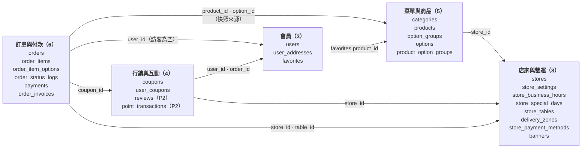
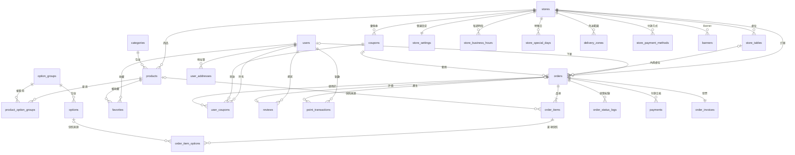
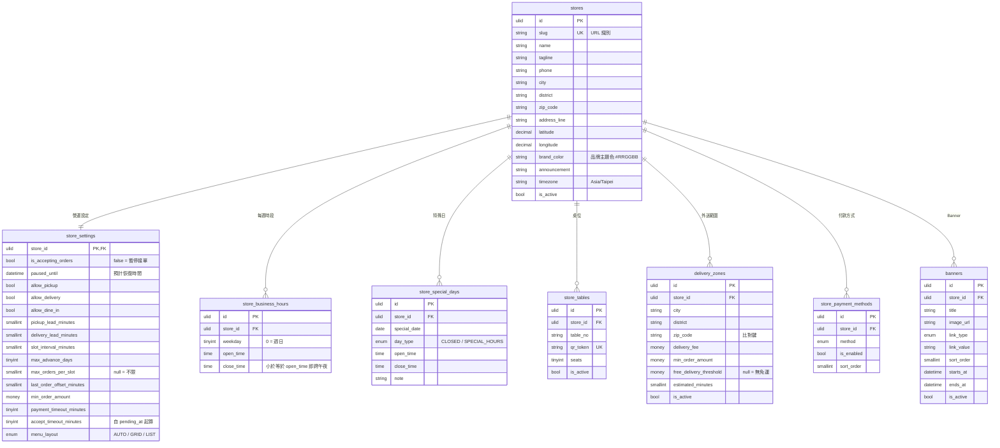
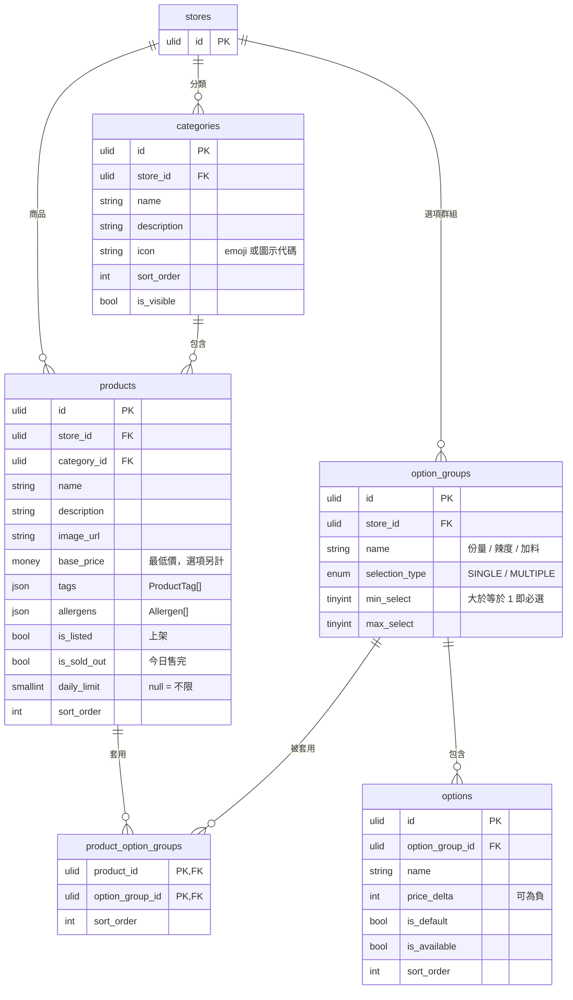
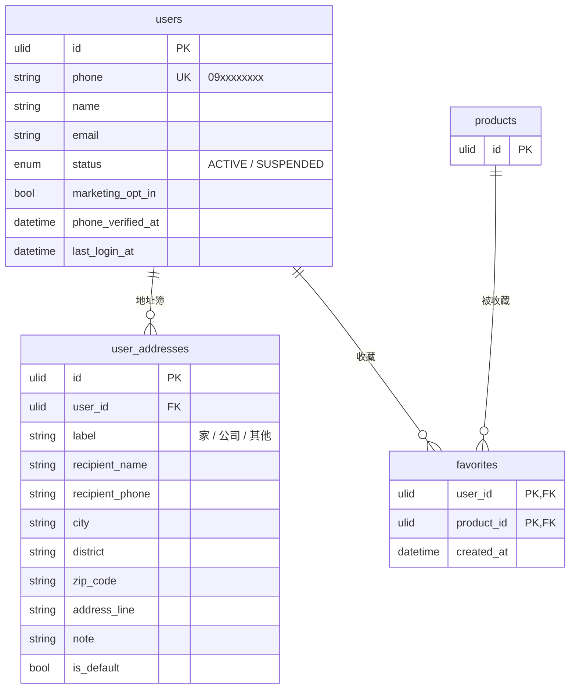
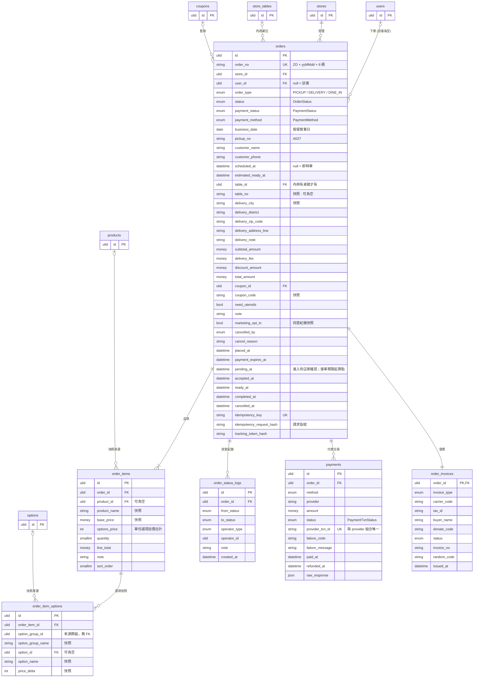
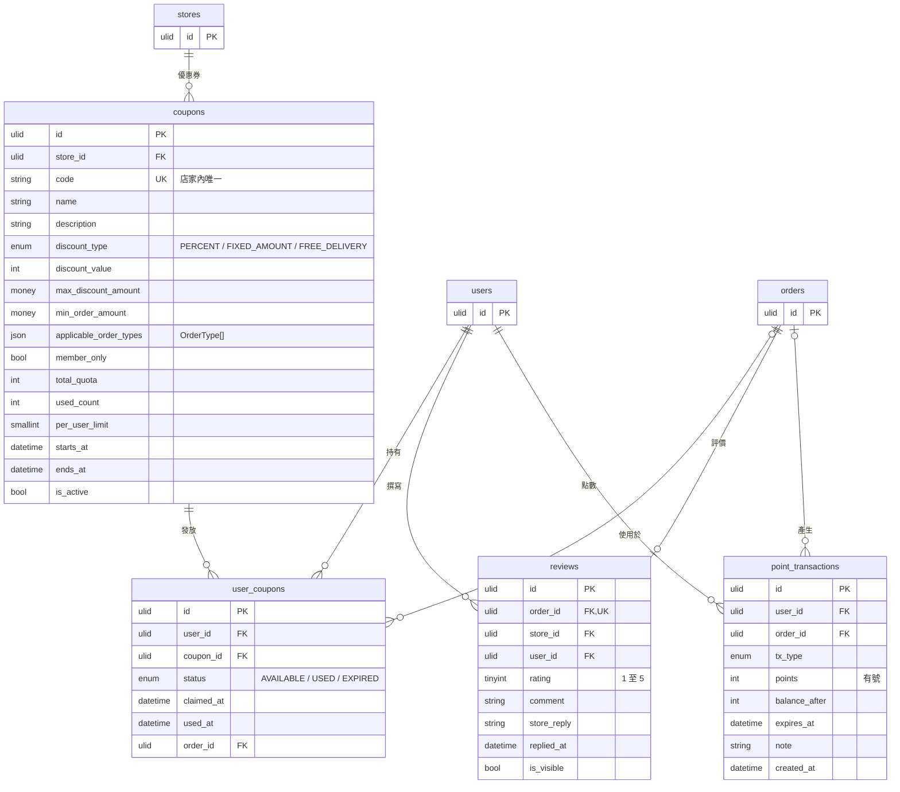

# 04 · ERD 實體關係圖（Entity Relationship Diagram）

| 項目 | 內容 |
| --- | --- |
| 專案 | ZaiOrder — 台灣小吃店線上點餐平台（消費者端） |
| 文件 | 邏輯資料模型：總覽圖、各領域詳細圖、關聯清單、設計決策 |
| 版本 | v0.4.1 草案 ｜ 2026-10-16 |
| 相關文件 | [05 資料表設計](./05-database-schema.md)（欄位型別、預設值、索引）・[06 API](./06-api-spec.md) |

> 文件導覽：[← 03 UI/UX 設計](./03-uiux-design.md) ・ 下一份：[05 資料表設計 →](./05-database-schema.md)

---

## 1. 閱讀指引

| 項目 | 說明 |
| --- | --- |
| 圖形語法 | [Mermaid `erDiagram`](https://mermaid.js.org/syntax/entityRelationshipDiagram.html) |
| 邏輯型別 | `ulid`＝CHAR(26)、`money`＝新台幣整數（INT）、`enum`＝VARCHAR + CHECK、`datetime`＝UTC 時間戳記；實體型別見 [05 §2](./05-database-schema.md) |
| 鍵 | `PK` 主鍵、`FK` 外鍵、`UK` 唯一鍵 |
| 省略欄位 | 為利閱讀，各圖**省略** `created_at`、`updated_at`、`deleted_at`（共通欄位，見 05 §1） |
| 基數符號 | `\|\|` 恰好一個、`\|o` 零或一個、`o{` 零或多個、`\|{` 一或多個 |

| 符號 | 意義 | 範例 |
| --- | --- | --- |
| `A \|\|--o{ B` | 一個 A 對應零或多個 B | 一家店有多個分類 |
| `A \|\|--\|\| B` | 一對一 | 店家與營運設定 |
| `A \|o--o{ B` | A 可有可無（可選外鍵） | 訪客訂單沒有 `user_id` |
| `A \|\|--\|{ B` | 一個 A 至少對應一個 B | 一張訂單至少有一個品項 |

---

## 2. 總覽（26 張資料表）

### 2.1 領域地圖

5 個領域與跨領域外鍵。各領域內部關聯見 §3，完整外鍵清單見 §4。



### 2.2 完整關聯圖

僅呈現關聯、不含欄位。為利閱讀，**省略**「各設定 / 菜單表指向 `stores` 的 `store_id` 外鍵」（見 §4 #1～#12）；圖面較大時請使用 GitHub 的圖表縮放，或直接閱讀 §3 各領域詳細圖。



---

## 3. 領域詳細圖

### 3.1 店家與營運



### 3.2 菜單與商品



### 3.3 會員



### 3.4 訂單與付款



> `business_date` 為**取餐 / 送達所屬營業日**：即時單為下單當下所處的營業日，預約單為 `scheduled_at` 所屬營業日，跨午夜依 BR-23；限量份數與 `pickup_no` 序號皆以此欄歸屬（D-08）。`idempotency_request_hash` 為請求指紋（SHA-256，排除 `expectedTotal`），與 `idempotency_key` 同時寫入，供 `IDEMPOTENCY_CONFLICT` 比對（BR-27）；去識別化時置為 `NULL`（[05 §7.2](./05-database-schema.md)）。`pending_at` 為進入 `PENDING` 的時間，是**接單期限的起算點**（BR-17）：現金單等於建單時間；線上付款單為付款成功或改用現金的時間；`PENDING_PAYMENT` 期間為 `NULL`。接單期限不儲存，由 `pending_at` 與 `store_settings.accept_timeout_minutes` 推導；預約單另與 `scheduled_at − 前置分鐘`（前置分鐘同 BR-08：外送以配送區 `estimated_minutes` 為先）取較大者（[05 §6.4](./05-database-schema.md)）。`payments` 以 `UK(provider, provider_txn_id)` 作為付款回呼的冪等依據（[05 §5.4、§6.3](./05-database-schema.md)）。

### 3.5 行銷與互動



> `reviews`、`point_transactions` 為 **P2** 預留，Phase 1 前端不實作。

---

## 4. 關聯清單

| # | 父表 | 子表 | 基數 | 外鍵 | 可否為空 | 刪除規則 |
| --- | --- | --- | --- | --- | --- | --- |
| 1 | `stores` | `store_settings` | 1 : 1 | `store_id` | 否 | RESTRICT |
| 2 | `stores` | `store_business_hours` | 1 : N | `store_id` | 否 | RESTRICT |
| 3 | `stores` | `store_special_days` | 1 : N | `store_id` | 否 | RESTRICT |
| 4 | `stores` | `store_tables` | 1 : N | `store_id` | 否 | RESTRICT |
| 5 | `stores` | `delivery_zones` | 1 : N | `store_id` | 否 | RESTRICT |
| 6 | `stores` | `store_payment_methods` | 1 : N | `store_id` | 否 | RESTRICT |
| 7 | `stores` | `banners` | 1 : N | `store_id` | 否 | RESTRICT |
| 8 | `stores` | `categories` | 1 : N | `store_id` | 否 | RESTRICT |
| 9 | `stores` | `products` | 1 : N | `store_id` | 否 | RESTRICT |
| 10 | `stores` | `option_groups` | 1 : N | `store_id` | 否 | RESTRICT |
| 11 | `stores` | `coupons` | 1 : N | `store_id` | 否 | RESTRICT |
| 12 | `stores` | `orders` | 1 : N | `store_id` | 否 | RESTRICT |
| 13 | `categories` | `products` | 1 : N | `category_id` | 否 | RESTRICT |
| 14 | `products` | `product_option_groups` | 1 : N | `product_id` | 否 | CASCADE |
| 15 | `option_groups` | `product_option_groups` | 1 : N | `option_group_id` | 否 | CASCADE |
| 16 | `option_groups` | `options` | 1 : N | `option_group_id` | 否 | CASCADE |
| 17 | `users` | `user_addresses` | 1 : N | `user_id` | 否 | CASCADE |
| 18 | `users` | `favorites` | 1 : N | `user_id` | 否 | CASCADE |
| 19 | `products` | `favorites` | 1 : N | `product_id` | 否 | CASCADE |
| 20 | `users` | `orders` | 1 : N | `user_id` | **是（訪客）** | SET NULL |
| 21 | `store_tables` | `orders` | 1 : N | `table_id` | 是（非內用，或內用沒有桌號） | SET NULL |
| 22 | `coupons` | `orders` | 1 : N | `coupon_id` | 是 | SET NULL |
| 23 | `orders` | `order_items` | 1 : N（至少 1） | `order_id` | 否 | CASCADE |
| 24 | `order_items` | `order_item_options` | 1 : N | `order_item_id` | 否 | CASCADE |
| 25 | `products` | `order_items` | 1 : N | `product_id` | 是（快照） | SET NULL |
| 26 | `options` | `order_item_options` | 1 : N | `option_id` | 是（快照） | SET NULL |
| 27 | `orders` | `order_status_logs` | 1 : N | `order_id` | 否 | CASCADE |
| 28 | `orders` | `payments` | 1 : N | `order_id` | 否 | RESTRICT |
| 29 | `orders` | `order_invoices` | 1 : 1 | `order_id` | 否 | RESTRICT |
| 30 | `coupons` | `user_coupons` | 1 : N | `coupon_id` | 否 | RESTRICT |
| 31 | `users` | `user_coupons` | 1 : N | `user_id` | 否 | CASCADE |
| 32 | `orders` | `user_coupons` | 1 : N | `order_id` | 是 | SET NULL |
| 33 | `orders` | `reviews` | 1 : 0..1 | `order_id` | 否 | RESTRICT |
| 34 | `users` | `reviews` | 1 : N | `user_id` | 否 | RESTRICT |
| 35 | `users` | `point_transactions` | 1 : N | `user_id` | 否 | CASCADE |
| 36 | `orders` | `point_transactions` | 1 : N | `order_id` | 是 | SET NULL |

---

## 5. 設計決策

| # | 決策 | 理由 | 取捨 |
| --- | --- | --- | --- |
| D-01 | **不建立 `carts` 資料表**，購物車為前端狀態 | 小吃點餐流程短，購物車壽命通常 < 1 小時；無伺服器狀態可簡化 API 與避免髒資料 | 無跨裝置同步；若未來需要，可新增 `carts`、`cart_items` 並提供 `GET/PUT /me/cart` |
| D-02 | 訂單**快照**品名、價格、選項與地址 | 商品改價、下架、地址更動不應改變歷史訂單；利於對帳與客訴 | 儲存空間略增；快照欄位與主檔名稱需同步維護 |
| D-03 | `option_groups` 為**店家層級可重用**，以 `product_option_groups` 綁定商品 | 「辣度」「甜度冰塊」等群組跨多商品，修改一次即可 | 商品需客製專屬群組時須另建群組 |
| D-04 | 規格（大碗 / 小碗）以「必選單選群組 + 加價」表達，不另設 `product_variants` | 模型一致、前端單一元件即可處理；套餐亦可用多個必選群組表達（例：主餐、附湯、飲料） | 無法為不同規格設定獨立庫存；若需規格或套餐子品項庫存，須改採 `product_variants` 或選項層級計數（Q-15，預設不新增） |
| D-05 | `orders.payment_status` 與 `orders.status` **分離**；交易層級另有 `payments` | 付款與製作是兩條獨立狀態機；同一訂單可有多次付款嘗試與退款 | 需維護兩者一致性（以交易與狀態機規則約束） |
| D-06 | 發票資訊獨立為 `order_invoices`（1:1） | 發票欄位多且僅部分訂單需要；開立後為不可變資料；利於串接加值中心 | 多一次關聯查詢 |
| D-07 | `orders.user_id` 可為 `NULL`，訪客以 `tracking_token_hash` 與「編號 + 手機」存取 | 降低結帳門檻（FR-CK-03）；仍可事後歸戶（FR-AC-08） | 訪客訂單權限需額外驗證 |
| D-08 | 剩餘份數與時段已訂數由**查詢計算**，不存計數欄位；採「**訂單即保留**」：訂單成立的那一刻即計入，不另設保留表 | 避免計數欄位與訂單不同步，也不會漏寫任何一條釋放路徑：取消、拒單、逾時皆使訂單轉為 `CANCELLED` 而自動釋放；量級小，查詢成本可接受 | 計入集合 = `status <> 'CANCELLED'`（建單鎖內先將已逾 `payment_expires_at` 的 `PENDING_PAYMENT` 結算為 `CANCELLED`，轉換與後處理在同一交易內完成，再計數），限量依**取餐營業日**（`orders.business_date`）歸屬；建單須在店家建單互斥鎖下、`READ COMMITTED` 內「計數 → 寫入 → 提交」，否則並行會超賣（BR-38～40，見 [05 §6.3、§6.4](./05-database-schema.md)）；購物車與 `quote` 為不保留的預檢；線上付款保留至 `payment_expires_at`；現金單與付款完成者進入 `PENDING` 後保留至接單或接單期限（BR-17，自 `orders.pending_at` 起算，預約單最長可至預約時間前）；唯讀查詢（`quote`、菜單、可選時段）只以計入條件排除、不寫入 |
| D-09 | 營業狀態（`OPEN` / `CLOSED` / `PAUSED`）**不落庫**，由設定與時間即時計算 | 狀態隨時間改變，儲存即過期；Demo 的「時間穿梭」可直接重算 | 每次請求需計算（成本極低） |
| D-10 | 所有營運資料帶 `store_id` | 預留多店 / 多商家（P3），Phase 1 僅一筆 | 查詢需恆帶 `store_id` 條件 |
| D-11 | **計數器替代方案**：以每日庫存計數表（`product_daily_stock`）搭配條件式 `UPDATE` 原子扣減庫存；僅列為替代方案，**預設不採用**，維持 D-08 | 條件式 `UPDATE` 影響 0 列即數量不足，免除鎖內聚合查詢，可支撐更高的建單吞吐，也能在多店共用庫存時使用 | 每一條 `CANCELLED` 路徑與逾時都須於同交易遞減，漏一條即永久短少；須與 `orders` 對帳偵測漂移；`daily_limit` 變更須同步 `limit_qty`。計數器只降低鎖內成本，**不消除店家建單互斥鎖**：時段容量（I2）仍以 `orders` 計數，必須對同店序列化；若要完全去鎖，須連時段容量一併改為計數器。單店建單序列化的鎖內預期不到 30 ms（A-08），不需要這些成本，故預設維持 D-08；採用時才新增資料表，本文件的 26 張不含此表 |
| D-12 | **內用桌號為選填**：`orders.table_id`、`orders.table_no` 皆可為 `NULL`，不設「內用時 `table_no` 必填」的 `CHECK`（`order_type <> 'DINE_IN' OR table_no IS NOT NULL`，v0.4.1 移除） | 現實中內用有自由入座、先領餐號叫號等沒有桌號的情況；叫號與領餐以 `pickup_no`（`T` 前綴）識別，不依賴桌號（BR-22、01 Q-17） | 店員無法依桌號送餐；`table_no` 為空的內用單需靠 `pickup_no` 對應；桌位 Session（09 CF-23）仍以有桌號為前提 |

### 5.1 D-11 計數器替代方案概要

僅在建單 QPS 使店家建單互斥鎖成為瓶頸、或需多店共用庫存時採用；Phase 1 的 Mock 與預設後端皆不建立此表，ERD 總覽與各領域圖亦不呈現。計數器只縮短持鎖時間、支援多店共用庫存，**不能取代**店家建單互斥鎖（見下方說明）。

```sql
-- 替代方案（預設不採用）：每日庫存計數器
CREATE TABLE product_daily_stock (
  store_id CHAR(26) NOT NULL, product_id CHAR(26) NOT NULL, business_date DATE NOT NULL,
  limit_qty SMALLINT UNSIGNED NOT NULL, sold_qty SMALLINT UNSIGNED NOT NULL DEFAULT 0,
  PRIMARY KEY (store_id, product_id, business_date)
);

-- 原子扣減：影響 0 列 = 數量不足（ITEM_STOCK_INSUFFICIENT）
UPDATE product_daily_stock SET sold_qty = sold_qty + :q
 WHERE store_id = :s AND product_id = :p AND business_date = :d AND sold_qty + :q <= limit_qty;
```

採用時的額外義務：(1) 訂單進入 `CANCELLED` 的每條路徑（顧客取消、拒單、店家取消、未取餐、配送異常、付款逾時、接單逾時）須在同一交易遞減 `sold_qty`，並以條件式更新確保只遞減一次；(2) 每日對帳須比對 `sold_qty` 與 `orders` 查詢結果並告警漂移；(3) 店家調整 `daily_limit` 須同步 `limit_qty`。時段容量仍以 `orders` 查詢計算（[05 §6.4](./05-database-schema.md)），其「計數 → 寫入」仍須對同店序列化，因此店家建單互斥鎖必須保留；若要去鎖，須連時段容量一併改為計數器，並同樣負擔上列 (1)～(3) 的義務。
