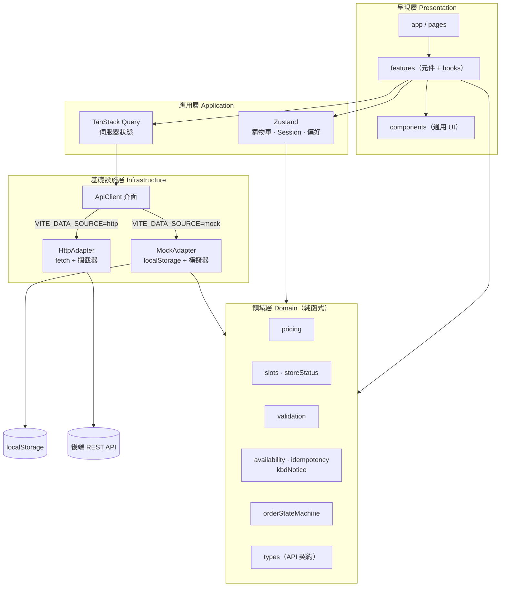
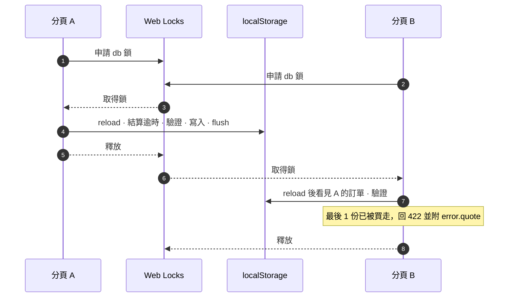
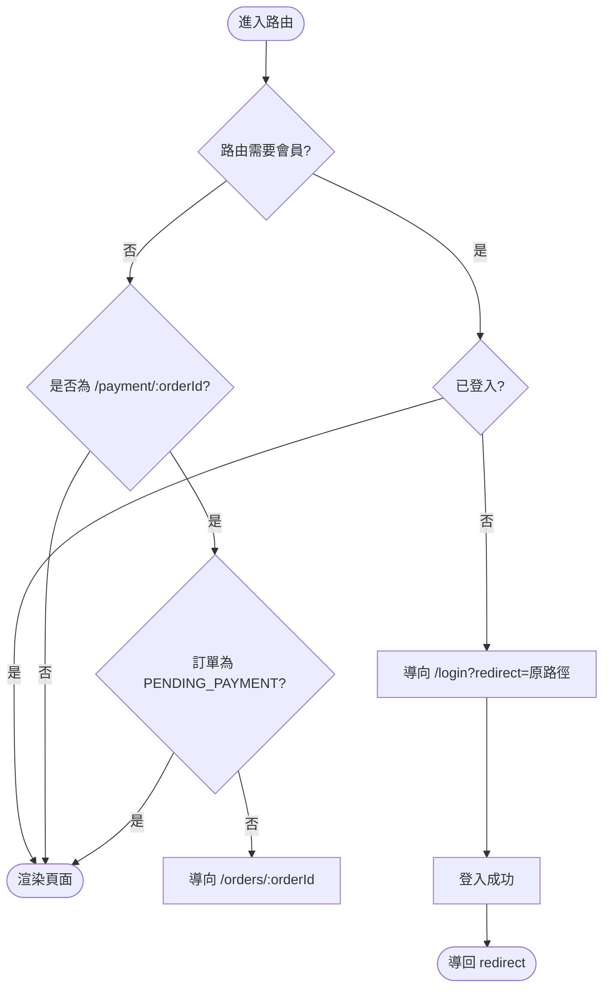
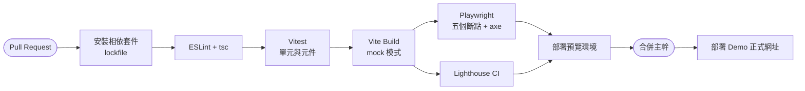

# 07 · 前端架構與 Demo 模式（Frontend Architecture）

| 項目 | 內容 |
| --- | --- |
| 專案 | ZaiOrder — 台灣小吃店線上點餐平台（消費者端） |
| 文件 | 技術選型、專案結構、分層、Mock / HTTP 切換、狀態管理、測試與部署 |
| 版本 | v0.4.1 草案 ｜ 2026-10-16 |
| 相關文件 | [06 API 規格](./06-api-spec.md)（型別與端點）・[02 流程圖](./02-flows.md)（FLOW-19、FLOW-22～25）・[03 UI/UX](./03-uiux-design.md)・[08 Demo 指南](./08-demo-guide.md) |

> 文件導覽：[← 06 API 規格](./06-api-spec.md) ・ 下一份：[08 Demo 操作指南 →](./08-demo-guide.md)

---

## 1. 架構目標與原則

| # | 原則 | 做法 |
| --- | --- | --- |
| 1 | **UI 與資料來源解耦** | UI 只依賴 `ApiClient` 介面；Mock 與 HTTP 是兩個可抽換的 Adapter（KPI-06） |
| 2 | **型別即契約** | `src/domain/types.ts` 與 [06 §4](./06-api-spec.md) 完全一致；Mock 回傳值受同一份型別約束 |
| 3 | **商業規則為純函式** | 計價、時段、營業狀態、狀態機、驗證放在 `domain/`，無 React、無 I/O，可獨立測試並被 Mock 與 UI 共用 |
| 4 | **後端為權威** | 前端計算僅供預覽；送出時以 `quote` / `POST /orders` 為準（BR-25）；庫存與時段只在 `POST /orders` 的單一交易內裁決，其餘皆為不保留的預檢（BR-39） |
| 5 | **Demo 能力不污染正式碼** | Demo 面板與模擬器只在 `VITE_DEMO_MODE=true` 時動態載入，正式建置可被 tree-shaking 移除 |
| 6 | **靜態可部署** | 單純 SPA；無伺服器端渲染；所有環境差異由 `VITE_*` 變數決定 |
| 7 | **預檢不保留、送出才計入** | 購物車、步進器與 `quote` 只讀不扣；Mock 以同一個 `evaluateOrder`、同步臨界區與真實訂單列重現後端的計入語意，並由同一組契約測試驗證（§6.8、§13） |

---

## 2. 技術選型

> 版本以建立專案當下的最新穩定版為準；Node.js 建議 22 LTS 以上。

| 類別 | 選用 | 理由 | 備選 |
| --- | --- | --- | --- |
| 框架 | **React** + **TypeScript**（strict） | 需求指定；型別即契約 | — |
| 建置 | **Vite** | 啟動快、靜態輸出簡單、`VITE_*` 環境變數 | — |
| 路由 | **React Router**（Data / Declarative 皆可） | 巢狀路由、Search Params、lazy | TanStack Router |
| 伺服器狀態 | **TanStack Query** | 快取、輪詢、重試、`refetchOnWindowFocus` 與需求吻合 | SWR |
| 用戶端狀態 | **Zustand** + `persist` | 輕量；購物車、Session、偏好 | Redux Toolkit |
| 表單 | **React Hook Form** + **Zod** | 效能佳；Schema 可重用 VR 規則 | Formik |
| 樣式 | **Tailwind CSS** + CSS Variables（設計代幣） | 與 [03 §4](./03-uiux-design.md) 代幣對應；品牌色於執行期以 CSS 變數注入，免重新建置即可換色；RWD 斷點直接設定 | CSS Modules |
| 無障礙元件 | **Radix UI / React Aria**（Dialog、Tabs、Radio） | 焦點管理與 ARIA 已處理 | Headless UI |
| 圖示 | **lucide-react** | 與設計規格一致 | — |
| 日期時間 | **dayjs**（`utc`、`timezone` 外掛） | 體積小、時區處理 | date-fns-tz |
| 單元 / 元件測試 | **Vitest** + **Testing Library** | 與 Vite 共用設定 | Jest |
| 屬性測試（建議） | **fast-check** | 以隨機序列驗證庫存、時段與冪等的不變式（§13） | — |
| E2E | **Playwright** + **axe-core** | 多視窗尺寸、時鐘控制、無障礙掃描 | Cypress |
| 品質 | ESLint 9（flat config）+ Prettier；分層以 `no-restricted-imports` 的 `overrides` 強制 | 強制分層依賴方向；不引入 `eslint-plugin-boundaries`（其相依鏈有未修補的安全性通報，且與 ESLint 10 / jsx-a11y 的 peer 範圍不相容） | dependency-cruiser |

---

## 3. 專案結構

```text
zaiorderv2-Demo/
├── docs/                         # 本規格文件
├── public/
│   └── images/                   # Demo 佔位圖（SVG / emoji 圖卡）
├── src/
│   ├── main.tsx
│   ├── app/
│   │   ├── App.tsx
│   │   ├── router.tsx            # 路由表與守衛（§8）
│   │   ├── providers.tsx         # QueryClient、ApiClient、Clock、Toast
│   │   └── layouts/              # AppShell、TaskLayout（結帳 / 訂單；同樣保留 ⌨ 入口、跳過連結與頁尾「鍵盤快速鍵」，03 §3.3）
│   ├── config/
│   │   └── env.ts                # VITE_* 讀取與預設值
│   ├── domain/                   # ★ 純 TypeScript：無 React、無 I/O
│   │   ├── types.ts              # = 06 §4
│   │   ├── pricing.ts            # BR-02、03、05、06
│   │   ├── cart.ts               # 合併鍵、數量限制（BR-13）
│   │   ├── slots.ts              # BR-09 / FLOW-05；nearestAvailableSlot（EC-07）
│   │   ├── availability.ts       # 庫存與時段的計入、配置、營業日、異動清單、送出決策（BR-38～40、FLOW-23）
│   │   ├── idempotency.ts        # 請求指紋與 Idempotency-Key 生命週期（BR-27、BR-41）
│   │   ├── storeStatus.ts        # BR-07 / FLOW-02
│   │   ├── orderStateMachine.ts  # BR-15 / FLOW-10
│   │   ├── timeouts.ts           # 付款 / 接單期限（BR-17；接單自 pending_at 起算）與前置分鐘 leadMinutesFor（BR-08）
│   │   ├── hotkeys.ts            # 快速鍵登錄表與解析、Esc 順序（BR-34）
│   │   ├── kbdNotice.ts          # 鍵盤偵測提醒：證據、門檻、gate、阻擋條件、狀態轉換（BR-42）
│   │   ├── rememberedChoice.ts   # 點餐記憶：寫入、驗證、常點（BR-35）
│   │   ├── idle.ts               # 觸控面板閒置重置（BR-37）
│   │   ├── validation.ts         # VR-01 ～ VR-17
│   │   ├── theme.ts              # 品牌色 → 主題代幣、對比保護（BR-32）
│   │   ├── menuLayout.ts         # 版面判定與卡片圖片區（BR-31）
│   │   └── format.ts             # formatTWD、formatTime、遮罩
│   ├── services/
│   │   ├── clock.ts              # Clock 與時間穿梭；systemClock 供鍵盤提醒使用（§6.4）
│   │   ├── api/
│   │   │   ├── ApiClient.ts      # 介面（§5）
│   │   │   ├── createApiClient.ts
│   │   │   ├── http/             # HttpAdapter：fetch、攔截器、錯誤正規化
│   │   │   └── mock/             # MockAdapter（§6）
│   │   │       ├── db.ts
│   │   │       ├── seed/
│   │   │       ├── menuProfile.ts    # 菜單資料完整度轉換與目錄視圖（FR-DM-09、§6.7）
│   │   │       ├── world.ts          # loadWorld：db 與 DemoState 覆寫的唯一合成處（§6.8）
│   │   │       ├── evaluateOrder.ts  # quote 與 create 共用的單一驗證（BR-39）
│   │   │       ├── createOrder.ts    # orders.create 的臨界區管線（FLOW-22）
│   │   │       ├── lock.ts           # withDbLock：Web Locks 臨界區；所有寫入 db 的路徑（§6.8）
│   │   │       ├── settle.ts         # settleExpiredOrders 的逾時判斷（FLOW-14 的 T → X；僅寫入路徑呼叫）
│   │   │       ├── inject.ts         # 他人訂單注入、取餐號碼序號鍵
│   │   │       ├── requestLog.ts     # demo_request_log：最近送出紀錄
│   │   │       ├── simulator.ts      # 讀取時惰性推進；預約單 pending_at + 5 秒自動接單（FLOW-14）
│   │   │       └── handlers/
│   │   └── storage/              # safeStorage、鍵名、版本遷移
│   ├── features/                 # 依功能切分（元件 + hooks）
│   │   ├── store/                # StoreHeader、StoreStatusBadge、ThemeProvider、useStoreStatus
│   │   ├── a11y/                 # HotkeyProvider、KeyboardNotice、useKeyboardNotice、ShortcutsDialog、KeyHint、SkipLinks、LiveAnnouncer
│   │   ├── kiosk/                # KioskShell、IdleGuard（觸控面板模式）
│   │   ├── menu/                 # CategoryChips、ProductCard、ImageOrPlaceholder、ProductSheet、RecentItems（常點）
│   │   ├── cart/                 # cartStore、CartBar、CartPage
│   │   ├── checkout/             # 各區塊、checkoutSchema、AvailabilityIssueList（CMP-40）、送出決策
│   │   ├── orders/               # OrderTimeline、OrderCard、useOrderPolling
│   │   ├── account/              # 地址簿、最愛、優惠券
│   │   ├── auth/                 # LoginPage、OtpInput、sessionStore
│   │   └── demo/                 # DemoPanel（僅 demoMode 動態載入）
│   ├── components/               # 通用 UI：Button、TextField、Dialog、Toast…
│   ├── hooks/                    # useClock、useMediaQuery、usePageVisibility
│   ├── i18n/zh-TW.ts             # 文案集中管理（03 §9）
│   ├── styles/                   # tokens.css、tailwind.css
│   └── test/                     # setup、fixtures、msw handlers
├── e2e/                          # Playwright（對應 UAT-01～17、19～27；UAT-18 與 UAT-26 的朗讀順序為手動）
├── .env.example
└── vite.config.ts
```

---

## 4. 分層與依賴規則



**依賴規則**（以 `eslint.config.js` 的 `no-restricted-imports` 逐層覆寫強制，違反即 `npm run lint` 失敗）：

| 層 | 可以依賴 | 不可依賴 |
| --- | --- | --- |
| `domain` | 無（僅標準函式庫） | React、`services`、`features`、任何 I/O |
| `services` | `domain` | `features`、`components`、React |
| `components` | `domain`（型別、格式化） | `services`、`features` |
| `features` | `domain`、`components`、`services/api/ApiClient`（僅介面）、`services/clock`、`services/storage` | `services/api/mock/*`、`services/api/http/*` |
| `features/demo` | 全部，**唯一**可經 `DemoControl` 存取 Mock 內部的模組 | — |

---

## 5. 資料來源切換（Adapter 模式）

### 5.1 環境變數

| 變數 | 預設 | 說明 |
| --- | --- | --- |
| `VITE_DATA_SOURCE` | `mock` | `mock`：Mock Adapter；`http`：HTTP Adapter |
| `VITE_API_BASE_URL` | `/api/v1` | `http` 模式使用 |
| `VITE_STORE_SLUG` | `demo-snack` | 店家識別 |
| `VITE_DEMO_MODE` | `false` | `true`：顯示 Demo 面板、橫幅與模擬器；`mock` 模式下建議為 `true` |
| `VITE_APP_BASE_PATH` | `/` | 子路徑部署（如 GitHub Pages `/zaiorderv2-Demo/`） |
| `VITE_ROUTER_MODE` | `browser` | `browser` 或 `hash`（無法設定 SPA fallback 的主機使用） |
| `VITE_KIOSK_MODE` | `false` | `true`：專用觸控面板部署，啟動即為觸控面板模式（BR-36）。網址 `?mode=kiosk` 僅在 `VITE_DEMO_MODE=true` 時有效（展示與測試用，啟用後寫入 `sessionStorage` 旗標；以 `?mode=default` 或 Demo 面板離開），正式環境不接受消費者以網址切換 |
| `VITE_GA_ID` | 空 | GA4 衡量 ID；空值不載入 |

```ts
// src/config/env.ts
export type DataSource = 'mock' | 'http';

export const env = {
  dataSource: (import.meta.env.VITE_DATA_SOURCE ?? 'mock') as DataSource,
  apiBaseUrl: import.meta.env.VITE_API_BASE_URL ?? '/api/v1',
  storeSlug: import.meta.env.VITE_STORE_SLUG ?? 'demo-snack',
  demoMode: import.meta.env.VITE_DEMO_MODE === 'true',
  basePath: import.meta.env.VITE_APP_BASE_PATH ?? '/',
  routerMode: (import.meta.env.VITE_ROUTER_MODE ?? 'browser') as 'browser' | 'hash',
  kiosk: import.meta.env.VITE_KIOSK_MODE === 'true',
} as const;
```

### 5.2 `ApiClient` 介面

端點與 [06 §2](./06-api-spec.md) 一一對應；Mock 與 HTTP Adapter **必須實作完整介面**。

```ts
// src/services/api/ApiClient.ts
import type {
  Address, AuthTokens, Banner, CreateOrderRequest, CreateOrderResponse,
  CreatePaymentRequest, CreatePaymentResponse, DeliveryCheckResponse, DeliveryZone,
  FrequentItemsResponse,
  ID, Menu, Order, OrderSummary, OrderType, OtpVerifyResponse, PickupSlotsResponse,
  ProductDetail, QuoteRequest, QuoteResponse, StoreInfo, StoreStatus, UserCoupon,
  UserCouponStatus, UserProfile,
} from '@/domain/types';

/** 存取訪客訂單時附帶的追蹤權杖 */
export interface TrackingOpts { trackingToken?: string }

export interface ApiClient {
  auth: {
    sendOtp(phone: string): Promise<{ resendAfterSeconds: number }>;
    verifyOtp(phone: string, code: string): Promise<OtpVerifyResponse>;
    /** Cookie 模式（06 §1.3）不需傳入 refreshToken */
    refresh(refreshToken?: string): Promise<{ tokens: AuthTokens }>;
    logout(refreshToken?: string): Promise<void>;
  };
  store: {
    getInfo(): Promise<StoreInfo>;
    getStatus(): Promise<StoreStatus>;
    getMenu(): Promise<Menu>;
    getProduct(productId: ID): Promise<ProductDetail>;
    getBanners(): Promise<{ items: Banner[] }>;
    getPickupSlots(params: { orderType: OrderType; zipCode?: string }): Promise<PickupSlotsResponse>;
    getDeliveryZones(): Promise<{ items: DeliveryZone[] }>;
    checkDelivery(zipCode: string): Promise<DeliveryCheckResponse>;
    /** 僅在網址帶 ?table= 時呼叫；手動選內用（桌號選填，BR-22）不呼叫。無法辨識時丟出 TABLE_NOT_FOUND，前端回退為一般點餐 */
    resolveTable(qrToken: string): Promise<{ tableNo: string; seats?: number }>;
  };
  orders: {
    quote(req: QuoteRequest): Promise<QuoteResponse>;
    /**
     * Idempotency-Key 由呼叫端（結帳送出流程）管理（BR-41、FLOW-24）：首次送出才產生並存入 checkoutDraft
     * （sessionStorage；觸控面板僅記憶體，閒置重置時連同記下的送出內容一併丟棄），到 2xx 才作廢。
     * 422、409 PRICE_CHANGED、400、429、附 retryAfterSeconds 的 503（確定未建立）與結果未知（無回應、逾時、
     * 其他 5xx）後修改內容再送一律沿用同一把；收到 IDEMPOTENCY_CONFLICT 不得換新 Key，改以同 Key 重放記下的內容取回原訂單。
     * 重放以回應 body 的 replayed 為準，標頭 Idempotent-Replayed 僅輔助。判別與狀態轉換見 domain/idempotency.ts。
     */
    create(req: CreateOrderRequest, idempotencyKey: string): Promise<CreateOrderResponse>;
    list(params: {
      tab: 'active' | 'completed' | 'cancelled';
      limit?: number;
      cursor?: string;
    }): Promise<{ items: OrderSummary[]; nextCursor: string | null }>;
    get(orderId: ID, opts?: TrackingOpts): Promise<Order>;
    cancel(orderId: ID, reason?: string, opts?: TrackingOpts): Promise<Order>;
    lookup(orderNo: string, phone: string): Promise<{ orderId: ID; trackingToken: string }>;
    pay(orderId: ID, req: CreatePaymentRequest, opts?: TrackingOpts): Promise<CreatePaymentResponse>;
  };
  me: {
    get(): Promise<UserProfile>;
    update(patch: Partial<Pick<UserProfile, 'name' | 'email' | 'marketingOptIn'>>): Promise<UserProfile>;
    remove(): Promise<void>;
    addresses: {
      list(): Promise<{ items: Address[] }>;
      create(input: Omit<Address, 'id'>): Promise<Address>;
      update(id: ID, patch: Partial<Omit<Address, 'id'>>): Promise<Address>;
      remove(id: ID): Promise<void>;
    };
    favorites: {
      list(): Promise<{ productIds: ID[] }>;
      add(productId: ID): Promise<void>;
      remove(productId: ID): Promise<void>;
    };
    coupons: {
      list(status?: UserCouponStatus): Promise<{ items: UserCoupon[] }>;
    };
    /** 會員常點 / 上次點過（訪客不呼叫，記憶僅存本機）；limit 預設 50、最大 100 */
    frequentItems(limit?: number): Promise<FrequentItemsResponse>;
  };
}
```

### 5.3 工廠與動態載入

```ts
// src/services/api/createApiClient.ts
import { env } from '@/config/env';
import type { ApiClient } from './ApiClient';

/**
 * 依 VITE_DATA_SOURCE 建立 ApiClient。
 * 使用動態 import：http 建置不會把 Mock（含種子資料）打包進來，反之亦然。
 */
export async function createApiClient(): Promise<ApiClient> {
  if (env.dataSource === 'http') {
    const { createHttpClient } = await import('./http/createHttpClient');
    return createHttpClient({ baseUrl: env.apiBaseUrl, storeSlug: env.storeSlug });
  }
  const { createMockClient } = await import('./mock/createMockClient');
  return createMockClient({ storeSlug: env.storeSlug });
}
```

### 5.4 HTTP Adapter 的錯誤正規化

所有非 2xx 回應轉為單一 `ApiError`，UI 與 TanStack Query 只處理 `error.code`（對應 [FLOW-15](./02-flows.md#flow-15-api-錯誤處理策略)）。

```ts
// src/services/api/http/request.ts
import type { ApiErrorResponse, ErrorCode } from '@/domain/types';

export class ApiError extends Error {
  constructor(
    public readonly status: number,
    public readonly code: ErrorCode,
    message: string,
    public readonly body?: ApiErrorResponse['error'],
  ) {
    super(message);
    this.name = 'ApiError';
  }
}

/** 非同步請求的逾時（NFR-06、FLOW-15）：逾時與網路中斷同為「無回應」（status 0） */
export const REQUEST_TIMEOUT_MS = 10_000;

export interface RequestOptions {
  method?: 'GET' | 'POST' | 'PUT' | 'PATCH' | 'DELETE';
  body?: unknown;
  headers?: Record<string, string>;
  /** 呼叫端的取消訊號（例如 quote 被新請求取代、離開頁面）；與逾時訊號合併，任一觸發即中止 */
  signal?: AbortSignal;
}

/** 網路中斷、逾時（10 秒）或 CORS：視為可重試的服務不可用；POST /orders 因此為結果未知（FLOW-24） */
const unreachable = (): ApiError => new ApiError(0, 'SERVICE_UNAVAILABLE', '網路好像不太穩，請稍後再試');

async function send<T>(url: string, opts: RequestOptions, signal: AbortSignal): Promise<T> {
  let res: Response;
  try {
    res = await fetch(url, {
      method: opts.method ?? 'GET',
      headers: { 'Content-Type': 'application/json', ...opts.headers },
      body: opts.body === undefined ? undefined : JSON.stringify(opts.body),
      signal,
      credentials: 'include', // Cookie 模式需要（06 §1.3）；需後端設定 CORS 白名單與 Allow-Credentials
    });
  } catch (e) {
    // 呼叫端主動取消不是錯誤：原樣丟出（AbortError），由 TanStack Query 忽略
    if (opts.signal?.aborted === true) throw e;
    throw unreachable();
  }
  if (res.status === 204) return undefined as T;

  const payload: unknown = await res.json().catch(() => undefined);
  // 讀取回應本文途中逾時：同樣是「無回應」，不可把截斷的本文當成功回傳
  if (signal.aborted && opts.signal?.aborted !== true) throw unreachable();
  if (res.ok) return payload as T;

  const err = (payload as ApiErrorResponse | undefined)?.error;
  throw new ApiError(
    res.status,
    err?.code ?? 'INTERNAL_ERROR',
    err?.message ?? '發生了一點問題，請稍後再試',
    err,
  );
}

export async function request<T>(url: string, opts: RequestOptions = {}): Promise<T> {
  // 逾時與呼叫端取消合併為同一個 AbortController（不依賴較新的 AbortSignal.any，內建瀏覽器亦可用）
  const controller = new AbortController();
  const caller = opts.signal;
  const abort = (): void => controller.abort();
  if (caller?.aborted === true) abort();
  caller?.addEventListener('abort', abort, { once: true });
  const timer = setTimeout(abort, REQUEST_TIMEOUT_MS);
  try {
    return await send<T>(url, opts, controller.signal);
  } finally {
    clearTimeout(timer);
    caller?.removeEventListener('abort', abort);
  }
}
```

**逾時與取消**：每個請求設 10 秒逾時（上方程式碼的常數，NFR-06；[FLOW-15](./02-flows.md#flow-15-api-錯誤處理策略) 的「請求逾時 10 秒」，含讀取回應本文），並與呼叫端的 `signal` 合併為同一個 `AbortController`（不依賴較新的 `AbortSignal.any`，LINE 等內建瀏覽器亦可用）。逾時、網路中斷與 CORS 一律丟 `ApiError(0, 'SERVICE_UNAVAILABLE')`（`status = 0` 即「無回應」，`POST /orders` 因此為結果未知，FLOW-24）；呼叫端主動取消（`quote` 被新請求取代、離開頁面）原樣丟出 `AbortError`，不轉為 `ApiError`、不當錯誤處理。

`ApiError.body` 即 [06 §3.1](./06-api-spec.md) 的 `error` 物件：`POST /orders` 的所有 `422` 與 `409 PRICE_CHANGED` 都帶 `body.quote`（交易回復當下的最新報價，結構同 `quote` 回應）。結帳頁以同一個 `deriveCheckoutIssues`（§7.6）處理 `quote` 預檢與送出被退回（FLOW-23），不另寫一套錯誤對應；店家狀態類（`STORE_PAUSED`、`STORE_CLOSED`）以 `storeIssue` 旗標回傳、不進清單；已知錯誤碼的清單文案由前端依 `code` 與 `availableQuantity`、`remaining` 組成（[03 §9](./03-uiux-design.md)），`message` 只作未知 `ErrorCode` 的降級文字並重新 `quote`（06 §1.2），不白屏。

---

## 6. Mock Adapter 設計

目標：讓 Demo **零設定可完整操作**，並在行為上盡量貼近真實後端（延遲、錯誤、時間、狀態推進）。

### 6.1 資料庫與持久化

| 項目 | 設計 |
| --- | --- |
| 集合 | 以資料表名稱為集合名（`orders`、`order_items`…），欄位同 [05](./05-database-schema.md)；對外回傳前由 `handlers` 組裝為 [06 §4](./06-api-spec.md) 的 DTO |
| 種子（唯讀） | `stores`、`store_*`、`categories`、`products`、`option_groups`、`options`、`product_option_groups`、`banners`、`delivery_zones`、`coupons`：每次啟動由 `seed/` **以程式產生**，日期皆相對於 `clock.now()`（確保 Demo 隨時有可展示的特殊公休日與優惠期間） |
| 可變集合 | `users`、`user_addresses`、`favorites`、`user_coupons`、`orders`、`order_items`、`order_item_options`、`order_status_logs`、`payments`、`order_invoices`，以及序號（取餐號碼以 `(business_date, 前綴)` 為鍵、訂單流水）。`orders` 另含 `idempotency_request_hash`（請求指紋；缺值的舊資料視為內容相同，避免誤報衝突；帳號刪除的去識別化步驟將其置 `NULL`，[05 §7.2](./05-database-schema.md)）、`pending_at`（進入 `PENDING` 的時間，接單期限的起算點，BR-17、[05 §5.4](./05-database-schema.md)）與他人訂單（`pickup_no` 前綴 `X`，無 `user_id`、不寫入 `guestOrders`，見 §6.8）。所有寫入 db 的路徑（建單、取消、付款、店家模擬動作、惰性推進、會員資料與 `DemoControl`）一律經 `withDbLock`，鎖內先 `reload` 再變更再同步寫回 `localStorage`（§6.8）；100 ms debounce 只用於非 db 的儲存鍵（偏好、購物車等） |
| 版本 | `meta.schemaVersion`；版本不符時清除可變資料並以 Toast 告知（Demo 可接受）；`DemoState` 新增欄位以預設值合併舊資料，不需升版 |
| 重置 | `DemoControl.resetAll()`：清除所有 `zaiorder:v1:*` 後重新載入頁面（FR-DM-02）；庫存覆寫、他人訂單、送出紀錄與鍵盤提醒旗標一併歸零；網址上的 `demo_*` 啟動參數不會被清除，重新載入後會再次套用（§6.3、[08 §4](./08-demo-guide.md)） |
| 送出紀錄 | 新集合 `demo_request_log`（環形緩衝 20 筆，面板顯示最近 5 筆）；不屬 [05](./05-database-schema.md) 資料表 |
| 多分頁 | 所有會寫入 db 的路徑（建單、取消、付款、店家模擬動作、惰性推進、會員資料、`DemoControl`）一律經 `withDbLock`：鎖內先 `reload` 再變更再 `flush`（§6.8）；不支援 Web Locks 的瀏覽器降級為單分頁保證，可能遺失寫入（[08 §8](./08-demo-guide.md)） |

### 6.2 儲存鍵

| 鍵 | 內容 | 擁有者 |
| --- | --- | --- |
| `zaiorder:v1:cart` | `{ lines, orderType, updatedAt }` | `features/cart` |
| `zaiorder:v1:session` | `{ tokens, user }` | `features/auth` |
| `zaiorder:v1:prefs` | 上次取餐方式 / 付款方式、單鍵快速鍵開關（`hotkeysEnabled`，**預設關**）與鍵盤提醒旗標（`kbdNotice`：`outcome`、`shownCount`、`lastShownAt`）、點餐記憶開關與內容（`rememberChoices`、`lastChoices`）、大字與減少動態（`largeText`、`reduceMotion`）、菜單版面手動選擇（`menuLayoutOverride`）、已關閉的公告日期與「保存訂單」提示、Demo 橫幅是否關閉；**訪客資料**（`guestProfile`：姓名、手機、最近外送地址與常用付款 / 發票設定，僅在使用者勾選「記住我的資料」時寫入，可清除） | `app`、`features/checkout` |
| `zaiorder:v1:guestOrders` | `{ orderId, orderNo, trackingToken, placedAt }[]`（最多 10 筆） | `features/orders` |
| `zaiorder:v1:db` | Mock 可變集合 | `mock/db` |
| `zaiorder:v1:demo` | `DemoState`（見 §6.5） | `features/demo` |
| `zaiorder:v1:checkoutDraft`（sessionStorage） | 結帳表單草稿（含選填的桌號 `tableNo`，空字串視為未提供，BR-22），另含 `idempotencyKey` 與結果未知時記下的送出內容 `unknownBodies`（含姓名手機，與草稿同敏感度）；2xx 後清除（BR-41）；觸控面板閒置重置時一併丟棄（FLOW-21） | `features/checkout` |
| `zaiorder:v1:mode`（sessionStorage） | 此分頁是否為觸控面板模式的旗標（不含個資）；由 `VITE_KIOSK_MODE`，或 `VITE_DEMO_MODE=true` 時的 `?mode=kiosk` 寫入，避免站內導覽遺失 query | `app` |

所有存取經 `safeStorage`：`localStorage` 不可用或寫入失敗時降級為記憶體並通知 UI 顯示一次性提示（FR-SY-11）。

**觸控面板模式的隔離儲存**（BR-36、BR-37）：`cart`、`session`、`prefs`（含 `guestProfile`、`lastChoices`）、`guestOrders`、`checkoutDraft` 一律改用**僅存記憶體**的儲存（`createMemoryStorage()`），不讀取也不寫入上表的 `localStorage` 鍵；進入模式與每次重置時清空。完成畫面的 `trackingToken` 只存於記憶體；鍵盤提醒旗標（`prefs.kbdNotice`）同樣只存記憶體，且觸控面板不偵測、不提醒、不寫入；`checkoutDraft` 內的 `idempotencyKey` 與 `unknownBodies` 亦僅存記憶體；閒置重置是邊界，**一併丟棄** Key 與記下的送出內容（結果未知時警示照常出現並多一行「上一筆訂單結果尚未確認，請洽櫃檯確認」，不延後重置；下一位顧客一律使用新 Key，重複下單的風險交由櫃檯確認承擔，FLOW-21、FLOW-24）。進入觸控面板模式時不清除既有的 `localStorage` 鍵（同源共用的 Demo 站台可能已有一般模式留下的資料），驗證以「觸控面板期間這些鍵不新增、不變更」為準（UAT-19）。Mock 的 `zaiorder:v1:db` 屬後端模擬，不視為本機個資儲存（正式環境由後端保存）。

```ts
// src/services/storage/safeStorage.ts
export interface SafeStorage extends Storage {
  /** 是否因環境限制而降級為記憶體儲存 */
  readonly degraded: boolean;
}

export function createSafeStorage(kind: 'local' | 'session' = 'local'): SafeStorage {
  const memory = new Map<string, string>();
  let degraded = false;

  const backend = (): Storage | null => {
    try {
      const s = kind === 'local' ? window.localStorage : window.sessionStorage;
      const probe = '__zaiorder_probe__';
      s.setItem(probe, '1');
      s.removeItem(probe);
      return s;
    } catch {
      degraded = true;
      return null;
    }
  };

  const store = backend();

  return {
    get degraded() { return degraded; },
    get length() { return store ? store.length : memory.size; },
    clear: () => { memory.clear(); store?.clear(); },
    // 寫入失敗而降級到記憶體的值優先讀取，否則剛寫入的資料會讀不回來
    getItem: (k) => memory.get(k) ?? (store ? store.getItem(k) : null),
    key: (i) => (store ? store.key(i) : Array.from(memory.keys())[i] ?? null),
    removeItem: (k) => { memory.delete(k); store?.removeItem(k); },
    setItem: (k, v) => {
      if (!store) { memory.set(k, v); return; }
      try { store.setItem(k, v); } catch { degraded = true; memory.set(k, v); }
    },
  };
}
```

**`prefs` 的預設與遷移**（FR-SY-17、BR-34、BR-42）

| 欄位 | 預設 | 說明 |
| --- | --- | --- |
| `hotkeysEnabled` | `false`（v1 為 `true`） | 單一開關：徽章（`KeyHint`）與單鍵的 `aria-keyshortcuts` 跟隨；`Esc` 與 `Ctrl/⌘ + Enter` 不受影響；於 PG-19 或鍵盤提醒的「開啟」切換 |
| `kbdNotice.outcome` | `'NONE'` | `'NONE'`、`'ACCEPTED'`、`'DECLINED'`；非 `'NONE'` 即不再自動提醒（入口仍在）；啟用單鍵快速鍵時由 `'NONE'` 轉為 `'ACCEPTED'` |
| `kbdNotice.shownCount` | `0` | 0～2；提醒轉為顯示的當下 +1（顯示中關閉分頁也算一次） |
| `kbdNotice.lastShownAt` | `null` | epoch ms，取自 `systemClock`（真實時間，不受時間穿梭影響，§6.4） |

persist `version` 由 1 升為 2：`migratePrefs`（`domain/kbdNotice.ts`，§7.5）把 v1 的 `hotkeysEnabled` 一律重設為 `false` 並補上 `kbdNotice` 預設，因為 v1 的 `true` 無法分辨是預設值還是使用者的選擇。專案上線前沒有既有資料需要遷移，保留此步驟是為了讓測試環境的舊資料不會使單鍵快速鍵意外維持開啟。偵測證據、待命狀態與計時器只存在記憶體，不持久化。

### 6.3 延遲與錯誤注入

| 機制 | 說明 |
| --- | --- |
| 延遲 | 每個 Mock 請求 `await sleep(latencyMs + jitter)`；預設 300ms（±100ms），可由 Demo 面板切換 0 / 300 / 1500（FR-DM-06） |
| 指定端點失敗 | `failNext = { target, remaining }`：只消耗「使用者觸發」的請求（寫入類請求，以及面板明確指定的端點）；`store.getStatus`、`orders.get` 的背景輪詢**不會**消耗 `target='any'`。每失敗一次 `remaining` 遞減，歸零即清除，失敗時丟出 `ApiError(503, 'SERVICE_UNAVAILABLE')`（不附 `retryAfterSeconds`，前端依 FLOW-24 判別為結果未知）。GET 內建自動重試 2 次，因此指定 GET 端點時預設 `remaining = 3` 才會呈現錯誤。`target = 'orders.create'` 時可加 `phase`：`'BEFORE'` 請求未被處理（不進臨界區、不消耗 `raceOnNextCreate`）；`'AFTER_COMMIT'` 訂單已建立並同步寫回後才丟網路層錯誤（回應遺失，EC-05），見 §6.8 |
| URL 參數 | 僅 `VITE_DEMO_MODE=true`，開啟網址時套用一次，供 E2E 與展示預先佈置情境（[08 §4](./08-demo-guide.md)）；套用後不自網址移除，重新整理與「重置 Demo 資料」重新載入後會再次套用同一情境：`?demo_clock=<ISO 時間>`（等同 `clockOverride`：以該時間作為「現在」的起點並繼續走時，不是凍結，要完全凍結請於 E2E 搭配 `page.clock`；只影響 `getClock()`，不影響 `systemClock`）、`?demo_fail=<端點>[:<階段>][:<次數>]`（階段為 `'BEFORE'` 或 `'AFTER_COMMIT'`、次數為整數，依內容辨識、順序不拘；省略階段為 `'BEFORE'`、省略次數為持續失敗，`remaining` 取 `Number.MAX_SAFE_INTEGER`；例：`orders.create:AFTER_COMMIT:1`、`orders.create:3`）、`?demo_limit=<商品>:<份數>`（立即覆寫每日限量）、`?demo_race=<商品>:<份數>`（預備「下一次送出前」他人買走）、`?demo_fullslot=<ISO 時間>`（預備「下一次送出前」該時段補到額滿，等同 `armRace`；要立即補滿請用面板「讓此時段額滿」） |
| 一致性 | Mock 必須回傳與真實 API 相同的錯誤碼與 `details` 結構（[06 §3](./06-api-spec.md)） |

### 6.4 時鐘（時間穿梭）

所有與時間相關的邏輯（營業狀態、時段、逾時、模擬器、購物車保存期限、畫面顯示）一律透過 `getClock().now()` 取得「現在」，**不得直接呼叫 `Date.now()` / `new Date()`**（由 ESLint `no-restricted-syntax` 強制；`services/clock.ts` 與測試除外）。因此「時間穿梭」也會影響購物車的 24 小時過期，Demo 面板提供「快轉 +24 小時」以展示 FR-CT-04。

```ts
// src/services/clock.ts
export interface Clock {
  now(): Date;
}

export const systemClock: Clock = { now: () => new Date() };

/**
 * 以固定起點「繼續走時」的時鐘：設定 12:00 後，每過 1 秒顯示時間也前進 1 秒。
 */
export function createOffsetClock(anchor: Date, base: Clock = systemClock): Clock {
  const startedAt = base.now().getTime();
  return {
    now: () => new Date(anchor.getTime() + (base.now().getTime() - startedAt)),
  };
}

let current: Clock = systemClock;

/** 全站唯一的「現在」來源；Demo 時間穿梭與測試以 setClock 覆寫 */
export const getClock = (): Clock => current;
export const setClock = (clock: Clock): void => {
  current = clock;
};
```

HTTP 模式下改以 `StoreStatus.serverTime` 計算與本機時鐘的偏差並校正（以 `createOffsetClock` 包裝），避免使用者裝置時間錯誤造成誤判。

**真實時間的例外**：鍵盤偵測提醒的 `lastShownAt`、24 小時間隔與 12 秒 / 6 秒計時**不使用** `getClock()`——Demo 的時間穿梭不得讓提醒提早或延後出現——一律以 `systemClock.now()` 取得真實時間。`Date.now()` 與無參數的 `new Date()` 仍由 ESLint 禁止（`services/clock.ts` 與測試除外），提醒計時因此是經由 `systemClock` 取得時間，而不是直接呼叫 `Date.now()`；`domain/kbdNotice.ts` 只接收呼叫端傳入的毫秒數。同理，觸控面板的閒置計時使用 `performance.now()`（§7.5）。

### 6.5 Demo 狀態與控制介面

```ts
// src/services/api/mock/demoControl.ts
import type { ID, ISODate, ISODateTime, Order, PaymentMethod } from '@/domain/types';
import type { MenuProfile } from './menuProfile';
import type { CreateLogEntry } from './requestLog';

export type PaymentResultMode = 'MANUAL' | 'SUCCESS' | 'FAILED' | 'TIMEOUT';

export interface FailNext {
  /** 指定要失敗的端點；'any' 為任一「使用者觸發」的請求（不含輪詢與背景更新） */
  target: 'any' | 'orders.quote' | 'orders.create' | 'orders.pay' | 'auth.verifyOtp' | 'store.getMenu';
  remaining: number;
  /**
   * 僅 target = 'orders.create'：'BEFORE' 請求未被處理（503，不附 retryAfterSeconds，前端依 FLOW-24 視為結果未知）；
   * 'AFTER_COMMIT' 訂單已建立並同步寫回後丟網路層錯誤（回應遺失，EC-05）。省略時為 'BEFORE'（FR-DM-13）
   */
  phase?: 'BEFORE' | 'AFTER_COMMIT';
}

/** 「下一次送出訂單」才發生的情境（一次性；不影響 quote）：他人搶購、商品售完、時段額滿（FR-DM-12） */
export interface RaceOnNextCreate {
  /** 送出時才變成手動售完的商品：寫入 DemoState.soldOutProductIds 並保留，需於面板恢復上架或重置 Demo 資料 */
  soldOutProductIds?: ID[];
  /** 他人先買走：寫入真實的他人訂單列，份數夾在剩餘內 */
  buy?: Array<{ productId: ID; quantity: number }>;
  /** 時段補到額滿（leave = 0）或只剩 1 個名額（leave = 1） */
  fillSlots?: Array<{ startAt: ISODateTime; leave: 0 | 1 }>;
}

/** 面板「庫存與時段情境」的讀數；與 loadWorld 同一份計算 */
export interface StockSnapshot {
  dailyLimit: number | null;     // null = 不限量
  sold: number;                  // 計入集合內已成立（非待付款保留）的份數
  held: number;                  // 待付款保留中的份數
  remaining: number | null;
}

export interface DemoState {
  autoSimulate: boolean;                         // 自動推進訂單
  speed: 1 | 2 | 5;                              // 模擬速度倍率
  storeOverride: 'AUTO' | 'OPEN' | 'CLOSED' | 'PAUSED';
  clockOverride: string | null;                  // ISO 時間；null = 使用實際時間
  soldOutProductIds: ID[];                       // 手動售完旗標（僅約束當前營業日）
  priceOverrides: Record<ID, number>;            // productId → 暫時基本價（展示價格異動）
  limitOverrides: Record<ID, number | null>;     // productId → 每日限量覆寫；null = 不限量（FR-DM-12）
  menuProfile: MenuProfile;                      // 菜單資料完整度（FR-DM-09）
  themeOverride: string | null;                  // 預覽用品牌色 #RRGGBB；null = 使用店家設定（FR-DM-10）
  inputMode: 'AUTO' | 'KIOSK' | 'KEYBOARD_HINTS'; // 輸入模式預覽（FR-DM-11）
  nextPaymentResult: PaymentResultMode;
  latencyMs: 0 | 300 | 1500;
  failNext: FailNext | null;
  raceOnNextCreate: RaceOnNextCreate | null;     // 預備在下一次送出才發生的情境（FR-DM-12）
}

export const DEFAULT_DEMO_STATE: DemoState = {
  autoSimulate: true,
  speed: 1,
  storeOverride: 'AUTO',
  clockOverride: null,
  soldOutProductIds: [],
  priceOverrides: {},
  limitOverrides: {},
  menuProfile: 'FULL',
  themeOverride: null,
  inputMode: 'AUTO',
  nextPaymentResult: 'MANUAL',
  latencyMs: 300,
  failNext: null,
  raceOnNextCreate: null,
};

export type StoreAction = 'ACCEPT' | 'READY' | 'DISPATCH' | 'COMPLETE' | 'REJECT';

/**
 * 凡寫入 db 的動作（act、settlePayment、injectOtherOrder、fillSlot、clearOtherOrders、loginAsDemoUser）
 * 一律經 withDbLock：鎖內先 reload 再變更再 flush（§6.8）。
 */
export interface DemoControl {
  getState(): DemoState;
  setState(patch: Partial<DemoState>): void;
  /** 對訂單執行「店家端」動作；不合法的轉換會被狀態機拒絕；不作用於他人訂單（pickup_no 前綴 X） */
  act(orderId: ID, action: StoreAction): Promise<Order>;
  /** 快速登入示範會員 */
  loginAsDemoUser(): Promise<void>;
  /** 供付款頁模擬結果使用 */
  settlePayment(orderId: ID, result: 'SUCCESS' | 'FAILED', method?: PaymentMethod): Promise<Order>;
  resetAll(): void;

  // ── 庫存與時段情境（FR-DM-12）；動作完成後 invalidate menu / product / pickup-slots / quote 查詢 ──
  /** 取餐營業日（預設為當前營業日）的庫存讀數 */
  getStock(productId: ID, businessDate?: ISODate): StockSnapshot;
  /** 覆寫每日限量（null = 不限量）；「恢復預設」以 setState 移除 limitOverrides 的該項（不清除已成立的訂單與他人訂單，要回到全新狀態請 resetAll） */
  setLimit(productId: ID, limit: number | null): void;
  /** 設為「剩 n 份」：每日限量 = 已售 + 保留 + n */
  setRemaining(productId: ID, remaining: number): void;
  /** 他人現在下單：以真實訂單列注入（pickup_no 前綴 X），份數夾在剩餘內；回傳實際注入的份數 */
  injectOtherOrder(spec: {
    productId: ID;
    quantity: number;
    status?: 'ACCEPTED' | 'PENDING_PAYMENT';
    scheduledAt?: ISODateTime | null;
  }): Promise<{ added: number }>;
  /** 讓時段額滿（leave = 0）或只剩 1 個名額（leave = 1）：以不限量商品 ×1 補單 */
  fillSlot(startAt: ISODateTime, leave: 0 | 1): Promise<{ added: number }>;
  /** 預備 / 取消預備「下一次送出訂單」才發生的情境 */
  armRace(spec: RaceOnNextCreate): void;
  disarmRace(): void;
  /** 清除所有他人訂單（X 前綴）並釋放其占用的份數與時段；回傳清除筆數 */
  clearOtherOrders(): number;
  /** 最近送出紀錄（最新在前；環形緩衝 20 筆，面板顯示 5 筆） */
  getCreateLog(limit?: number): CreateLogEntry[];
}
```

> 點餐記憶的「清除 / 載入範例」（FR-DM-11）操作的是前端偏好儲存（`prefs.lastChoices`），由 `features/demo` 直接呼叫 `prefs` store 的動作，不經 `DemoControl`（`services/` 不得依賴 `features/`）。範例內容見 [08 §2.5](./08-demo-guide.md)。

> 「重播鍵盤提醒」（FR-DM-11、FR-SY-18）同樣由 `features/demo` 直接操作：先呼叫 prefs 的 `resetKeyboardNotice()`（`kbdNotice` 歸零、`hotkeysEnabled` 設回 `false`），再向 `useKeyboardNotice` 送出 `replay()`（略過證據、仍遵守阻擋條件，§7.5）。按鈕位於 Demo 面板內，面板展開本身即為阻擋條件，因此重播先進入待命（`'PENDING'`），收合面板後才顯示；此待命沒有證據，不受 60 秒證據逾時限制。它不經 `DemoControl`，也不需要 `DemoState` 欄位。
>
> **覆寫的合成處**：`soldOutProductIds`、`priceOverrides`、`limitOverrides` 只在 `loadWorld()`（§6.8）一處與 db 合成，`orders.quote`、`orders.create`、`store.getMenu`、`store.getProduct` 與 `pickup-slots` 共用；因此面板的售完、調價與限量覆寫**同時作用於試算與送出**。
>
> 觸控面板模式的 Demo 面板不顯示「庫存與時段情境」與「送出結果」兩區塊（[03 PG-18](./03-uiux-design.md)）；該模式下需要的情境改以網址參數預先佈置（例：`?mode=kiosk&demo_fail=orders.create:AFTER_COMMIT:1`，§6.3）。

| 欄位 | 預設 | 說明 |
| --- | --- | --- |
| `autoSimulate` | `true` | 自動推進訂單（[FLOW-14](./02-flows.md#flow-14-demo-模擬器狀態推進)）；要停在某狀態展示（如取消訂單）請先關閉 |
| `speed` | `1` | 模擬速度倍率 |
| `storeOverride` | `'AUTO'` | `AUTO` 依營業時間與時鐘；其餘為強制狀態 |
| `clockOverride` | `null` | 時間穿梭；`null` = 實際時間 |
| `soldOutProductIds`、`priceOverrides` | 空 | 商品手動售完 / 調價（UAT-08）；與 `limitOverrides` 一樣同時作用於 quote 與 create |
| `limitOverrides` | 空 | 商品每日限量覆寫（`null` = 不限量）；未列出者用種子的 `daily_limit`；面板的「剩 n 份」「用盡」「恢復預設」操作它（FR-DM-12、UAT-22）；「恢復預設」只移除覆寫，不清除已成立的訂單與他人訂單，要回到全新狀態請重置 Demo 資料 |
| `menuProfile` | `'FULL'` | `FULL` 完整；`MIXED` 約半數缺圖；`NO_IMAGES` 全無圖；`MINIMAL` 只剩品名與價格（無描述、標籤、選項）。於 Mock 回傳前轉換（§6.7），用於驗證降級呈現（UAT-13） |
| `themeOverride` | `null` | 預覽用品牌色（hex）；`null` = 使用店家設定。僅影響前端 `ThemeProvider`（UAT-14） |
| `inputMode` | `'AUTO'` | `AUTO`：依裝置能力與網址，單鍵快速鍵預設關閉並依偵測提醒（§7.5）；`KIOSK`：強制觸控面板模式（不偵測、不提醒）；`KEYBOARD_HINTS`：顯示名稱為「強制啟用快速鍵並顯示徽章」，**不寫入偏好**、不影響 `kbdNotice`，且因視為已啟用而不提醒（UAT-17、UAT-19、UAT-27） |
| `nextPaymentResult` | `'MANUAL'` | `MANUAL`：付款頁顯示「付款成功 / 付款失敗 / 取消付款」由操作者決定；`SUCCESS` / `FAILED`：約 1 秒「處理中」後自動套用；`TIMEOUT`：顯示「等待金流回應…」且不提供按鈕，直到付款期限到期（可搭配「快轉」展示 UAT-06）。**使用一次後自動回到 `MANUAL`** |
| `latencyMs` | `300` | 請求延遲 |
| `failNext` | `null` | 指定端點失敗（§6.3）；送出訂單的 `phase` 見 §6.8（FR-DM-13、UAT-25） |
| `raceOnNextCreate` | `null` | 預備「下一次送出訂單」才發生的情境：他人買走 n 份、商品變售完、時段額滿；送出時套用一次即清除，不影響 quote；重放與被 `'BEFORE'` 擋下的請求不消耗；「變成售完」套用後寫入 `soldOutProductIds` 並保留，需於面板恢復上架或重置 Demo 資料（FR-DM-12、UAT-21～23） |

### 6.6 訂單狀態機、逾時與模擬器

訂單狀態轉換與逾時期限由純函式判斷，模擬器、店家端動作與（Phase 2）後端排程共用同一份規則：

```ts
// src/domain/orderStateMachine.ts
import type { OrderStatus, OrderType } from './types';

const BASE: Record<OrderStatus, OrderStatus[]> = {
  PENDING_PAYMENT: ['PENDING', 'CANCELLED'],
  PENDING: ['ACCEPTED', 'CANCELLED'],
  ACCEPTED: ['READY', 'CANCELLED'],
  READY: ['DELIVERING', 'COMPLETED', 'CANCELLED'],
  DELIVERING: ['COMPLETED', 'CANCELLED'],
  COMPLETED: [],
  CANCELLED: [],
};

export const TERMINAL_STATUSES: readonly OrderStatus[] = ['COMPLETED', 'CANCELLED'];

export function isTerminal(status: OrderStatus): boolean {
  return TERMINAL_STATUSES.includes(status);
}

/** 依取餐方式限制：外送才會經過 DELIVERING；其餘直接 READY → COMPLETED */
export function canTransition(from: OrderStatus, to: OrderStatus, orderType: OrderType): boolean {
  if (!BASE[from].includes(to)) return false;
  if (from === 'READY' && to === 'DELIVERING') return orderType === 'DELIVERY';
  if (from === 'READY' && to === 'COMPLETED') return orderType !== 'DELIVERY';
  return true;
}

/** 顧客可自助取消（BR-16） */
export function customerCanCancel(status: OrderStatus): boolean {
  return status === 'PENDING_PAYMENT' || status === 'PENDING';
}
```

```ts
// src/domain/timeouts.ts
import type { OrderType } from './types';

const MIN = 60_000;

/** 前置分鐘所需的店家設定（store_settings） */
export interface LeadSettings {
  /** store_settings.pickup_lead_minutes */
  pickupLeadMinutes: number;
  /** store_settings.delivery_lead_minutes：該單配送區沒有 estimated_minutes 時的預設 */
  deliveryLeadMinutes: number;
}

/**
 * 訂單的前置分鐘 lead（BR-08；接單期限與製作基準共用）：
 * 外送 = 該單配送區的 delivery_zones.estimated_minutes（以 orders.delivery_zip_code 對應），缺值才用 deliveryLeadMinutes；
 * 其餘取餐方式（自取、內用）= pickupLeadMinutes。與 05 §6.4 對帳 4 的 COALESCE 同一規則；
 * Mock 的 AcceptDeadlineInput.leadMinutes 與 SimulationInput.leadMinutes 一律取自本函式，不直接讀店家層級的 delivery_lead_minutes。
 */
export function leadMinutesFor(
  orderType: OrderType,
  zoneEstimatedMinutes: number | null | undefined,
  settings: LeadSettings,
): number {
  if (orderType !== 'DELIVERY') return settings.pickupLeadMinutes;
  return zoneEstimatedMinutes ?? settings.deliveryLeadMinutes;
}

export interface AcceptDeadlineInput {
  /** 進入 PENDING 的時間（orders.pending_at）：現金單為建單時間；線上付款單為付款成功或改用現金的時間（05 §5.4） */
  pendingAtMs: number;
  scheduledAtMs: number | null;   // null = 即時單
  /** 前置分鐘，同 BR-08（leadMinutesFor）：外送取該單配送區的 estimated_minutes，缺值才用 delivery_lead_minutes；其餘 pickup_lead_minutes */
  leadMinutes: number;
  acceptTimeoutMinutes: number;   // store_settings.accept_timeout_minutes
}

/** BR-17：付款期限 = 下單時間 + payment_timeout_minutes */
export function paymentDeadlineMs(placedAtMs: number, paymentTimeoutMinutes: number): number {
  return placedAtMs + paymentTimeoutMinutes * MIN;
}

/**
 * BR-17：店家接單期限，自「進入 PENDING 的時間」（pending_at）起算，不是下單時間：
 * 線上付款者可在 15 分鐘的付款期限內才付款成功，若以下單時間起算，進入 PENDING 時就可能已逾時。
 * 即時單：pending_at + acceptTimeoutMinutes；
 * 預約單：max(pending_at + acceptTimeoutMinutes, scheduledAt − lead)，不早於「開始製作時間」，避免休息時段下的預約單被誤判逾時；
 * lead 同 BR-08（leadMinutesFor），與 API 的 acceptBy 及 05 §6.4 的排程、對帳 4 使用同一個值。
 * 即 API 的 Order.acceptBy（僅 PENDING 有值，06 §4.4）。
 */
export function acceptDeadlineMs(i: AcceptDeadlineInput): number {
  const base = i.pendingAtMs + i.acceptTimeoutMinutes * MIN;
  if (i.scheduledAtMs === null) return base;
  return Math.max(base, i.scheduledAtMs - i.leadMinutes * MIN);
}
```

**接單期限的起算點**（BR-17）：一律自 `orders.pending_at`（進入 `PENDING` 的時間）起算——現金單為建單時間；線上付款單為付款成功或改用現金的時間，因此在 15 分鐘付款期限內才付款成功者，不會在進入 `PENDING` 當下就已逾時（[05 §5.4](./05-database-schema.md)、[FLOW-22](./02-flows.md#flow-22-結帳最終庫存確認) 的保留時長表）。`Order.acceptBy`（[06 §4.4](./06-api-spec.md)，僅 `PENDING` 有值）在 Mock 由同一個 `acceptDeadlineMs` 計算，HTTP 來源取伺服器值，前端不自行推算，供 PG-06 顯示「店家將於 HH:mm 前確認」。

**前置分鐘 `leadMinutes`**（預約單的 `scheduledAt − lead`，同時是製作基準）一律同 BR-08（R-U）：Mock 由 `createMockClient` 以 `leadMinutesFor` 取值——外送取該單 `delivery_zip_code` 對應之配送區的 `estimated_minutes`，缺值才用店家 `delivery_lead_minutes`；自取與內用取 `pickup_lead_minutes`。與 API 的 `acceptBy`、[05 §6.4](./05-database-schema.md) 的排程與對帳 4 使用同一個 lead，不直接讀店家層級的 `delivery_lead_minutes`（否則店家預設 40、配送區 35 的外送預約單，排程會比顧客被告知的 `acceptBy` 早 5 分鐘取消）。

模擬器採「**讀取時惰性推進**」（[FLOW-14](./02-flows.md#flow-14-demo-模擬器狀態推進)）：`PENDING → ACCEPTED` 自 `pending_at` 起算 +5 秒（即時單與預約單皆同，早於任何接單期限，預約單不會在能被接單之前先逾時）；其後各轉換自製作基準起算——即時單為 `pending_at`，預約單為 `scheduledAt − lead`，尚未到達前維持 `ACCEPTED`，不被推進。計算「現在應該在哪個狀態」後補寫缺漏的 `order_status_logs`。**逾時與模擬的先後**（R-V）：付款逾時與退款完成不受「自動模擬」開關影響；接單逾時只在自動模擬關閉、店家端未接單時發生。自動模擬開啟時，惰性推進必須**先**以 `min(now, 接單期限)` 為時間點補寫模擬轉換（至少補到 `pending_at + 5 秒` 的 `ACCEPTED`），**再**判斷接單逾時（FLOW-14 的 S 與 TA；`SettleCandidate.autoAcceptAtMs` 與 `expiryOf`，§6.8），因此離頁、分頁被背景節流或用時間穿梭「快轉」超過接單期限之後才讀取，仍為 `ACCEPTED`（或其後的模擬狀態），不會被取消。惰性推進與寫入路徑的 `settleExpiredOrders`（§6.8）共用同一個逾時判斷與後處理（FLOW-14 的 T → X），且與其他寫入路徑一樣經 `withDbLock`。

```ts
// src/services/api/mock/simulator.ts
import type { OrderStatus, OrderType } from '@/domain/types';

interface Step { to: OrderStatus; afterSeconds: number }

/** 已付款訂單取消後，完成退款所需秒數（速度 1×） */
export const REFUND_SECONDS = 10;

/** PENDING → ACCEPTED 自 pending_at 起算的秒數（速度 1×）；即時單與預約單皆同 */
export const ACCEPT_AFTER_SECONDS = 5;

/** 自取 / 內用：5s 接單 → 25s 出餐 → 40s 完成；外送：5s → 25s → 35s 出發 → 55s 送達（速度 1×，自時間基準起算） */
export function simulationPlan(orderType: OrderType): Step[] {
  const base: Step[] = [
    { to: 'ACCEPTED', afterSeconds: ACCEPT_AFTER_SECONDS },
    { to: 'READY', afterSeconds: 25 },
  ];
  return orderType === 'DELIVERY'
    ? [...base, { to: 'DELIVERING', afterSeconds: 35 }, { to: 'COMPLETED', afterSeconds: 55 }]
    : [...base, { to: 'COMPLETED', afterSeconds: 40 }];
}

/**
 * 製作時間基準：即時單自 pending_at 起算；預約單自「開始製作時間」（scheduledAt − lead）起算，
 * 避免 14:30 下的 17:00 預約單在 40 秒內就「完成」。接單不用此基準：預約單同樣在 pending_at + 5 秒接單（autoAcceptAtMs）。
 * leadMinutes 同 BR-08 與接單期限（timeouts.leadMinutesFor）：外送取該單配送區的 estimated_minutes，缺值才用店家預設。
 */
export function simulationBaselineMs(
  pendingAtMs: number,
  scheduledAtMs: number | null,
  leadMinutes: number,
): number {
  if (scheduledAtMs === null) return pendingAtMs;
  return Math.max(pendingAtMs, scheduledAtMs - leadMinutes * 60_000);
}

/**
 * 自動接單的時點：pending_at + 5 秒（速度倍率套用），即時單與預約單皆同。
 * 早於任何接單期限（BR-17），預約單因此不會在能被接單之前先逾時；其後維持 ACCEPTED，直到製作基準。
 */
export function autoAcceptAtMs(pendingAtMs: number, speed: 1 | 2 | 5): number {
  return pendingAtMs + (ACCEPT_AFTER_SECONDS * 1000) / speed;
}

/** 回傳「經過 elapsedSeconds 後應抵達的所有轉換」（依序），尚未到時間者不含 */
export function dueTransitions(
  orderType: OrderType,
  elapsedSeconds: number,
  speed: 1 | 2 | 5,
): OrderStatus[] {
  const scaled = elapsedSeconds * speed;
  return simulationPlan(orderType)
    .filter((s) => scaled >= s.afterSeconds)
    .map((s) => s.to);
}

export interface SimulationInput {
  orderType: OrderType;
  /** orders.pending_at：進入 PENDING 的時間 */
  pendingAtMs: number;
  scheduledAtMs: number | null;
  /** 前置分鐘，同 BR-08（timeouts.leadMinutesFor），與接單期限使用同一個值 */
  leadMinutes: number;
}

/**
 * 自動模擬開啟時，訂單（自 PENDING 起）在 nowMs 應抵達的狀態：
 * pending_at + 5 秒 ACCEPTED（預約單同），其後依製作基準的 dueTransitions 推進；基準之前維持 ACCEPTED。
 */
export function simulatedStatusAt(i: SimulationInput, nowMs: number, speed: 1 | 2 | 5): OrderStatus {
  const baseline = simulationBaselineMs(i.pendingAtMs, i.scheduledAtMs, i.leadMinutes);
  const due = dueTransitions(i.orderType, (nowMs - baseline) / 1000, speed);
  const last = due[due.length - 1];
  if (last !== undefined) return last;
  return nowMs >= autoAcceptAtMs(i.pendingAtMs, speed) ? 'ACCEPTED' : 'PENDING';
}

/** 取消後經過 secondsSinceCancel 是否已完成退款 */
export function refundDone(secondsSinceCancel: number, speed: 1 | 2 | 5): boolean {
  return secondsSinceCancel * speed >= REFUND_SECONDS;
}
```

### 6.7 菜單資料完整度（Demo）

為了讓設計與 QA 能在**同一份種子資料**上驗證「沒有圖片、沒有選項」的呈現，Mock Adapter 在回傳菜單與商品詳情前，依 `DemoState.menuProfile` 轉換資料（純函式，不改動原物件）。轉換結果與正式環境中「店家只填品名與價格」的資料形狀相同（[06 §5.5 最小商品](./06-api-spec.md)）。轉換只發生在**呈現層**（菜單與商品詳情的回傳）；庫存與時段的驗證不吃轉換後的資料，見下方「精簡菜單與庫存」。

```ts
// src/services/api/mock/menuProfile.ts
import type { Menu, ProductDetail, ProductSummary } from '@/domain/types';

/**
 * Demo 用：把完整菜單降級，以驗證「缺圖 / 無選項」的呈現（FR-DM-09）。
 * FULL 完整；MIXED 約半數缺圖；NO_IMAGES 全無圖；MINIMAL 只剩品名與價格。
 */
export type MenuProfile = 'FULL' | 'MIXED' | 'NO_IMAGES' | 'MINIMAL';

function withoutImage<T extends ProductSummary>(p: T): T {
  const copy = { ...p };
  delete copy.imageUrl;
  return copy;
}

function minimalize<T extends ProductSummary>(p: T): T {
  const copy = withoutImage(p);
  delete copy.description;
  delete copy.remainingToday;
  return {
    ...copy,
    // 精簡菜單不顯示「剩 n 份」：先把「可購買量為 0」折進 isSoldOut，再移除 remainingToday（FR-DM-09）
    isSoldOut: p.isSoldOut || p.remainingToday === 0,
    tags: [],
    allergens: [],
    displayPrice: p.basePrice,
    isPriceFrom: false,
    hasRequiredOptions: false,
  };
}

/** 以商品 ID 決定 MIXED 是否保留圖片：同一商品在清單與詳情必定一致 */
function keepsImageInMixed(id: string): boolean {
  let sum = 0;
  for (const ch of id) sum += ch.charCodeAt(0);
  return sum % 2 === 0;
}

function applyToSummary<T extends ProductSummary>(p: T, profile: MenuProfile): T {
  switch (profile) {
    case 'FULL':
      return p;
    case 'MIXED':
      return keepsImageInMixed(p.id) ? p : withoutImage(p);
    case 'NO_IMAGES':
      return withoutImage(p);
    case 'MINIMAL':
      return minimalize(p);
  }
}

export function applyMenuProfile(menu: Menu, profile: MenuProfile): Menu {
  if (profile === 'FULL') return menu;
  return {
    ...menu,
    categories: menu.categories.map((c) => ({
      ...c,
      products: c.products.map((p) => applyToSummary(p, profile)),
    })),
  };
}

export function applyDetailProfile(detail: ProductDetail, profile: MenuProfile): ProductDetail {
  const base = applyToSummary(detail, profile);
  return profile === 'MINIMAL' ? { ...base, optionGroups: [] } : base;
}

/**
 * 供 evaluateOrder 使用的「目錄視圖」（FR-DM-09）：結構（選項群組為空、單價為 basePrice）依 profile 轉換，
 * 庫存事實（isSoldOut、remainingToday）保留原始值、不經 minimalize 折疊。applyMenuProfile / applyDetailProfile
 * 只是呈現層轉換，其結果不得直接餵給 evaluateOrder（精簡菜單已刪除 remainingToday，會讓限量檢查失效）。
 * 注意：evaluateOrder 的 ProductFacts（listed、manualSoldOut、remaining）由 loadWorld() 依取餐營業日從 db 與 DemoState 計算，
 * 不從 DTO 的合成值還原——DTO 的 isSoldOut 是「手動旗標或當前營業日可購買量為 0」，remainingToday 只代表當前營業日。
 */
export function toCatalogView(detail: ProductDetail, profile: MenuProfile): ProductDetail {
  const view: ProductDetail = { ...applyDetailProfile(detail, profile), isSoldOut: detail.isSoldOut };
  if (detail.remainingToday !== undefined) view.remainingToday = detail.remainingToday;
  return view;
}
```

| `menuProfile` | 圖片 | 描述 | 標籤 / 過敏原 | 選項 | 價格顯示 |
| --- | --- | --- | --- | --- | --- |
| `FULL` | 有 | 有 | 有 | 有 | 依選項顯示「起」 |
| `MIXED` | 約半數（以商品 ID 決定，清單與詳情一致） | 有 | 有 | 有 | 同上 |
| `NO_IMAGES` | 無 | 有 | 有 | 有 | 同上 |
| `MINIMAL` | 無 | 無 | 無 | 無（`hasRequiredOptions=false`） | 基本價，不顯示「起」 |

**精簡菜單與庫存**：`MINIMAL` 會刪除 `remainingToday`，因此先把「可購買量為 0」折進 `isSoldOut`（`isSoldOut || remainingToday === 0`）再刪除，顧客端仍顯示「今日售完」。`applyMenuProfile` / `applyDetailProfile` 是呈現層轉換，**不得**餵給 `evaluateOrder`；驗證改用 `toCatalogView`：選項群組為空、單價為 `basePrice`（與精簡菜單呈現的資料形狀一致），庫存事實（`isSoldOut`、`remainingToday`）一律取原始值，因此精簡菜單下的限量用盡、數量不足與手動售完，行為與完整菜單相同（UAT-13、UAT-22）。`ProductFacts`（`listed`、`manualSoldOut`、`remaining`）由 `loadWorld()` 依取餐營業日從 db 與 `DemoState` 計算，不從 DTO 的合成 `isSoldOut` 或當日 `remainingToday` 還原；因此預約隔日時，今日已用盡的限量或今日手動售完不會誤判隔日（BR-40、EC-38）。

### 6.8 庫存與時段計算與建單（Mock）

Mock 要在單一瀏覽器內重現後端 [FLOW-22](./02-flows.md#flow-22-結帳最終庫存確認) 的語意：驗證與計入之間不被其他請求插入、取消與逾時立即釋放、回應遺失後以同一把 Key 取回原訂單。做法是「單一 `evaluateOrder` + 同步臨界區 + 真實訂單列」，而不是另寫一個庫存計數器（沿用 [04 D-08](./04-erd.md)，計數器替代方案見 D-11）。限量用盡、逾時釋放、店家拒單回補與他人搶購因此都由同一個計入查詢自然得出。

| 步驟 | 函式 | 說明 |
| --- | --- | --- |
| 1 | `loadWorld()` | 讀取 db、`DemoState` 覆寫（`soldOutProductIds`、`priceOverrides`、`limitOverrides`）、`menuProfile` 的目錄視圖（§6.7）與時鐘，合成一份唯讀的 `World`；覆寫只在這裡合成，menu、product、pickup-slots、quote 與 create 共用 |
| 2 | `settleExpiredOrders(now)` | 只在**寫入路徑**呼叫（`orders.create` 的臨界區內、`orders.cancel`、`orders.pay`、`GET /orders/{id}` 的 `expireIfDue`）：把已逾付款期限、以及（自動模擬關閉時）已逾接單期限的訂單條件式轉為 `CANCELLED`（判斷見下方 `settle.ts`；自動模擬開啟時先補寫模擬轉換再判斷接單逾時，R-V；`cancel_reason` 於同一次寫入），並在**同一個臨界區內**做與 FLOW-14 的 T → X 相同的後處理（作廢進行中交易、返還優惠券、狀態紀錄、必要時進入 `REFUNDING`），不存在「稍後補做」；影響 0 列即視為已處理，可重複呼叫。**唯讀路徑**（`store.getMenu`、`store.getProduct`、`store.getPickupSlots`、`orders.quote`、`orders.list`）不呼叫、不寫入，只以 `countsTowardStock` 排除已逾付款期限的待付款單，釋放不依賴掃描時機；`orders.list` 為顯示修正（已逾付款期限者以相同判斷顯示為 `CANCELLED`、`tab` 歸 `cancelled`，不寫入、不推進模擬狀態），`orders.lookup` 只回 `orderId` 與新簽發的權杖，不回狀態、不結算（[06 §5.12、§5.14](./06-api-spec.md)） |
| 3 | `evaluateOrder(world, req)` | 與 `quote` 同一個函式：計入集合用 `countsTowardStock`、剩餘用 `remainingOf`、同商品多行用 `allocateByProduct`（§7.6）；全部收集、不短路，頂層錯誤碼依 [06 §3.2](./06-api-spec.md) 的優先序。`create` 專屬的桌號檢查只在請求有提供 `dineIn.tableNo` 或 `dineIn.qrToken` 時執行（空字串、全空白視為未提供，BR-22）：提供 `qrToken` 時以權杖、否則以桌號比對店家桌位，查無或已停用才回 `TABLE_NOT_FOUND`；內用沒有桌號不檢查。`quote` 只回報結果，`create` 才依結果寫入 |
| 4 | `commit(...)` | 同步寫入 `orders`、`order_items`、`order_item_options`、`order_status_logs`，綁定 Key 與請求指紋；`payments` 只寫現金單的 `PENDING` 現金交易，線上付款交易不在建單時建立（由 `orders.pay` 於鎖外建立，[05 §6.3](./05-database-schema.md) ⑧、FLOW-22 步驟 9）；取餐號碼以 `nextPickupNo` 取 `(營業日, 前綴)` 的下一個序號 |
| 5 | `db.flush()` | 同步寫回 `localStorage`（db 不使用 debounce），在臨界區結束前完成 |

**臨界區**：所有會寫入 db 的路徑（含會員資料與 `DemoControl`）經 `withDbLock`（Web Locks）。取得鎖後在回呼內先 `reload`（取得其他分頁寫入的訂單）、再變更、再 `flush`；回呼內不得 `await`，使驗證與計入之間不讓出執行權；100 ms debounce 只用於非 db 的儲存鍵，因此鎖內 `reload` 不會丟棄尚未寫回的 db 變更。延遲（`latencyMs`）與請求指紋的雜湊在臨界區之外。後端的鎖序為 `store_settings → orders（逾期結算）→ products → options → coupons`（[05 §6.3](./05-database-schema.md)；`payments`、`user_coupons` 隨所屬 `orders` 列處理，取消、付款回呼與改用現金不取店家鎖）；Mock 以單一臨界區涵蓋，不另模擬鎖序。

```ts
// src/services/api/mock/lock.ts
export const DB_LOCK_NAME = 'zaiorder:db';

/** navigator.locks 的最小介面；測試以假實作注入 */
export interface LockManagerLike {
  request<T>(name: string, callback: () => Promise<T> | T): Promise<T>;
}

/**
 * Mock db 的臨界區（FLOW-22）：所有會寫入 db 的路徑（建單、取消、付款、店家模擬動作、惰性推進、會員資料與 DemoControl）
 * 一律經此函式；debounce 只用於非 db 的儲存鍵（偏好、購物車等）。
 * 取得鎖後在 fn 內「先 reload、再變更、再 flush」，fn 內不得 await，使驗證與計入之間不讓出執行權。
 * 不支援 Web Locks 的環境降級為直接執行：同一分頁仍安全（JS 單執行緒），多分頁可能遺失寫入（08 §8）。
 */
export async function withDbLock<T>(
  fn: () => T,
  locks: LockManagerLike | undefined = globalThis.navigator?.locks,
): Promise<T> {
  if (locks === undefined) return fn();
  return locks.request(DB_LOCK_NAME, () => fn());
}
```

`orders.create` 的步驟順序即契約：`createOrder` 只依賴 `CreateOrderPorts`，不碰 I/O，因此順序規則（`'BEFORE'` 不消耗預備情境、重放不重驗、被拒仍寫回他人訂單、`'AFTER_COMMIT'` 只在真正建立後觸發）可獨立測試；Mock 的 `createMockClient` 負責把 db、`DemoState` 與時鐘接成 `ports`，並依結果寫入 `demo_request_log`。

```ts
// src/services/api/mock/createOrder.ts
import type {
  CreateOrderRequest, CreateOrderResponse, ErrorCode, QuoteResponse,
} from '@/domain/types';

export type FailPhase = 'BEFORE' | 'AFTER_COMMIT';

/** 單次驗證結果：與 quote 同一份（evaluateOrder 為單一實作） */
export interface Evaluation {
  quote: QuoteResponse;
  /** 依 06 §3.2 優先序取最高者；沒有業務 ERROR 時為 null */
  topError: ErrorCode | null;
}

/** 已綁定 Idempotency-Key 的訂單 */
export interface KeyBinding {
  /** 綁定當時的請求指紋；舊資料缺值（null）視為內容相同，避免誤報衝突 */
  fingerprint: string | null;
  /** 原訂單「目前狀態」的重放回應：replayed = true、重新簽發 trackingToken；不重驗、不重複計入 */
  replay(): CreateOrderResponse;
}

/** Mock 的狀態與副作用，由 createMockClient 注入；管線本身不碰 I/O，順序規則可獨立測試 */
export interface CreateOrderPorts {
  simulateLatency(): Promise<void>;
  /** 命中 DemoState.failNext：BEFORE 丟 503（不附 retryAfterSeconds；請求未處理，前端依 FLOW-24 判別為結果未知）；AFTER_COMMIT 丟網路層錯誤（訂單已建立、回應遺失） */
  failIfInjected(phase: FailPhase): void;
  fingerprint(req: CreateOrderRequest): Promise<string>;
  /** 臨界區（Web Locks）：fn 內不得 await */
  withDbLock<T>(fn: () => T): Promise<T>;
  /** 重讀 db，取得其他分頁寫入的訂單 */
  reload(): void;
  /** 逾時先結算（05 §6.3）：付款與接單逾時的狀態轉換與後處理（FLOW-14 的 T → X）在同一臨界區內完成；先於查 Key，重放回應因此以結算後狀態計算 */
  settleExpired(): void;
  findByKey(key: string): KeyBinding | null;
  /** 套用 raceOnNextCreate：他人先買走、時段補滿、設為售完（一次性） */
  applyRace(): void;
  /** 與 quote 同一份驗證；loadWorld 於此合成 DemoState 的售完、調價與限量覆寫 */
  evaluate(req: CreateOrderRequest): Evaluation;
  /**
   * 同步寫入 orders、items、options、logs，綁定 Key 與指紋，並取得 pickup_no；
   * payments 只寫現金單的 PENDING 現金交易，線上付款交易不在建單時建立（由 orders.pay 於鎖外建立，05 §6.3 ⑧、FLOW-22 步驟 9）
   */
  commit(req: CreateOrderRequest, key: string, fingerprint: string, ev: Evaluation): CreateOrderResponse;
  /** 同步寫回 localStorage（db 不使用 debounce）；鎖內任何路徑結束前都會呼叫（含被拒與重放） */
  flush(): void;
  /** 丟出 422（業務錯誤）或 409 PRICE_CHANGED，error.quote 為最新報價；不寫入 */
  reject(status: 409 | 422, code: ErrorCode, quote: QuoteResponse): never;
  /** 丟出 409 IDEMPOTENCY_CONFLICT */
  conflict(): never;
}

/** orders.create 的 Mock 管線（FLOW-22 的 Mock 臨界區）：步驟順序即契約 */
export async function createOrder(
  ports: CreateOrderPorts,
  req: CreateOrderRequest,
  key: string,
): Promise<CreateOrderResponse> {
  await ports.simulateLatency(); // 延遲在臨界區之外
  ports.failIfInjected('BEFORE'); // 請求未被處理：不進臨界區、不消耗預備情境
  const fingerprint = await ports.fingerprint(req); // 雜湊在臨界區之外

  const result = await ports.withDbLock((): { done: CreateOrderResponse; created: boolean } => {
    // ── 臨界區：內部不得 await ──
    ports.reload();
    try {
      ports.settleExpired();

      const bound = ports.findByKey(key);
      if (bound !== null) {
        if (bound.fingerprint !== null && bound.fingerprint !== fingerprint) return ports.conflict();
        return { done: bound.replay(), created: false }; // 重放：不重驗、不套用預備情境
      }

      ports.applyRace();
      const ev = ports.evaluate(req);
      if (ev.topError !== null) return ports.reject(422, ev.topError, ev.quote);
      if (req.expectedTotal !== ev.quote.total) return ports.reject(409, 'PRICE_CHANGED', ev.quote);

      return { done: ports.commit(req, key, fingerprint, ev), created: true };
    } finally {
      ports.flush(); // 鎖內的寫入（逾時結算、他人訂單、本單）一律在釋放鎖之前同步寫回
    }
  });

  if (result.created) ports.failIfInjected('AFTER_COMMIT'); // 訂單已建立，回應遺失
  return result.done;
}
```



**送出被拒或失敗時的行為**

| 情境 | Mock 的行為 |
| --- | --- |
| `failNext.phase = 'BEFORE'` | 延遲之後、進入臨界區之前丟 `503 SERVICE_UNAVAILABLE`（不附 `retryAfterSeconds`，前端依 FLOW-24 判別為結果未知，「再試一次」即可成立）：請求未被處理，不消耗 `raceOnNextCreate`，不寫入 |
| 同 Key 同指紋 | 重放：回傳原訂單**目前狀態**（可為 `CANCELLED`、`nextAction = 'TRACK'`），`replayed = true`、重新簽發 `trackingToken`；不重驗、不套用預備情境、不重複計入；回應前先結算逾期（等同後端的 `expireIfDue`），已逾付款期限者回 `CANCELLED`，`nextAction` 以結算後狀態計算 |
| 同 Key 不同指紋 | `409 IDEMPOTENCY_CONFLICT`；缺指紋的舊資料視為內容相同 |
| 驗證有任何 ERROR | `422` 並附 `error.quote`（頂層錯誤碼依優先序）；整單不寫入，也不綁定 Key、不消耗優惠券；預備情境注入的他人訂單仍同步寫回 |
| 無 ERROR 但 `expectedTotal` 不同 | `409 PRICE_CHANGED` 並附 `error.quote`（庫存先於價格） |
| `failNext.phase = 'AFTER_COMMIT'` | 訂單已建立並同步寫回後才丟網路層錯誤（回應遺失）；以同 Key 重送取回原訂單，庫存只扣一次 |

**逾時判斷**（與 `countsTowardStock` 一致的半開區間：到期當下即逾時，付款與改用現金一律 `409`）與**他人訂單、取餐號碼、送出紀錄**的純函式如下：

```ts
// src/services/api/mock/settle.ts
import type { OrderStatus } from '@/domain/types';

export type ExpiryReason = 'PAYMENT_TIMEOUT' | 'ACCEPT_TIMEOUT';

export interface SettleCandidate {
  id: string;
  status: OrderStatus;
  /** payment.expiresAt（epoch ms）；僅 PENDING_PAYMENT 有值 */
  paymentExpiresAtMs: number | null;
  /**
   * acceptDeadlineMs（domain/timeouts.ts，BR-17，自 pending_at 起算）；只對 PENDING 有意義，且 PENDING 必有值：
   * pending_at 於建單（現金）、付款成功與改用現金時寫入，05 §5.4 以 CHECK 擋下缺值
   */
  acceptDeadlineMs: number | null;
  /**
   * 自動模擬開啟時，模擬器接單的時點（simulator.autoAcceptAtMs：pending_at + 5 秒 ÷ 速度）；自動模擬關閉為 null（R-V）。
   * 非 null 且不晚於接單期限時，惰性推進必須先以 min(now, 接單期限) 為時間點補寫 ACCEPTED（時間戳取此值）再判斷逾時，
   * 該單不會被判接單逾時（FLOW-14 的 S；自動模擬關閉才走接單逾時判斷 TA）
   */
  autoAcceptAtMs: number | null;
}

/**
 * 訂單此刻是否已逾時。半開區間，與 countsTowardStock 一致：付款期限當下即逾時（付款 / 改現金一律 409）。
 * 付款逾時不受「自動模擬」開關影響；接單逾時只在自動模擬關閉、店家端未接單時發生：
 * 自動模擬開啟時 pending_at + 5 秒即接單，早於（或同時於）任何接單期限，因此離頁、分頁被背景節流或時間穿梭快轉
 * 超過期限之後才讀取，仍由模擬器補寫 ACCEPTED 與其後的轉換，不會被判逾時（FLOW-14）。
 * settleExpiredOrders 對每筆命中者做條件式轉 CANCELLED（cancelled_by = SYSTEM，cancel_reason 於同一次寫入），
 * 並在同一個臨界區（等同後端的同一交易）內完成與 FLOW-14 的 T → X 相同的後處理
 * （作廢進行中交易、返還優惠券、狀態紀錄、必要時進入 REFUNDING），不存在「稍後補做」；
 * 影響 0 列即視為已處理，因此可重複呼叫（冪等）。僅在寫入路徑（建單、取消、付款、GET /orders/{id}）呼叫；
 * 唯讀路徑（菜單、商品、時段、quote、訂單列表）不結算，只以 countsTowardStock 排除逾期的待付款單。
 */
export function expiryOf(o: SettleCandidate, nowMs: number): ExpiryReason | null {
  if (o.status === 'PENDING_PAYMENT' && o.paymentExpiresAtMs !== null && o.paymentExpiresAtMs <= nowMs) {
    return 'PAYMENT_TIMEOUT';
  }
  if (o.status === 'PENDING' && o.acceptDeadlineMs !== null && o.acceptDeadlineMs <= nowMs) {
    // 自動模擬開啟：模擬器已在期限前（或同時）接單，補寫 ACCEPTED 之後不再是 PENDING
    if (o.autoAcceptAtMs !== null && o.autoAcceptAtMs <= o.acceptDeadlineMs) return null;
    return 'ACCEPT_TIMEOUT';
  }
  return null;
}

/**
 * 寫入路徑（鎖內）要結算的訂單：付款逾時一律結算；接單逾時只對自動模擬關閉者結算（autoAcceptAtMs 為 null）。
 * Mock 因此比後端的排程更精確（06 §7 差異表，契約測試不斷言接單逾時的釋放時點）。
 */
export function findExpired(
  orders: ReadonlyArray<SettleCandidate>,
  nowMs: number,
): Array<{ id: string; reason: ExpiryReason }> {
  const out: Array<{ id: string; reason: ExpiryReason }> = [];
  for (const o of orders) {
    const reason = expiryOf(o, nowMs);
    if (reason !== null) out.push({ id: o.id, reason });
  }
  return out;
}
```

```ts
// src/services/api/mock/inject.ts
/** 他人訂單（Demo 注入）的取餐號碼前綴；正式環境沒有這個概念 */
export const OTHER_ORDER_PREFIX = 'X';

/** 注入份數夾在目前剩餘內：Demo 動作本身不得造成超賣（FR-DM-12）；remaining 為 null 代表不限量 */
export function clampInjection(quantity: number, remaining: number | null): number {
  const q = Math.max(0, Math.floor(quantity));
  return remaining === null ? q : Math.min(q, Math.max(0, remaining));
}

/** 讓時段額滿（leave = 0）或只剩 1 個名額（leave = 1）所需補入的單數；不限量的時段回傳 0 */
export function slotFillCount(maxOrdersPerSlot: number | null, booked: number, leave: 0 | 1): number {
  if (maxOrdersPerSlot === null) return 0;
  return Math.max(0, maxOrdersPerSlot - leave - booked);
}

export interface PickupNoRow {
  /** orders.business_date（取餐營業日） */
  businessDate: string;
  pickupNo: string;
}

/**
 * 下一個取餐號碼：前綴 + 3 碼序號。序號以 (營業日, 前綴) 為鍵取 MAX + 1（05 §5.4）：
 * 今日下的隔日預約單取得隔日的序號（可為隔日 A001），不佔用今日的；隔日第一張即時單因此為 A002 且不重號；
 * 他人訂單的 X 前綴自成一組，不影響 A / D / T。
 */
export function nextPickupNo(
  rows: ReadonlyArray<PickupNoRow>,
  businessDate: string,
  prefix: string,
): string {
  let max = 0;
  for (const r of rows) {
    if (r.businessDate !== businessDate || !r.pickupNo.startsWith(prefix)) continue;
    const n = Number(r.pickupNo.slice(prefix.length));
    if (Number.isInteger(n) && n > max) max = n;
  }
  return `${prefix}${String(max + 1).padStart(3, '0')}`;
}
```

```ts
// src/services/api/mock/requestLog.ts
import type { ErrorCode, ISODateTime } from '@/domain/types';

export type CreateOutcome = 'CREATED' | 'REPLAYED' | 'REJECTED' | 'FAILED_BEFORE' | 'RESPONSE_LOST';

/** 「最近送出紀錄」的一筆：不含個資；不屬 05 資料表 */
export interface CreateLogEntry {
  at: ISODateTime;
  idempotencyKey: string;
  outcome: CreateOutcome;
  code?: ErrorCode;
  orderNo?: string;
  /** 面板顯示用的一句摘要，不含個資；被拒時由 error.quote 組成（品名與原因，例如「古早味紅茶今日售完」，文案同 03 §9） */
  summary?: string;
}

/** 環形緩衝容量；Demo 面板顯示最近 5 筆，重置 Demo 資料時清除 */
export const CREATE_LOG_CAPACITY = 20;

export function appendCreateLog(
  log: ReadonlyArray<CreateLogEntry>,
  entry: CreateLogEntry,
): CreateLogEntry[] {
  return [...log, entry].slice(-CREATE_LOG_CAPACITY);
}

/** 最新的在前 */
export function recentCreateLog(log: ReadonlyArray<CreateLogEntry>, limit: number = 5): CreateLogEntry[] {
  return log.slice(-Math.max(0, limit)).reverse();
}
```

| 項目 | 規範 |
| --- | --- |
| 他人訂單的辨識 | `pickup_no` 前綴 `X`（`X001`、`X002`）；無 `user_id`，不寫入 `guestOrders`，因此不出現在「歷史訂單」與「查詢訂單」；手動店家操作與 `DemoControl.act` 排除 `X` 前綴 |
| 狀態 | 預設 `ACCEPTED`（不受接單逾時影響，持續占用份數與時段，直到「清除他人訂單」）；可選 `PENDING_PAYMENT`（15 分鐘後由 `settleExpiredOrders` 釋放，用來展示限量保留與逾時釋放） |
| 份數與時段 | `clampInjection` 夾在目前剩餘內，Demo 動作本身不得造成超賣；時段以 `slotFillCount` 計算補單數，以不限量商品 ×1 補單 |
| 預備情境 | `armRace` 預備、`disarmRace` 取消；在下一次 `orders.create` 的臨界區內、驗證之前才寫入他人訂單、補滿時段、設為售完，然後清除預備（一次性）。`quote` 不受影響，因此可展示「進入結帳時仍可購買、按下送出才被搶走」（UAT-21～23） |
| 暫時額滿的顯示 | 他人 `PENDING_PAYMENT` 訂單占用造成的暫時額滿，維持顯示「今日售完」（`remainingToday = 0`），不新增 `stockState` 欄位（Q-15）；送出被退回時以限量補充文案說明份數可能於付款期限後釋出 |
| 取餐號碼 | 序號以 `(營業日, 前綴)` 為鍵：今日下的隔日預約單取得隔日營業日的序號（可為隔日 `A001`），不佔用今日序號；隔日第一張即時單因此為 `A002`，不與預約單重號；`X` 前綴自成一組計數，不影響 `A`、`D`、`T`（[05 §5.4](./05-database-schema.md)） |
| 送出紀錄 | 每次送出的結果（`'CREATED'`、`'REPLAYED'`、`'REJECTED'`、`'FAILED_BEFORE'`、`'RESPONSE_LOST'`）寫入 `demo_request_log`；被拒者另附一句 `summary`（由 `error.quote` 以 03 §9 的異動文案組成品名與原因，例如「古早味紅茶今日售完」，供 PG-18 顯示）；不含個資，重置 Demo 資料時清除 |

**與後端的刻意差異**（同步寫入 [08 §8](./08-demo-guide.md)）

| 差異 | 說明 |
| --- | --- |
| 無真實並行 | Mock 以同步臨界區與預備情境確定性重現搶購；超賣的保證只由後端的並行契約測試驗證（01 R-06、R-08） |
| 多分頁 | 所有寫入 db 的路徑（含會員資料與 `DemoControl`）以 Web Locks + 鎖內重讀 + 同步寫回；不支援 Web Locks 的環境降級為單分頁保證，可能遺失寫入 |
| 逾時結算 | Mock 於寫入路徑（建單、取消、付款、`GET /orders/{id}`）把兩種逾時都結算（精確）；自動模擬開啟時先補寫模擬轉換再判斷接單逾時，因此接單逾時只在自動模擬關閉、店家端未接單時出現（付款逾時不受開關影響）；唯讀路徑（含訂單列表，列表為顯示修正）只以 predicate 排除逾期待付款單、不寫入。後端的接單逾時只由排程寫入、不做惰性排除，差一個掃描週期，只讓檢查偏保守；契約測試不得斷言接單逾時的釋放時點（[06 §7](./06-api-spec.md)） |
| 時間穿梭往回撥 | 已寫入 `CANCELLED` 者不復活，尚未結算者會重新計入，不保證可逆 |
| 手動售完重置 | 「營業日結束自動重置」（Q-12）不模擬；Demo 覆寫需手動恢復或重置 Demo 資料 |
| 取餐號碼 | 他人訂單的 `X` 前綴只存在於 Mock，正式環境沒有這個概念 |

## 7. 狀態管理

### 7.1 資料歸屬

| 資料 | 類型 | 位置 | 持久化 | 更新策略 |
| --- | --- | --- | --- | --- |
| 店家資訊、菜單、商品、Banner | 伺服器狀態 | TanStack Query | — | `staleTime`：菜單 60s、店家資訊 5 分 |
| 店家營業狀態 | 伺服器狀態 | Query | — | `refetchInterval` 60s + `refetchOnWindowFocus`（FR-ST-08） |
| 時段、外送範圍 | 伺服器狀態 | Query | — | 依參數鍵快取；結帳頁的 `pickup-slots`：`staleTime: 0`、`refetchOnWindowFocus: true`、從付款頁返回時重打；不做週期輪詢 |
| 報價（`quote`，購物車頁與結帳頁） | 伺服器狀態 | Query | — | `staleTime: 0`；進入購物車（背景預檢，逐行標示可購買狀態，不阻擋「前往結帳」）、進入結帳、購物車品項的數量 / 移除 / 復原 / 改為 n 份 / 套用建議、變更取餐方式 / 地址 / 時段 / 折扣碼（250ms debounce、取消舊請求）、視窗取得焦點、從付款頁返回與送出前重打；不做週期輪詢；回應與請求當時的 `lineId` 快照一併保存（`{ quote, lineIds }`）；逾時或 5xx 不阻擋送出（`POST /orders` 完整重驗，BR-39） |
| 異動清單（結帳） | 衍生狀態 | `deriveCheckoutIssues(quote, lineIds, cartLines, shown, previous)` 回傳 `{ issues, storeIssue }`（`lineIds` 為該 `quote` 請求當時的 `lineId` 快照：以 `lineId` 對應目前購物車行並驗證 `productId`，對不到或不一致者略過；重新計價期間沿用快照並停用逐行動作，R-Y）；展開 / 收合為 UI 暫態 | — | 每次 quote 回應重算；背景偵測（進入結帳、欄位變更、視窗取得焦點）只更新狀態列、訂單明細行與送出鈕，**不展開**；只在送出被退回（含按下送出後的預檢發現異動）或使用者點「查看」（含點擊鎖定的送出鈕、鎖定時 Ctrl/⌘ + Enter）時展開（FLOW-23） |
| Idempotency-Key 與結果未知的送出內容 | 用戶端狀態 | `checkoutDraft`（`idempotencyKey`、`unknownBodies`） | `sessionStorage`（觸控面板僅記憶體） | 首次送出產生；422、`PRICE_CHANGED`、確定未建立的 429 / 503 與結果未知後沿用；到 2xx 才作廢；觸控面板閒置重置時與記下的送出內容一併丟棄（BR-37、BR-41、FLOW-21、FLOW-24） |
| 訂單詳情 | 伺服器狀態 | Query | — | 非終態，或終態但退款進行中（`payment.status=REFUNDING`），且頁面可見時 `refetchInterval` 5s（FLOW-16） |
| 購物車 | 用戶端狀態 | Zustand `persist` | `localStorage`（24h，以 `getClock()` 計算） | 每次變更寫入；還原時不判斷過期（時鐘尚未校正）；資料來源啟動完成（時鐘就緒）後、進入首頁 / 購物車 / 結帳與視窗取得焦點時 `purgeIfExpired()` |
| Session | 用戶端狀態 | Zustand `persist` | `localStorage`（Demo） | 登入 / 登出 / refresh |
| 取餐方式與偏好 | 用戶端狀態 | Zustand `persist`（`prefs`） | `localStorage` | — |
| 訪客資料（姓名、手機、最近地址、付款 / 發票設定） | 用戶端狀態 | `prefs.guestProfile` | `localStorage`（僅勾選「記住我的資料」時；觸控面板模式不保存） | 可由「清除我的資料」移除，連同點餐記憶與本機訂單記錄（FR-CK-14） |
| 單鍵快速鍵、大字、減少動態 | 用戶端狀態 | `prefs`（`hotkeysEnabled`、`largeText`、`reduceMotion`） | `localStorage`（觸控面板僅記憶體） | `hotkeysEnabled` **預設關**；於「快速鍵與偏好」對話框（03 PG-19）或鍵盤提醒的「開啟」切換（FR-SY-17、FR-SY-18）；persist `version` 2（§6.2） |
| 鍵盤偵測結果與提醒狀態 | UI 暫態 + 偏好 | 證據歷史、階段與計時器只在 `useKeyboardNotice`（記憶體；由 `HotkeyProvider` 建立並經 context 提供）；旗標在 `prefs.kbdNotice` | 旗標 `localStorage`（觸控面板與儲存降級時僅記憶體）；證據與階段不持久化 | `HotkeyProvider` 的單一 `keydown` 處理器（`document` capture 階段）只分類並呼叫 `feed(evidence)`，不另存一份；階段轉換見 §7.5 與 FLOW-25；多分頁經 `storage` 事件同步 |
| 點餐記憶（上次選項） | 用戶端狀態 + 伺服器狀態 | 訪客：`prefs.lastChoices`；會員：Query 取 `GET /me/frequent-items`，與訪客記憶在記憶體合併（`mergeRemembered`） | 訪客：`localStorage`（180 天、≤ 100 項）；會員：僅記憶體，登出即清除 | 訪客於訂單成立時寫入、會員不寫本機；觸控面板模式不啟用；可於 PG-19 關閉（`rememberChoices`）或清除（BR-35） |
| 品牌主題、有效菜單版面 | 衍生狀態 | `ThemeProvider`、`useMenuLayout`（由 `StoreInfo.display` 與 `prefs` 推導） | — | 店家資訊更新或 Demo 切換時重算 |
| 結帳表單 | 表單狀態 | React Hook Form | `sessionStorage` 草稿 | 送出成功後清除 |
| 開啟的商品面板、搜尋字串、分頁籤 | URL 狀態 | Search Params | URL | 支援返回鍵與分享 |
| Toast、Dialog | UI 暫態 | React Context | — | — |

### 7.2 計價與合併鍵（純函式）

```ts
// src/domain/pricing.ts
import type { DeliveryZone, DiscountType, OrderType, TWD } from './types';

export interface PricedLine {
  basePrice: TWD;
  optionDeltas: number[];
  quantity: number;
}

/** BR-02：單價 = 基本價 + Σ 選項加價，且不得小於 0 */
export function unitPrice(line: Pick<PricedLine, 'basePrice' | 'optionDeltas'>): TWD {
  const delta = line.optionDeltas.reduce((sum, d) => sum + d, 0);
  return Math.max(0, line.basePrice + delta);
}

export function lineTotal(line: PricedLine): TWD {
  return unitPrice(line) * line.quantity;
}

/** BR-03：僅外送；以「折扣前小計」判斷免運 */
export function calcDeliveryFee(
  orderType: OrderType,
  subtotal: TWD,
  zone: Pick<DeliveryZone, 'deliveryFee' | 'freeDeliveryThreshold'> | null,
): TWD {
  if (orderType !== 'DELIVERY' || zone === null) return 0;
  const free = zone.freeDeliveryThreshold;
  return free !== null && subtotal >= free ? 0 : zone.deliveryFee;
}

export interface DiscountRule {
  discountType: DiscountType;
  discountValue: number;
  maxDiscountAmount?: TWD | null;
}

/** BR-05：百分比無條件捨去並受上限約束；不得超過小計；免運折抵等於運費 */
export function calcDiscount(rule: DiscountRule | null, subtotal: TWD, deliveryFee: TWD): TWD {
  if (rule === null) return 0;
  switch (rule.discountType) {
    case 'PERCENT': {
      const raw = Math.floor((subtotal * rule.discountValue) / 100);
      return Math.min(raw, rule.maxDiscountAmount ?? raw, subtotal);
    }
    case 'FIXED_AMOUNT':
      return Math.min(rule.discountValue, subtotal);
    case 'FREE_DELIVERY':
      return deliveryFee;
  }
}

/** BR-06 */
export function calcTotal(subtotal: TWD, deliveryFee: TWD, discount: TWD): TWD {
  return Math.max(0, subtotal + deliveryFee - discount);
}
```

```ts
// src/domain/cart.ts
import type { ID, OrderType } from './types';

export const MAX_QTY_PER_LINE = 20;
export const MAX_LINES = 30;
export const CART_TTL_MS = 24 * 60 * 60 * 1000;

export interface CartLine {
  lineId: string;                 // 前端產生
  productId: ID;
  quantity: number;
  optionIds: ID[];
  note?: string;
  /** 顯示用快照；價格以伺服器 quote 為準 */
  snapshot: { name: string; imageUrl?: string; unitPrice: number; optionLabels: string[] };
}

export interface CartState {
  lines: CartLine[];
  orderType: OrderType;
  updatedAt: number;              // epoch ms
}

/** BR-13：商品 + 排序後選項 + 備註 即為合併鍵 */
export function cartLineKey(l: Pick<CartLine, 'productId' | 'optionIds' | 'note'>): string {
  const opts = [...l.optionIds].sort().join(',');
  return `${l.productId}|${opts}|${(l.note ?? '').trim()}`;
}

export function isCartExpired(state: Pick<CartState, 'updatedAt'>, nowMs: number): boolean {
  return nowMs - state.updatedAt > CART_TTL_MS;
}
```

單行數量上限固定為 20 份（BR-13）；限量商品另有剩餘份數上限。步進器與「＋」可增加到的上限為 `maxAddable(remainingToday, 同商品其他行份數, MAX_QTY_PER_LINE)`（§7.6），`remainingToday` 省略（未提供）或為 `null`（不限量）時只受 20 份限制。購物車 store 仍只強制 20 份，剩餘份數的最終裁決在送出時（BR-39）。

### 7.3 購物車 Store

```ts
// src/features/cart/cartStore.ts
import { create } from 'zustand';
import { createJSONStorage, persist } from 'zustand/middleware';
import { maxAddable } from '@/domain/availability';
import { MAX_LINES, MAX_QTY_PER_LINE, cartLineKey, isCartExpired } from '@/domain/cart';
import type { CartLine, CartState } from '@/domain/cart';
import type { ID, OrderType } from '@/domain/types';
import { getClock } from '@/services/clock';
import { createSafeStorage } from '@/services/storage/safeStorage';

interface CartActions {
  /** 回傳 false 表示超過上限而未加入 */
  addLine(line: Omit<CartLine, 'lineId'>): boolean;
  replaceLine(lineId: string, next: Omit<CartLine, 'lineId'>): void;
  setQuantity(lineId: string, quantity: number): void;
  removeLine(lineId: string): void;
  clear(): void;
  setOrderType(orderType: OrderType): void;
  /** 購物車超過 24 小時未更新則清空（FR-CT-04） */
  purgeIfExpired(): void;
  /** 同商品在購物車內的份數；可排除某一行（編輯該行時） */
  quantityOfProduct(productId: ID, excludeLineId?: string): number;
  /** 步進器與「＋」可增加到的上限（FR-PD-04）：remaining 為 null 或省略時只受單行 20 份限制 */
  maxAddableFor(productId: ID, remaining: number | null | undefined, excludeLineId?: string): number;
  /** 異動清單「改為 n 份」與「全部套用建議」：依 { lineId, quantity } 調整，quantity 為 0 者移除（FLOW-23） */
  fitLinesToAvailable(fits: ReadonlyArray<{ lineId: string; quantity: number }>): void;
  /** 異動清單的「復原」（單項移除 6 秒、hover 或焦點暫停；全部套用建議的復原持續存在）：以先前的快照整批還原 */
  restoreLines(lines: CartLine[]): void;
}

const storage = createSafeStorage('local');
const newId = () => crypto.randomUUID();
const nowMs = (): number => getClock().now().getTime();

export const useCartStore = create<CartState & CartActions>()(
  persist(
    (set, get) => ({
      lines: [],
      orderType: 'PICKUP',
      updatedAt: nowMs(),

      addLine: (input) => {
        const key = cartLineKey(input);
        const { lines } = get();
        const existing = lines.find((l) => cartLineKey(l) === key);
        if (existing) {
          const quantity = Math.min(MAX_QTY_PER_LINE, existing.quantity + input.quantity);
          set({
            lines: lines.map((l) => (l.lineId === existing.lineId ? { ...l, quantity } : l)),
            updatedAt: nowMs(),
          });
          return true;
        }
        if (lines.length >= MAX_LINES) return false;
        set({
          lines: [...lines, { ...input, lineId: newId(), quantity: Math.min(MAX_QTY_PER_LINE, input.quantity) }],
          updatedAt: nowMs(),
        });
        return true;
      },

      replaceLine: (lineId, next) => {
        const key = cartLineKey(next);
        const others = get().lines.filter((l) => l.lineId !== lineId);
        const dup = others.find((l) => cartLineKey(l) === key);
        const lines = dup
          ? others.map((l) =>
              l.lineId === dup.lineId
                ? { ...l, quantity: Math.min(MAX_QTY_PER_LINE, l.quantity + next.quantity) }
                : l,
            )
          : get().lines.map((l) => (l.lineId === lineId ? { ...next, lineId } : l));
        set({ lines, updatedAt: nowMs() });
      },

      setQuantity: (lineId, quantity) => {
        const q = Math.max(1, Math.min(MAX_QTY_PER_LINE, Math.floor(quantity)));
        set({
          lines: get().lines.map((l) => (l.lineId === lineId ? { ...l, quantity: q } : l)),
          updatedAt: nowMs(),
        });
      },

      removeLine: (lineId) =>
        set({ lines: get().lines.filter((l) => l.lineId !== lineId), updatedAt: nowMs() }),

      clear: () => set({ lines: [], updatedAt: nowMs() }),

      setOrderType: (orderType) => set({ orderType, updatedAt: nowMs() }),

      purgeIfExpired: () => {
        if (get().lines.length > 0 && isCartExpired({ updatedAt: get().updatedAt }, nowMs())) {
          set({ lines: [], updatedAt: nowMs() });
        }
      },

      quantityOfProduct: (productId, excludeLineId) =>
        get()
          .lines.filter((l) => l.productId === productId && l.lineId !== excludeLineId)
          .reduce((sum, l) => sum + l.quantity, 0),

      maxAddableFor: (productId, remaining, excludeLineId) =>
        maxAddable(remaining, get().quantityOfProduct(productId, excludeLineId), MAX_QTY_PER_LINE),

      fitLinesToAvailable: (fits) => {
        const target = new Map(fits.map((f) => [f.lineId, Math.floor(f.quantity)]));
        const lines = get().lines.flatMap((l) => {
          const q = target.get(l.lineId);
          if (q === undefined) return [l];
          return q >= 1 ? [{ ...l, quantity: Math.min(MAX_QTY_PER_LINE, q) }] : [];
        });
        set({ lines, updatedAt: nowMs() });
      },

      restoreLines: (lines) => set({ lines: [...lines], updatedAt: nowMs() }),
    }),
    {
      name: 'zaiorder:v1:cart',
      version: 1,
      storage: createJSONStorage(() => storage),
      partialize: (s) => ({ lines: s.lines, orderType: s.orderType, updatedAt: s.updatedAt }),
      // 還原時只檢查資料形狀；24 小時過期（FR-CT-04）交給 purgeIfExpired()：
      // store 在模組載入時就還原，此時 Demo 的時間穿梭 / 伺服器時差校正尚未套用到 getClock()，
      // 以未校正的時鐘判斷會誤清購物車。應用程式啟動完成（時鐘就緒）後與每次進入頁面都會呼叫 purgeIfExpired()。
      merge: (persisted, current) => {
        const p = persisted as Partial<CartState> | undefined;
        if (!p || typeof p.updatedAt !== 'number' || !Array.isArray(p.lines)) return current;
        return { ...current, ...p };
      },
    },
  ),
);
```

---

### 7.4 主題與菜單版面（純函式）

品牌主題與版面判定都是純函式：輸入店家設定（`StoreInfo.display`）與菜單資料，輸出代幣或版面，可獨立測試，Mock 與正式環境共用。

```ts
// src/domain/theme.ts
export interface Rgb { r: number; g: number; b: number }

export const WHITE = '#FFFFFF';
export const INK = '#18181B';
export const DEFAULT_BRAND = '#D93A22';
export const MIN_TEXT_CONTRAST = 4.5;

/** 接受 #RGB / #RRGGBB（大小寫皆可），回傳大寫 #RRGGBB；格式不符回傳 null */
export function normalizeHex(input: string | null | undefined): string | null {
  if (!input) return null;
  const m = /^#?([0-9a-fA-F]{3}|[0-9a-fA-F]{6})$/.exec(input.trim());
  if (!m || m[1] === undefined) return null;
  const h = m[1].length === 3 ? [...m[1]].map((c) => c + c).join('') : m[1];
  return `#${h.toUpperCase()}`;
}

export function hexToRgb(hex: string): Rgb {
  const n = normalizeHex(hex);
  if (n === null) throw new Error(`Invalid hex color: ${hex}`);
  return {
    r: parseInt(n.slice(1, 3), 16),
    g: parseInt(n.slice(3, 5), 16),
    b: parseInt(n.slice(5, 7), 16),
  };
}

export function rgbToHex({ r, g, b }: Rgb): string {
  const c = (v: number) => Math.round(Math.min(255, Math.max(0, v))).toString(16).padStart(2, '0');
  return `#${c(r)}${c(g)}${c(b)}`.toUpperCase();
}

/** WCAG 2.1 相對亮度 */
export function relativeLuminance(hex: string): number {
  const { r, g, b } = hexToRgb(hex);
  const lin = (v: number) => {
    const s = v / 255;
    return s <= 0.03928 ? s / 12.92 : ((s + 0.055) / 1.055) ** 2.4;
  };
  return 0.2126 * lin(r) + 0.7152 * lin(g) + 0.0722 * lin(b);
}

/** WCAG 對比度（1～21） */
export function contrastRatio(a: string, b: string): number {
  const la = relativeLuminance(a);
  const lb = relativeLuminance(b);
  const [hi, lo] = la >= lb ? [la, lb] : [lb, la];
  return (hi + 0.05) / (lo + 0.05);
}

/** 以 weightB（0～1）混合 a 與 b */
export function mix(a: string, b: string, weightB: number): string {
  const x = hexToRgb(a);
  const y = hexToRgb(b);
  const w = Math.min(1, Math.max(0, weightB));
  return rgbToHex({
    r: x.r * (1 - w) + y.r * w,
    g: x.g * (1 - w) + y.g * w,
    b: x.b * (1 - w) + y.b * w,
  });
}

/**
 * 主色上的文字色：依序嘗試白、#18181B、純黑，取第一個對比 ≥ 4.5 者。
 * 中等明度的色（如 #947D39）白字與 #18181B 皆不足，需退到純黑；任何顏色必有白或黑可達 4.5。
 */
export function pickOnBrand(brand: string): string {
  for (const c of [WHITE, INK, '#000000']) {
    if (contrastRatio(c, brand) >= MIN_TEXT_CONTRAST) return c;
  }
  return '#000000';
}

export interface BrandTokens {
  brand: string;           // 主色（按鈕底色、重點填色）
  onBrand: string;         // 主色上的文字色（白或深色，確保 ≥ 4.5:1）
  brandHover: string;      // Hover / Pressed
  brandSoft: string;       // 淺色底（選取、標籤）
  brandSoftStrong: string; // 較深的淺色底（邊框、分隔）
  brandText: string;       // 白底上的文字 / 圖示 / 連結色（確保 ≥ 4.5:1）
}

/** 由店家設定的品牌色推導整組主題代幣；無效或空值退回預設色 */
export function deriveBrandTokens(input: string | null | undefined): BrandTokens {
  const brand = normalizeHex(input) ?? DEFAULT_BRAND;
  const onBrand = pickOnBrand(brand);
  // hover 預設加深；若深色文字因加深而對比不足，改為提亮（兩者必有一個維持 ≥ 4.5）
  let brandHover = mix(brand, '#000000', 0.12);
  if (contrastRatio(onBrand, brandHover) < MIN_TEXT_CONTRAST) brandHover = mix(brand, WHITE, 0.12);
  const brandSoft = mix(brand, WHITE, 0.92);
  const brandSoftStrong = mix(brand, WHITE, 0.82);
  // 以「淺色底」為基準：同時滿足白底與淺色底（選取中的標籤、徽章）上的文字對比 ≥ 4.5
  let brandText = brand;
  for (let w = 0.05; contrastRatio(brandText, brandSoft) < MIN_TEXT_CONTRAST && w <= 0.8; w += 0.05) {
    brandText = mix(brand, '#000000', w);
  }
  return { brand, onBrand, brandHover, brandSoft, brandSoftStrong, brandText };
}

/** 轉為可直接寫入 :root 的 CSS 變數 */
export function brandCssVars(t: BrandTokens): Record<string, string> {
  return {
    '--color-brand': t.brand,
    '--color-on-brand': t.onBrand,
    '--color-brand-hover': t.brandHover,
    '--color-brand-soft': t.brandSoft,
    '--color-brand-soft-strong': t.brandSoftStrong,
    '--color-brand-text': t.brandText,
  };
}
```

```ts
// src/domain/menuLayout.ts
export type MenuLayout = 'AUTO' | 'GRID' | 'LIST';
export type ResolvedLayout = 'GRID' | 'LIST';
export type CardMedia = 'PHOTO' | 'PLACEHOLDER' | 'THUMB' | 'NONE';

/** AUTO 模式下，有圖商品佔比達此門檻才採用圖卡版面 */
export const IMAGE_RATIO_THRESHOLD = 0.5;

export function imageRatio(products: ReadonlyArray<{ imageUrl?: string | null }>): number {
  if (products.length === 0) return 0;
  const withImage = products.filter((p) => !!p.imageUrl).length;
  return withImage / products.length;
}

/** 使用者手動切換（userOverride）優先，其次店家設定，AUTO 依有圖比例決定 */
export function resolveMenuLayout(
  setting: MenuLayout,
  products: ReadonlyArray<{ imageUrl?: string | null }>,
  userOverride: ResolvedLayout | null = null,
): ResolvedLayout {
  if (userOverride) return userOverride;
  if (setting === 'GRID' || setting === 'LIST') return setting;
  return imageRatio(products) >= IMAGE_RATIO_THRESHOLD ? 'GRID' : 'LIST';
}

/** 單一商品卡的圖片區呈現：圖卡缺圖用佔位圖塊維持版面節奏；清單缺圖則整個不顯示 */
export function cardMedia(layout: ResolvedLayout, hasImage: boolean): CardMedia {
  if (layout === 'GRID') return hasImage ? 'PHOTO' : 'PLACEHOLDER';
  return hasImage ? 'THUMB' : 'NONE';
}
```

主題於店家資訊載入（或 Demo 切換 `themeOverride`）時寫入 `:root`，樣式一律讀取 CSS 變數，不寫死色碼：

```ts
// src/features/store/applyTheme.ts
import { brandCssVars, deriveBrandTokens } from '@/domain/theme';

/** 將品牌色推導出的代幣寫入 :root，並同步瀏覽器網址列顏色 */
export function applyTheme(root: HTMLElement, brandColor: string | null | undefined): void {
  const tokens = deriveBrandTokens(brandColor);
  for (const [name, value] of Object.entries(brandCssVars(tokens))) {
    root.style.setProperty(name, value);
  }
  document
    .querySelector('meta[name="theme-color"]')
    ?.setAttribute('content', tokens.brand);
}
```

| 規則 | 說明 |
| --- | --- |
| 色碼驗證 | `normalizeHex` 接受 `#RGB` / `#RRGGBB`；無效值退回預設 `#D93A22`，不丟錯（EC-22） |
| 文字對比 | 主色上的文字依序嘗試白、`#18181B`、純黑，取第一個對比 ≥ 4.5 者（中等明度的色如 `#947D39` 需退到純黑）；hover 預設加深，若深色文字因此不足則改為提亮；`brandText`（連結、圖示、選取標籤文字）需在白底與淺色底上皆 ≥ 4.5，不足逐步加深。對全部 RGB 色彩的格點掃描最差值皆 ≥ 4.5 |
| 危險色 | 一律使用 `danger` 語意色，不由品牌色推導（避免品牌為紅色時與錯誤混淆） |
| 版面優先序 | 使用者手動選擇 ＞ 店家 `menu_layout` ＞ `AUTO`（有圖比例 ≥ 50% → `GRID`，否則 `LIST`）（BR-31） |
| 圖片區 | `GRID` 缺圖 → 佔位圖塊；`LIST` 缺圖 → 不顯示縮圖（`cardMedia`） |

### 7.5 快速鍵、鍵盤提醒、點餐記憶與閒置重置（純函式）

四者都是無 React、無 I/O 的純函式，可獨立測試；UI 只負責把「事件 → 純函式 → 動作」接起來。

**快速鍵**：登錄表 `HOTKEYS` 是**單一事實來源**——說明對話框、提示徽章（`KeyHint`）、`aria-keyshortcuts` 與 [03 §10.3](./03-uiux-design.md) 的地圖皆由它產生或與它逐項核對。`HotkeyProvider` 於 `document` 的 **capture 階段**、先於所有元件處理器監聽 `keydown`，先 `classify`（累積偵測證據，不 `preventDefault`、不吞事件）再處理 `HOTKEYS`；`HOTKEYS` 登錄的鍵（單字元、`Esc`、`Ctrl/⌘ + Enter`）只能由 `HotkeyProvider` 處理，元件不得自行監聽（見 §16）。方向鍵、`Home` / `End`、搜尋框的 ↓ / `Enter` 屬元件原生導覽（商品網格、膠囊列、radio、步進器），不是單字元快速鍵，元件可自行處理；因 `HotkeyProvider` 先於元件執行，元件對這些鍵的 `preventDefault` 不會讓證據被誤判（`defaultPrevented` 的排除只針對擴充功能、瀏覽器等他人已消費的事件）。

**預設關閉（BR-34）**：`prefs.hotkeysEnabled` 預設為 `false`，啟用前沒有單鍵快速鍵、徽章與單鍵的 `aria-keyshortcuts`。`?` 是符號字元快捷鍵（WCAG 2.1.4），同受開關約束（`help` 不設 `alwaysOn`），因此未啟用時須由鍵盤提醒、頂部 ⌨ 按鈕、跳過連結或頁尾連結進入說明對話框（PG-19）。`Esc` 與 `Ctrl/⌘ + Enter` 不是單字元快捷鍵，不受開關影響。

`HotkeyProvider` 組裝 `HotkeyContext` 的規則：

| 欄位 | 來源 |
| --- | --- |
| `enabled` | `!kiosk && (prefs.hotkeysEnabled \|\| inputMode === 'KEYBOARD_HINTS')`，其中 `kiosk = env.kiosk \|\| inputMode === 'KIOSK'`；**預設 `false`**。為 `false` 時，`KeyHint` 與單鍵的 `aria-keyshortcuts` 一併不輸出，`?` 也不生效；Esc 與 Ctrl/⌘ + Enter 不受影響 |
| `scopes` | 目前頁面與可見區塊，由特定到泛用；例：桌機菜單頁 `['menu', 'cart', 'global']`、結帳頁 `['checkout', 'global']` |
| `modalOpen`、`modalScope` | 有浮層時 `modalOpen = true`；`modalScope` 為最上層浮層註冊的範圍（商品面板 `sheet`、購物車抽屜 `cart`；純對話框不提供）。背景頁面範圍（含其 Ctrl/⌘ + Enter）此時一律失效 |
| `targetIsEditable` | `isEditableTarget(document.activeElement)`：文字類 `<input>`、`<textarea>`、`<select>`、`contenteditable`、`role="textbox" / "searchbox" / "combobox"`；radio、checkbox、button、range 與步進器（`role="spinbutton"`）**不算**，否則選項群組上的 `a`、`+`、`-` 會失效 |

- 命中動作時呼叫 `preventDefault()`（避免 `/` 觸發 Firefox 快速尋找）；未命中不攔截。
- **Esc 只由 `HotkeyProvider` 處理**：對話框元件（Radix、React Aria 等）內建的 Esc 關閉需停用，避免重複關閉。`close` 的順序（`closeTarget`）：關閉最上層浮層 → 收起鍵盤提醒（可見且焦點在其中；`closeTarget` 為 `'NOTICE'` 時由 `HotkeyProvider` 呼叫 `useKeyboardNotice` 的 `dismiss()`——`'NOTICE'` 是 `closeTarget` 的結果，不是 `HotkeyScope`，`HOTKEYS` 也沒有 notice 範圍；`KeyboardNotice` 不得自行監聽 `keydown`）→ 搜尋框有字則清除並失焦 → 其餘不動作（不做頁面返回）。焦點不在提醒內時，`Esc` 不被提醒劫持。
- `submitOrder`（Ctrl/⌘ + Enter）等同按下「送出訂單」按鈕，兩者共用 `decideSubmit`（§7.6）：送出中或店家暫停接單時不動作（不重複送出）；重新計價中排入佇列，`quote` 回來後再決定；有阻擋項時**鎖定**——不送出，改為聚焦並捲動到異動清單標題；總額增加時第一次只展開差異並聚焦清單，差異展示後第二次才送出；僅降價或價格不變可一鍵送出（FLOW-23）。
- `QuantityStepper` 不自行監聽 `+`、`-`，由登錄表的 `qtyUp` / `qtyDown` 負責；元件本身只處理 ↑ ↓ 與點擊。
- 非 QWERTY 配置以印在鍵帽上的 `event.key` 為準；僅輸入法佔位值（`Process`、`Unidentified`）與非拉丁字元才改用 `event.code`。非輸入元件焦點下，輸入法送出的 `keyCode 229` 仍以 `code` 比對；實際行為依瀏覽器 / 輸入法而異，列入 §13 手動矩陣。

```ts
// src/domain/hotkeys.ts
export type HotkeyScope = 'global' | 'menu' | 'sheet' | 'cart' | 'checkout' | 'order';

export type HotkeyAction =
  | 'help' | 'search' | 'goMenu' | 'openCart' | 'goOrders' | 'goStore' | 'goLogin' | 'close'
  | 'jumpCategory' | 'toggleLayout' | 'addFocused' | 'repeatFocused' | 'toggleFavorite'
  | 'qtyUp' | 'qtyDown' | 'confirmAdd' | 'restoreDefault'
  | 'editLine' | 'removeLine' | 'checkout'
  | 'back' | 'submitOrder'
  | 'again' | 'refresh';

export interface HotkeyDef {
  action: HotkeyAction;
  scope: HotkeyScope;
  /** 小寫單一字元、數字、符號，或 'Escape'、'Ctrl+Enter' */
  keys: readonly string[];
  /** 繁體中文說明：快速鍵說明對話框與提示共用 */
  label: string;
  /** 即使使用者未啟用單鍵快速鍵仍有效（Esc、含修飾鍵的組合；WCAG 2.1.4） */
  alwaysOn?: boolean;
}

/** 單一事實來源：說明對話框、提示徽章、aria-keyshortcuts 與測試皆由此產生 */
export const HOTKEYS: readonly HotkeyDef[] = [
  // `?` 是符號字元快捷鍵（WCAG 2.1.4）：不設 alwaysOn，未啟用時不生效；入口改由鍵盤提醒、頂部 ⌨ 按鈕、跳過連結與頁尾連結提供
  { action: 'help', scope: 'global', keys: ['?'], label: '顯示 / 關閉快速鍵說明' },
  { action: 'search', scope: 'global', keys: ['s', '/'], label: '搜尋菜單' },
  { action: 'goMenu', scope: 'global', keys: ['m'], label: '回到菜單' },
  { action: 'openCart', scope: 'global', keys: ['c'], label: '開啟購物車（桌機：移到訂單面板）' },
  { action: 'goOrders', scope: 'global', keys: ['o'], label: '訂單（會員：歷史訂單；訪客：查詢訂單）' },
  { action: 'goStore', scope: 'global', keys: ['i'], label: '店家資訊' },
  { action: 'goLogin', scope: 'global', keys: ['l'], label: '登入 / 會員中心' },
  // Esc 的處理順序見 closeTarget：浮層 → 鍵盤提醒 → 搜尋框
  { action: 'close', scope: 'global', keys: ['Escape'], label: '關閉浮層、清除搜尋', alwaysOn: true },

  { action: 'jumpCategory', scope: 'menu', keys: ['1', '2', '3', '4', '5', '6', '7', '8', '9', '0'], label: '跳到第 N 個分類（0 = 全部）' },
  { action: 'toggleLayout', scope: 'menu', keys: ['v'], label: '切換圖卡 / 清單' },
  { action: 'addFocused', scope: 'menu', keys: ['a'], label: '加入焦點商品（含必選選項者開啟面板）' },
  { action: 'repeatFocused', scope: 'menu', keys: ['r'], label: '再點上次的選擇' },
  { action: 'toggleFavorite', scope: 'menu', keys: ['f'], label: '收藏 / 取消收藏' },

  { action: 'qtyUp', scope: 'sheet', keys: ['+', '='], label: '數量 +1' },
  { action: 'qtyDown', scope: 'sheet', keys: ['-'], label: '數量 −1' },
  { action: 'confirmAdd', scope: 'sheet', keys: ['a'], label: '加入購物車' },
  { action: 'restoreDefault', scope: 'sheet', keys: ['d'], label: '恢復預設選項' },

  { action: 'editLine', scope: 'cart', keys: ['e'], label: '編輯焦點品項' },
  { action: 'removeLine', scope: 'cart', keys: ['d'], label: '移除焦點品項（需確認）' },
  { action: 'qtyUp', scope: 'cart', keys: ['+', '='], label: '數量 +1' },
  { action: 'qtyDown', scope: 'cart', keys: ['-'], label: '數量 −1' },
  { action: 'checkout', scope: 'cart', keys: ['p'], label: '前往結帳' },

  { action: 'back', scope: 'checkout', keys: ['b'], label: '返回購物車' },
  { action: 'submitOrder', scope: 'checkout', keys: ['Ctrl+Enter'], label: '送出訂單（macOS 為 ⌘ + Enter）', alwaysOn: true },

  { action: 'again', scope: 'order', keys: ['a'], label: '再來一單' },
  { action: 'refresh', scope: 'order', keys: ['u'], label: '立即更新狀態' },
];

export interface KeyEventLike {
  key: string;
  code: string;
  ctrlKey: boolean;
  altKey: boolean;
  metaKey: boolean;
  shiftKey: boolean;
  repeat: boolean;
  isComposing: boolean;
  keyCode?: number;
}

export interface HotkeyContext {
  /**
   * 單鍵快速鍵是否啟用：= 使用者已啟用（預設未啟用）且不在觸控面板模式（WCAG 2.1.4：必須可關閉）。
   * Demo 的 inputMode = 'KEYBOARD_HINTS' 視同啟用（不寫入偏好）。
   */
  enabled: boolean;
  /** 目前有效範圍，由最特定到最泛用；例：['menu', 'cart', 'global'] */
  scopes: readonly HotkeyScope[];
  /** 焦點是否在會接收文字輸入的元件（由 isEditableTarget 判定） */
  targetIsEditable: boolean;
  /** 是否有浮層（商品面板、購物車抽屜、對話框）開啟 */
  modalOpen: boolean;
  /**
   * modalOpen 時，浮層自己的範圍（例：商品面板為 'sheet'）。
   * 浮層開啟時背景頁面的範圍一律失效，僅保留此範圍與全域的 help / close；
   * 未提供（純對話框）時只剩 ? 與 Esc。
   */
  modalScope?: HotkeyScope;
}

export type HotkeyResolution =
  | { type: 'none' }
  | { type: 'action'; action: HotkeyAction; scope: HotkeyScope; arg?: string };

const NONE: HotkeyResolution = { type: 'none' };
const SYMBOLS = new Set(['?', '/', '+', '=', '-']);

/**
 * 正規化按鍵：優先使用 event.key。
 * 只有「輸入法佔位值」（'Process'、'Unidentified'）或「非拉丁字元」（注音符號、西里爾字母、全形字母…）
 * 才改用實體按鍵 event.code；'Dead'、ß、é、, . ; 等屬於目前配置下確實輸入的字元，不可當成別的鍵。
 */
export function normalizeKey(e: KeyEventLike): string | null {
  // 瀏覽器自動填入等合成事件可能沒有 key / code
  const key = typeof e.key === 'string' ? e.key : '';
  const code = typeof e.code === 'string' ? e.code : '';

  if (key === 'Escape') return 'Escape';
  if (key === 'Enter') return 'Enter';
  const k = key.length === 1 ? key.toLowerCase() : '';
  if (/^[a-z0-9]$/.test(k) || SYMBOLS.has(k)) return k;

  const viaCode =
    key === 'Process' || key === 'Unidentified' || (key.length === 1 && key.charCodeAt(0) > 0x024f);
  if (!viaCode) return null;

  const letter = /^Key([A-Z])$/.exec(code);
  if (letter?.[1]) return letter[1].toLowerCase();
  const digit = /^Digit([0-9])$/.exec(code);
  if (digit?.[1]) return digit[1];
  if (code === 'Slash') return e.shiftKey ? '?' : '/';
  if (code === 'Equal') return e.shiftKey ? '+' : '=';
  if (code === 'Minus') return e.shiftKey ? null : '-'; // Shift + - 輸入的是 '_'
  return null;
}

export function resolveHotkey(e: KeyEventLike, ctx: HotkeyContext): HotkeyResolution {
  // 輸入法組字中、長按重複：一律忽略（BR-34）。
  // keyCode 229 只在焦點位於輸入元件時視為組字；非輸入元件時 key 為 'Process' 的事件仍以 code 比對。
  if (e.isComposing || e.repeat) return NONE;
  if (e.keyCode === 229 && ctx.targetIsEditable) return NONE;
  if (e.altKey) return NONE;

  const key = normalizeKey(e);
  if (key === null) return NONE;

  const mod = e.ctrlKey || e.metaKey;
  let token: string;
  if (mod) {
    if (key !== 'Enter') return NONE; // 其他 Ctrl / ⌘ 組合留給瀏覽器與輔助科技
    token = 'Ctrl+Enter';
  } else {
    // Shift 僅用於符號（? +）；Shift + 字母 / 數字不觸發
    if (e.shiftKey && /^[a-z0-9]$/.test(key)) return NONE;
    token = key;
  }

  const isAlwaysOn = HOTKEYS.some((h) => h.alwaysOn && h.keys.includes(token));
  if (ctx.targetIsEditable && !isAlwaysOn) return NONE;
  if (!ctx.enabled && !isAlwaysOn) return NONE;

  for (const scope of ctx.scopes) {
    // 浮層開啟：背景頁面範圍失效（含其 Ctrl/⌘ + Enter）；全域只保留 help 與 close
    if (ctx.modalOpen && scope !== 'global' && scope !== ctx.modalScope) continue;
    const def = HOTKEYS.find((h) => h.scope === scope && h.keys.includes(token));
    if (!def) continue;
    if (ctx.modalOpen && scope === 'global' && def.action !== 'help' && def.action !== 'close') continue;
    return def.action === 'jumpCategory'
      ? { type: 'action', action: def.action, scope, arg: token }
      : { type: 'action', action: def.action, scope };
  }
  return NONE;
}

/** 供 isEditableTarget 使用的最小元素介面（真實 DOM 的 HTMLElement 即符合） */
export interface EditableProbe {
  tagName: string;
  type?: string;
  isContentEditable?: boolean;
  getAttribute(name: string): string | null;
}

const TEXT_INPUT_TYPES = new Set([
  'text', 'search', 'email', 'tel', 'url', 'password', 'number',
  'date', 'datetime-local', 'month', 'time', 'week',
]);
const EDITABLE_ROLES = new Set(['textbox', 'searchbox', 'combobox']);

/**
 * 焦點是否在「會接收文字輸入」的元件：是則單鍵快速鍵一律不觸發（BR-34）。
 * radio、checkbox、button、range 與 role="spinbutton" 的步進器不算，否則選項群組與數量鍵會失效。
 */
export function isEditableTarget(el: EditableProbe | null | undefined): boolean {
  if (!el) return false;
  if (el.isContentEditable === true) return true;
  const tag = el.tagName.toUpperCase();
  if (tag === 'TEXTAREA' || tag === 'SELECT') return true;
  if (tag === 'INPUT') {
    const type = (el.type ?? el.getAttribute('type') ?? 'text').toLowerCase();
    return TEXT_INPUT_TYPES.has(type);
  }
  const role = el.getAttribute('role');
  return role !== null && EDITABLE_ROLES.has(role);
}

export type CloseTarget = 'OVERLAY' | 'NOTICE' | 'SEARCH' | 'NONE';

export interface CloseState {
  /** 有浮層（商品面板、購物車抽屜、對話框）開啟 */
  overlayOpen: boolean;
  /** 鍵盤提醒正在顯示（提示或確認狀態） */
  noticeVisible: boolean;
  /** 焦點在提醒卡片內 */
  focusInNotice: boolean;
  /** 搜尋框有字 */
  searchHasText: boolean;
}

/**
 * Esc（close）的處理順序（BR-34）：關閉最上層浮層 → 收起鍵盤提醒（可見且焦點在其中）
 * → 搜尋框有字則清除並失焦 → 其餘不動作（不做頁面返回）。只由 HotkeyProvider 處理，元件不得自行監聽；
 * 'NOTICE' 是本函式的結果，不是 HotkeyScope（HOTKEYS 沒有 notice 範圍）。
 */
export function closeTarget(s: CloseState): CloseTarget {
  if (s.overlayOpen) return 'OVERLAY';
  if (s.noticeVisible && s.focusInNotice) return 'NOTICE';
  if (s.searchHasText) return 'SEARCH';
  return 'NONE';
}
```

**徽章（`KeyHint`）與 `aria-keyshortcuts`**

| 項目 | 規範 |
| --- | --- |
| 顯示時機 | 只在 `enabled` 為真時輸出，預設不輸出；觸控面板永不輸出。不以 `hover`、`pointer` 媒體查詢或 userAgent 決定（EC-28）——裝置能力只影響提醒的證據門檻，不影響徽章 |
| 版面 | 行內元素：`display: inline-flex`、`pointer-events: none`、`aria-hidden`，跟在標籤之後（間距 6 px，03 §10.3）；使用者主動開啟的瞬間允許局部重排（Q-16、NFR-18），但不得隱藏或移動功能控制項（購物車的「編輯」「移除」）。只有 `KeyboardNotice` 限定 `position: fixed` |
| 與功能控制項脫鉤 | 購物車品項的「移除」等功能控制項不得與徽章開關耦合而被隱藏或位移（Q-16） |
| 商品卡提示條 | 焦點在商品卡時底部的提示列（例：`a` 加入 · `r` 再點）只在單鍵快速鍵啟用時顯示，且不得蓋住可點目標 |
| `aria-keyshortcuts` | 單鍵的值跟隨 `enabled`；`Ctrl/⌘ + Enter` 的 `aria-keyshortcuts="Control+Enter Meta+Enter"` 與結帳送出鈕旁的小字說明**不**跟隨單鍵開關：桌機（`(hover: hover) and (pointer: fine)`）常駐，觸控面板模式除外 |

**鍵盤偵測與開啟提醒**：單鍵快速鍵預設關閉，因此偵測到實體鍵盤後，由 `KeyboardNotice`（CMP-41）提醒「可以開啟」；按「開啟」才寫入偏好並顯示徽章。偵測只用於提醒，不隱藏或停用任何輸入方式（BR-36、BR-42）。流程與狀態圖見 [FLOW-25](./02-flows.md#flow-25-鍵盤偵測與快速鍵提醒)，版位與文案見 [03 §10.3、CMP-41](./03-uiux-design.md)：非 modal 的浮動卡（`position: fixed`、不佔流、不搶焦點），≥ 768 錨定於頂部 ⌨ 圖示按鈕下方，< 768 位於 CartBar 與底部 Tab 之上（與 Toast 同一浮動槽），顯示與收起前後主要控制項的位置差為 0（NFR-18）；不遮蔽取得焦點的元件與主要操作（`'FOCUS_COVERED'` 阻擋條件），可暫時覆蓋非互動的標題區（例如訂單面板標題）。入口皆不依賴單鍵：提醒的「開啟」、頂部 ⌨ 按鈕（≥ 768；結帳、付款與訂單詳情等任務型頁面同樣保留）、跳過連結「鍵盤快速鍵與偏好」、頁尾「鍵盤快速鍵」與「偏好設定」；提醒本身在結帳與付款頁不顯示。

偵測放在 `HotkeyProvider` 內，不新增監聽 `keydown` 的 hook。`features/a11y` 另有兩個單元：`useKeyboardNotice`（以 `nextNoticeState` 驅動階段與計時，**不監聽 `keydown`**）與 `KeyboardNotice`（呈現；不得自行監聽鍵盤、顯示時不得呼叫 `focus()`——收起時還原焦點與鍵盤啟動「開啟」後移到「查看全部」只由 `'RESTORE_FOCUS'`、`'FOCUS_VIEW_ALL'` 效果執行，DOM 順序緊接 `SkipLinks` 之後，Tab 可立即到達）。證據歷史、階段與計時器只存在 `useKeyboardNotice` 的記憶體狀態（由 `HotkeyProvider` 建立並經 context 提供），`HotkeyProvider` 的 `keydown` 處理器只分類並呼叫 `feed`，不另存一份。`useKeyboardNotice` 的對外介面：

| 成員 | 轉換為 | 呼叫者 |
| --- | --- | --- |
| `phase`、`variant`（一般或 HIT 變體） | — | `KeyboardNotice`；⌨ 按鈕在 `phase === 'SNOOZED'` 且 ≥ 768 時顯示小圓點 |
| `feed(evidence)` | `'EVIDENCE'`（依 `evidenceReached` 與 `activeBlockers`）；證據逾 60 秒時內部送出 `'EVIDENCE_EXPIRED'` | `HotkeyProvider` 的 `keydown` 處理器（capture 階段） |
| `dismiss()` | `'ESC'` | `HotkeyProvider`（`closeTarget` 為 `'NOTICE'` 時） |
| `hold(source)` / `release(source)` | `'HOLD'` / `'RELEASE'` | `KeyboardNotice`（`'HOVER'`、`'FOCUS'`）與頁面可見性（`'HIDDEN'`）；三個來源以 `applyHold` 合取，任一為真即維持暫停，整體狀態改變時才送出事件 |
| `seize()` | `'SEIZED'` | 浮層、Toast、Demo 面板、結帳 / 付款路由或焦點遮擋成立且提醒已顯示時 |
| `accept(viaKeyboard)`、`decline()`、`undo()`、`viewAll()` | `'ACCEPT'`（帶 `viaKeyboard`：由 Enter / Space 啟動為 `true`，滑鼠或觸控點擊為 `false`）、`'DECLINE'`、`'UNDO'`、`'VIEW_ALL'` | `KeyboardNotice` 的按鈕 |
| `openPrefs()` | 先設定記憶體旗標 `prefsOpenedThisLoad`，再送出 `'PREFS_OPENED'` | ⌨ 按鈕、跳過連結與頁尾連結（於對話框開啟前呼叫；焦點交給對話框，不還原先前焦點） |
| `replay()` | `'REPLAY'` | `features/demo` |

| 輸入 | 來源 | 純函式 |
| --- | --- | --- |
| 證據 | `HotkeyProvider` 的單一 `keydown` 處理器（`document` capture 階段）：先把事件交給 `classifyKeyboardEvidence` 並 `feed`（不 `preventDefault`、不吞事件），再照 FLOW-19 跑 `resolveHotkey`；`matchMedia('(any-pointer: fine)')` 決定門檻 | `classifyKeyboardEvidence`、`recordEvidence`、`evidenceReached` |
| gate | `prefs`（`hotkeysEnabled`、`kbdNotice`）、`env.kiosk` 與 `inputMode`、`safeStorage.degraded`、本次載入是否已顯示、本次載入是否已開啟過 PG-19（記憶體旗標 `prefsOpenedThisLoad`）、`systemClock.now()` | `gateOffReason` |
| 阻擋條件 | 浮層（`modalOpen`）、Toast 佇列、Demo 面板展開旗標、路由（`ROUTES.checkout` 與 `/payment/*`）、`document.visibilityState`、視窗高度、焦點是否在輸入元件、焦點是否被卡片遮住（`document.activeElement` 與卡片矩形重疊） | `activeBlockers`、`seizesVisibleNotice` |
| 狀態轉換 | 上述結果、使用者操作（`accept()` 等）、計時與 `storage` 事件；事件發生當下焦點是否仍在卡片內（`focusInsideCard`，`card.contains(document.activeElement)`） | `nextNoticeState` |

- **時間**：所有時間以 `systemClock.now().getTime()` 傳入（§6.4），不受 Demo 時間穿梭影響。提示狀態停留 12 秒、確認狀態 6 秒；hover、焦點在卡片內、頁面隱藏三個來源**任一為真即維持暫停**並保留剩餘時間，三者皆解除才繼續計時（`applyHold` 合取，不得以單一布林互相覆寫：例如滑鼠移出但焦點仍在卡片內，不送出 `'RELEASE'`）；提示與確認狀態皆然，確認狀態不改變階段，只暫停計時，因此焦點移到「查看全部」後不會因逾時而遺失；達標但被阻擋的證據保留 60 秒（Demo 重播產生的待命沒有證據，不受此限，直到阻擋條件解除），阻擋解除後再經 300 ms 確認期（Toast 消失後 400 ms）才顯示。
- **HIT 變體**：證據的按鍵若在啟用後會對應動作（例如 `c`），提醒改用「剛才按的 c 是快速鍵」的文案；以 `resolveHotkey(e, { ...ctx, enabled: true })` 乾跑得知，不實際觸發。
- **Esc**：焦點在提醒內時由 `HotkeyProvider` 依 `closeTarget` 的 `'NOTICE'` 結果處理（呼叫 `dismiss()`）並收起；≥ 768 轉為頂部 ⌨ 按鈕上的小圓點（`aria-label` 補「，有新提示」），不佔流、不消失，< 768 沒有 ⌨ 按鈕，直接收起（入口為頁尾「鍵盤快速鍵」與跳過連結）。圓點只在點 ⌨、開啟 PG-19（`openPrefs()` → `'PREFS_OPENED'`）或以任何途徑啟用單鍵快速鍵（`'EXTERNAL_CHANGE'`）時清除，路由切換不清除；入口永遠在（EC-41）。
- **阻擋與讓位**（單一事實來源為 FLOW-25 的阻擋條件表，BR-42、03 §10.3 與本節皆引用）：結帳與付款路由不顯示；顯示中被 Toast、浮層（開啟 PG-19 者直接 `'OFF'`）、Demo 面板搶走或進入這兩個路由，直接轉 `'SNOOZED'`（同次載入不再出現），避免閃現（EC-40）。焦點被卡片遮住（`'FOCUS_COVERED'`）：待命時維持 `'PENDING'`，顯示中於 `focusin` 偵測到重疊即轉 `'SNOOZED'`（`seizesVisibleNotice`）。輸入元件焦點、頁面隱藏與視窗高度 < 480 只讓提醒待命，不收起已顯示者。
- **輸入元件內的打字不算證據**（BR-42、EC-39）：`kbdNotice.ENABLE_EDIT_TYPING` 預設 `false`（P2 選配）；Tab 不論焦點位置皆為導覽證據。
- **到達性**：焦點已在頁面中段時（例如在第 8 張商品卡按 `c`），需 `Shift + Tab` 回到頁首才到得了提醒，12 秒內不一定來得及；錯過不影響功能，⌨ 圓點（≥ 768）、跳過連結與頁尾入口仍在（EC-41），顯示時另以 polite 通報一次。
- **已看過開關**（R-AB(2)）：`openPrefs()` 先設定記憶體旗標 `prefsOpenedThisLoad = true` 再送出 `'PREFS_OPENED'`；之後即使只切換其他偏好（大字、減少動態）而重新評估 gate，`gateOffReason` 仍回傳 `'PREFS_OPENED_THIS_LOAD'`，不會回到 `'WATCHING'`，本次載入不再提醒（FLOW-25 前置 gate）。旗標只存記憶體，重新載入後歸零。
- **焦點**（R-Z、NFR-18）：顯示時不呼叫 `focus()`。收起時由 `nextNoticeState` 的第三個參數 `focusInsideCard`（事件發生當下 `card.contains(document.activeElement)`）決定是否附 `'RESTORE_FOCUS'`：焦點仍在卡片內才還原先前焦點，已離開（例如 Enter 開啟後按 `s` 進搜尋框輸入，6 秒確認狀態逾時；或被浮層帶走）不得移動焦點（WCAG 3.2.1）。「開啟」僅由鍵盤（Enter / Space）啟動時才把焦點移到「查看全部」（`accept(viaKeyboard)`）；滑鼠或觸控點擊不移動焦點，確認卡依計時於 6 秒後收起，不會因焦點被移進卡片而停住。
- **儲存降級與多分頁**：`safeStorage` 降級為記憶體時 gate 關閉（不主動提醒，入口仍在，FR-SY-11）；多分頁經 `storage` 事件（persist rehydrate）同步，任一分頁按「開啟」或「不用了」，其他分頁的提醒立即收起（`'EXTERNAL_CHANGE'`）。
- **Demo**：「重播鍵盤提醒」先呼叫 `resetKeyboardNotice`，再送出 `'REPLAY'`（略過證據，仍遵守阻擋條件；觸控面板不送入）。按鈕位於 Demo 面板內，面板展開本身即為阻擋條件，因此先進入 `'PENDING'`，收合面板後才顯示；此待命不受 60 秒證據逾時限制。

**效果的執行者**（`nextNoticeState` 回傳的 `effects`）

| 效果 | 執行者 | 內容 |
| --- | --- | --- |
| `'RECORD_SHOWN'` | prefs store（`recordNoticeShown`） | 轉為顯示的當下寫入 `shownCount + 1` 與 `lastShownAt`，並以 polite 通報一次（文案見 03 §9） |
| `'ENABLE_HOTKEYS'` | prefs store（`enableHotkeys`） | `hotkeysEnabled = true`，`outcome` 由 `'NONE'` 轉為 `'ACCEPTED'`；徽章此時才顯示；polite 通報 |
| `'DISABLE_HOTKEYS'` | prefs store（`disableHotkeys`） | 確認狀態的「復原」：關閉單鍵快速鍵；polite 通報 |
| `'MARK_DECLINED'` | prefs store（`declineNotice`） | `outcome = 'DECLINED'`，不再自動提醒；polite 通報 |
| `'OPEN_SHORTCUTS'` | `ShortcutsDialog` | 確認狀態的「查看全部」：開啟 PG-19 |
| `'RESTORE_FOCUS'` | `KeyboardNotice` | 收起當下 `document.activeElement` 仍在卡片內才附此效果並還原先前焦點（已不在 DOM 則留給瀏覽器）；焦點已離開卡片時不附、不得移動焦點；顯示時 `document.activeElement` 前後相同 |
| `'FOCUS_VIEW_ALL'` | `KeyboardNotice` | 僅由鍵盤（Enter / Space）啟動「開啟」時附此效果：焦點由「開啟」移到「查看全部」，避免焦點遺失；滑鼠或觸控點擊不移動焦點 |

```ts
// src/domain/kbdNotice.ts
// 實體鍵盤偵測與開啟提醒（FR-SY-18、BR-42、FLOW-25）：證據分類、門檻、gate、阻擋條件與狀態轉換。
// 全部為純函式；時間一律由呼叫端傳入 systemClock.now().getTime()（真實時間，不受 Demo 時間穿梭影響）。

export const NOTICE_VISIBLE_MS = 12_000;          // 提示狀態停留；hover / 焦點進入即暫停
export const NOTICE_CONFIRMED_MS = 6_000;         // 確認狀態停留
export const NOTICE_EVIDENCE_TTL_MS = 60_000;     // 達標但被阻擋時，證據保留時間
export const NOTICE_SETTLE_MS = 300;              // 阻擋條件解除後的確認期
export const NOTICE_TOAST_SETTLE_MS = 400;        // Toast 消失後再多等
export const NOTICE_MIN_VIEWPORT_HEIGHT = 480;    // 視窗高度低於此值不顯示
export const NOTICE_MAX_SHOWN = 2;                // 每裝置最多提醒次數（Q-16）
export const NOTICE_REPEAT_AFTER_MS = 24 * 60 * 60 * 1000;
export const TOUCH_EVIDENCE_WINDOW_MS = 10_000;   // 純觸控裝置：證據計算視窗
export const TOUCH_EVIDENCE_COUNT = 3;
export const EDIT_TYPING_COUNT = 3;
/** P2 選配，預設關閉：輸入元件內的打字不算證據（BR-42、EC-39）；開啟後才會產生 EDIT_TYPING */
export const ENABLE_EDIT_TYPING = false;

// ───────── 證據分類 ─────────

export interface KeyboardEvidenceInput {
  key: string;
  code: string;
  ctrlKey: boolean;
  altKey: boolean;
  metaKey: boolean;
  shiftKey: boolean;
  repeat: boolean;
  isComposing: boolean;
  /** 瀏覽器自動填入、密碼管理員、擴充功能與腳本合成的事件為 false */
  isTrusted: boolean;
  /** 他人（擴充功能如 Vimium、瀏覽器）已消費；HotkeyProvider 於 capture 階段先於元件處理器執行，自家元件的 preventDefault 不會被算進來 */
  defaultPrevented: boolean;
  keyCode?: number;
}

export interface EvidenceContext {
  /** 焦點是否在會接收文字輸入的元件（isEditableTarget） */
  targetIsEditable: boolean;
  /** document.activeElement 為 body、html 或沒有焦點元素 */
  focusOnBody: boolean;
  /** matchMedia('(any-pointer: fine)') */
  finePointer: boolean;
  /** 覆寫 ENABLE_EDIT_TYPING（測試與 P2 實驗用）；省略時採預設（關閉） */
  editTyping?: boolean;
}

export type EvidenceKind = 'NAV' | 'CHAR' | 'EDIT_TYPING' | 'NONE';

// 實體鍵碼白名單：以 code 而非 key 判斷，AZERTY、Dvorak、注音等配置結果一致
const TEXT_CODE = /^(Key[A-Z]|Digit[0-9]|Numpad[0-9]|NumpadAdd|NumpadSubtract|Slash|Equal|Minus)$/;
const ALNUM_CODE = /^(Key[A-Z]|Digit[0-9]|Numpad[0-9])$/;
const ENTER_CODES: ReadonlySet<string> = new Set(['Enter', 'NumpadEnter']);
const ARROW_CODES: ReadonlySet<string> = new Set(['ArrowUp', 'ArrowDown', 'ArrowLeft', 'ArrowRight']);

/**
 * 一個 keydown 是否構成「這個裝置有實體鍵盤在用」的證據。
 * - NAV：Tab / Shift + Tab（不論焦點位置，含輸入元件內）；或 Enter、方向鍵，且目標不是可編輯元件、焦點不在 body（BR-42）
 * - CHAR：字母、數字、/ = - ?，且焦點不在輸入元件（涵蓋「按 c 卻沒反應」的時刻）
 * - EDIT_TYPING（P2 選配，預設關閉：ENABLE_EDIT_TYPING）：輸入元件內的實體字母 / 數字鍵，僅有 fine pointer 的裝置計入
 * 修飾鍵、Esc、Space、PageUp / PageDown、Home / End 與無實體 code 的事件（軟鍵盤、輸入法合成）一律為 NONE。
 */
export function classifyKeyboardEvidence(e: KeyboardEvidenceInput, ctx: EvidenceContext): EvidenceKind {
  if (!e.isTrusted || e.defaultPrevented || e.repeat || e.isComposing) return 'NONE';
  if (e.altKey || e.ctrlKey || e.metaKey) return 'NONE';
  const code = typeof e.code === 'string' ? e.code : '';
  if (code === 'Tab') return 'NAV';
  if (ctx.targetIsEditable && e.keyCode === 229) return 'NONE'; // 輸入元件內的輸入法組字
  if (ENTER_CODES.has(code) || ARROW_CODES.has(code)) {
    return !ctx.targetIsEditable && !ctx.focusOnBody ? 'NAV' : 'NONE';
  }
  if (!TEXT_CODE.test(code)) return 'NONE';
  if (!ctx.targetIsEditable) return 'CHAR';
  const editTyping = ctx.editTyping ?? ENABLE_EDIT_TYPING;
  return editTyping && ctx.finePointer && ALNUM_CODE.test(code) ? 'EDIT_TYPING' : 'NONE';
}

// ───────── 門檻 ─────────

export interface EvidenceEvent {
  at: number;
  kind: 'NAV' | 'CHAR' | 'EDIT_TYPING';
  code: string;
}

/** 記下一筆證據，並丟棄超過保留期限者（只存在記憶體，不持久化） */
export function recordEvidence(history: ReadonlyArray<EvidenceEvent>, e: EvidenceEvent): EvidenceEvent[] {
  return [...history.filter((h) => e.at - h.at <= NOTICE_EVIDENCE_TTL_MS), e];
}

/**
 * 證據是否達標：
 * - 有 fine pointer（桌機、筆電、接了觸控板或滑鼠的平板）：1 次 NAV 或 CHAR 即達標；
 *   EDIT_TYPING（P2 選配，預設不會產生）須累積 ≥ 3 次且焦點已離開輸入框（editableLeft）
 * - 純觸控裝置（外接鍵盤的平板、手機）：證據含 Tab，或 10 秒內 ≥ 3 次且至少一次非 Enter 鍵；EDIT_TYPING 不計
 */
export function evidenceReached(
  history: ReadonlyArray<EvidenceEvent>,
  nowMs: number,
  opts: { finePointer: boolean; editableLeft: boolean },
): boolean {
  const live = history.filter((h) => nowMs - h.at <= NOTICE_EVIDENCE_TTL_MS);
  const direct = live.filter((h) => h.kind !== 'EDIT_TYPING');
  if (opts.finePointer) {
    if (direct.length >= 1) return true;
    const typing = live.filter((h) => h.kind === 'EDIT_TYPING').length;
    return typing >= EDIT_TYPING_COUNT && opts.editableLeft;
  }
  if (direct.some((h) => h.code === 'Tab')) return true;
  const recent = direct.filter((h) => nowMs - h.at <= TOUCH_EVIDENCE_WINDOW_MS);
  return recent.length >= TOUCH_EVIDENCE_COUNT && recent.some((h) => !ENTER_CODES.has(h.code));
}

// ───────── 偏好與 gate ─────────

export type NoticeOutcome = 'NONE' | 'ACCEPTED' | 'DECLINED';

/** prefs.kbdNotice：只存布林、計數與時間戳，不含個資 */
export interface KbdNoticePrefs {
  outcome: NoticeOutcome;
  /** 0..2；提醒轉為 VISIBLE 的當下 +1 */
  shownCount: number;
  /** epoch ms，取自 systemClock（真實時間） */
  lastShownAt: number | null;
}

export const DEFAULT_KBD_NOTICE: KbdNoticePrefs = { outcome: 'NONE', shownCount: 0, lastShownAt: null };

export interface GateInput {
  /** env.kiosk 或 inputMode === 'KIOSK' */
  kiosk: boolean;
  /** prefs.hotkeysEnabled 或 inputMode === 'KEYBOARD_HINTS' */
  hotkeysActive: boolean;
  /** 本機儲存降級為記憶體（FR-SY-11）：不主動提醒，入口仍在 */
  storageDegraded: boolean;
  /** 本次載入是否已顯示過（記憶體旗標） */
  shownThisLoad: boolean;
  /**
   * 本次載入是否已開啟過偏好設定 PG-19（記憶體旗標：PREFS_OPENED 時設為 true，不寫入儲存）：
   * 使用者已看過開關，之後即使只切換其他偏好（大字、減少動態）而重新評估 gate 也不再提醒（R-AB(2)）
   */
  prefsOpenedThisLoad: boolean;
  notice: KbdNoticePrefs;
  nowMs: number;
}

export type GateOffReason =
  | 'KIOSK' | 'ENABLED' | 'DECIDED' | 'MAX_SHOWN' | 'TOO_SOON' | 'SHOWN_THIS_LOAD' | 'PREFS_OPENED_THIS_LOAD'
  | 'STORAGE_DEGRADED';

/** gate 關閉的原因（依序判斷）；null 代表可進入 WATCHING 累積證據 */
export function gateOffReason(g: GateInput): GateOffReason | null {
  if (g.kiosk) return 'KIOSK';
  if (g.hotkeysActive) return 'ENABLED';
  if (g.notice.outcome !== 'NONE') return 'DECIDED';
  if (g.notice.shownCount >= NOTICE_MAX_SHOWN) return 'MAX_SHOWN';
  if (g.notice.lastShownAt !== null && g.nowMs - g.notice.lastShownAt < NOTICE_REPEAT_AFTER_MS) {
    return 'TOO_SOON';
  }
  if (g.shownThisLoad) return 'SHOWN_THIS_LOAD';
  if (g.prefsOpenedThisLoad) return 'PREFS_OPENED_THIS_LOAD';
  if (g.storageDegraded) return 'STORAGE_DEGRADED';
  return null;
}

/** 鍵盤相關偏好切片：與 prefs 同一份 persist 資料（zaiorder:v1:prefs） */
export interface KeyboardPrefs {
  /** 單一開關：徽章與 aria-keyshortcuts 跟隨；預設 false（WCAG 2.1.4） */
  hotkeysEnabled: boolean;
  kbdNotice: KbdNoticePrefs;
}

export const DEFAULT_KEYBOARD_PREFS: KeyboardPrefs = {
  hotkeysEnabled: false,
  kbdNotice: DEFAULT_KBD_NOTICE,
};

/** prefs 的 persist 版本：v1 → v2 重設單鍵快速鍵預設並補 kbdNotice */
export const PREFS_VERSION = 2;

/** 啟用單鍵快速鍵（提醒的「開啟」或 PG-19 開關）：outcome 由 NONE 轉為 ACCEPTED，之後不再自動提醒 */
export function enableHotkeys(p: KeyboardPrefs): KeyboardPrefs {
  const outcome: NoticeOutcome = p.kbdNotice.outcome === 'NONE' ? 'ACCEPTED' : p.kbdNotice.outcome;
  return { hotkeysEnabled: true, kbdNotice: { ...p.kbdNotice, outcome } };
}

/** 於 PG-19 關閉單鍵快速鍵：outcome 不變（已 ACCEPTED 或 DECLINED 者不再自動提醒） */
export function disableHotkeys(p: KeyboardPrefs): KeyboardPrefs {
  return { ...p, hotkeysEnabled: false };
}

/** 提醒轉為 VISIBLE 的當下寫入（不是關閉時），因此顯示中關分頁也算一次 */
export function recordNoticeShown(p: KeyboardPrefs, nowMs: number): KeyboardPrefs {
  const shownCount = Math.min(NOTICE_MAX_SHOWN, p.kbdNotice.shownCount + 1);
  return { ...p, kbdNotice: { ...p.kbdNotice, shownCount, lastShownAt: nowMs } };
}

/** 「不用了」：不再自動提醒；不改變 hotkeysEnabled */
export function declineNotice(p: KeyboardPrefs): KeyboardPrefs {
  return { ...p, kbdNotice: { ...p.kbdNotice, outcome: 'DECLINED' } };
}

/** 確認狀態的「復原」：關閉單鍵快速鍵並視為「不用了」 */
export function undoAccept(p: KeyboardPrefs): KeyboardPrefs {
  return declineNotice(disableHotkeys(p));
}

/** Demo「重播鍵盤提醒」：旗標歸零並把單鍵快速鍵設回關閉 */
export function resetKeyboardNotice(p: KeyboardPrefs): KeyboardPrefs {
  return { ...p, hotkeysEnabled: false, kbdNotice: { ...DEFAULT_KBD_NOTICE } };
}

/**
 * persist 遷移：v1 的 hotkeysEnabled: true 無法分辨是預設還是使用者的選擇，一律重設為預設關閉並補 kbdNotice。
 * 其餘欄位原樣保留；無法辨識的資料不處理（交由 persist 回到預設）。
 */
export function migratePrefs(persisted: unknown, fromVersion: number): unknown {
  if (typeof persisted !== 'object' || persisted === null) return persisted;
  if (fromVersion >= PREFS_VERSION) return persisted;
  return { ...(persisted as Record<string, unknown>), ...DEFAULT_KEYBOARD_PREFS, kbdNotice: { ...DEFAULT_KBD_NOTICE } };
}

// ───────── 阻擋條件（讓位） ─────────

export type NoticeBlocker =
  | 'EDITABLE_FOCUS' | 'OVERLAY' | 'TOAST' | 'DEMO_PANEL' | 'ROUTE' | 'PAGE_HIDDEN' | 'SHORT_VIEWPORT'
  | 'FOCUS_COVERED';

export interface BlockerInput {
  /** 焦點在輸入元件（isEditableTarget） */
  targetIsEditable: boolean;
  /** 商品面板、購物車抽屜、對話框、閒置警示 */
  overlayOpen: boolean;
  toastVisible: boolean;
  demoPanelOpen: boolean;
  /** 路由為結帳（PG-04）或付款（PG-05） */
  onCheckoutOrPayment: boolean;
  /** document.visibilityState === 'visible' */
  pageVisible: boolean;
  viewportHeight: number;
  /**
   * 取得焦點的元件（document.activeElement，不在提醒卡片內）的矩形與卡片（PENDING 時為預期位置）重疊：
   * 提醒不得遮蔽取得焦點的元件（WCAG 2.4.11、NFR-18）
   */
  focusCovered: boolean;
}

/** 目前成立的阻擋條件（空陣列 = 可顯示）；達標後只要有任一項即保持 PENDING */
export function activeBlockers(i: BlockerInput): NoticeBlocker[] {
  const out: NoticeBlocker[] = [];
  if (i.targetIsEditable) out.push('EDITABLE_FOCUS');
  if (i.overlayOpen) out.push('OVERLAY');
  if (i.toastVisible) out.push('TOAST');
  if (i.demoPanelOpen) out.push('DEMO_PANEL');
  if (i.onCheckoutOrPayment) out.push('ROUTE');
  if (!i.pageVisible) out.push('PAGE_HIDDEN');
  if (i.viewportHeight < NOTICE_MIN_VIEWPORT_HEIGHT) out.push('SHORT_VIEWPORT');
  if (i.focusCovered) out.push('FOCUS_COVERED');
  return out;
}

/**
 * 提醒已顯示時，哪些條件會「搶走」它（轉 SNOOZED，同次載入不再出現，EC-40）：
 * 浮層、Toast、Demo 面板、結帳 / 付款路由，以及焦點被卡片遮住（於 focusin 偵測重疊）。
 * 輸入元件焦點、頁面隱藏與視窗過矮只影響「是否可顯示」。
 */
export function seizesVisibleNotice(blockers: ReadonlyArray<NoticeBlocker>): boolean {
  return blockers.some(
    (b) => b === 'OVERLAY' || b === 'TOAST' || b === 'DEMO_PANEL' || b === 'ROUTE' || b === 'FOCUS_COVERED',
  );
}

// ───────── 狀態轉換（FLOW-25） ─────────

export type NoticePhase =
  | 'OFF' | 'WATCHING' | 'PENDING' | 'VISIBLE' | 'PAUSED' | 'CONFIRMED' | 'SNOOZED' | 'DECLINED';

export type NoticeEvent =
  /** gate 可通過（載入、偏好或模式改變後重新評估） */
  | { type: 'GATE_OPEN' }
  /** gate 因次數、間隔、本次載入已顯示或儲存降級而關閉：只影響尚未顯示者 */
  | { type: 'GATE_CLOSED' }
  /** 單鍵快速鍵已被其他途徑或分頁啟用，或其他分頁已決定（開啟 / 不用了） */
  | { type: 'EXTERNAL_CHANGE' }
  | { type: 'ENTER_KIOSK' }
  /**
   * 使用者以任何入口開啟 PG-19（點 ⌨ 按鈕、跳過連結、頁尾連結）：提醒與 ⌨ 上的小圓點一併清除，本次載入不再提醒。
   * 於對話框開啟前送入，焦點交給對話框（不還原先前焦點）；路由切換不是此事件，不清除小圓點
   */
  | { type: 'PREFS_OPENED' }
  /** 證據達標；blocked = 此刻有任一阻擋條件 */
  | { type: 'EVIDENCE'; blocked: boolean }
  /** 阻擋條件解除並經確認期（300 ms；Toast 為 400 ms） */
  | { type: 'UNBLOCKED' }
  /** 證據保留 60 秒逾時；Demo 重播產生的待命沒有證據，不送出此事件（不受 60 秒限制） */
  | { type: 'EVIDENCE_EXPIRED' }
  /**
   * 暫停與繼續計時；確認狀態只暫停計時，階段不變。來源為 hover、焦點在卡片內、頁面隱藏三者的合取：
   * 任一為真即維持暫停，三者皆解除才送出 RELEASE（由 applyHold 產生，避免單一布林互相覆寫）
   */
  | { type: 'HOLD' }
  | { type: 'RELEASE' }
  | { type: 'TIMEOUT' }
  /** 被 Toast、浮層、Demo 面板、結帳 / 付款路由搶走，或焦點被卡片遮住（FOCUS_COVERED） */
  | { type: 'SEIZED' }
  /** 焦點在提醒內按 Esc（由 closeTarget 判定為 NOTICE 才送入） */
  | { type: 'ESC' }
  /** 按「開啟」；viaKeyboard = 由鍵盤（Enter / Space）啟動：只有此時才把焦點移到「查看全部」，滑鼠與觸控點擊不移動焦點 */
  | { type: 'ACCEPT'; viaKeyboard: boolean }
  | { type: 'DECLINE' }
  | { type: 'UNDO' }
  | { type: 'VIEW_ALL' }
  /** Demo「重播鍵盤提醒」：略過證據，仍遵守阻擋條件；觸控面板不送入 */
  | { type: 'REPLAY'; blocked: boolean };

export type NoticeEffect =
  /** shownCount + 1、lastShownAt = now，並以 polite 通報一次 */
  | 'RECORD_SHOWN'
  /** hotkeysEnabled = true、outcome = ACCEPTED，通報「單鍵快速鍵已開啟」 */
  | 'ENABLE_HOTKEYS'
  /** hotkeysEnabled = false，通報「單鍵快速鍵已關閉」 */
  | 'DISABLE_HOTKEYS'
  /** outcome = DECLINED，通報「已不再提醒」 */
  | 'MARK_DECLINED'
  | 'OPEN_SHORTCUTS'
  /** 收起當下焦點仍在卡片內：還原先前焦點（已不在 DOM 則留給瀏覽器）；焦點已離開卡片時不附此效果，不得移動焦點（R-Z） */
  | 'RESTORE_FOCUS'
  /** 確認狀態：僅由鍵盤啟動「開啟」時，焦點才由「開啟」移到「查看全部」，避免焦點遺失 */
  | 'FOCUS_VIEW_ALL';

export interface NoticeTransition {
  phase: NoticePhase;
  effects: NoticeEffect[];
}

const stay = (phase: NoticePhase): NoticeTransition => ({ phase, effects: [] });
const go = (phase: NoticePhase, ...effects: NoticeEffect[]): NoticeTransition => ({ phase, effects });

/** 提醒卡片是否在畫面上 */
export function isNoticeShown(phase: NoticePhase): boolean {
  return phase === 'VISIBLE' || phase === 'PAUSED' || phase === 'CONFIRMED';
}

// ───────── 暫停來源的合取（FLOW-25 的 PAUSED） ─────────

/** 暫停計時的三個來源：滑鼠停留、焦點在卡片內、頁面隱藏 */
export type HoldSource = 'HOVER' | 'FOCUS' | 'HIDDEN';
export type HoldFlags = Readonly<Record<HoldSource, boolean>>;

export const NO_HOLDS: HoldFlags = { HOVER: false, FOCUS: false, HIDDEN: false };

/** 任一來源為真即維持暫停；三者皆解除才繼續計時 */
export function isHeld(flags: HoldFlags): boolean {
  return flags.HOVER || flags.FOCUS || flags.HIDDEN;
}

/**
 * 更新某個來源後的旗標，以及要送入 nextNoticeState 的事件（'HOLD' 或 'RELEASE'）；
 * 整體暫停狀態沒有改變時為 null（例如滑鼠移出但焦點仍在卡片內，不得送出 RELEASE）。
 */
export function applyHold(
  flags: HoldFlags,
  source: HoldSource,
  active: boolean,
): { flags: HoldFlags; event: 'HOLD' | 'RELEASE' | null } {
  const next: HoldFlags = { ...flags, [source]: active };
  const before = isHeld(flags);
  const after = isHeld(next);
  return { flags: next, event: after === before ? null : after ? 'HOLD' : 'RELEASE' };
}

/**
 * 依 FLOW-25 的狀態圖與圖下補充轉換；未列出的（狀態，事件）組合維持原狀態。
 * focusInsideCard：事件發生當下 document.activeElement 是否在提醒卡片內（由呼叫端取得）。
 * 收起時只有焦點仍在卡片內才附 'RESTORE_FOCUS'；焦點已離開（已 Tab 到搜尋框，或被浮層帶走）時不附，
 * 不得移動焦點（R-Z、WCAG 3.2.1）。
 */
export function nextNoticeState(phase: NoticePhase, e: NoticeEvent, focusInsideCard: boolean): NoticeTransition {
  const restore: NoticeEffect[] = focusInsideCard ? ['RESTORE_FOCUS'] : [];
  if (e.type === 'ENTER_KIOSK') {
    if (phase === 'OFF') return stay('OFF');
    return isNoticeShown(phase) ? go('OFF', ...restore) : go('OFF');
  }
  if (e.type === 'PREFS_OPENED') {
    // 焦點交給 PG-19，不還原先前焦點；OFF 與 DECLINED 不受影響
    return phase === 'OFF' || phase === 'DECLINED' ? stay(phase) : go('OFF');
  }
  if (e.type === 'REPLAY') {
    return e.blocked ? go('PENDING') : go('VISIBLE', 'RECORD_SHOWN');
  }

  switch (phase) {
    case 'OFF':
    case 'DECLINED':
      return e.type === 'GATE_OPEN' ? go('WATCHING') : stay(phase);

    case 'WATCHING':
      switch (e.type) {
        case 'EVIDENCE':
          return e.blocked ? go('PENDING') : go('VISIBLE', 'RECORD_SHOWN');
        case 'GATE_CLOSED':
        case 'EXTERNAL_CHANGE':
          return go('OFF');
        default:
          return stay(phase);
      }

    case 'PENDING':
      switch (e.type) {
        case 'UNBLOCKED':
          return go('VISIBLE', 'RECORD_SHOWN');
        case 'EVIDENCE_EXPIRED':
          return go('WATCHING');
        case 'GATE_CLOSED':
        case 'EXTERNAL_CHANGE':
          return go('OFF');
        default:
          return stay(phase);
      }

    case 'VISIBLE':
    case 'PAUSED':
      switch (e.type) {
        case 'HOLD':
          return phase === 'VISIBLE' ? go('PAUSED') : stay(phase);
        case 'RELEASE':
          return phase === 'PAUSED' ? go('VISIBLE') : stay(phase);
        case 'TIMEOUT':
          return phase === 'VISIBLE' ? go('SNOOZED', ...restore) : stay(phase);
        case 'SEIZED':
        case 'ESC':
          return go('SNOOZED', ...restore);
        case 'ACCEPT':
          // 僅鍵盤啟動才移動焦點；滑鼠點擊不移動，確認卡依計時於 6 秒後收起
          return e.viaKeyboard
            ? go('CONFIRMED', 'ENABLE_HOTKEYS', 'FOCUS_VIEW_ALL')
            : go('CONFIRMED', 'ENABLE_HOTKEYS');
        case 'DECLINE':
          return go('DECLINED', 'MARK_DECLINED', ...restore);
        case 'EXTERNAL_CHANGE':
          return go('OFF', ...restore);
        default:
          return stay(phase);
      }

    case 'CONFIRMED':
      switch (e.type) {
        case 'TIMEOUT':
        case 'SEIZED':
        case 'ESC':
          return go('OFF', ...restore);
        case 'VIEW_ALL':
          return go('OFF', 'OPEN_SHORTCUTS');
        case 'UNDO':
          return go('DECLINED', 'DISABLE_HOTKEYS', 'MARK_DECLINED', ...restore);
        default:
          // 自己剛寫入的偏好變更（EXTERNAL_CHANGE）不影響確認狀態；HOLD / RELEASE 只暫停 / 繼續 6 秒計時，階段不變
          return stay(phase);
      }

    case 'SNOOZED':
      // ⌨ 上的小圓點（≥ 768）只在 EXTERNAL_CHANGE（他途徑啟用）或 PREFS_OPENED（點 ⌨ / 開啟 PG-19）時清除；路由切換不清除
      return e.type === 'EXTERNAL_CHANGE' ? go('OFF') : stay(phase);
  }
}
```

**點餐記憶**：
- **寫入**：僅訪客於訂單成立時 `rememberFromOrder`，存於 `prefs.lastChoices`。會員由伺服器依訂單推導（`GET /me/frequent-items`），**不寫入本機**，登出後不殘留。
- **讀取**：載入與顯示前一律先 `pruneRemembered` / `frequentItems(…, nowMs)`，超過 180 天者不顯示、不可再點。「常點」區塊預取最多 6 筆商品詳情（Query 快取）以驗證記憶並計算現價；載入中或失敗時顯示菜單的起始價。
- **合併**：會員登入期間以 `mergeRemembered` 把伺服器常點與此裝置的訪客記憶在**記憶體**合併（較新者優先），結果不寫回 `prefs.lastChoices`。
- **套用**：開啟面板與「↻ 再點」時 `applyRemembered` 以商品**目前**的選項驗證：失效、超出群組上限者皆視同失效（`PARTIAL`），不靜默截斷。

```ts
// src/domain/rememberedChoice.ts
import type { FrequentItem, ID, ProductDetail } from './types';

/** 某商品「上一次點過」的選項（訂單成立時寫入；僅存於此裝置，會員另可由伺服器同步） */
export interface RememberedChoice {
  productId: ID;
  optionIds: ID[];          // 跨群組的選項 ID
  labels: string[];         // 選項名稱快照，供卡片顯示「上次：大碗・滷蛋」
  note?: string;
  at: number;               // epoch ms（取自 Clock）
}
export type RememberedMap = Record<ID, RememberedChoice>;

export const MAX_REMEMBERED = 100;
export const REMEMBER_TTL_MS = 180 * 24 * 60 * 60 * 1000;

export interface OrderedLine {
  productId: ID;
  optionIds: ID[];
  labels: string[];
  note?: string;
}

/**
 * 清除過期紀錄；同商品只留最新一筆；超過上限時淘汰最舊者。不改動輸入物件。
 * 載入本機記憶與讀取「常點」前都要先呼叫（過期者不得顯示或再點）。
 */
export function pruneRemembered(map: RememberedMap, nowMs: number): RememberedMap {
  if (!Number.isFinite(nowMs)) return { ...map }; // 時鐘異常時不得清空使用者的記憶
  const alive = Object.values(map)
    .filter((r) => Number.isFinite(r.at) && nowMs - r.at <= REMEMBER_TTL_MS)
    .sort((a, b) => b.at - a.at); // 新 → 舊
  const out: RememberedMap = {};
  let n = 0;
  for (const r of alive) {
    if (Object.hasOwn(out, r.productId)) continue; // 同商品只留最新一筆，不佔名額
    out[r.productId] = r;
    if (++n >= MAX_REMEMBERED) break;
  }
  return out;
}

/** 訂單成立後寫入：同商品覆蓋為最新一次的選擇 */
export function rememberFromOrder(
  map: RememberedMap,
  lines: readonly OrderedLine[],
  nowMs: number,
): RememberedMap {
  const next: RememberedMap = { ...map };
  lines.forEach((l, i) => {
    const entry: RememberedChoice = {
      productId: l.productId,
      optionIds: [...l.optionIds],
      labels: [...l.labels],
      at: nowMs - i, // 同一筆訂單內以行序遞減 1ms，讓「常點」排序穩定（第 1 行最新）
    };
    const note = l.note?.trim();
    if (note) entry.note = note;
    next[l.productId] = entry;
  });
  return pruneRemembered(next, nowMs);
}

/** 最近點過的前 N 項（「常點」區塊）；超過 180 天者不列入 */
export function frequentItems(map: RememberedMap, limit: number, nowMs: number): RememberedChoice[] {
  const n = Number.isFinite(limit) ? Math.max(0, Math.floor(limit)) : 0;
  return Object.values(map)
    .filter((r) => Number.isFinite(r.at) && nowMs - r.at <= REMEMBER_TTL_MS)
    .sort((a, b) => b.at - a.at)
    .slice(0, n);
}

/** 會員：合併伺服器常點與本機記憶，較新者優先（BR-35、FLOW-20、FR-AC-11） */
export function mergeRemembered(
  local: RememberedMap,
  server: readonly FrequentItem[],
  nowMs: number,
): RememberedMap {
  const next: RememberedMap = { ...local };
  for (const f of server) {
    const at = Date.parse(f.lastOrderedAt);
    if (!Number.isFinite(at)) continue;
    const cur = next[f.productId];
    if (cur && cur.at >= at) continue; // 本機較新（或同時）：保留本機
    const entry: RememberedChoice = {
      productId: f.productId,
      optionIds: [...f.optionIds],
      labels: [...f.optionLabels],
      at,
    };
    const note = f.note?.trim();
    if (note) entry.note = note;
    next[f.productId] = entry;
  }
  return pruneRemembered(next, nowMs);
}

export type ApplyStatus = 'NONE' | 'FULL' | 'PARTIAL';

export interface AppliedChoice {
  status: ApplyStatus;
  optionIds: ID[];
  labels: string[];
  note?: string;
  /** 記憶中已不可用（下架、售完、群組變更、超出上限）而被丟棄的選項 */
  dropped: ID[];
}

function optionName(detail: ProductDetail, id: ID): string {
  for (const g of detail.optionGroups) {
    const o = g.options.find((x) => x.id === id);
    if (o) return o.name;
  }
  return id;
}

/** 商品目前的預設選項（每個群組 isDefault 且可用者；單選最多 1 個、複選至多 maxSelect 個） */
export function defaultOptionIds(detail: ProductDetail): ID[] {
  const out: ID[] = [];
  for (const g of detail.optionGroups) {
    const defs = g.options.filter((o) => o.isDefault && o.isAvailable).map((o) => o.id);
    out.push(...(g.selectionType === 'SINGLE' ? defs.slice(0, 1) : defs.slice(0, g.maxSelect)));
  }
  return out;
}

/** 選取是否滿足所有群組的最少 / 最多限制 */
export function satisfiesGroups(detail: ProductDetail, optionIds: readonly ID[]): boolean {
  return detail.optionGroups.every((g) => {
    const n = g.options.filter((o) => optionIds.includes(o.id)).length;
    return n >= g.minSelect && n <= g.maxSelect;
  });
}

/**
 * 以商品「目前」的選項群組驗證記憶：失效者丟棄；超出群組上限者視同失效（不靜默截斷）；
 * 必選群組不足時保留仍有效者並以預設補到最少數量（PARTIAL）。
 * 無記憶或記憶不屬於此商品 → NONE（呼叫端使用 defaultOptionIds）。
 */
export function applyRemembered(
  detail: ProductDetail,
  remembered: RememberedChoice | undefined,
): AppliedChoice {
  if (!remembered || remembered.productId !== detail.id) {
    return { status: 'NONE', optionIds: [], labels: [], dropped: [] };
  }

  const wanted = [...new Set(remembered.optionIds)];
  const available = new Set<ID>();
  for (const g of detail.optionGroups) for (const o of g.options) if (o.isAvailable) available.add(o.id);

  const dropped = wanted.filter((id) => !available.has(id));
  let status: ApplyStatus = dropped.length === 0 ? 'FULL' : 'PARTIAL';
  const picked: ID[] = [];

  for (const g of detail.optionGroups) {
    const cap = g.selectionType === 'SINGLE' ? 1 : g.maxSelect;
    const mine = wanted.filter((id) => g.options.some((o) => o.id === id && o.isAvailable));
    const take = mine.slice(0, cap);
    if (mine.length > take.length) {
      dropped.push(...mine.slice(cap)); // 群組改單選或上限調降：不可靜默截斷
      status = 'PARTIAL';
    }
    if (take.length < g.minSelect) {
      const defs = g.options.filter((o) => o.isDefault && o.isAvailable).map((o) => o.id);
      if (take.length === 0) {
        take.push(...defs.slice(0, cap));
      } else {
        for (const d of defs) {
          if (take.length >= g.minSelect) break;
          if (!take.includes(d)) take.push(d); // 保留仍有效者，以預設補到最少數量
        }
      }
      status = 'PARTIAL';
    }
    picked.push(...take);
  }

  const applied: AppliedChoice = {
    status,
    optionIds: picked,
    labels: picked.map((id) => optionName(detail, id)),
    dropped,
  };
  const note = remembered.note?.trim();
  if (note) applied.note = note;
  return applied;
}

/**
 * 卡片「↻ 再點」可否直接加入（不開面板）：記憶全數有效、群組限制皆滿足，且商品還能再加 1 份。
 * inCartQuantity 為購物車內該商品已有的份數（所有行加總）：remainingToday 為數字時，
 * 剩餘份數扣掉已在購物車的份數後須 ≥ 1；remainingToday 省略（未提供）或為 null（不限量）時不限制。
 */
export function canRepeatDirectly(
  detail: ProductDetail,
  applied: AppliedChoice,
  inCartQuantity: number = 0,
): boolean {
  if (applied.status !== 'FULL' || detail.isSoldOut) return false;
  const remaining = detail.remainingToday;
  if (typeof remaining === 'number' && remaining - Math.max(0, inCartQuantity) < 1) return false;
  return satisfiesGroups(detail, applied.optionIds);
}
```

**閒置重置**（觸控面板模式）：`idleState` 只回傳階段與剩餘秒數，計時器與重置動作由 `IdleGuard` 負責。`lastActivityMs` 與 `nowMs` 取自 `performance.now()`（單調時鐘），**不使用** `getClock()`（時間穿梭）或 `Date.now()`，因此 Demo 的「快轉」與系統時間調整都不會觸發重置。完成畫面以 `doneCountdown` 倒數，任何操作視為延長。

```ts
// src/domain/idle.ts
/** 觸控面板（Kiosk）閒置：先警示，再重置（WCAG 2.2.1 可調整時限：警示並可延長） */
export const KIOSK_IDLE_WARN_MS = 60_000;
export const KIOSK_IDLE_RESET_MS = 90_000;
/** 完成畫面自動回到首頁的秒數 */
export const KIOSK_DONE_RETURN_SECONDS = 30;
/** 警示後至少保留給使用者延長的時間（WCAG 2.2.1 要求至少 20 秒） */
export const KIOSK_MIN_WARNING_MS = 20_000;

export type IdlePhase = 'ACTIVE' | 'WARNING' | 'RESET';

export interface IdleConfig {
  warnMs: number;
  resetMs: number;
}

export const DEFAULT_IDLE_CONFIG: IdleConfig = {
  warnMs: KIOSK_IDLE_WARN_MS,
  resetMs: KIOSK_IDLE_RESET_MS,
};

export interface IdleState {
  phase: IdlePhase;
  /** 距離自動重置的剩餘秒數（所有階段皆同：ACTIVE 90→31、WARNING 30→1、RESET 0） */
  remainingSeconds: number;
}

/**
 * 任何指標、觸控、鍵盤、捲動操作都會更新 lastActivityMs；按「繼續點餐」亦視為操作。
 * lastActivityMs 與 nowMs 須取自單調時鐘（performance.now()），不使用 Clock（時間穿梭）或系統時間。
 * 重置（RESET）是邊界：購物車、結帳草稿、聯絡資訊、trackingToken 與 Idempotency-Key / 記下的送出內容一併丟棄
 * （idempotency.ts 的 EMPTY_KEY_STATE），下一位顧客一律使用新 Key；送出結果未知時警示照常出現、不延後重置（FLOW-21、FLOW-24）。
 */
export function idleState(
  lastActivityMs: number,
  nowMs: number,
  cfg: IdleConfig = DEFAULT_IDLE_CONFIG,
): IdleState {
  const resetMs = Math.max(0, cfg.resetMs);
  // 不合理的自訂值也要保證有 WARNING 階段，且警示後至少留 20 秒
  const warnMs = Math.min(cfg.warnMs, Math.max(0, resetMs - KIOSK_MIN_WARNING_MS));
  if (!Number.isFinite(lastActivityMs) || !Number.isFinite(nowMs)) {
    return { phase: 'ACTIVE', remainingSeconds: Math.ceil(resetMs / 1000) };
  }
  const idle = Math.max(0, nowMs - lastActivityMs);
  const remainingSeconds = Math.max(0, Math.ceil((resetMs - idle) / 1000));
  if (idle >= resetMs) return { phase: 'RESET', remainingSeconds: 0 };
  if (idle >= warnMs) return { phase: 'WARNING', remainingSeconds };
  return { phase: 'ACTIVE', remainingSeconds };
}

/**
 * 完成畫面：距離自動回到首頁的剩餘秒數；為 0 時導回首頁。
 * 完成畫面上的任何操作會更新 lastActivityMs，等同延長（WCAG 2.2.1）。
 */
export function doneCountdown(
  lastActivityMs: number,
  nowMs: number,
  seconds: number = KIOSK_DONE_RETURN_SECONDS,
): number {
  if (!Number.isFinite(lastActivityMs) || !Number.isFinite(nowMs)) return seconds;
  const idle = Math.max(0, nowMs - lastActivityMs);
  return Math.max(0, Math.ceil(seconds - idle / 1000));
}
```

| 模組 | 重點規則 | 對應 |
| --- | --- | --- |
| `hotkeys` | 組字中 / 長按 / Alt / 輸入元件 / 未啟用（預設；含觸控面板模式）時不觸發，`?` 亦同；Ctrl/⌘ + Enter 與 Esc 例外；僅輸入法佔位值與非拉丁字元改用 `event.code`；浮層開啟時背景範圍一律失效，只留 `?`（已啟用時）、Esc 與 `modalScope`；`isEditableTarget` 定義「輸入元件」；`closeTarget` 定義 Esc 順序（浮層 → 鍵盤提醒 → 搜尋框） | BR-34、FLOW-19 |
| `kbdNotice` | 只以可信、非修飾、非組字、非長按、無 Alt / Ctrl / ⌘、實體 `code` 的 `keydown` 為證據；Tab 為導覽證據（不論焦點位置），Enter 與方向鍵須目標非可編輯且焦點不在 body，輸入元件內的打字不算（`kbdNotice.ENABLE_EDIT_TYPING` 預設關閉）；有 fine pointer 者 1 次達標，純觸控須含 Tab 或 10 秒內 ≥ 3 次且含非 Enter 鍵；gate：觸控面板、已啟用、已決定、已提醒 2 次、24 小時內、本次載入已顯示、本次載入已開啟過偏好設定、儲存降級；阻擋條件（含 `'FOCUS_COVERED'`）待命、顯示中被搶走轉 `'SNOOZED'`；小圓點只由 `'PREFS_OPENED'` 與 `'EXTERNAL_CHANGE'` 清除；`hold` / `release` 為 hover、焦點、頁面隱藏三來源的合取；`'RESTORE_FOCUS'` 只在收起當下焦點仍在卡片內才附、`'FOCUS_VIEW_ALL'` 只在鍵盤啟動時附；時間用 `systemClock` | BR-42、FLOW-25 |
| `rememberedChoice` | 同商品覆蓋（同商品多筆只留最新）；180 天（讀取也過濾）、100 項；驗證後 `FULL` 才可一鍵再點，失效 / 超出上限 / 必選不足為 `PARTIAL` 開面板；`mergeRemembered` 較新者優先；`canRepeatDirectly` 納入購物車內已有份數（`inCartQuantity`）：剩餘扣掉已有份數後 ≥ 1 才可一鍵再點，`remainingToday` 省略視為未提供 | BR-35、FLOW-20 |
| `idle` | 60 秒警示、90 秒重置（警示後至少留 20 秒）；重置一併丟棄 Idempotency-Key 與記下的送出內容（結果未知時警示照常出現、不延後重置）；非有限值與時鐘倒退不產生負值；完成畫面 30 秒倒數（`doneCountdown`） | BR-37、FLOW-21 |

### 7.6 庫存、時段與冪等（純函式）

計入集合、同商品多行配置、取餐營業日、異動清單、送出決策與冪等的規則同樣是無 React、無 I/O 的純函式：前端預覽、Mock 與後端規格共用同一份語意，可獨立測試。型別來自 `domain/types.ts`（= [06 §4](./06-api-spec.md)）。

| 函式 | 規則 | 對應 |
| --- | --- | --- |
| `countsTowardStock` | 計入集合 = `status` 不是 `CANCELLED`，且排除付款期限已到的 `PENDING_PAYMENT`（半開區間，到期當下即不計入）。`nowMs`：後端為資料庫時鐘，Mock 為 `getClock().now()` | BR-38、[05 §6.4](./05-database-schema.md) |
| `remainingOf` | `max(0, 限量 − 已計入份數)`；`null` = 不限量；店家調降限量低於已售時夾為 0 | BR-11、BR-40 |
| `allocateByProduct` | 同商品多行以 `productId` 加總、依請求順序配置；只有可供應的行（未下架、選項有效）參與；配置為 0 而商品層級仍有剩餘 → 數量不足（已被同商品其他行占用），不是售完 | BR-40、[06 §4.3](./06-api-spec.md) |
| `maxAddable` | 步進器上限 = `min(單行上限, 剩餘 − 同商品其他行份數)`，不為負；剩餘為 `null` 或省略時只受單行上限限制 | FR-PD-04 |
| `slotHasCapacity` | `max_orders_per_slot` 為 `null` 不限；已訂數 ≥ 上限即額滿；即時單暫不計入（Q-11） | BR-09 |
| `targetBusinessDate` | 取餐營業日：即時單為 now 所屬營業日，預約單為 `scheduledAt` 所屬營業日；跨午夜時段歸屬開始營業的那一日；特殊營業日優先於一般時段。結帳頁的異動文案也以它判斷「取餐日非今日」：所選時段的取餐營業日與今日營業日（`targetBusinessDate(now, null, cal)`）比較，「今日」改寫為「明天（M/D）」等（[03 §9](./03-uiux-design.md) 變體） | BR-23、BR-40 |
| `deriveCheckoutIssues` | `quote`（含 `error.quote`）+ 該 `quote` 請求當時的 `lineId` 快照 `lineIds` + 目前購物車（+ 顧客目前據以送出的金額 `shown`、前一次報價 `previous`）→ `{ issues, storeIssue }`：以快照的 `lineId` 對應購物車行並驗證 `productId`，對不到（已移除）或不一致者略過，不指到別的品項（R-Y）；依無法購買 → 數量不足 → 時段 · 取餐方式 → 折扣 / 付款 / 發票 / 外送條件 → 價格更新排序（FLOW-23 的類別 1～5；同類別依行序，行數超限的整單項排在「數量不足」類別最前）；只有價格更新不阻擋，`LOGIN_REQUIRED` 與其他折扣碼錯誤同為阻擋（定位 `couponCode`）；每個 422 錯誤碼都有落點：`STORE_PAUSED` / `STORE_CLOSED` 以 `storeIssue` 回傳（不進清單、不計入 n），`SERVICE_NOT_AVAILABLE` 列為第 3 類（`field = 'orderType'`），`QUANTITY_EXCEEDED` 單行帶 `availableQuantity`、行數超限為無 `lineIndex` 的整單項；同一行只列優先序最高的一項；折扣失效列為價格差異；`remaining` 與 `wasAvailable` 供 03 §9 的售完文案判斷 | FR-CK-16、FLOW-23 |
| `decideSubmit` | 點擊送出鈕與 Ctrl/⌘ + Enter 共用：送出中 / 冷卻中（`429` 或附 `retryAfterSeconds` 的 `503`，依該秒數暫停）/ 暫停接單不動作；重新計價中排入佇列；有阻擋項聚焦清單；總額增加且差異未展示 → 第一次只展開差異，第二次才送出；降價或不變一鍵送出。`shownTotal` = 顧客目前據以送出的金額（進入結帳時為購物車快照加總，已被移除的行不計；之後為已確認的最近一次 `quote.total`），`quotedTotal` = 最新的 `quote.total` | FLOW-23、BR-27 |
| `canonicalRequest`、`requestFingerprint` | 正規化後取 SHA-256：每行 `optionIds` 排序、備註去前後空白、移除 `expectedTotal`、`items` 順序保留；`crypto.subtle` 不可用（http 區網預覽）時改用不具密碼學強度的後備雜湊 | [06 §1.4](./06-api-spec.md)、BR-27 |
| `ensureKey`、`classifyFailedSubmit`、`afterSubmit` | Idempotency-Key 與結果未知內容的狀態轉換（見下表）；`classifyFailedSubmit` 判別無 2xx 回應時的結果（`429` 與附 `retryAfterSeconds` 的 `503` 為確定未建立，未附者為結果未知） | BR-41、FLOW-24 |
| `nearestAvailableSlot` | 優先之後最近的可用時段，其次之前，無則 `null`；只作建議，不靜默改選 | EC-07 |

```ts
// src/domain/availability.ts
import type { CartLine } from './cart';
import type {
  BusinessHour, ErrorCode, HHmm, ID, ISODate, ISODateTime, OrderStatus, QuoteResponse,
  SpecialDay, TWD, Weekday,
} from './types';

// ───────── 計入集合與剩餘份數（BR-38） ─────────

export interface CountableOrder {
  status: OrderStatus;
  /** payment.expiresAt（epoch ms）；僅 PENDING_PAYMENT 有值 */
  paymentExpiresAtMs: number | null;
}

/**
 * BR-38：訂單是否計入已售份數與時段已訂數。半開區間：付款期限當下即不計入；CANCELLED 一律不計入。
 * nowMs 在後端為資料庫時鐘（05 §6.3），在 Mock 為 getClock().now()；不得混用應用伺服器時間。
 */
export function countsTowardStock(o: CountableOrder, nowMs: number): boolean {
  if (o.status === 'CANCELLED') return false;
  if (o.status === 'PENDING_PAYMENT' && o.paymentExpiresAtMs !== null && o.paymentExpiresAtMs <= nowMs) {
    return false;
  }
  return true;
}

/** 取餐營業日尚可購買份數；null = 不限量；不得為負（店家調降限量低於已售時夾為 0） */
export function remainingOf(limit: number | null, consumed: number): number | null {
  return limit === null ? null : Math.max(0, limit - consumed);
}

/** 剩餘份數 ≤ 此值才向顧客揭露「今日剩 n 份」（FR-MN-06） */
export const REMAINING_DISCLOSE_MAX = 10;

/** 要顯示的剩餘份數；不限量、售完（0）、未提供或超過揭露門檻時回傳 null */
export function disclosedRemaining(remaining: number | null | undefined): number | null {
  if (remaining === null || remaining === undefined) return null;
  return remaining >= 1 && remaining <= REMAINING_DISCLOSE_MAX ? remaining : null;
}

// ───────── 同商品多行配置（BR-40） ─────────

export interface AllocationLine {
  /** QuoteRequest.items 的索引 */
  index: number;
  productId: ID;
  quantity: number;
  /** false = 選項不符或暫無供應：不參與配置，availableQuantity 為 0（issue 由選項驗證給出） */
  optionsValid: boolean;
}

export interface ProductFacts {
  /** 未下架 */
  listed: boolean;
  /** is_sold_out 手動旗標；僅約束當前營業日，取餐營業日不是當前營業日時由呼叫端傳入 false（BR-40） */
  manualSoldOut: boolean;
  /** 取餐營業日的剩餘份數；null = 不限量 */
  remaining: number | null;
}

export type AllocationIssue = 'ITEM_UNLISTED' | 'ITEM_SOLD_OUT' | 'ITEM_STOCK_INSUFFICIENT';

export interface AllocatedLine {
  index: number;
  availableQuantity: number;
  /** 同商品多行加總前的剩餘份數；null = 不限量；省略 = 不適用（已下架或查無商品） */
  remaining?: number | null;
  issue?: AllocationIssue;
}

/**
 * 同商品多行以 productId 加總，依請求順序配置剩餘量，後面的行先被縮減。
 * 只有可供應的行（未下架、選項有效）參與配置；已被前面的行用完而配置為 0 時，
 * 只要商品層級仍有剩餘就是 ITEM_STOCK_INSUFFICIENT（已被同商品其他行占用），不是 ITEM_SOLD_OUT（BR-40）。
 */
export function allocateByProduct(
  lines: ReadonlyArray<AllocationLine>,
  facts: ReadonlyMap<ID, ProductFacts>,
): AllocatedLine[] {
  const left = new Map<ID, number | null>();
  return lines.map((l): AllocatedLine => {
    const f = facts.get(l.productId);
    if (f === undefined || !f.listed) {
      return { index: l.index, availableQuantity: 0, issue: 'ITEM_UNLISTED' };
    }
    const base: AllocatedLine = { index: l.index, availableQuantity: 0, remaining: f.remaining };
    if (f.manualSoldOut || f.remaining === 0) return { ...base, issue: 'ITEM_SOLD_OUT' };
    if (!l.optionsValid) return base;

    const want = Math.max(0, l.quantity);
    const cap = left.has(l.productId) ? left.get(l.productId) ?? null : f.remaining;
    if (cap === null) {
      left.set(l.productId, null);
      return { ...base, availableQuantity: want };
    }
    const take = Math.min(want, cap);
    left.set(l.productId, cap - take);
    return take < want
      ? { ...base, availableQuantity: take, issue: 'ITEM_STOCK_INSUFFICIENT' }
      : { ...base, availableQuantity: take };
  });
}

/**
 * 步進器 / 「＋」可增加到的上限（FR-PD-04）：remaining 為 null 或未提供時只受 maxPerLine 限制。
 * maxPerLine 由呼叫端傳入 MAX_QTY_PER_LINE（domain/cart.ts），避免模組間的值相依。
 */
export function maxAddable(
  remaining: number | null | undefined,
  otherLinesQty: number,
  maxPerLine: number,
): number {
  const cap =
    remaining === null || remaining === undefined
      ? Number.POSITIVE_INFINITY
      : Math.max(0, remaining - Math.max(0, otherLinesQty));
  return Math.max(0, Math.min(maxPerLine, cap));
}

/** 時段是否還有名額：max_orders_per_slot 為 null 代表不限 */
export function slotHasCapacity(maxOrdersPerSlot: number | null, booked: number): boolean {
  return maxOrdersPerSlot === null || booked < maxOrdersPerSlot;
}

// ───────── 取餐營業日（BR-23、BR-40） ─────────

export interface BusinessCalendar {
  /** 店家時區相對 UTC 的分鐘位移（Asia/Taipei = 480；不含夏令時間） */
  utcOffsetMinutes: number;
  businessHours: ReadonlyArray<BusinessHour>;
  specialDays?: ReadonlyArray<SpecialDay>;
}

const DAY_MS = 86_400_000;

function minutesOf(hhmm: HHmm): number {
  const [h, m] = hhmm.split(':');
  return Number(h) * 60 + Number(m);
}

/** 自 1970-01-01 起的日數 → "YYYY-MM-DD"（civil_from_days；純算術，不使用 Date 建構子） */
function isoFromDays(days: number): ISODate {
  const z = days + 719_468;
  const era = Math.floor(z / 146_097);
  const doe = z - era * 146_097;
  const yoe = Math.floor(
    (doe - Math.floor(doe / 1460) + Math.floor(doe / 36_524) - Math.floor(doe / 146_096)) / 365,
  );
  const doy = doe - (365 * yoe + Math.floor(yoe / 4) - Math.floor(yoe / 100));
  const mp = Math.floor((5 * doy + 2) / 153);
  const d = doy - Math.floor((153 * mp + 2) / 5) + 1;
  const m = mp < 10 ? mp + 3 : mp - 9;
  const y = yoe + era * 400 + (m <= 2 ? 1 : 0);
  return `${String(y).padStart(4, '0')}-${String(m).padStart(2, '0')}-${String(d).padStart(2, '0')}`;
}

/** 某營業日跨午夜時段的收店分鐘數（隔日 00:00 起算）；特殊營業日優先於一般營業時段 */
function overnightCloses(days: number, cal: BusinessCalendar): number[] {
  const date = isoFromDays(days);
  const weekday = ((((days + 4) % 7) + 7) % 7) as Weekday;
  const special = cal.specialDays?.find((s) => s.date === date);
  let spans: Array<{ open: HHmm; close: HHmm }>;
  if (special !== undefined) {
    spans =
      special.type === 'SPECIAL_HOURS' && special.open !== undefined && special.close !== undefined
        ? [{ open: special.open, close: special.close }]
        : [];
  } else {
    spans = cal.businessHours.filter((h) => h.weekday === weekday);
  }
  return spans
    .filter((s) => minutesOf(s.close) < minutesOf(s.open))
    .map((s) => minutesOf(s.close));
}

/**
 * 訂單的取餐營業日：即時單為 now 所屬營業日，預約單為 scheduledAt 所屬營業日。
 * 跨午夜營業的時段歸屬開始營業的那一日（BR-23）：18:00–01:00 的店，00:30 屬於前一日。
 */
export function targetBusinessDate(
  nowMs: number,
  scheduledAt: ISODateTime | null,
  cal: BusinessCalendar,
): ISODate {
  const parsed = scheduledAt === null ? nowMs : Date.parse(scheduledAt);
  const instant = Number.isFinite(parsed) ? parsed : nowMs;
  const local = instant + cal.utcOffsetMinutes * 60_000;
  const days = Math.floor(local / DAY_MS);
  const minutes = Math.floor((local - days * DAY_MS) / 60_000);
  const spillsOver = overnightCloses(days - 1, cal).some((close) => minutes < close);
  return isoFromDays(spillsOver ? days - 1 : days);
}

// ───────── 結帳異動清單（FR-CK-16、FLOW-23） ─────────

/** 依顯示順序（FLOW-23 的類別編號）：1 無法購買 → 2 數量不足 → 3 時段 · 取餐方式 → 4 折扣 · 付款 · 發票 · 外送條件 → 5 價格更新 */
export type CheckoutIssueKind = 'UNAVAILABLE' | 'QUANTITY' | 'SLOT' | 'CONDITION' | 'PRICE';
export type PriceIssueCode = 'PRICE_UPDATED' | 'DISCOUNT_LOST' | 'TOTAL_CHANGED';

/** 店家狀態類不進清單：呼叫端立即 invalidate /status 與 StoreInfo，於狀態列顯示店家狀態說明（休息 → 改預約；暫停 → 唯讀與店家電話） */
export type StoreIssue = 'STORE_PAUSED' | 'STORE_CLOSED';

export interface CheckoutIssue {
  kind: CheckoutIssueKind;
  code: ErrorCode | PriceIssueCode;
  /** 阻擋送出並計入「還有 n 項需要處理」；只有價格更新不阻擋（LOGIN_REQUIRED 與其他折扣碼錯誤同為阻擋，BR-33） */
  blocking: boolean;
  /** 對應 quote.items 的索引與購物車行；「行數超過 maxLines」為無 lineIndex 的整單項 */
  lineIndex?: number;
  lineId?: string;
  productId?: ID;
  /** 落點欄位：items、orderType、scheduledAt、couponCode、delivery.zipCode、paymentMethod、invoice、dineIn.tableNo */
  field?: string;
  requestedQuantity?: number;
  availableQuantity?: number;
  /** 商品層級剩餘份數（同商品多行加總前；null = 不限量；省略 = 不適用）：0 為限量用盡（補充說明份數可能釋出，Q-15），並供同商品組標題「今日只剩 n 份」 */
  remaining?: number | null;
  /** ITEM_SOLD_OUT：前一次報價（previous）顯示此行可購買，即送出被退回時的「剛剛被訂走了」；未提供前一次報價時省略 */
  wasAvailable?: boolean;
  /** 價格更新：單價（PRICE_UPDATED）或總額（DISCOUNT_LOST、TOTAL_CHANGED）的舊值與新值 */
  from?: TWD;
  to?: TWD;
  /** DISCOUNT_LOST：失效的折扣金額 */
  discountLost?: TWD;
  /** 伺服器訊息；未知錯誤碼時作為顯示用的降級文字（已知錯誤碼的文案由前端依 code 與份數組成，03 §9） */
  message?: string;
}

export interface CheckoutIssueResult {
  issues: CheckoutIssue[];
  /** 店家狀態類（STORE_PAUSED 優先於 STORE_CLOSED）；沒有則為 null。不進 issues，也不計入鎖定數 */
  storeIssue: StoreIssue | null;
}

type LineRef = Pick<CheckoutIssue, 'lineIndex' | 'lineId' | 'productId' | 'field'>;

/**
 * 顧客目前據以送出的金額（即送出請求的 expectedTotal）：進入結帳時為購物車快照加總（已被移除的行不計），
 * 之後為顧客已看見並確認的最近一次 quote.total；不是最新一次 quote 的值，否則永遠看不到「總額增加」（FLOW-23）。
 */
export interface ShownTotals {
  total: TWD;
  discount: TWD;
}

const KIND_ORDER: Record<CheckoutIssueKind, number> = {
  UNAVAILABLE: 0, QUANTITY: 1, SLOT: 2, CONDITION: 3, PRICE: 4,
};

const UNAVAILABLE_CODES: ReadonlySet<ErrorCode> = new Set<ErrorCode>([
  'ITEM_UNLISTED', 'ITEM_SOLD_OUT', 'OPTION_INVALID', 'OPTION_UNAVAILABLE',
]);
const QUANTITY_CODES: ReadonlySet<ErrorCode> = new Set<ErrorCode>([
  'ITEM_STOCK_INSUFFICIENT', 'QUANTITY_EXCEEDED',
]);
/** 第 4 類（FLOW-23 的類別編號即顯示順序）：每個 422 錯誤碼在畫面上都有落點欄位 */
const CONDITION_FIELDS: Partial<Record<ErrorCode, string>> = {
  COUPON_NOT_FOUND: 'couponCode',
  COUPON_EXPIRED: 'couponCode',
  COUPON_NOT_APPLICABLE: 'couponCode',
  COUPON_MIN_NOT_MET: 'couponCode',
  COUPON_USED_UP: 'couponCode',
  LOGIN_REQUIRED: 'couponCode',
  MIN_ORDER_NOT_MET: 'items',
  OUT_OF_DELIVERY_AREA: 'delivery.zipCode',
  PAYMENT_METHOD_NOT_ALLOWED: 'paymentMethod',
  INVOICE_INVALID: 'invoice',
  TABLE_NOT_FOUND: 'dineIn.tableNo',
};

/**
 * 前端：QuoteResponse（含 POST /orders 被退回時的 error.quote）+ 該 quote 請求當時的 lineId 快照 + 目前購物車
 * → 異動項與店家狀態旗標。同一個函式處理 quote 預檢與送出被退回（FLOW-23）；每個 422 錯誤碼都有落點，不靜默丟棄：
 * STORE_PAUSED / STORE_CLOSED 以 storeIssue 回傳，SERVICE_NOT_AVAILABLE 列為第 3 類（field = orderType）。
 * lineIds[i] 為該 quote 請求當時 QuoteRequest.items[i] 對應的購物車行 lineId（隨 quote 一併保存的快照，重新計價期間沿用）：
 * 以 lineId 在「目前」的購物車找行並驗證 productId 一致；對不到（該行已移除）或不一致者略過，不指到別的品項（R-Y）。
 * 快照使用期間（就地動作送出到新 quote 回來之間）逐行動作停用，避免連續點擊作用在已改變的購物車。
 * shown 為顧客目前據以送出的金額（見 ShownTotals），供折扣失效與總額變動判斷；
 * previous 為前一次已呈現的報價，供「剛剛被訂走了」判斷（wasAvailable）。
 */
export function deriveCheckoutIssues(
  quote: QuoteResponse,
  lineIds: ReadonlyArray<string>,
  cartLines: ReadonlyArray<CartLine>,
  shown?: ShownTotals,
  previous?: QuoteResponse,
): CheckoutIssueResult {
  const out: CheckoutIssue[] = [];
  const seen = new Set<string>();
  // 每個 lineIndex 只列優先序最高的一項（06 §4.3：issue 為該行主要原因），其餘 check 不重複計入 n
  const handledLines = new Set<number>();
  const push = (i: CheckoutIssue): void => {
    const key = `${i.code}|${i.lineIndex ?? ''}|${i.field ?? ''}`;
    if (seen.has(key)) return;
    seen.add(key);
    out.push(i);
  };
  const cartById = new Map<string, CartLine>();
  for (const l of cartLines) cartById.set(l.lineId, l);
  /** quote 第 index 行對應的目前購物車行；快照的 lineId 對不到，或 productId 與 quote 不一致者為 undefined（略過） */
  const bind = (index: number, productId: ID | undefined): CartLine | undefined => {
    const lineId = lineIds[index];
    const cart = lineId === undefined ? undefined : cartById.get(lineId);
    if (cart === undefined) return undefined;
    return productId !== undefined && cart.productId !== productId ? undefined : cart;
  };
  const lineRef = (index: number, cart: CartLine): LineRef => ({
    lineIndex: index, field: 'items', lineId: cart.lineId, productId: cart.productId,
  });

  // 1) 品項行：issue 為單一最高優先序；未帶 issue 但可購買量不足者視為數量不足
  for (const q of quote.items) {
    const code: ErrorCode | undefined =
      q.issue ?? (q.availableQuantity < q.quantity ? 'ITEM_STOCK_INSUFFICIENT' : undefined);
    if (code === undefined) continue;
    const cart = bind(q.index, q.productId);
    if (cart === undefined) continue; // 該行已移除，或與 quote 請求時不是同一品項：略過
    handledLines.add(q.index);
    const base = lineRef(q.index, cart);
    if (UNAVAILABLE_CODES.has(code)) {
      const issue: CheckoutIssue = { kind: 'UNAVAILABLE', code, blocking: true, ...base, availableQuantity: 0 };
      if (q.remaining !== undefined) issue.remaining = q.remaining;
      if (code === 'ITEM_SOLD_OUT' && previous !== undefined) {
        issue.wasAvailable = previous.items.some(
          (p) => p.index === q.index && p.productId === q.productId && p.available,
        );
      }
      push(issue);
    } else {
      const issue: CheckoutIssue = {
        kind: 'QUANTITY', code, blocking: true, ...base,
        requestedQuantity: q.quantity, availableQuantity: q.availableQuantity,
      };
      if (q.remaining !== undefined) issue.remaining = q.remaining;
      push(issue);
    }
  }

  // 2) checks[]：店家狀態、時段 · 取餐方式、數量上限（含行數）與第 4 類；已由品項行呈現的行不重複列出
  let storeIssue: StoreIssue | null = null;
  let hasCouponError = false;
  for (const c of quote.checks) {
    if (c.severity !== 'ERROR') continue;
    if (c.code === 'STORE_PAUSED') {
      storeIssue = 'STORE_PAUSED';
      continue;
    }
    if (c.code === 'STORE_CLOSED') {
      if (storeIssue === null) storeIssue = 'STORE_CLOSED';
      continue;
    }
    if (c.code === 'SERVICE_NOT_AVAILABLE') {
      // 第 3 類：呼叫端重新載入 StoreInfo 並停用該取餐方式；動作「改為其他取餐方式」
      push({ kind: 'SLOT', code: c.code, blocking: true, message: c.message, field: 'orderType' });
      continue;
    }
    // 指向品項行的 check：以快照 lineId 綁定目前購物車行，綁不到者略過；整單項（無 lineIndex）不受影響
    let ref: LineRef = {};
    if (c.lineIndex !== undefined) {
      const cart = bind(c.lineIndex, quote.items.find((x) => x.index === c.lineIndex)?.productId);
      if (cart === undefined) continue;
      ref = lineRef(c.lineIndex, cart);
      if (UNAVAILABLE_CODES.has(c.code) || QUANTITY_CODES.has(c.code)) {
        if (handledLines.has(c.lineIndex)) continue;
        handledLines.add(c.lineIndex);
      }
    }
    const common = { code: c.code, blocking: true, message: c.message, ...ref };
    if (UNAVAILABLE_CODES.has(c.code)) {
      push({ kind: 'UNAVAILABLE', ...common, field: c.field ?? 'items' });
    } else if (QUANTITY_CODES.has(c.code)) {
      // 單行超過上限，或「行數超過 maxLines」（無 lineIndex 的整單項，動作「移除品項」）
      push({ kind: 'QUANTITY', ...common, field: c.field ?? 'items' });
    } else if (c.code === 'SLOT_UNAVAILABLE') {
      push({ kind: 'SLOT', ...common, field: 'scheduledAt' });
    } else {
      const field = c.field ?? CONDITION_FIELDS[c.code] ?? 'items';
      if (field === 'couponCode') hasCouponError = true;
      push({ kind: 'CONDITION', ...common, field });
    }
  }

  // 3) 價格更新（不計入阻擋數）：單價與購物車快照不同；折扣失效；其餘總額變動
  let explained = false;
  for (const q of quote.items) {
    const cart = bind(q.index, q.productId);
    if (cart === undefined || q.availableQuantity === 0) continue;
    if (cart.snapshot.unitPrice !== q.unitPrice) {
      explained = true;
      push({
        kind: 'PRICE', code: 'PRICE_UPDATED', blocking: false, ...lineRef(q.index, cart),
        from: cart.snapshot.unitPrice, to: q.unitPrice,
      });
    }
  }
  if (shown !== undefined) {
    const lost = shown.discount - quote.discount;
    if (hasCouponError && lost > 0) {
      explained = true;
      push({
        kind: 'PRICE', code: 'DISCOUNT_LOST', blocking: false, field: 'couponCode',
        from: shown.total, to: quote.total, discountLost: lost,
      });
    }
    const blockingTotal = out.filter((i) => i.blocking).length;
    if (!explained && blockingTotal === 0 && quote.total !== shown.total) {
      push({ kind: 'PRICE', code: 'TOTAL_CHANGED', blocking: false, from: shown.total, to: quote.total });
    }
  }

  // 同類別內依行序；無 lineIndex 的整單項（行數超過 maxLines）排在所屬類別最前（FLOW-23）
  const issues = out.sort(
    (a, b) => KIND_ORDER[a.kind] - KIND_ORDER[b.kind] || (a.lineIndex ?? -1) - (b.lineIndex ?? -1),
  );
  return { issues, storeIssue };
}

/** 「還有 n 項需要處理」的 n：只計阻擋項，價格更新不計入 */
export function blockingCount(issues: ReadonlyArray<CheckoutIssue>): number {
  return issues.filter((i) => i.blocking).length;
}

/** 購物車內所有品項都無法購買 → 以 EmptyState 取代清單（金額皆為 0） */
export function hasNothingToBuy(quote: QuoteResponse): boolean {
  return quote.items.length > 0 && quote.items.every((i) => i.availableQuantity === 0);
}

// ───────── 送出鈕與 Ctrl/⌘ + Enter 的鎖定語意（FLOW-23、BR-27） ─────────

export interface SubmitContext {
  /** 送出中（按鈕 aria-busy）：不動作，避免重複送出 */
  submitting: boolean;
  /**
   * 冷卻中：429（POST /orders 專屬限流）或附 retryAfterSeconds 的 503（建單鎖等待逾時）之後，依該秒數暫停送出（FLOW-24）；
   * 不動作。按鈕以 aria-disabled 呈現並以 aria-describedby 帶倒數說明（可聚焦，同送出中）
   */
  coolingDown: boolean;
  /** 店家暫停接單（PAUSED）：不動作 */
  storePaused: boolean;
  /** 重新計價中：排入佇列，quote 回來後再決定（FLOW-23） */
  repricing: boolean;
  /** 價格差異已展示（清單已展開並呈現差異）；總額增加時須先展示才能送出（FLOW-23） */
  priceDiffShown: boolean;
}

export type SubmitDecision =
  | { type: 'NOOP' }
  | { type: 'QUEUE' }
  | { type: 'FOCUS_LIST'; blockingCount: number }
  | { type: 'REVEAL_PRICE_DIFF' }
  | { type: 'SEND' };

/**
 * 點擊送出鈕或 Ctrl/⌘ + Enter 時的決策（兩者共用）：
 * 有阻擋項 → 聚焦並捲動到清單、不送出；總額增加且差異尚未展示 → 第一次只展開差異並聚焦清單，第二次才送出；
 * 僅降價或價格不變可一鍵送出。判斷順序：送出中 / 冷卻中 / 暫停接單 → 重新計價中 → 阻擋項 → 價格差異 → 送出（FLOW-19 相同）。
 * shownTotal 為顧客目前據以送出的金額（ShownTotals.total）；quotedTotal 為最新的 quote.total（送出被退回時為 error.quote.total）。
 */
export function decideSubmit(
  issues: ReadonlyArray<CheckoutIssue>,
  shownTotal: TWD,
  quotedTotal: TWD,
  ctx: SubmitContext,
): SubmitDecision {
  if (ctx.submitting || ctx.coolingDown || ctx.storePaused) return { type: 'NOOP' };
  if (ctx.repricing) return { type: 'QUEUE' };
  const n = blockingCount(issues);
  if (n > 0) return { type: 'FOCUS_LIST', blockingCount: n };
  if (quotedTotal > shownTotal && !ctx.priceDiffShown) return { type: 'REVEAL_PRICE_DIFF' };
  return { type: 'SEND' };
}
```

```ts
// src/domain/idempotency.ts
import type { CreateOrderRequest, OrderLineInput, OrderStatus } from './types';

// ───────── 請求指紋（06 §1.4、BR-27） ─────────

/** 以鍵排序的穩定 JSON：略過 undefined，陣列保留順序 */
function stableJson(value: unknown): string {
  if (Array.isArray(value)) return `[${value.map(stableJson).join(',')}]`;
  if (value !== null && typeof value === 'object') {
    const entries = Object.entries(value as Record<string, unknown>)
      .filter(([, v]) => v !== undefined)
      .sort(([a], [b]) => (a < b ? -1 : a > b ? 1 : 0));
    return `{${entries.map(([k, v]) => `${JSON.stringify(k)}:${stableJson(v)}`).join(',')}}`;
  }
  return JSON.stringify(value) ?? 'null';
}

function normalizeLine(l: OrderLineInput): OrderLineInput {
  const note = l.note?.trim();
  const line: OrderLineInput = {
    productId: l.productId,
    quantity: l.quantity,
    optionIds: [...l.optionIds].sort(),
  };
  if (note) line.note = note;
  return line;
}

/**
 * 正規化後的請求內容：每行 optionIds 排序、note 去前後空白（空白視同未填）、移除 expectedTotal。
 * items 順序保留（順序決定同商品多行的配置，BR-40）。欄位順序無關。
 */
export function canonicalRequest(req: CreateOrderRequest): string {
  const { expectedTotal: _omit, ...rest } = req;
  return stableJson({ ...rest, items: req.items.map(normalizeLine) });
}

function toHex(buf: ArrayBuffer): string {
  return Array.from(new Uint8Array(buf), (b) => b.toString(16).padStart(2, '0')).join('');
}

/**
 * 後備雜湊（8 輪種子不同的 FNV-1a，64 碼 hex）：不具密碼學強度，只用於 Mock 比對「內容是否相同」。
 * crypto.subtle 只在安全環境（https 或 localhost）可用；以區網 IP 的 http 預覽（08 §1）時改走此路徑。
 */
export function fallbackFingerprint(req: CreateOrderRequest): string {
  const text = canonicalRequest(req);
  let out = '';
  for (let seed = 0; seed < 8; seed++) {
    let h = (0x811c9dc5 ^ Math.imul(seed + 1, 0x9e3779b1)) >>> 0;
    for (let i = 0; i < text.length; i++) {
      h = Math.imul(h ^ text.charCodeAt(i), 0x01000193) >>> 0;
    }
    out += h.toString(16).padStart(8, '0');
  }
  return out;
}

/**
 * SHA-256（hex，64 碼）：與 05 的 orders.idempotency_request_hash 同格式；於 Mock 臨界區之外計算。
 * crypto.subtle 不可用（非安全環境）時改用 fallbackFingerprint：格式相同，Mock 只比對同一環境內計算的值。
 */
export async function requestFingerprint(req: CreateOrderRequest): Promise<string> {
  const subtle = globalThis.crypto?.subtle;
  if (subtle === undefined) return fallbackFingerprint(req);
  const bytes = new TextEncoder().encode(canonicalRequest(req));
  return toHex(await subtle.digest('SHA-256', bytes));
}

/** 兩次送出內容是否相同（忽略 expectedTotal 與欄位順序） */
export function isSameContent(a: CreateOrderRequest, b: CreateOrderRequest): boolean {
  return canonicalRequest(a) === canonicalRequest(b);
}

/**
 * 被重放的訂單內容是否與目前購物車一致（BR-41）：以 productId + 排序後選項 + 備註為鍵比對份數，與順序無關。
 * 只比對品項；訂單層級欄位（訂單備註、時段、付款方式）不參與（FLOW-24）。replayedItems 取被重放的那次請求的 items
 * （記下的送出內容或當次送出內容），不是 Order.items（其選項只有名稱快照、沒有 optionId，productId 也可能為 null）。
 * 一致才清除購物車；不一致則保留並提示，避免清掉顧客剛改好的內容。
 */
export function cartMatchesOrder(
  replayedItems: ReadonlyArray<OrderLineInput>,
  cartItems: ReadonlyArray<OrderLineInput>,
): boolean {
  const tally = (items: ReadonlyArray<OrderLineInput>): Map<string, number> => {
    const m = new Map<string, number>();
    for (const l of items) {
      const n = normalizeLine(l);
      const key = stableJson({ p: n.productId, o: n.optionIds, n: n.note ?? '' });
      m.set(key, (m.get(key) ?? 0) + n.quantity);
    }
    return m;
  };
  const a = tally(replayedItems);
  const b = tally(cartItems);
  if (a.size !== b.size) return false;
  for (const [k, q] of a) if (b.get(k) !== q) return false;
  return true;
}

// ───────── Key 生命週期（BR-41、FLOW-24；存於 checkoutDraft） ─────────

export interface CheckoutKeyState {
  /** 首次按下送出時產生；到 2xx 才作廢 */
  idempotencyKey: string | null;
  /** 結果未知時記下的送出內容（依送出順序，相同內容只記一次）；含個資，與草稿同敏感度 */
  unknownBodies: CreateOrderRequest[];
}

/** 初始與作廢後的狀態；觸控面板閒置重置時整份回到此值（丟棄 Key 與記下的送出內容，FLOW-21） */
export const EMPTY_KEY_STATE: CheckoutKeyState = { idempotencyKey: null, unknownBodies: [] };

/** 首次送出才產生 Key；422、PRICE_CHANGED、400 與結果未知後再送一律沿用 */
export function ensureKey(state: CheckoutKeyState, makeKey: () => string): CheckoutKeyState {
  return state.idempotencyKey === null ? { ...state, idempotencyKey: makeKey() } : state;
}

export type SubmitResult =
  /** 201 且非重放 */
  | { type: 'CREATED' }
  /**
   * 201 且 replayed = true（含 IDEMPOTENCY_CONFLICT 後以同 Key 重放取回）。
   * sameAsCart：被重放的那次請求內容（不是 Order.items）是否與目前購物車一致；
   * orderStatus：取回的原訂單目前狀態（可為 CANCELLED，回應前已先 expireIfDue）
   */
  | { type: 'REPLAYED'; sameAsCart: boolean; orderStatus: OrderStatus }
  /** 確定未建立：422、409 PRICE_CHANGED、400 */
  | { type: 'REJECTED' }
  /** 確定未建立且需稍後重送：429，或附 retryAfterSeconds 的 503（建單鎖等待逾時）；不記下送出內容（FLOW-24） */
  | { type: 'NOT_CREATED' }
  /** 無回應、逾時、5xx（含未附 retryAfterSeconds 的 503，例如維護、閘道，或 Mock 的 failNext BEFORE） */
  | { type: 'UNKNOWN' }
  /** 409 IDEMPOTENCY_CONFLICT：先前某次未知的送出其實已成立 */
  | { type: 'CONFLICT' };

/**
 * 沒有 2xx 回應時的結果判別（FLOW-24）；status = 0 代表無回應、逾時或斷線。
 * 503 以「是否附 retryAfterSeconds」區分「確定未建立」與「結果未知」（06 §3.2）。
 */
export function classifyFailedSubmit(f: {
  status: number;
  code?: string;
  retryAfterSeconds?: number;
}): Exclude<SubmitResult['type'], 'CREATED' | 'REPLAYED'> {
  if (f.status === 409 && f.code === 'IDEMPOTENCY_CONFLICT') return 'CONFLICT';
  if (f.status === 429) return 'NOT_CREATED';
  if (f.status === 503 && typeof f.retryAfterSeconds === 'number') return 'NOT_CREATED';
  if (f.status >= 400 && f.status < 500) return 'REJECTED';
  return 'UNKNOWN';
}

export interface KeyTransition {
  state: CheckoutKeyState;
  /** 是否清除購物車：201 非重放一律清除；重放僅在原訂單未取消且內容一致時清除（BR-41） */
  clearCart: boolean;
  /**
   * CONFLICT 時依序以同一把 Key 重放的內容（先前未知的送出內容，依送出順序）；
   * 為空代表無從取回，改走「結果未知」（再試一次、致電店家確認）。不得換新 Key。
   */
  replay: CreateOrderRequest[];
}

/** 一次送出得到結果後的 Key 與草稿狀態轉換（純函式；不含導向與通報） */
export function afterSubmit(
  state: CheckoutKeyState,
  body: CreateOrderRequest,
  result: SubmitResult,
): KeyTransition {
  switch (result.type) {
    case 'CREATED':
      return { state: EMPTY_KEY_STATE, clearCart: true, replay: [] };
    case 'REPLAYED':
      return {
        state: EMPTY_KEY_STATE,
        clearCart: result.sameAsCart && result.orderStatus !== 'CANCELLED',
        replay: [],
      };
    case 'REJECTED':
    case 'NOT_CREATED':
      return { state, clearCart: false, replay: [] };
    case 'UNKNOWN': {
      const known = state.unknownBodies.some((b) => isSameContent(b, body));
      return {
        state: known ? state : { ...state, unknownBodies: [...state.unknownBodies, body] },
        clearCart: false,
        replay: [],
      };
    }
    case 'CONFLICT':
      return { state, clearCart: false, replay: [...state.unknownBodies] };
  }
}
```

**Key 與草稿的狀態轉換**（`afterSubmit`；導向與通報由結帳頁處理）

| 結果 | Key | 草稿與購物車 | 下一步 |
| --- | --- | --- | --- |
| `201` 非重放（`'CREATED'`） | 作廢 | 清除購物車與 `unknownBodies` | 依 `nextAction` 導向訂單頁或付款頁 |
| `201` 且 `replayed = true`（`'REPLAYED'`） | 作廢 | 原訂單未取消，且被重放的內容與購物車一致（`cartMatchesOrder`，只比對品項）才清除；不一致或原訂單已取消則保留並提示 | 依 `nextAction`：`TRACK` → 訂單頁；`PAY` → 付款頁並顯示剩餘時間；原訂單已取消 → 訂單頁，顯示取消原因與「再來一單」（不提示「訂單已成立」、不進付款頁） |
| `422`、`409 PRICE_CHANGED`、`400`（`'REJECTED'`） | 沿用 | 保留 | 回到異動清單或欄位錯誤 |
| `429`、附 `retryAfterSeconds` 的 `503`（`'NOT_CREATED'`） | 沿用 | 保留，不記下送出內容 | 依 `retryAfterSeconds` 暫停送出鈕（`SubmitContext.coolingDown`：`aria-disabled`，Ctrl/⌘ + Enter 同樣不動作）後以同 Key 重送；文案「操作太頻繁，請稍後再按一次送出訂單」（`429`）與鎖逾時句（`503`）見 [03 §9](./03-uiux-design.md)，焦點在頁首 Alert 的「再試一次」 |
| 無回應、逾時、其他 `5xx`（含未附 `retryAfterSeconds` 的 `503`；`'UNKNOWN'`） | 沿用 | 記下該次送出內容（相同內容只記一次） | 「再試一次」「致電店家確認」（觸控面板為「請洽櫃檯確認」），不導向「查詢訂單」 |
| `409 IDEMPOTENCY_CONFLICT`（`'CONFLICT'`） | 沿用，**不得換新 Key** | 保留 | 依序以同 Key 重放 `replay` 內的內容；取回後視為 `'REPLAYED'`；`replay` 為空或全部失敗則走「結果未知」 |

觸控面板的閒置重置是邊界：整份狀態回到空狀態（`idempotencyKey = null`、`unknownBodies = []`，即 Key 與記下的送出內容一併丟棄），下一位顧客首次送出一律產生新 Key，不會以前一位顧客的內容重放（FLOW-21）。

關閉分頁後重新開始會產生新 Key，無法涵蓋「首次已建立但回應遺失」，屬可接受限制（[08 §8](./08-demo-guide.md)）。同理，送出途中頁面被重新整理或回收時，該次內容尚未記下（記下發生在收到結果之後，`afterSubmit`）：顧客若隨後修改內容再送，伺服器回 `409 IDEMPOTENCY_CONFLICT` 而 `replay` 為空，依上表走「結果未知」，出口為「致電店家確認」（觸控面板為「請洽櫃檯確認」）。

```ts
// src/domain/slots.ts
import type { ISODateTime, Slot } from './types';

/**
 * 送出時時段額滿的「最近可選時段」建議（EC-07、FR-CK-16）：優先選擇之後最近的可用時段，其次之前最近的，都沒有則 null。
 * selected 為 null（盡快）時回傳最早的可用時段。只作建議，不靜默改選；slots 為重新載入的 PickupSlotsResponse 時段。
 */
export function nearestAvailableSlot(
  slots: ReadonlyArray<Slot>,
  selected: ISODateTime | null,
): Slot | null {
  const open = slots
    .filter((s) => s.status === 'AVAILABLE')
    .map((s) => ({ slot: s, at: Date.parse(s.startAt) }))
    .filter((x) => Number.isFinite(x.at))
    .sort((a, b) => a.at - b.at);
  if (open.length === 0) return null;

  const target = selected === null ? Number.NaN : Date.parse(selected);
  if (!Number.isFinite(target)) return open[0]?.slot ?? null;

  const after = open.find((x) => x.at >= target);
  if (after !== undefined) return after.slot;
  return open[open.length - 1]?.slot ?? null; // 沒有之後的：排序後最後一個即之前最近者
}
```

`slots.ts` 的時段產生函式（BR-09、FLOW-05）不在本文件展開，此處只收錄結帳異動清單用的 `nearestAvailableSlot`。

## 8. 路由與守衛

```ts
// src/app/routes.ts —— 路由表（與 03 §3.2 一致）
export const ROUTES = {
  home: '/',
  cart: '/cart',
  checkout: '/checkout',
  payment: (orderId: string) => `/payment/${orderId}`,
  order: (orderId: string) => `/orders/${orderId}`,
  orders: '/orders',
  orderLookup: '/orders/lookup',
  login: '/login',
  account: '/account',
  accountProfile: '/account/profile',
  accountAddresses: '/account/addresses',
  accountFavorites: '/account/favorites',
  accountCoupons: '/account/coupons',
  store: '/store',
  privacy: '/privacy',
  terms: '/terms',
} as const;
```



| 路由 | 守衛 |
| --- | --- |
| `/orders`、`/account/*` | 需會員；訪客導向 `/login?redirect=` |
| `/orders` 訪客 | 導向 `/orders/lookup`（PG-07 規格） |
| `/`（`?table=`） | 有 `?table=` 時以 `resolveTable` 解析（結果以 TanStack Query 快取，結帳頁共用）：有效且店家開放內用 → 取餐方式鎖定「內用」並帶入桌號；無法辨識或店家未開放內用 → 非阻擋提示並回退為一般點餐（不鎖定，不影響其他守衛）。沒有 `?table=` 時不鎖定，顧客可直接選「內用」，桌號選填（BR-22）；觸控面板模式不套用 `?table=`（內用單一律無桌號） |
| `/orders/:orderId` | 會員本人，或 `guestOrders` 內有對應 `trackingToken`（觸控面板模式的 `guestOrders` 僅存記憶體）；否則顯示「找不到訂單」並導向 `/orders/lookup`。以權杖存取回 `404`（權杖已被較晚簽發者取代，BR-27）時，先以記下的 `orderNo` 與手機呼叫 `orders.lookup` 換取新權杖並重試一次（FLOW-16）：手機取自同一次載入內該筆 `201` 的 `order.customer.phone`（不另寫入 `guestOrders`），頁面重新載入後取不到時，改取已勾選「記住我的資料」的 `prefs.guestProfile`；兩者皆無或仍失敗才顯示「找不到訂單」 |
| `/payment/:orderId` | 訂單須為 `PENDING_PAYMENT`，否則導向 `/orders/:orderId` |
| `/checkout` | 購物車為空 → 導向 `/cart`；店家 `PAUSED` → 唯讀模式；內用單不因缺桌號而被擋下（桌號選填，BR-22） |
| `/cart` | 寬度 ≥ 1024 時導向 `/` 並展開右側購物車面板（03 §5.2）；其餘斷點顯示獨立頁 |

路由層級皆使用 `lazy()` 切分；`/login`、`/account/*`、`/store` 為非關鍵路徑，不放入首屏 bundle。

---

## 9. 表單與驗證

- 驗證規則（VR-01 ～ VR-17）**只定義一次**於 `domain/validation.ts`，表單 Schema、Mock 後端與單元測試共用：

```ts
// src/domain/validation.ts
export const PHONE_RE = /^09\d{8}$/;                  // VR-01
export const MOBILE_BARCODE_RE = /^\/[0-9A-Z.+-]{7}$/; // VR-12
export const CITIZEN_CERT_RE = /^[A-Z]{2}\d{14}$/;     // VR-13
export const DONATE_CODE_RE = /^\d{3,7}$/;             // VR-14
export const COUPON_CODE_RE = /^[A-Z0-9]{4,20}$/;      // VR-15（輸入前先轉大寫、去空白）

/** VR-01：去除空白與連字號後再驗證 */
export function normalizePhone(input: string): string {
  return input.replace(/[\s-]/g, '');
}

/** VR-11：統一編號檢查碼（2023/04/01 起除數為 5，可同時相容新舊統編） */
export function isValidTaxId(id: string): boolean {
  if (!/^\d{8}$/.test(id)) return false;
  const weights = [1, 2, 1, 2, 1, 2, 4, 1];
  let sum = 0;
  for (let i = 0; i < 8; i++) {
    const p = Number(id[i]) * (weights[i] ?? 0);
    sum += Math.floor(p / 10) + (p % 10);
  }
  return sum % 5 === 0 || (id[6] === '7' && (sum + 1) % 5 === 0);
}
```

- 結帳表單以 Zod Schema 描述，條件式欄位（發票、外送地址）使用 `superRefine`：

```ts
// src/features/checkout/checkoutSchema.ts
import { z } from 'zod';
import {
  CITIZEN_CERT_RE, DONATE_CODE_RE, MOBILE_BARCODE_RE, PHONE_RE, isValidTaxId, normalizePhone,
} from '@/domain/validation';

const phone = z
  .string()
  .transform(normalizePhone)
  .pipe(z.string().regex(PHONE_RE, '請輸入正確的手機號碼（09 開頭，共 10 碼）'));

export const invoiceSchema = z
  .object({
    type: z.enum(['PAPER', 'MOBILE_BARCODE', 'CITIZEN_CERT', 'DONATION', 'COMPANY']),
    carrierCode: z.string().trim().optional(),
    taxId: z.string().trim().optional(),
    buyerName: z.string().trim().max(60, '抬頭最多 60 字').optional(),
    donateCode: z.string().trim().optional(),
  })
  .superRefine((v, ctx) => {
    const fail = (path: string, message: string) =>
      ctx.addIssue({ code: 'custom', path: [path], message });

    if (v.type === 'MOBILE_BARCODE' && !MOBILE_BARCODE_RE.test(v.carrierCode ?? '')) {
      fail('carrierCode', '手機條碼格式不正確（例：/ABC1234）');
    }
    if (v.type === 'CITIZEN_CERT' && !CITIZEN_CERT_RE.test(v.carrierCode ?? '')) {
      fail('carrierCode', '自然人憑證條碼格式不正確');
    }
    if (v.type === 'DONATION' && !DONATE_CODE_RE.test(v.donateCode ?? '')) {
      fail('donateCode', '愛心碼為 3～7 位數字');
    }
    if (v.type === 'COMPANY' && !isValidTaxId(v.taxId ?? '')) {
      fail('taxId', '統一編號格式不正確');
    }
  });

export const contactSchema = z.object({
  name: z.string().trim().min(1, '請輸入姓名（最多 20 字）').max(20, '請輸入姓名（最多 20 字）'),
  phone,
});

export const noteSchema = z.string().trim().max(100, '備註最多 100 字');
```

- 手機輸入以 `inputmode="numeric"`、`autocomplete="tel"` 並即時格式化（[03 §5.4](./03-uiux-design.md)）。
- **桌號（VR-10、BR-22）**：`tableNo` 為選填字串，只在 `orderType === 'DINE_IN'` 時參與驗證與請求組裝：`trim()` 後為空字串視為未提供，不驗證，請求不帶 `dineIn.tableNo`（`dineIn` 可整個省略）；有填才檢查格式（1～10 字元英數字，輸入自動轉大寫）。QR 帶入且有效時桌號唯讀，請求另帶 `qrToken`。是否為店家桌位由 `POST /orders` 的 `TABLE_NOT_FOUND` 判定（`QuoteRequest` 無此欄位），落點為 `dineIn.tableNo`（桌號欄可改正或清空）。觸控面板模式沒有桌號欄，內用單一律不帶 `dineIn`。
- 後端回傳 `VALIDATION_FAILED.details[].field` 以 `setError(field, …)` 對應回表單欄位。

---

## 10. 錯誤處理與可觀測性

| 層級 | 做法 |
| --- | --- |
| 請求 | `ApiError` 統一型別（§5.4）；GET 自動重試 2 次（指數退避）；非 GET 不重試 |
| 查詢 | TanStack Query `onError` → 依錯誤碼對應 Toast / 區塊錯誤；`401` 交由攔截器處理（FLOW-15） |
| 畫面 | 路由層與關鍵功能區塊包 `ErrorBoundary`，錯誤時顯示可重試區塊，不整頁白屏（FR-SY-05） |
| 使用者訊息 | 一般錯誤使用 API 回傳的 `message`（已為使用者語言），無則使用 `i18n` 預設文案；異動清單的逐項文案由前端依錯誤碼與 `availableQuantity`、`remaining` 組成（03 §9），`message` 僅作未知錯誤碼的降級文字 |
| 診斷 | 錯誤附 `requestId`；Phase 2 串接 Sentry 等錯誤追蹤並遮罩個資 |
| 日誌 | 開發環境輸出 Mock 請求 / 回應；正式環境不輸出含個資的日誌 |

### 事件追蹤（FR-SY-10，Phase 2）

採 GA4 電子商務事件命名；`currency` 固定 `TWD`，`items[]` 使用 `item_id = productId`。

| 事件 | 觸發時機 | 重要參數 |
| --- | --- | --- |
| `view_item` | 開啟商品面板 | `items[]` |
| `add_to_cart` | 加入購物車 | `items[]`、`value` |
| `remove_from_cart` | 刪除品項 | `items[]` |
| `view_cart` | 進入購物車 | `value` |
| `begin_checkout` | 進入結帳 | `value`、`order_type` |
| `add_payment_info` | 選定付款方式 | `payment_type` |
| `purchase` | 訂單建立成功 | `transaction_id=orderNo`、`value`、`order_type` |
| `order_cancel` | 顧客取消訂單 | `transaction_id`、`reason` |
| `checkout_availability_issue` | 結帳頁出現異動項（進入結帳預檢或送出被退回） | `issue_codes[]`、`phase`（`'PRECHECK'`、`'SUBMIT_REJECTED'`）、`count` |
| `checkout_availability_resolved` | 異動項處理完成 | `action`（`'REDUCE'`、`'REMOVE'`、`'RESLOT'`、`'APPLY_ALL'`、`'ABANDON'`）、`count` |

兩個異動事件只帶錯誤碼與數量，不含個資（不帶姓名、手機、地址與品名）。

---

## 11. 安全性

| 主題 | 規範 |
| --- | --- |
| 機敏資料 | 前端不得內嵌任何金鑰、Token、密碼；`VITE_*` 變數會被打包進瀏覽器，**不可放祕密** |
| Token（Phase 2） | Access Token 僅存記憶體；Refresh Token 用 `HttpOnly; Secure; SameSite=Lax` Cookie。Demo 的 `localStorage` Session 僅限虛構資料 |
| XSS | React 預設跳脫；禁用 `dangerouslySetInnerHTML`（靜態條款頁以受信任的 Markdown 轉換並淨化）；使用者輸入（備註、地址）一律當純文字顯示 |
| CSP | 已落實於 `vite-plugins/deployHeaders.ts`（`public/_headers`、`vercel.json`、`vite preview` 共用同一份定義）：`default-src 'self'; script-src 'self'; style-src 'self' 'unsafe-inline'; img-src 'self' data: https:; font-src 'self' data:; connect-src 'self'; frame-ancestors 'self'; base-uri 'self'; form-action 'self'; object-src 'none'`。`script-src` 不允許 inline 與 eval；`style-src` 的 `'unsafe-inline'` 是因為 Radix 捲動鎖會注入 `<style>`；專案不載入網頁字型，故沒有 Google Fonts 來源；**串接真實 API 時請把 API 網域加進 `connect-src` 並重新產生設定檔**（見 README「部署」）。E2E（`e2e/csp.spec.ts`）在同樣的標頭下走過典型流程，出現任何 CSP 違規即失敗 |
| 其他標頭 | `X-Content-Type-Options: nosniff`、`Referrer-Policy: strict-origin-when-cross-origin`、`Permissions-Policy: camera=(), microphone=(), geolocation=()`；`Strict-Transport-Security` 由主機（HTTPS 終止處）設定，不在靜態檔內 |
| 轉址 | `redirect` 參數僅接受站內相對路徑（以 `/` 開頭且不為 `//`），避免開放式轉址 |
| 付款 | 不信任導回網址參數；付款結果一律向後端查詢（FLOW-09） |
| 第三方腳本 | 僅在 `VITE_GA_ID` 設定時載入 GA；字型以 `preconnect` 載入 |
| 相依套件 | 推送前執行 `npm audit`（§14.1）；鎖定 lockfile |
| 個資 | 日誌與錯誤追蹤遮罩手機與地址；URL 不放個資（`?table`、`?product` 除外） |
| Demo 站台 | 加入 `noindex`（`<meta name="robots" content="noindex">`），避免被搜尋引擎收錄 |

---

## 12. 效能

| 項目 | 目標 / 做法 |
| --- | --- |
| 預算 | LCP ≤ 2.5s、INP ≤ 200ms、CLS ≤ 0.1；首次 JS ≤ 200 KB（gzip）（NFR-03） |
| 版面穩定 | **首頁（PG-01）首次載入以整頁骨架一次換成內容**：店家資訊、營業狀態、Banner 與菜單都回來（成功或失敗皆算）才切換，切換為單向（`useLatched`，之後的重新取資料不退回骨架）；公告橫幅只在首頁並與內容同時出現；休息中提示併入店家資訊列（不另插提示列）；清單區 `min-height: 70dvh` 使頁尾留在首屏之外。實測（Pixel 7、4G、4× CPU、冷啟動）CLS 由 0.24～1.0 降為 0。結帳頁首屏預留 `min-height`（以 rem 計，涵蓋兩行文字與 44 px 目標，內容可撐高）的狀態列，僅在文字縮放或使用者覆寫間距時才允許位移（WCAG 1.4.4、1.4.12）；異動清單只在送出被退回或點「查看」時展開並明確捲動；訂單明細行的狀態使用預留高度的槽（無狀態時空白佔位），右欄的送出鈕與小計位置不位移；鍵盤提醒為 `position: fixed`，顯示與收起前後主要控制項的 `getBoundingClientRect()` 差為 0（NFR-18）。LayoutShift 不計輸入後 500ms 內的位移，因此不能只靠 CLS 指標 |
| 啟動 | `main.tsx` 在 React 渲染前就呼叫 `startApiBootstrap()`：載入資料來源、在時鐘就緒後判斷購物車過期、預取店家資訊與營業狀態（首頁另含菜單與 Banner；查詢選項與頁面 hook 共用，見 `features/store/queries`），並預先下載 Logo 與第一張 Banner；`vite-plugins/preloadChunks.ts` 於 `index.html` 預載資料來源與首頁路由的 chunk（含相依，排除入口本來就預載的）；路由器的 `HydrateFallback` 顯示頂部列骨架。實測 LCP 由 2.4～2.8 s 降至約 2.0～2.3 s |
| 分割 | 路由層級 `lazy()`；`DemoPanel`、`LoginPage`、`AccountPages` 動態載入；`mock/` 於 `http` 建置不打包 |
| 資料 | 菜單單次請求（不含選項群組）；商品詳情點擊時才取並預取（hover / 進入視窗）；`quote` 250ms debounce 並取消舊請求（`AbortSignal`） |
| 圖片 | `loading="lazy"`、明確 `width` / `height`；無 `imageUrl` 時**不發出任何圖片請求**，佔位圖塊為純 CSS；載入失敗（`onError`）即切換為佔位；正式版以 CDN 提供 WebP/AVIF 與 `srcset` |
| 字型 | `font-display: swap`；僅載入 400 / 500 / 700 |
| 渲染 | 商品約 30～60 筆，不需虛擬化；`ProductCard` 以 `React.memo`；避免在 scroll 事件中 setState（改用 `IntersectionObserver`） |
| 快取 | 雜湊檔名資源 `Cache-Control: public, max-age=31536000, immutable`；`index.html` 使用 `no-cache`；檔名不含雜湊的圖片與圖示快取一天。已落實於 `public/_headers` 與 `vercel.json`（同一份定義，見 §14.2） |

---

## 13. 測試策略

| 層級 | 工具 | 範圍 | 目標 |
| --- | --- | --- | --- |
| 單元 | Vitest | `domain/*`：計價、時段（含 `nearestAvailableSlot`）、營業狀態、狀態機、逾時、驗證、合併鍵、主題對比（`theme`）、版面判定（`menuLayout`）、快速鍵解析與 Esc 順序（`hotkeys`）、鍵盤提醒（`kbdNotice`）、點餐記憶（`rememberedChoice`）、閒置（`idle`）、庫存與時段（`availability`）、冪等（`idempotency`）；`mock/simulator`、`mock/menuProfile`、`mock/createOrder`、`mock/lock`、`mock/settle`、`mock/inject`、`mock/requestLog`（重點見下方「單元測試重點」） | 涵蓋率 ≥ 80%（NFR-09）；BR-38～42 每條至少一組斷言 |
| 元件 | Testing Library | `ProductSheet` 選項規則、`QuantityStepper`（剩餘份數上限與提示）、`TimeSlotPicker`、`InvoiceSelector`、`OrderTimeline`、`AvailabilityIssueList`（焦點、通報、動作鈕名稱、不位移）、鎖定的送出鈕（點擊與 Ctrl/⌘ + Enter）、`KeyboardNotice`、Demo 面板的庫存區塊 | 關鍵互動與 a11y 屬性 |
| 契約 | Vitest | 同一組測試對 `MockAdapter` 與 `HttpAdapter`（以測試環境或 MSW 提供後端）執行，並以 JSON Schema（由 `types.ts` 產生）驗證回應；含下方「庫存與時段契約案例」。HTTP 來源缺少測試輔助時整套標記為 skipped 並於報告列出，不得靜默通過 | KPI-06；防止 Mock 漂移 |
| 屬性 | Vitest + fast-check（建議） | 隨機序列（`create`、`cancel`、店家拒單、注入他人訂單、`fillSlot`、快轉、換日、同 Key 重放、並行）驗證下方 I1～I6；固定 seed 回歸 + CI 200 組，預算 < 5 秒 | 不變式不被破壞 |
| E2E | Playwright | UAT-01～17、UAT-19～27（UAT-18 為手動；UAT-26 的螢幕閱讀器朗讀順序為手動）；五個斷點專案（360 / 390 / 768 / 1024 / 1440）；結帳頁另在 200% 字級與大字模式檢查狀態列與頁尾說明不被裁切，並以 `getBoundingClientRect()` 比對背景偵測前後送出鈕與小計的位置（同時量測 CLS，NFR-03） | 主流程零失敗 |
| 無障礙 | axe-core（嵌入 E2E） | 每個主要頁面（含浮層開啟狀態、觸控面板模式、異動清單展開、鍵盤提醒的顯示與確認狀態） | 無 Critical / Serious |
| 鍵盤 | Playwright `page.keyboard` | 純鍵盤走完 UAT-01；Tab 順序與可見焦點；焦點陷阱與還原；預設未啟用（按 `c`、`s`、`?` 無反應，`Esc` 與 `Ctrl/⌘ + Enter` 有效）；提醒的出現、開啟、不用了、逾時與讓位；顯示前後主要控制項的 `getBoundingClientRect()` 逐一比對（容差 0） | 全程不用滑鼠 |
| 螢幕閱讀器 | 手動（VoiceOver、NVDA） | UAT-18 冒煙；UAT-26 的朗讀順序與不重複朗讀 | 每個版本發布前執行 |
| 鍵盤 / 輸入法矩陣 | 手動 | Windows Chrome + 微軟注音、macOS Safari / Chrome + 注音 / 倉頡：啟用後非輸入元件焦點下 `c` 是否觸發、輸入框內組字不誤觸、組字中按 Esc 不關閉浮層（EC-25）；iPad 外接鍵盤（有 / 無觸控板）與純觸控 iPad、Android Chrome + Gboard（軟鍵盤不誤報）與外接藍牙鍵盤、VoiceOver / NVDA / TalkBack（瀏覽模式不被提醒、焦點模式只通報一次）、語音控制冒煙 | 每個版本發布前執行 |
| 並行與內建瀏覽器 | 手動 | 同一瀏覽器兩個分頁同時搶最後 1 份（恰一個成功，驗證 Web Locks 與寫入前重讀 db；不支援 Web Locks 的環境記錄降級行為）；LINE / Facebook / Instagram 內建瀏覽器於虛擬鍵盤開啟時，sticky 列與異動清單不遮擋輸入（EC-16） | 每個版本發布前執行 |
| 視覺（選用） | Playwright 截圖 | 首頁（預設無徽章）、結帳（含異動清單展開）、訂單頁 × 斷點；鍵盤提醒的顯示與確認狀態、開啟後的徽章 | 防止版面回歸 |

**測試用時鐘**：E2E 以 `page.clock` 固定時間；`?demo_clock=2026-10-14T12:00:00+08:00` 則是以該時間為起點繼續走時（不是凍結），要完全凍結請搭配 `page.clock`，並於起點後的數分鐘內完成步驟，確保營業狀態與時段可重現。鍵盤提醒的次數、24 小時間隔與計時使用真實時間（`systemClock`，§6.4），以 `page.clock` 快轉驗證；`?demo_clock` 只影響 `getClock()`。

**元件測試的查詢慣例**：視覺隱藏的即時通報區（`[data-zo-live-announcer]`）會在 50 ms 後再寫一份與畫面提示（Toast）相同的文字，因此測試設定（`src/test/setup.ts`）讓 `*ByText` 預設不比對它——否則兩份同時在 DOM 時 `findByText` 會因「找到多個元素」而失敗，且只在較慢的機器上才發生；要驗證通報內容時直接查 `document.querySelector('[data-zo-live-announcer]')`（Toast 與通報各自斷言）。涉及輸入的測試以 `waitFor` / `findBy*` 等待非同步結果，不假設固定時間內完成。

**單元測試重點**

| 模組 | 重點案例 |
| --- | --- |
| `availability` | `countsTowardStock`：`CANCELLED` 不計入；待付款於到期前 1 ms 計入、到期當下不計入；`PENDING` 以後（含 `COMPLETED`）計入。`remainingOf`：不限量為 `null`、超賣夾 0。`allocateByProduct`：剩 3 時 [1, 2, 2] → [1, 2, 0]、[4, 2] → [3, 0]；手動售完與下架為 0；選項無效不參與配置；配置為 0 且商品層級仍有剩餘 → 數量不足而非售完。`maxAddable`：剩 2 且其他行已有 1 → 1、`null` → 20、0 → 0、25 → 20。`targetBusinessDate`：即時單、預約明日、跨午夜 00:30、特殊營業日。`deriveCheckoutIssues`：售完 + 數量不足 + 時段額滿 + 單價變動 → 4 項且依序排列；行數超限的整單項排在數量不足類別最前；`quote` 與購物車錯位（快照 `lineId` 對不到或 `productId` 不一致者略過，不指到別的品項）；僅價格 → 阻擋數 0；同商品多行分組（EC-32）；折扣失效；每個 422 錯誤碼有落點（`STORE_*` 回 `storeIssue`、`SERVICE_NOT_AVAILABLE` 為第 3 類、`LOGIN_REQUIRED` 為折扣類且阻擋、`QUANTITY_EXCEEDED` 含行數整單項）；同一行只算一項；`remaining` 與 `wasAvailable`。`hasNothingToBuy`（EC-37）。`decideSubmit`：有阻擋項聚焦清單、總額增加兩步、降價一鍵、送出中與冷卻中不動作（含 Ctrl/⌘ + Enter）、重新計價排入佇列且優先於鎖定 |
| `idempotency` | 指紋：排除 `expectedTotal`、`optionIds` 排序、備註去空白、欄位順序無關、任一內容變更則不同。Key 狀態：首次產生、422 後沿用、結果未知後改內容沿用並記下內容（相同內容只記一次）、CONFLICT 依序重放且不換新 Key、2xx 後作廢、重放內容與購物車不一致或原訂單已取消時保留購物車；`classifyFailedSubmit`（`429` 與 503 附 `retryAfterSeconds` → 確定未建立、不記下內容；未附 → 結果未知）；觸控面板閒置重置回到空狀態；非安全環境的後備指紋 |
| `slots` | `nearestAvailableSlot`：優先之後最近、其次之前、無則 `null`；盡快（`null`）回最早的可用時段 |
| `checkoutSchema`、請求組裝、`mock/evaluateOrder`（桌號，BR-22、VR-10） | 內用桌號空字串 / 全空白 → 表單通過、請求不帶 `dineIn.tableNo`；`A3`、`a3`（轉大寫）通過；11 字元或含符號 → 格式錯誤；非內用忽略桌號欄；觸控面板模式內用單一律不帶 `dineIn`。`create`：內用沒有桌號 → 成功、不回 `TABLE_NOT_FOUND`、`Order.table` 省略、`pickupNo` 為 `T` 前綴；有提供但不是店家桌位 → `422 TABLE_NOT_FOUND`（`field = 'dineIn.tableNo'`，只出現在 `create` 的 `error.quote`）；僅提供 `qrToken` 時以權杖解析 |
| `http/request` | 逾時 10 秒（假計時器）→ `ApiError(0, 'SERVICE_UNAVAILABLE')`；呼叫端 `signal` 取消 → 原樣丟出 `AbortError`、不轉為 `ApiError`；非 2xx 轉為 `ApiError(status, code, message, body)`，無 `code` 退回 `'INTERNAL_ERROR'`（NFR-06、FLOW-15） |
| `kbdNotice`、`hotkeys` | `classifyKeyboardEvidence` 表格案例：不可信事件、Tab、方向鍵與 Enter 的焦點條件、Ctrl / Meta / Alt、Esc / Space / PageDown、軟鍵盤 `code` 為空、`'Process'` + 實體 `code`、組字、長按、AZERTY、`Digit` 與 `Numpad`；Tab 在輸入元件內仍為導覽證據、輸入元件內打字預設不算證據（`kbdNotice.ENABLE_EDIT_TYPING`）；門檻（fine pointer 1 次、純觸控含 Tab 或 10 秒內 3 次）；gate 各原因（含本次載入已開啟過偏好設定：只切換其他偏好重新評估仍不提醒）與 24 小時邊界；阻擋條件（含 `'FOCUS_COVERED'`）與讓位；狀態轉換逐條對照 FLOW-25（含 `'PREFS_OPENED'` 清除小圓點、確認狀態 `HOLD` / `RELEASE` 不改階段）；`'RESTORE_FOCUS'` 只在收起當下焦點仍在卡片內才附（焦點曾進入但已離開、被浮層搶走皆不附）、`'FOCUS_VIEW_ALL'` 只在鍵盤啟動「開啟」時附；`applyHold` 三來源合取（滑鼠移出但焦點仍在卡片內不得 `RELEASE`）；`closeTarget`；`resolveHotkey` 在 `enabled = false` 時單鍵與 `?` 無效、Esc 與 Ctrl/⌘ + Enter 仍有效；`migratePrefs` |
| `mock/*` | `createOrder`：`'BEFORE'` 不消耗預備情境、重放不重驗且不消耗預備情境、被拒不寫入且不消耗優惠券、成功才綁定 Key、`'AFTER_COMMIT'` 後同 Key 重送取回原訂單；`withDbLock`：同鎖序列化、不支援 Web Locks 時降級；`expiryOf` 與 `countsTowardStock` 互為補集、重複結算冪等；唯讀路徑（quote）不結算、寫入路徑才寫成 `CANCELLED`；`acceptDeadlineMs` 自 `pending_at` 起算（12:00 下單、12:11 付款成功 → 12:21，不在進入 `PENDING` 當下逾時）；`leadMinutesFor`（外送取配送區 `estimated_minutes`、缺值才用店家預設，自取與內用取 `pickup_lead_minutes`；配送區 35、店家預設 40 的外送預約單期限為 16:25 而非 16:20）；`simulator`：預約單 `pending_at + 5 秒` 即 `ACCEPTED`、基準前維持 `ACCEPTED`、快轉到製作基準為 `ACCEPTED` 而非 `CANCELLED`；自動模擬開啟時離頁超過接單期限後才讀取，仍為 `ACCEPTED` 或其後的模擬狀態（`autoAcceptAtMs`），自動模擬關閉才判為接單逾時；`requestLog`：被拒紀錄附 `summary`；`nextPickupNo` 以 (營業日, 前綴) 為鍵；`toCatalogView` 保留庫存事實、`minimalize` 折疊 `isSoldOut`；兩個模擬分頁（兩個 db 實例共用 storage）交錯建單不遺失、不超賣 |

**庫存與時段契約案例**（Mock 與 HTTP 同組；標示專屬者只在該來源執行）。HTTP 來源須先關閉或放寬 `POST /orders` 專屬限流（[06 §1.6、§7「測試輔助」](./06-api-spec.md)：開關、測試標頭或白名單 IP 豁免）：並行案例（庫存-10、庫存-11、庫存-12、庫存-22）不得依賴正式環境的限流值，否則同 IP、同手機的瞬間多筆會先回 `429`。

| 編號 | 情境 | 重點斷言 |
| --- | --- | --- |
| 庫存-1 | `quote` 無副作用 | 連續 `quote` 10 次，菜單的 `remainingToday`、`pickup-slots`、`coupons.used_count` 與訂單數皆不變；存在已逾期未結算的待付款單時，`quote`、菜單與時段只以計入條件排除、不寫入（前後 db 深度相等），接單逾時的釋放時點不斷言（06 §7） |
| 庫存-2 | 計入與釋放 | `create` ×2 後剩餘少 2；顧客取消與店家拒單後回補；重複 `cancel` 冪等且不重複返還優惠券 |
| 庫存-3 | 保留與逾時 | 線上付款 `create` 後剩餘與時段已訂數減少；時鐘 +15 分鐘（不跑排程）回升；`GET` 訂單為 `CANCELLED`（付款逾時）；到期前 1 ms 計入、等於到期不計入；現金即時單 `acceptBy` = 建單時間 + 接單時限；現金預約單 = `max(建單時間 + 接單時限, scheduledAt − lead)`（14:30 建立 17:00 預約、前置 15 分 → 16:45；外送的 lead 取該單配送區的 `estimatedMinutes`，缺值才用店家預設，BR-08）；線上付款單於付款成功（或改現金）後才出現 `acceptBy`，自該時刻起算（需付款模擬輔助，無則略過），不斷言接單逾時的釋放時點（06 §7） |
| 庫存-4 | 售完行 | `quote`：`valid = false`、`available = false`、`availableQuantity = 0`；`create` 回 `422 ITEM_SOLD_OUT` 並附 `error.quote`、不建單 |
| 庫存-5 | 數量不足 | 剩 2 要 3：`quote` 的 `availableQuantity = 2`、`total` 為調整後金額；`create` 回 `422 ITEM_STOCK_INSUFFICIENT`；改為 2 重送回 `201` |
| 庫存-6 | 同商品多行（EC-32） | 剩 3、A×2、B×2 → A = 2、B = 1；A×4、B×2 → A = 3、B = 0（B 為 `ITEM_STOCK_INSUFFICIENT`，不是售完）；剩 0 → 兩行皆 `ITEM_SOLD_OUT` |
| 庫存-7 | 一次回報與優先序 | 售完 + 數量不足 + 時段額滿 + 價格變動同時成立 → `422` 頂層 `ITEM_SOLD_OUT`、`checks` 含三者、`quote` 帶最新價格；僅價格變動才回 `409 PRICE_CHANGED` |
| 庫存-8 | `error.quote` 與 `quote` 一致 | 同一請求的 `error.quote` 與 `quote` 回應的 `items`、金額、`checks` 逐欄相同（資料驅動表列情境）；`create` 的錯誤碼集合 = `quote.checks` 的 `ERROR` 碼集合，至多多出 `PAYMENT_METHOD_NOT_ALLOWED`、`INVOICE_INVALID`、`TABLE_NOT_FOUND`（`QuoteRequest` 無對應欄位，只出現在 `create` 的 `error.quote`，06 §3.2） |
| 庫存-9 | 全有或全無 | A 行可買、B 行售完 → `422`；A 商品剩餘、`coupons.used_count`、`pickup_no` 序號皆不變 |
| 庫存-10 | 並行最後 1 份 | 20 個不同 Key 以 `Promise.all` 同時 `create` → 恰 1 筆 `201`，其餘 `422 ITEM_SOLD_OUT`；剩餘為 0 非負；`order_items` 無多餘列 |
| 庫存-11 | 並行最後 1 個時段名額 | `max_orders_per_slot = 1`（或只剩 1 個名額）N = 10 → 恰 1 筆成功，其餘 `422 SLOT_UNAVAILABLE` |
| 庫存-12 | 同 Key 並行 ×5 | 內容相同 → 僅 1 筆訂單，其餘 `201` 且 `replayed = true`，庫存只扣一次；最後簽發的 `trackingToken` 有效、較早簽發者回 `404`（同一訂單同時只有一把，06 §5.9；前端於送出中停用送出鈕、不並行送出同一把 Key，以權杖存取回 `404` 時以 `lookup` 取回，§8） |
| 庫存-13 | 冪等重放 | 同 Key 同內容 → 同 `orderId`、`replayed = true`、舊 `trackingToken` 失效；重放不重驗（建單後才售完仍回原訂單）；原訂單已取消時回 `CANCELLED` 與 `nextAction = 'TRACK'`；逾付款期限但排程尚未寫入時重放 → 回應前先 `expireIfDue`，回 `CANCELLED` 與 `TRACK`（兩種來源皆同） |
| 庫存-14 | 冪等衝突 | 同 Key 不同內容 → `409 IDEMPOTENCY_CONFLICT`；僅 `expectedTotal` 不同 → 重放而非衝突 |
| 庫存-15 | 4xx 不綁定 | `422` 後補庫存、同 Key 同內容 → `201` 且 `replayed` 不為 `true`；`422` 後修改內容、同 Key → `201` |
| 庫存-16 | 逾時後付款 | 交易記 `SUCCESS`、訂單 `CANCELLED`、`REFUNDING` 進入 `REFUNDED`；期間他人買走最後一份時剩餘不為負且不重新占用；逾期未掃描時付款與改現金 → `409 ORDER_STATE_CONFLICT`（需付款模擬輔助，無則標記略過） |
| 庫存-17 | 付款成功與逾時排程並行 | 恰一方生效，最終狀態一致且只退款一次 |
| 庫存-18 | 營業日歸屬（EC-38） | 預約明日的單只消耗明日限量；今日 `is_sold_out` 不擋明日；快轉 +24 小時後昨日訂單不計入 |
| 庫存-19 | 調降限量 | `daily_limit` 調降到低於已售 → 剩餘為 0，既有訂單不受影響 |
| 庫存-20 | 時段容量 | 即時單不計入容量（固定現況，Q-11 變更時測試即提醒）；`scheduledAt` 不在重新產生的時段內 → `SLOT_UNAVAILABLE` |
| 庫存-21 | 前向相容 | 前端收到未知 `ErrorCode` 時顯示 `message` 並重新 `quote`，不白屏；JSON Schema 驗證 `availableQuantity`、`remaining`、`replayed` 於兩個 Adapter 皆符合 |
| 庫存-22 | 鎖逾時與專屬限流（HTTP 專屬） | 鎖逾時回 `503` 並附 `retryAfterSeconds`，不綁定 Key，同 Key 重送成功；優惠券總量並行時 `used_count` 不超過 `total_quota`；專屬限流超過門檻回 `429` 並附 `retryAfterSeconds`，確定未建立、不綁定 Key、不計入庫存，等待後同 Key 重送成功（需可恢復限流的測試輔助，無則略過） |
| 庫存-23 | 付款交易在途時建單 | 付款交易已更新但尚未提交時建單：先等待並以新狀態判斷，不因「讀取時排除」而讓訂單在提交後重新進入計入集合（BR-38） |
| 庫存-24 | 改現金後晚到的線上付款 | 訂單已 `PENDING` 或 `ACCEPTED` 才收到原線上交易的成功回呼 → 只將該交易記 `SUCCESS` 並退回該筆款項，不變更訂單狀態、不影響庫存（BR-28）；同一成功回呼連送兩次：訂單不變，第二次直接回 `200`（先以（`provider`、`provider_txn_id`）查交易，再做 0 列分流）；兩個相同成功回呼**並行**抵達（金流重送與第一次處理重疊，預檢都讀到 `PENDING`）：恰一個通過交易層級閘門（`UPDATE payments … WHERE status IN ('PENDING','FAILED')` 影響 1 列），另一個影響 0 列回 `200`；正常付款退款 0 次、逾時路徑退款 1 次，訂單狀態與庫存不變（BR-28、06 §6.2） |
| 庫存-25 | 取餐號碼序號鍵 | 今日下的隔日預約單取得明日序號（可為明日 `A001`），不佔用今日序號；明日第一張即時單為 `A002` 且不重號；今日下一張 `A` 序號不受影響；`X` 前綴不影響 `A`、`D`、`T` 的序號（`X` 為 Mock 專屬） |
| 庫存-26 | Mock 專屬 | `failNext.phase` 的 `'BEFORE'` 與 `'AFTER_COMMIT'`；`raceOnNextCreate` 一次性且 `quote` 不受影響；`DemoControl` 的動作會 invalidate menu / product / pickup-slots / quote 查詢 |

**屬性測試的不變式**

| 編號 | 不變式 |
| --- | --- |
| I1 | 同店、同取餐營業日、同商品：計入集合的份數加總 ≤ `daily_limit`；例外：店家事後調降限量低於已售時，既有訂單不受影響、剩餘夾為 0，此時改以「調降後不再新增計入份數」為斷言（BR-40、NFR-17、庫存-19） |
| I2 | 同店、同時段：計入集合的訂單數 ≤ `max_orders_per_slot` |
| I3 | 釋放單調：取消、拒單、逾時只讓計入集合變小；只有成功建單讓它變大 |
| I4 | 同 Key 重放不改變任何計數 |
| I5 | `quote` 前後 db 深度相等（無副作用） |
| I6 | 剩餘份數不為負 |

**UAT 對應範例**

| UAT | 測試檔 | 重點斷言 |
| --- | --- | --- |
| UAT-01 | `e2e/quick-pickup.spec.ts` | 金額 `$92`、取餐號碼前綴 `A` |
| UAT-02 | `e2e/delivery-coupon.spec.ts` | 運費 `$0`、折扣 `−$40`、總計 `$380` |
| UAT-03 | `e2e/closed-schedule.spec.ts` | 「盡快」停用、預設 17:00 |
| UAT-05 | `e2e/payment-fail.spec.ts` | 失敗 → 改現金 → `PENDING` |
| UAT-08 | `e2e/cart-changes.spec.ts` | 紅茶設為售完、滷肉飯基本價調為 $40：進入結帳只顯示狀態列「有 1 項需要調整」，按「查看」展開單一異動清單（紅茶「今日售完」、滷肉飯「價格已更新」）；移除售完品後，總額增加（`quote.total` 大於 `shownTotal`）時，差異展示前第一次只展開差異、差異展示後第二次才送出（已按「查看」者差異已展示，一鍵確認新價格並送出），按鈕金額與 `quote.total` 一致；在姓名欄輸入中將商品設為售完 → 不插入版面、不搶焦點，離開欄位並送出後才展開 |
| UAT-11 | 全部專案 | 無水平捲動：`document.scrollingElement.scrollWidth <= innerWidth` |
| UAT-13 | `e2e/minimal-menu.spec.ts` | `menuProfile=MINIMAL`：清單版面、無 `` 與空描述行；「＋」不開面板；購物車品項單行；限量用盡的商品仍顯示「今日售完」 |
| UAT-14 | `e2e/theme-contrast.spec.ts` | 7 組主題：以 `getComputedStyle` 取色計算主要按鈕、選取標籤、連結對比 ≥ 4.5 |
| UAT-15 | `e2e/guest-flow.spec.ts` | 全程未導向 `/login`；以「查詢訂單」找回訂單；第二次結帳姓名手機預填 |
| UAT-16 | `e2e/keyboard-only.spec.ts` | 先以提醒的「開啟」啟用單鍵快速鍵，只用 `page.keyboard` 完成點餐並送出；另在未啟用時僅用 Tab / 方向鍵 / Enter 與 `Ctrl/⌘ + Enter` 重做一次；每個 Tab 停點 `:focus-visible` 外框可見 |
| UAT-17 | `e2e/hotkeys.spec.ts` | 載入時無徽章、按 `c` 無反應且出現提醒；「開啟」後徽章出現、`c` 開購物車、`?` 開說明；輸入框內與 `isComposing` 不觸發；於說明對話框停用並關閉後 `c` 失效、Esc 仍可關閉浮層；重新整理後不再提醒 |
| UAT-19 | `e2e/kiosk.spec.ts` | `?mode=kiosk`：量測目標 ≥ 56×56；以假時鐘驗證 60 / 90 秒與完成畫面 30 秒；進入與重置後 `localStorage` 無 `zaiorder:v1:{cart,session,prefs,guestOrders}` 寫入；單鍵快速鍵停用；按 Tab 與 `c` 不出現鍵盤提醒；結果未知（`?demo_fail=orders.create:AFTER_COMMIT:1`）後閒置：警示照常出現並多一行「上一筆訂單結果尚未確認，請洽櫃檯確認」，重置後 Key 與記下的送出內容皆已丟棄（下一位顧客的首次送出為新 Key） |
| UAT-20 | `e2e/repeat-order.spec.ts` | 下單後卡片顯示「上次：…」；「↻ 再點」不開面板；面板套用上次選項與恢復預設 |
| UAT-21 | `e2e/checkout-race-soldout.spec.ts` | 進入結帳後預備「下一次送出前：古早味紅茶變售完」→ 送出 → 留在 `/checkout`、清單標示「剛剛被訂走了」、表單與時段保留、`orders` 無新單、Key 不變 → 移除後再送出成功；全程點擊 ≤ 2 次 |
| UAT-22 | `e2e/checkout-limited-qty.spec.ts` | 雙人分享餐剩 2 份、購物車 ×3：進入結帳狀態列顯示「有 1 項需要調整」→ 按「查看」展開，清單顯示「今日只剩 2 份（已選 3 份）」→ 全部套用建議 → 復原 → 再套用 → 送出；訂單品項為 2 份，菜單顯示今日售完 |
| UAT-23 | `e2e/checkout-slot-full.spec.ts` | 選預約 12:30 後讓 12:30 額滿並送出 → 清單「改選 12:45」一鍵 → 送出成功且訂單時段為 12:45；另含「只剩 1 個名額」可成功送出 |
| UAT-24 | `e2e/payment-hold-release.spec.ts` | LINE Pay 送出雙人分享餐 ×3（剩 5 → 2）→ 菜單剩 2 份 → 快轉 +15 分鐘 → 剩 5 份、訂單頁已取消（付款逾時）並說明已釋出；另含店家拒單立即回補；以 `page.clock` 固定時間 |
| UAT-25 | `e2e/checkout-idempotency.spec.ts` | `?demo_fail=orders.create:AFTER_COMMIT:1`：顯示結果未知 → 再試一次只有 1 筆訂單、庫存只扣一次、取餐號碼不跳號；回應遺失後回購物車改品項備註（或數量）再回結帳送出 → 導向先前訂單並提示「稍早送出的訂單已成立」，購物車保留（訂單層級的備註不參與「內容一致」的判斷）；連點與 `Ctrl/⌘ + Enter` 並用只建立 1 筆 |
| UAT-26 | `e2e/checkout-issues-a11y.spec.ts` | 只用 Tab / Enter / `Ctrl/⌘ + Enter` 處理清單並送出；送出被退回後焦點在標題 h2；鎖定時 `Ctrl/⌘ + Enter` 聚焦清單；動作鈕名稱含品名；成功後焦點在訂單頁標題；五個斷點無水平捲動；axe 通過；朗讀順序為手動 |
| UAT-27 | `e2e/keyboard-notice.spec.ts` | 載入後記錄 topbar、膠囊列、前 6 張商品卡、OrderPanel CTA、CartBar、底部 Tab、頁尾的 `getBoundingClientRect` → 按 Tab → 提醒 500 ms 內出現 → 逐一比對 bounding box（容差 0）、`scrollWidth`、`scrollY` 與 `document.activeElement` 不變；提醒與 CTA、CartBar、底部 Tab 不相交（各斷點），Demo 模式另驗證與頂部列的 Demo 入口（及 ⌨）不相交，且提醒出現前後入口的位置不變（入口在頂部列，見 03 PG-18、CMP-41）；PerformanceObserver 的 layout-shift 為 0 僅作輔助；「開啟」後徽章與 `[aria-keyshortcuts]` 出現、`c` 開購物車；「不用了」與重新整理後不再提醒；`page.clock` 快轉 25 小時出現第 2 次、第 3 次不出現；逾時後 ≥ 768 的 ⌨ 按鈕出現小圓點（`aria-label` 含「有新提示」）、點 ⌨ 後清除，< 768 直接收起、無圓點；結帳頁與 `?mode=kiosk` 不出現，且觸控面板的 `localStorage` 無 `zaiorder:v1:prefs` |

---

## 14. 建置、部署與環境

### 14.1 檢查與發佈流程

本專案**不使用 GitHub Actions**，儲存庫也沒有隨附其他 CI 設定；下列檢查由開發者在推送或合併前於本機執行（指令見 README「本機驗證」）。日後若導入 CI（任何平台），建議的流程如下：



**目前的本機檢查**：

| 指令 | 內容 |
| --- | --- |
| `npm run typecheck` | `tsc --noEmit`（strict） |
| `npm run lint` | ESLint，含分層依賴規則（違反即失敗） |
| `npm test` | Vitest：單元與元件測試 |
| `npm audit --omit=dev --audit-level=high` | 正式相依套件的弱點（high 以上） |
| `npm run build:demo`；`VITE_DATA_SOURCE=http VITE_DEMO_MODE=false npx vite build` | Mock + Demo 與 HTTP（非 Demo）兩種建置都須成功 |
| `npm run measure:bundle -- --dist <HTTP 建置> --budget 200` | 首次載入 JS ≤ 200 kB gzip（NFR-03）；`npm run measure:vitals` 量 LCP / CLS |
| `npm run test:e2e -- --project=desktop --project=mobile` | Playwright（Chromium：`desktop` 與 `@mobile`） |
| `E2E_CROSS_BROWSER=1 npx playwright test … --project=webkit --project=firefox` | WebKit 與 Firefox 冒煙（NFR-02；需先安裝這兩個瀏覽器） |

`.github/dependabot.yml` 只保留 npm 的每週更新（次版號與修補版合併為一個 PR；ESLint 主版號暫不升級，等 `eslint-plugin-jsx-a11y` 支援 10）。

尚未納入：自動化 CI、Lighthouse CI（需決定量測環境與門檻）、預覽環境部署。

### 14.2 靜態主機設定

| 主機 | SPA fallback | 標頭（安全 + 快取） | 備註 |
| --- | --- | --- | --- |
| Vercel | `vercel.json` 的 `rewrites`（隨附） | `vercel.json` 的 `headers`（隨附） | 專案根目錄即可使用 |
| Netlify | `public/_redirects`：`/*  /index.html  200`（隨附） | `public/_headers`（隨附） | |
| Cloudflare Pages | 內建 SPA 支援（也可沿用 `_redirects`） | 沿用 `public/_headers` | |
| GitHub Pages | 建置後把 `index.html` 複製為 `404.html`（不隨附工作流程，需自行處理），並設定 `VITE_APP_BASE_PATH=/<repo>/` | **無法設定回應標頭**（CSP 等不生效） | 或使用 `VITE_ROUTER_MODE=hash`；hash 模式下查詢字串寫在 `#/` 之後（`/#/?mode=kiosk`），`?mode`、`?demo_*` 寫在 `#` 之前也有效 |

`public/_headers`、`public/_redirects` 與 `vercel.json` 都由 `vite-plugins/deployHeaders.ts` 的同一份定義產生；`vite-plugins/__tests__/deployHeaders.test.ts` 確保三者與定義一致，`vite preview`（E2E 使用）也送出同樣的標頭。子路徑部署時，`_headers` 的路徑需加上子路徑前綴。

### 14.3 建置指令（建議）

| 指令 | 用途 |
| --- | --- |
| `npm run dev` | 開發（預設 Mock + Demo 模式） |
| `npm run build` | 正式建置（讀取 `.env.production`） |
| `npm run build:demo` | `VITE_DATA_SOURCE=mock VITE_DEMO_MODE=true`，產出 Demo 站台 |
| `npm run preview` | 預覽建置結果 |
| `npm run test` / `test:e2e` | 單元 / E2E |
| `npm run lint` / `typecheck` | 品質檢查 |

---

## 15. 串接 API 的切換步驟（Runbook）

1. 後端依 [05](./05-database-schema.md)、[06](./06-api-spec.md) 完成實作，並提供測試環境網址與測試帳號。
2. 前端新增 / 校正 `HttpAdapter`，通過**契約測試**（§13）；庫存與時段套件需要後端提供測試輔助（設定每日限量、注入他人訂單、快轉時間、模擬付款回呼，以及關閉或放寬 `POST /orders` 專屬限流的開關或測試標頭 / 白名單 IP 豁免；契約並行測試不得依賴正式環境的限流值），沒有輔助時整套標記為 skipped 並於報告列出，不得靜默通過。
3. 設定環境變數：`VITE_DATA_SOURCE=http`、`VITE_API_BASE_URL=<測試環境>`、`VITE_DEMO_MODE=false`。
4. 驗證 CORS、Cookie（`SameSite`、`Secure`）與 CSP `connect-src`。
5. 以 [UAT-01～12、UAT-15](./01-requirements.md#11-驗收情境uat) 在測試環境完整驗收（會員另確認 `GET /me/frequent-items`）；Demo 專屬案例（時間穿梭、付款結果模擬）改以後端測試工具或測試帳號覆蓋；庫存與時段相關的 UAT-21～25 以同一組測試輔助覆蓋，並加驗併發超賣與冪等並行（須先關閉或放寬專屬限流，否則同 IP、同手機的瞬間多筆會先回 `429`；20 個不同 Key 搶最後 1 份只成功 1 筆、同 Key 並行 ×5 只建立 1 筆、付款成功與逾時排程並行只生效一方、兩個相同成功回呼並行只處理一次）。
6. 檢核 [06 §7.1 串接檢核表](./06-api-spec.md)。
7. 切換正式網域，移除 Demo 橫幅與 `noindex`；保留 Mock 建置作為展示 / 教育訓練用的獨立網址。
8. 還原（Rollback）：保留上一版靜態檔案；環境變數誤設時，只需重新部署 `VITE_DATA_SOURCE=mock` 的建置即可恢復 Demo。

---

## 16. 開發規範

| 主題 | 規範 |
| --- | --- |
| 命名 | 元件 `PascalCase`；hooks `useXxx`；檔名與匯出同名；常數 `UPPER_SNAKE_CASE` |
| 匯入 | 路徑別名 `@/` 指向 `src/`；禁止跨 feature 直接引用內部檔案（透過 `index.ts`） |
| 匯出 | 優先具名匯出；僅路由層 `lazy()` 目標使用預設匯出 |
| 型別 | `strict`、`noUncheckedIndexedAccess`；不使用 `any`；API 型別只能來自 `domain/types.ts` |
| 樣式 | 使用設計代幣（CSS 變數 / Tailwind 主題）；品牌色一律由 `ThemeProvider` 注入，不寫死色碼與間距 |
| 內容假設 | 元件**不得假設**商品有圖片、描述、標籤或選項；缺漏時依 [03 §6.7](./03-uiux-design.md) 降級，不留空標題或破圖 |
| 登入 | 主流程元件不得依賴登入狀態才能運作；登入提示一律可略過（BR-33）：折扣碼要求登入（`LOGIN_REQUIRED`）時只鎖定該折扣碼欄位，「移除折扣碼」即可送出，不強制登入下單 |
| 鍵盤 | `HotkeyProvider` 於 `document` 的 capture 階段、先於元件處理器監聽 `keydown`：先 `classify`（`classifyKeyboardEvidence`，偵測也在同一個處理器內完成）再處理 `HOTKEYS`；`HOTKEYS` 登錄的鍵（單字元、`Esc`、`Ctrl/⌘ + Enter`）只能由 `HotkeyProvider`（`resolveHotkey`）處理，元件不得自行監聽，以 ESLint 規則禁止 `HotkeyProvider` 以外對這些鍵的 `keydown` 監聽；方向鍵、`Home` / `End`、搜尋框的 ↓ / `Enter` 屬元件原生導覽，不在此限。`KeyboardNotice` 只讀取 `useKeyboardNotice` 的結果，不得自行監聽鍵盤、顯示時不得呼叫 `focus()`（僅 `'RESTORE_FOCUS'` 與鍵盤啟動後的 `'FOCUS_VIEW_ALL'` 效果可移動焦點）；有快速鍵的控制項需加 `aria-keyshortcuts` 並使用 `KeyHint`，說明與提示由 `HOTKEYS` 產生；單鍵快速鍵**預設未啟用**，因此預設不輸出徽章與單鍵的 `aria-keyshortcuts`（二者跟隨 `prefs.hotkeysEnabled`；徽章為行內元素，開啟瞬間允許局部重排，但「移除」「編輯」等功能控制項不得因徽章開關而隱藏或位移）；`Ctrl/⌘ + Enter` 的小字說明與 `aria-keyshortcuts="Control+Enter Meta+Enter"` 不跟隨單鍵開關（桌機常駐，觸控面板除外）；Esc 只由 `HotkeyProvider` 處理，順序為浮層 → 鍵盤提醒 → 搜尋框（對話框元件內建的 Esc 需停用）；`QuantityStepper` 不自行監聽 `+` `-`；測試斷言 `KeyboardNotice` 為 `position: fixed`、顯示與收起前後主要控制項的 bounding box 差為 0，且開啟徽章後「移除」「編輯」等功能控制項仍可見（不得 `display: none`） |
| 庫存與送出 | 加入購物車、步進器與 `quote` 只是不保留的預檢，不得宣稱「已保留」；庫存與時段只在 `POST /orders` 的單一交易內裁決（BR-39）。送出被退回時不離開結帳頁、不自動重送、不靜默改選；`Idempotency-Key` 到 2xx 才作廢，收到 `IDEMPOTENCY_CONFLICT` 不得換新 Key（BR-41）；每個 `422` 錯誤碼在畫面上都要有落點（FLOW-23；店家狀態類落在狀態列的店家狀態說明，不進清單）。送出鈕只有店家暫停接單為真正 `disabled`；送出中、冷卻中（`429` 或附 `retryAfterSeconds` 的 `503`，以 `aria-describedby` 帶倒數說明）、重新計價中與被異動清單鎖定一律 `aria-disabled`（可聚焦），點擊與 `Ctrl/⌘ + Enter` 依 `decideSubmit` 處理，送出中另加 `aria-busy` 並保留焦點；被退回時聚焦異動清單標題 h2 並以 `aria-describedby` 帶入摘要（不另用 `role="alert"`，避免重複朗讀）；單項處理後以 debounce 合併為一句 polite 通報 |
| 版面穩定 | 背景偵測（`quote`、視窗取得焦點、鍵盤提醒）不得位移既有版面或搶走焦點：浮動元件用 `position: fixed` 或預留位置（`min-height`，以 rem 計，內容可撐高；僅在文字縮放或使用者覆寫間距時才允許位移），動畫只用 `opacity` 與 `transform`；動態插入的區塊以明確捲動，不依賴 scroll anchoring（NFR-03、NFR-18） |
| 目標尺寸 | 互動元件最小尺寸由設計代幣控制（一般 44px、觸控面板 56px）；不得以 `:hover` 承載必要資訊或動作 |
| 文案 | 所有使用者可見文字置於 `i18n/zh-TW.ts`（03 §9） |
| 時間 | 一律經 `getClock().now()` 與 dayjs（`Asia/Taipei`）；禁止 `Date.now()` / `new Date()`（`services/clock.ts` 與測試除外，見 §6.4）；觸控面板閒置計時使用 `performance.now()`（§7.5）；鍵盤提醒的次數、間隔與計時使用 `systemClock.now()`（真實時間，不受 Demo 時間穿梭影響，§6.4） |
| 提交 | Conventional Commits（`feat:`、`fix:`、`docs:`…）；PR 須通過 §14.1 流程 |
| 文件 | 變更 API 型別或列舉時，**同步更新** 05 / 06 與本文件相關段落 |
