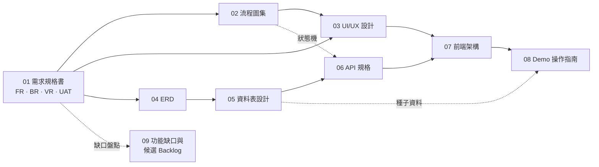

# ZaiOrder 規格文件索引

> 台灣小吃店 · 消費者端線上點餐平台｜純前端 React Demo → 後續串接 API

| 項目 | 內容 |
| --- | --- |
| 專案代號 | **ZaiOrder**（沿用資料夾名稱 `zaiorderv2-Demo`，可替換） |
| 文件版本 | v0.4.1 草案（2026-10-16） |
| 視覺方向 | 白底簡約、單一可換品牌主色，可套用不同餐飲業；沒有圖片、沒有選項也完整可用；**全程免登入**即可點餐 |
| 輸入與無障礙 | 觸控、滑鼠、**純鍵盤**（小寫字母快速鍵**預設關閉**，偵測到實體鍵盤時提醒可開啟，開啟後控制項旁附提示）與螢幕閱讀器皆可完成點餐；WCAG 2.2 AA；**觸控面板（Kiosk）模式**；**記住上次點過的選項**一鍵再點 |
| 專案性質 | 純前端 SPA · React + TypeScript · RWD（320 ～ 1920 px）· 可直接部署為線上 Demo · 後續以 HTTP Adapter 串接 API |
| 文件格式 | Markdown；流程圖、時序圖、狀態機、ERD 皆為 [Mermaid](https://mermaid.js.org/)（GitHub 可直接渲染） |
| 語言 | 繁體中文（台灣用語） |

---

## 1. 文件地圖

| # | 文件 | 內容 | 主要讀者 |
| --- | --- | --- | --- |
| 01 | [需求規格書](./01-requirements.md) | 目標與範圍、角色、**功能需求（FR）**、**業務規則（BR）**、驗證規則（VR）、非功能需求、例外情境、**UAT**、追溯矩陣、待確認事項 | 產品、QA、全員 |
| 02 | [流程圖集](./02-flows.md) | 25 組 Mermaid 圖：主流程、營業狀態、結帳、時段、運費、優惠券、OTP、下單付款、**訂單 / 付款狀態機**、取消、再來一單、Demo 模擬器、錯誤處理、輪詢、**商品卡降級**、**免登入與選填登入**、**快速鍵處理**、**點餐記憶與快速再點**、**觸控面板閒置重置**、**結帳最終庫存確認**（含保留與釋放狀態圖）、**異動清單處理**、**結果未知與冪等重送**、**鍵盤偵測與快速鍵提醒** | 產品、前後端、QA |
| 03 | [UI/UX 設計規格](./03-uiux-design.md) | 設計原則與**視覺參考取捨**、Persona、網站地圖、**白底設計代幣（含實測對比度）**、**品牌主題化**、**RWD 斷點與版型**、**輸入裝置與觸控面板**、41 個元件（含**異動清單**與**鍵盤提醒**）、**資料缺漏降級規則**、**點餐記憶與快速再點**、**19 個頁面規格與線框**、狀態、文案、**無障礙與鍵盤快速鍵（WCAG 2.2 AA）** | 設計、前端 |
| 04 | [ERD](./04-erd.md) | 26 張資料表的總覽圖與 5 個領域詳細圖、關聯清單、設計決策 | 後端、前端、DBA |
| 05 | [資料表設計](./05-database-schema.md) | 命名慣例、**列舉值字典**、欄位字典（型別 / 預設 / 鍵 / 說明）、外鍵動作、索引、**建單交易與鎖定、庫存與時段計入規則與對帳**、個資與生命週期 | 後端、DBA、QA |
| 06 | [API 規格](./06-api-spec.md) | 通則（含 Idempotency-Key 生命週期）、35 個端點、**錯誤碼表**、**TypeScript 資料契約**、請求 / 回應範例（含**送出時庫存最終確認**的 422 / 409 回應）、Mock ⇄ 正式 API 對照、串接檢核表 | 前後端 |
| 07 | [前端架構與 Demo 模式](./07-frontend-architecture.md) | 技術選型、目錄結構、分層、**Adapter 切換**、Mock 設計（含**庫存與時段計入、建單臨界區**）、狀態管理、**快速鍵（預設關閉與偵測提醒）/ 點餐記憶 / 閒置重置 / 庫存可購買量 / 冪等重送模組**、路由、驗證、安全、效能、測試、部署、串接 Runbook | 前端、技術主管 |
| 08 | [Demo 操作指南](./08-demo-guide.md) | 種子資料（店家 / 菜單 / 折扣碼 / 會員 / **庫存與時段**）、Demo 工具面板（含**庫存與時段情境**、**送出結果**、**重播鍵盤提醒**）、時間穿梭、菜單資料完整度與主題色切換、**26 個展示劇本（含純鍵盤、鍵盤提醒、觸控面板、一鍵再點、庫存最終確認）**、10 分鐘展示流程 | 前端、QA、業務 |
| 09 | [功能缺口與候選 Backlog](./09-feature-gaps.md) | 對照現行規格盤點尚未涵蓋的功能缺口，依主題分組並建議優先級；僅列出為候選 Backlog，**尚未納入 01 的需求範圍** | 產品、主管 |
| 附 | [設計參考原型](./assets/mockups/index.html) | 靜態 HTML 原型與 23 張截圖：可用 URL 參數切換畫面、品牌色、資料完整度、版面、鍵盤提醒、點餐記憶、結帳異動清單與觸控面板模式（**非產品程式碼**，為示意簡化版，與規格的差異見其 [README](./assets/mockups/README.md)） | 設計、前端、業務 |

### 文件關係

---

## 2. 依角色的閱讀順序

| 角色 | 建議順序 | 重點 |
| --- | --- | --- |
| 產品 / 專案管理 | 01 → 02 → 08 → 09 | 範圍、優先級、UAT、待確認事項（01 §13）、功能缺口與候選 Backlog（09） |
| 設計 | 01 §5 → 03 → 02 | 設計代幣、斷點、元件與頁面規格 |
| 前端 | 07 → 06 §4 → 03 → 02 → 08 | 分層與 Adapter、型別契約、頁面與元件、Mock 與種子資料 |
| 後端 | 04 → 05 → 06 → 02（FLOW-09/10/11、22～24） | 資料模型、列舉、API 契約、狀態機、冪等與庫存計入 |
| QA | 01 §11 → 08 → 02 | UAT、劇本、狀態機與邊界情境（01 §9） |

---

## 3. 一頁看懂

### 視覺預覽（設計參考原型）

| 桌機（圖卡 3 欄 + 常駐訂單面板） | 手機（圖卡 2 欄） | 手機・精簡資料（只有品名與價格） |
| :---: | :---: | :---: |
|  |  |  |

| 鍵盤快速鍵提示（桌機・開啟快速鍵後） | 點餐記憶與「常點」（手機） | 觸控面板模式（1280×800） |
| :---: | :---: | :---: |
|  |  |  |

白底簡約、單一可換品牌色（[七組預設](./assets/mockups/png/themes.png)）；沒有圖片、沒有選項也完整可用；訪客免登入即可結帳。單鍵快速鍵預設關閉，偵測到實體鍵盤時提醒可開啟；開啟後控制項旁才會出現小寫字母提示（完整清單見[鍵盤快速鍵對話框](./assets/mockups/png/shortcuts-dialog.png)），「上次：…」與「↻ 再點」讓回訪者一鍵點餐。完整規格見 [03 UI/UX 設計規格](./03-uiux-design.md)。

### 範圍（見 01 §2）

| 階段 | 內容 | 資料來源 |
| --- | --- | --- |
| **P1 純前端 Demo** | 菜單、客製化、購物車、結帳（自取 / 外送 / 內用）、模擬付款、訂單追蹤、會員、Demo 工具 | Mock + `localStorage` |
| **P2 串接 API 上線** | 真實後端、金流、電子發票、簡訊、點數、評價、PWA | HTTP API |
| **P3 平台化** | 多分店 / 多商家、LINE 登入、店家後台整合 | HTTP API |

### 核心設計決策

| 決策 | 說明 | 詳見 |
| --- | --- | --- |
| 免登入優先 | 瀏覽、點餐、結帳、付款、追蹤、查詢訂單全程不需登入；登入僅為選填的加速與保存，提示一律非阻擋 | 01 BR-33、02 FLOW-18 |
| 白底簡約 + 可換品牌色 | 中性灰階固定，只有一個品牌主色；由店家設定推導整組代幣並保護文字對比，可套用不同餐飲業 | 03 §4.8、07 §7.4 |
| 內容降級 | 只有品名與價格即可上架與下單；缺圖用佔位圖塊或純文字清單，缺描述 / 選項整塊隱藏 | 03 §6.7、02 FLOW-17 |
| 內用桌號選填 | 內用可以沒有桌號（自由入座、先領餐號叫號）：QR 帶入、手動輸入或留空皆可；有提供才驗證為店家桌位，沒有提供不檢查；以 `T` 前綴取餐號碼叫號，訂單不顯示桌號列 | 01 BR-22、Q-17、06 §4.4、04 D-12 |
| 輸入方式平等 | 觸控、滑鼠、鍵盤、螢幕閱讀器皆可完成主流程，不以單一偵測決定能力；觸控面板模式放大目標、不依賴 hover，僅櫃檯付款、用戶端儲存僅存記憶體，並於閒置後重置 | 01 BR-36/37、03 §5.6、02 FLOW-21 |
| 快速鍵可見、可關 | 開啟後才顯示：小寫字母單鍵快速鍵 + 控制項旁徽章 + `?` 說明；輸入框與輸入法組字中不觸發，可隨時停用（WCAG 2.1.4）；登錄表為單一事實來源 | 01 BR-34、03 §10.3、07 §7.5 |
| 鍵盤快速鍵預設關閉 | 單鍵快速鍵與徽章預設關閉（`Esc`、`Ctrl/⌘ + Enter` 不受影響）；偵測到實體鍵盤時以不位移版面、不搶焦點的提醒詢問是否開啟，按「開啟」才生效；觸控面板模式不偵測、不提醒 | 01 BR-34、BR-42、02 FLOW-25、03 §10.3、07 §7.5 |
| 回訪者一鍵再點 | 記住每個商品上次點過的選項（本機 180 天；會員由訂單推導）；卡片「↻ 再點」、面板預設套用；套用前以現行選項驗證，失效即提示 | 01 BR-35、02 FLOW-20、03 §6.8 |
| UI 與資料來源解耦 | `ApiClient` 介面 + Mock / HTTP 兩個 Adapter，以 `VITE_DATA_SOURCE` 切換 | 07 §5 |
| 契約先行 | TypeScript 型別為前後端共用契約，Mock 與後端通過同一組契約測試 | 06 §4、07 §13 |
| 商業規則為純函式 | 計價、時段、營業狀態、狀態機、驗證放在 `domain/`，可單獨測試 | 07 §3、§6、§7 |
| 後端為價格權威 | 前端為預覽；送出帶 `expectedTotal`，不符回 `PRICE_CHANGED` | 01 BR-25、06 §5.9 |
| 庫存最終確認 | 庫存與時段以「送出訂單」的單一交易為唯一最終裁決：全有或全無、不自動調整、一次回報所有異動；訂單即保留（線上付款保留至付款期限，取消 / 拒單 / 逾時即釋放），購物車與試算只是不保留的預檢；被退回時在結帳頁就地處理異動清單，已填資料與重送用的 Idempotency-Key 保留 | 01 BR-38～41、02 FLOW-22～24、04 D-08 / D-11、05 §6.3 / §6.4、06 §5.9、07 §6.8 |
| 購物車不落資料庫 | 前端狀態（`localStorage`），結帳時一次送出並由後端重新驗證 | 04 D-01 |
| 單店優先、預留多店 | 所有營運資料帶 `store_id` | 04 D-10 |
| 狀態分離 | 訂單狀態與付款狀態是兩條獨立狀態機 | 02 FLOW-10/11、04 D-05 |
| Demo 可完整操作 | 模擬店家接單、時間穿梭、付款結果與錯誤注入；惰性推進，重新整理不中斷 | 02 FLOW-14、08 |

### 在地化重點

手機 + OTP 登入 · 取餐號碼（叫號）· 行政區外送範圍與免運門檻 · 營業時段（午 / 晚市、跨午夜）與公休 · 自備餐具預設 · 電子發票載具 / 統編 / 愛心碼 · LINE Pay / 街口支付 · 個資法告知與刪除帳號 · 時區 `Asia/Taipei`。

---

## 4. 從規格到專案（建議里程碑）

| 里程碑 | 交付 | 對應 |
| --- | --- | --- |
| M0 專案骨架 | Vite + React + TS、路徑別名、ESLint 分層規則、設計代幣、路由空殼、CI | 07 §2～4、03 §4 |
| M1 菜單與店家 | `domain/types`、`domain/storeStatus`、Mock 種子與 `ApiClient`、PG-01、PG-15 | FR-ST、FR-MN |
| M2 客製化與購物車 | PG-02、PG-03、`pricing`、`cartStore`、`rememberedChoice`（上次選項、「↻ 再點」、「常點」）、`availability`（可購買份數預覽、步進器上限、「今日剩 n 份」） | FR-PD、FR-CT、FR-MN-12/13 |
| M3 結帳與訂單 | PG-04（含異動清單）、PG-05、PG-06、`slots`、`quote` / `create`（送出時庫存與時段最終確認、冪等重送）、狀態機與模擬器（保留與釋放） | FR-CK（含 FR-CK-15、16）、FR-PY、FR-OD、FR-DM |
| M4 Demo 工具 | PG-18：自動模擬、時間穿梭、付款 / 錯誤注入、庫存與時段情境、送出結果模擬、重播鍵盤提醒、重置 | FR-DM（含 FR-DM-12、13） |
| M5 會員 | PG-07～14、PG-09 OTP、再來一單、地址簿、最愛、優惠券 | FR-AC、FR-PR |
| M6 打磨與上線 | RWD / 無障礙（鍵盤快速鍵 `hotkeys` 預設關閉與偵測提醒、螢幕閱讀器、觸控面板模式與 `idle`）/ 效能預算（含提醒不位移版面）、E2E（UAT-01～17、19～27；UAT-18 手動，UAT-26 的螢幕閱讀器朗讀為手動）、部署與 SEO meta | FR-SY（含 FR-SY-18）、NFR |

---

## 5. 編號與慣例

| 前綴 | 意義 | 定義位置 |
| --- | --- | --- |
| `FR-<模組>-nn` | 功能需求（ST、MN、PD、CT、CK、PY、OD、AC、PR、DM、SY） | 01 §5 |
| `BR-nn` | 業務規則 | 01 §6 |
| `VR-nn` | 資料驗證規則 | 01 §7 |
| `NFR-nn` / `KPI-nn` | 非功能需求 / 成功指標 | 01 §8 / §1.3 |
| `EC-nn` | 例外與邊界情境 | 01 §9 |
| `UAT-nn` | 驗收情境 | 01 §11 |
| `A-nn` / `R-nn` / `Q-nn` | 假設 / 風險 / 待確認 | 01 §10、§13 |
| `FLOW-nn` | 流程圖 | 02 |
| `PG-nn` / `CMP-nn` | 頁面 / 元件 | 03 §7 / §6 |
| `D-nn` | 資料模型設計決策 | 04 §5 |

**一致性規則**

- 列舉值只在 [05 §3](./05-database-schema.md) 定義；流程圖、API、前端型別必須逐字相同。
- 欄位命名：資料庫 `snake_case` → API / 前端 `camelCase`（[05 §8](./05-database-schema.md)）。
- 修改狀態機、列舉、金額規則時，需同步更新：01（BR）、02（FLOW）、05、06、07 對應段落。
- 修改庫存、時段容量或冪等規則時，需同步更新：01（BR-38～41、NFR-17）、02（FLOW-22～24）、04（D-08 / D-11）、05（§6.3 / §6.4）、06（§5.9、§7.1）、07（§6.8 與庫存契約測試案例）、08（S20～S25）。
- 修改付款期限、接單期限或其起算點（`payment_expires_at`、`pending_at`、`acceptBy`）時，需同步更新：01（BR-17、BR-38）、02（FLOW-14、FLOW-22）、05（§6.3 / §6.4 與對帳）、06（`Order.acceptBy`、§7 差異表）、07（`timeouts.ts` 與模擬器）、08（§4、§5、S3、S6、S7、S23）。
- 修改快速鍵預設值、實體鍵盤偵測或提醒規則時，需同步更新：01（BR-34、BR-42、FR-SY-13 / 18）、02（FLOW-19、FLOW-25）、03（§10.3、CMP-34 / 41）、07（§7.5）、08（S16、S17、S26）與設計參考原型。
- 修改內用桌號規則（桌號是否必填、`dineIn`、`orders.table_no`、`TABLE_NOT_FOUND` 的檢查前提）時，需同步更新：01（FR-CK-05、BR-22、VR-10、EC-42、UAT-10、Q-17）、02（FLOW-04、FLOW-23）、03（PG-01、PG-04、PG-06、PG-07、§9 文案）、04（D-12）、05（`orders.table_id` / `table_no` 與 CHECK）、06（§3.2、§4.4、§5.9）、07（§8、§9）、08（S10、S18）。
- 圖表建議於 CI 以 `@mermaid-js/mermaid-cli` 驗證語法；API 型別與範例建議以 `tsc` 編譯檢查。

---

## 6. 變更紀錄

| 版本 | 日期 | 說明 |
| --- | --- | --- |
| v0.1 | 2026-10-14 | 初版草案：需求、流程、UI/UX、ERD、資料表、API、前端架構、Demo 指南 |
| v0.2 | 2026-10-14 | 依參考圖調整視覺方向（白底簡約、可換品牌色、膠囊分類列、常駐訂單面板）；新增免登入原則（BR-33）、無圖片 / 無選項降級規則（BR-30～32）、`brand_color` / `menu_layout` / `categories.icon` 資料欄位、FLOW-17/18、UAT-13～15 |
| v0.3 | 2026-10-14 | 新增無障礙（WCAG 2.2 AA）、純鍵盤與小寫字母快速鍵（附可見提示、可停用）、觸控面板（Kiosk）模式與閒置重置、點餐記憶與一鍵再點；新增 BR-34～37、FR-MN-12/13、FR-PD-09、FR-AC-11、FR-DM-11、FR-SY-12～17、EC-24～29、UAT-16～20、FLOW-19～21、PG-19、CMP-34～39、`GET /me/frequent-items`、`hotkeys` / `rememberedChoice` / `idle` 模組；原型新增快速鍵提示、記憶與觸控面板畫面。經獨立審查後補強：浮層範圍與輸入元件定義、觸控面板儲存僅存記憶體且僅櫃檯付款、會員記憶不落本機、「記住我的資料」預設不勾選 |
| v0.4 | 2026-10-14 | 新增**庫存最終確認**：庫存與時段以「送出訂單」的單一交易為唯一最終裁決（全有或全無、一次回報所有異動、訂單即保留、逾時 / 取消 / 拒單即釋放），結帳頁就地處理異動清單，Idempotency-Key 重送不重複下單；**鍵盤快速鍵預設關閉**，偵測到實體鍵盤時以不位移版面的提醒詢問是否開啟；新增 09 功能缺口與候選 Backlog。新增 FR-CK-15、16、FR-DM-12、13、FR-SY-18、BR-38～42、NFR-17、18、KPI-11、EC-30～41、R-06～08、A-08、Q-11～16、UAT-21～27、FLOW-22～25、CMP-40、41、D-11、錯誤碼 `ITEM_STOCK_INSUFFICIENT`、欄位 `orders.business_date`、`orders.idempotency_request_hash`、展示劇本 S20～S26；`prefs.hotkeysEnabled` 預設改為 `false`；Demo 面板新增「庫存與時段情境」「送出結果」「重播鍵盤提醒」；設計參考原型改為預設無徽章，並新增鍵盤提醒與結帳異動清單畫面。經獨立審查後補強：建單鎖內先結算逾期待付款再計數、付款回呼影響 0 列時依訂單狀態分流（晚到的付款不影響庫存）、冪等指紋與結果未知的處理（不導向查詢訂單）、總額增加需二次確認、提醒不位移版面並與 Toast / 浮層讓位；接單期限改自進入待確認的時間起算（新增 `orders.pending_at`、`Order.acceptBy`）、逾期結算與後處理於同一交易內完成、觸控面板結果未知以閒置重置為邊界（重置時丟棄 Idempotency-Key）、`LOGIN_REQUIRED` 與其他折扣碼錯誤同列為折扣類異動、休息或暫停接單被退回時以狀態列說明取代清單、`QUANTITY_EXCEEDED` 可定位單行與行數上限、Demo 劇本加入還原步驟與暫停接單變體；複審後再補強：預約單接單期限的前置分鐘同 BR-08（外送以配送區預估為準）、自動模擬開啟時惰性推進先補寫約 5 秒的自動接單再判斷接單逾時（劇本通則與 10 分鐘流程同步）、付款回呼以交易層級條件式更新為閘門並新增 `payments` 的 `UK(provider, provider_txn_id)`、`POST /orders` 的 429 結果對照與測試環境限流開關、異動清單與 quote 請求當時的購物車快照綁定、提醒焦點還原與記憶體旗標 `prefsOpenedThisLoad`、任務型頁面省略「跳到我的訂單」 |
| v0.4.1 | 2026-10-16 | **內用桌號改為選填**：現實中內用會有沒有桌號的情況（自由入座、先領餐號叫號），原「內用必須有桌號」放寬為桌號選填、可留空；有提供桌號（QR 或手動輸入）時仍須為店家桌位（`422 TABLE_NOT_FOUND`），沒有提供則不檢查；沒有桌號的內用單照常產生 `T` 前綴取餐號碼作為叫號與領餐識別，訂單頁不顯示「桌號」列（取餐資訊列改為「內用・{店名}・取餐號碼 T001」，頁面標題為「訂單追蹤・T001」；歷史訂單卡與 Demo 面板只列取餐方式與取餐號碼，本來就不含桌號）。`CreateOrderRequest.dineIn` 整個可省略，型別為 `{ tableNo?: string; qrToken?: string }`；`orders.table_no` 為可為空的快照，移除 `CHECK (order_type <> 'DINE_IN' OR table_no IS NOT NULL)`。結帳 ③ 的桌號欄改為「桌號（選填）」並提示「沒有桌號可以留空，餐點好了會依取餐號碼叫號」；QR 桌號無法辨識的回退文案補「要內用請改選「內用」（桌號可留空）」，回退行為不變；觸控面板沒有桌號輸入。更新 FR-CK-05、FR-SY-15、BR-22、BR-36、VR-10、UAT-10（新增無桌號與手動輸入不存在桌號變體），新增 EC-42、Q-17、D-12；08 S10 改為完整劇本（QR 帶桌號、無桌號、手動輸入、QR 無法辨識與觸控面板）。**商品卡排版重整**（03 §6.6、§6.7，FLOW-17）：愛心移到品名前（不再浮在圖片上）；`LIST` 縮圖 88×88 靠右，價格靠左、動作靠右位於跨滿內容寬度的底列（動作右緣 = 縮圖右緣 = 內容區右緣，價格與動作垂直置中，貼卡片底端）；精簡卡（無圖、無描述）同用這套底列規則；卡片內容寬 < 13.5rem（觸控面板 15.5rem）時底列一律堆疊（價格一列、動作一列靠右）；設計參考原型（`app.html` / `app.css` / `app.js`）與菜單相關截圖同步重拍，新增商品卡特寫 `card-list-member.png`、`card-grid-member.png`。**小修**：PG-07 歷史訂單卡只列取餐方式與取餐號碼（`OrderSummary` 沒有桌號欄，不顯示桌號）；訂單頁取餐資訊列的文字與實作逐字一致（「內用・{店名}・取餐號碼 T001」；頁面標題「訂單追蹤・T001」），同步 01 EC-42、UAT-10 與 08 S10；§6.8 窄卡的「↻ 再點」排列與「無最愛」空狀態文案 |

## 7. 尚待確認

共 17 項待確認事項（Q-01～Q-17），請見 [01 §13](./01-requirements.md#13-待確認事項)；所採預設假設已列於同處。影響 Phase 2 範圍的原 10 項為單店 / 多店、金流、發票、外送、LINE、品牌規範、資料保存年限、營業人身分、觸控面板部署、付款時限延長；v0.4 新增 6 項為即時單是否計入單時段上限、限量的營業日歸屬與手動售完重置時點、備料後取消是否回補、免登入訪客待處理訂單上限、他人未付款占用的顯示與套餐子品項庫存、鍵盤提醒次數與徽章重排；v0.4.1 新增 1 項（Q-17）為內用是否一定要有桌號（已決定：選填）。
